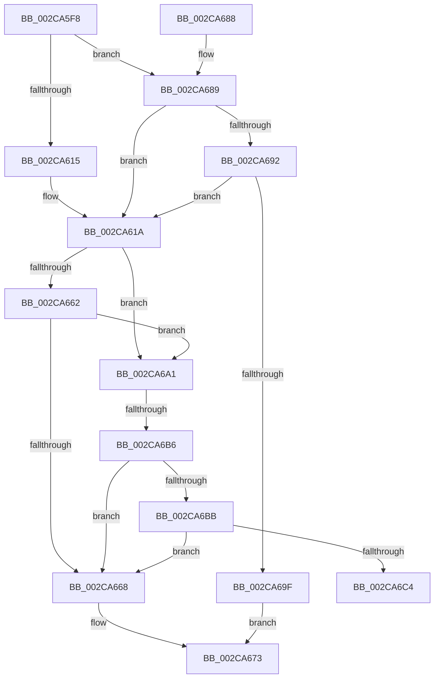

# MiLaunchZeroParent

- RVA: `0x002CA5F8`–`0x002CA6C9` (길이 `209` bytes)
- VA: `0x00000001402CA5F8`
- 실행 섹션: `.text`
- PDB 이름 있음: `예`; PDB Function 태그: `예`
- unwind 정보 RVA: `0x000676D8`
- 디코드: `53`개 명령, `209/209` bytes 표시
- 미해석 바이트: `0` (있으면 어셈블리에 `.byte`로 보존)

> 이 문서는 커널 이미지의 기계어와 PDB 기호를 분석해 생성했습니다. 4번과 5번은 함수 원형과 자료형을 바이너리 사용 방식에서 추정한 C 해석이며 원본 소스 복구 결과는 아닙니다.

## 1. Dependencies

- 직접 호출 지점: **2**; 고유 호출 대상: **2**
- 직접 호출자로 확인된 함수: **1**
- RIP 상대 이미지 참조: **2**

### Outgoing calls
- `0x002CA66E` → [guard_dispatch_icall](../6B/guard_dispatch_icall_function_006BAAD0.md) (function, `0x006BAAD0`)
- `0x002CA692` → [PsReferencePartitionSafe](../3B/PsReferencePartitionSafe_function_003BA6C0.md) (function, `0x003BA6C0`)

### Direct callers
- [MiZeroInParallel](MiZeroInParallel_function_002C9F78.md) at `0x002C9F96`

### Static image references
- `0x002CA61D` → RVA `0x002C6600` (`MiZeroInParallelWorker`; read)
- `0x002CA628` → RVA `0x0068C960` (`MiZeroHugeRangeWorker`; read)

## 2. Other-region calls and transfers

- 다른 실행 섹션으로 향하는 call: **0**
- call이 아닌 외부 분기/꼬리 이동: **2**
  - `0x002CA6B0` → [sub_006DCC66](../6D/Unknown_function_006DCC66.md) (`tail-transfer`)
  - `0x002CA6C4` → [sub_006DCC66](../6D/Unknown_function_006DCC66.md) (`tail-transfer`)

## 3. Assembly (complete function range)

```asm
002CA5F8  48 89 5C 24 08                  mov qword ptr [rsp + 8], rbx
002CA5FD  48 89 6C 24 10                  mov qword ptr [rsp + 0x10], rbp
002CA602  48 89 74 24 18                  mov qword ptr [rsp + 0x18], rsi
002CA607  57                              push rdi
002CA608  48 83 EC 20                     sub rsp, 0x20
002CA60C  83 79 20 00                     cmp dword ptr [rcx + 0x20], 0
002CA610  48 8B D9                        mov rbx, rcx
002CA613  75 74                           jne 0x1402ca689
002CA615  48 83 61 08 00                  and qword ptr [rcx + 8], 0
002CA61A  8B 7B 20                        mov edi, dword ptr [rbx + 0x20]
002CA61D  48 8D 05 DC BF FF FF            lea rax, [rip - 0x4024]
002CA624  48 C1 E7 07                     shl rdi, 7
002CA628  48 8D 2D 31 23 3C 00            lea rbp, [rip + 0x3c2331]
002CA62F  48 81 C7 A8 00 00 00            add rdi, 0xa8
002CA636  48 03 FB                        add rdi, rbx
002CA639  48 89 5F 20                     mov qword ptr [rdi + 0x20], rbx
002CA63D  C7 47 2C FE FF FF FF            mov dword ptr [rdi + 0x2c], 0xfffffffe
002CA644  F7 43 10 00 08 00 00            test dword ptr [rbx + 0x10], 0x800
002CA64B  48 89 7F 18                     mov qword ptr [rdi + 0x18], rdi
002CA64F  48 0F 44 E8                     cmove rbp, rax
002CA653  48 83 27 00                     and qword ptr [rdi], 0
002CA657  48 89 6F 10                     mov qword ptr [rdi + 0x10], rbp
002CA65B  8B 43 10                        mov eax, dword ptr [rbx + 0x10]
002CA65E  84 C0                           test al, al
002CA660  78 3F                           js 0x1402ca6a1
002CA662  83 7B 60 00                     cmp dword ptr [rbx + 0x60], 0
002CA666  75 39                           jne 0x1402ca6a1
002CA668  48 8B CF                        mov rcx, rdi
002CA66B  48 8B C5                        mov rax, rbp
002CA66E  E8 5D 04 3F 00                  call 0x1406baad0
002CA673  48 8B 5C 24 30                  mov rbx, qword ptr [rsp + 0x30]
002CA678  48 8B 6C 24 38                  mov rbp, qword ptr [rsp + 0x38]
002CA67D  48 8B 74 24 40                  mov rsi, qword ptr [rsp + 0x40]
002CA682  48 83 C4 20                     add rsp, 0x20
002CA686  5F                              pop rdi
002CA687  C3                              ret
002CA688  CC                              int3
002CA689  48 8B 49 08                     mov rcx, qword ptr [rcx + 8]
002CA68D  48 85 C9                        test rcx, rcx
002CA690  74 88                           je 0x1402ca61a
002CA692  E8 29 00 0F 00                  call 0x1403ba6c0
002CA697  84 C0                           test al, al
002CA699  0F 85 7B FF FF FF               jne 0x1402ca61a
002CA69F  EB D2                           jmp 0x1402ca673
002CA6A1  48 8B 8B 90 00 00 00            mov rcx, qword ptr [rbx + 0x90]
002CA6A8  48 8D 71 0C                     lea rsi, [rcx + 0xc]
002CA6AC  0F BA E0 08                     bt eax, 8
002CA6B0  0F 83 B0 25 41 00               jae 0x1406dcc66
002CA6B6  83 3E 00                        cmp dword ptr [rsi], 0
002CA6B9  75 AD                           jne 0x1402ca668
002CA6BB  83 B9 18 01 00 00 00            cmp dword ptr [rcx + 0x118], 0
002CA6C2  74 A4                           je 0x1402ca668
002CA6C4  E9 9D 25 41 00                  jmp 0x1406dcc66
```

## 4. C-style interpretation (structured pseudocode)

```c
__int64 __fastcall MiLaunchZeroParent(__int64 a1)
{
    __int64 result;
    __int64 v_rbp;
    __int64 v_rdi;
    __int64 v_rsp;
    unsigned __int64 v_stack_p10;
    unsigned __int64 v_stack_p18;
    unsigned __int64 v_stack_p8;

    v_stack_p8 = v_rbx;
    v_stack_p10 = v_rbp;
    v_stack_p18 = v_rsi;
    v_rsp = (v_rsp) - (32);
    if ((*(unsigned int *)(a1 + 32)) != 0) goto loc_002CA689;
loc_002CA61A:
    v_rdi = ((unsigned int)(*(unsigned int *)(a1 + 32))) << (7);
    v_rdi = (v_rdi) + (168);
    v_rdi = (v_rdi) + (a1);
    *(unsigned __int64 *)(v_rdi + 32) = a1;
    *(unsigned int *)(v_rdi + 44) = 0xFFFFFFFEULL;
    *(unsigned __int64 *)(v_rdi + 24) = v_rdi;
    v_rbp = v_rip + 3941169;
    if (((*(unsigned int *)(a1 + 16)) & (0x800ULL)) == 0) { v_rbp = v_rip - 16420; }
    *(unsigned __int64 *)(v_rdi + 16) = v_rbp;
    if (sign_flag) goto loc_002CA6A1;
    if ((*(unsigned int *)(a1 + 96)) != 0) goto loc_002CA6A1;
loc_002CA668:
    result = guard_dispatch_icall(v_rdi, a2, a3, a4);
loc_002CA673:
    v_rsp = (v_rsp) + (32);
    return result;
loc_002CA689:
    if (*(unsigned __int64 *)(v_rdi + 8) == 0) goto loc_002CA61A;
    result = PsReferencePartitionSafe(*(unsigned __int64 *)(v_rdi + 8), a2, a3, a4);
    if ((unsigned __int8)(result) != 0) goto loc_002CA61A;
    goto loc_002CA673;
loc_002CA6A1:
    if ((*(unsigned int *)(*(unsigned __int64 *)(v_stack_p8 + 144) + 12)) != 0) goto loc_002CA668;
    if ((*(unsigned int *)(*(unsigned __int64 *)(v_stack_p8 + 144) + 280)) == 0) goto loc_002CA668;
}
```

## 5. (Beta) C Style

```c
int64_t MiLaunchZeroParent(void *Arg1)
{
    uint8_t *arg1 = (uint8_t *)Arg1;

    int64_t result;
    int64_t local_rbp;
    int64_t local_rdi;
    int64_t local_rsp;
    uint64_t v_stack_p10;
    uint64_t v_stack_p18;
    uint64_t v_stack_p8;

    v_stack_p8 = local_rbx;
    v_stack_p10 = local_rbp;
    v_stack_p18 = local_rsi;
    local_rsp = (local_rsp) - (32);
    if ((*(uint32_t *)(arg1 + 0x20)) != 0) goto loc_002CA689;
loc_002CA61A:
    local_rdi = ((uint32_t)(*(uint32_t *)(arg1 + 0x20))) << (7);
    local_rdi = (local_rdi) + (168);
    local_rdi = (local_rdi) + (Arg1);
    *(void **)(local_rdi + 0x20) = Arg1;
    *(uint32_t *)(local_rdi + 0x2C) = 0xFFFFFFFEULL;
    *(uint64_t *)(local_rdi + 0x18) = local_rdi;
    local_rbp = v_rip + 3941169;
    if (((*(uint32_t *)(arg1 + 0x10)) & (0x800ULL)) == 0) { local_rbp = v_rip - 16420; }
    *(uint64_t *)(local_rdi + 0x10) = local_rbp;
    if (sign_flag) goto loc_002CA6A1;
    if ((*(uint32_t *)(arg1 + 0x60)) != 0) goto loc_002CA6A1;
loc_002CA668:
    result = guard_dispatch_icall(local_rdi, a2, a3, a4);
loc_002CA673:
    local_rsp = (local_rsp) + (32);
    return result;
loc_002CA689:
    if (*(uint64_t *)(local_rdi + 0x8) == 0) goto loc_002CA61A;
    result = PsReferencePartitionSafe(*(uint64_t *)(local_rdi + 0x8), a2, a3, a4);
    if ((uint8_t)(result) != 0) goto loc_002CA61A;
    goto loc_002CA673;
loc_002CA6A1:
    if ((*(uint32_t *)(*(uint64_t *)(v_stack_p8 + 0x90) + 0xC)) != 0) goto loc_002CA668;
    if ((*(uint32_t *)(*(uint64_t *)(v_stack_p8 + 0x90) + 0x118)) == 0) goto loc_002CA668;
}
```

### 관측된 메모리 오프셋

구조체 형식이 확인되지 않은 접근은 인자 기준의 오프셋으로만 기록했습니다.

| 기준 인자 | 오프셋 표현 | 폭 (bit) | 접근 |
|---|---:|---:|---|
| `Arg1` | `+ 0x8` | `64` | `R` |
| `Arg1` | `+ 0x8` | `64` | `R/W` |
| `Arg1` | `+ 0x10` | `32` | `R` |
| `Arg1` | `+ 0x20` | `32` | `R` |
| `Arg1` | `+ 0x60` | `32` | `R` |
| `Arg1` | `+ 0x90` | `64` | `R` |

## 6. Execution-region graph

[열기: 2D/3D 그래프와 함수 탐색 컨트롤 패널](../../../control-panel.html?section=text&rva=0x002CA5F8&view=graph)

- 2D 그래프는 위에서 아래로 흐르고, 3D 그래프는 빈 공간을 드래그해 회전합니다. Shift+드래그는 이동, 휠은 확대·축소, 함수 노드 선택은 대상 보고서 이동입니다.

### Static fallback


