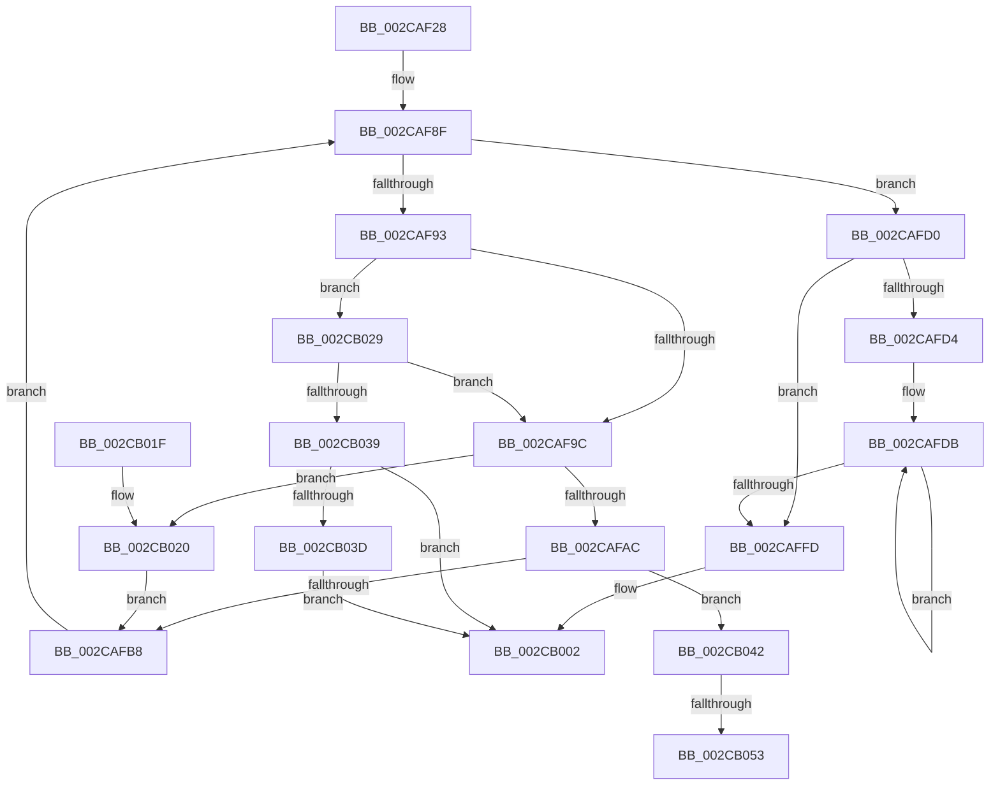

# MiLaunchZeroWorkers

- RVA: `0x002CAF28`–`0x002CB05F` (길이 `311` bytes)
- VA: `0x00000001402CAF28`
- 실행 섹션: `.text`
- PDB 이름 있음: `예`; PDB Function 태그: `예`
- unwind 정보 RVA: `0x0006F24C`
- 디코드: `84`개 명령, `311/311` bytes 표시
- 미해석 바이트: `0` (있으면 어셈블리에 `.byte`로 보존)

> 이 문서는 커널 이미지의 기계어와 PDB 기호를 분석해 생성했습니다. 4번과 5번은 함수 원형과 자료형을 바이너리 사용 방식에서 추정한 C 해석이며 원본 소스 복구 결과는 아닙니다.

## 1. Dependencies

- 직접 호출 지점: **4**; 고유 호출 대상: **4**
- 직접 호출자로 확인된 함수: **1**
- RIP 상대 이미지 참조: **2**

### Outgoing calls
- `0x002CAF77` → [KeQueryPriorityThread](../38/KeQueryPriorityThread_function_0038F4F0.md) (function, `0x0038F4F0`)
- `0x002CAFA3` → [MiGetNextAffinityWalker](MiGetNextAffinityWalker_function_002CCC28.md) (function, `0x002CCC28`)
- `0x002CAFEE` → [ExQueueWorkItemToPartition](../35/ExQueueWorkItemToPartition_function_00356E2C.md) (function, `0x00356E2C`)
- `0x002CB02C` → [PsReferencePartitionSafe](../3B/PsReferencePartitionSafe_function_003BA6C0.md) (function, `0x003BA6C0`)

### Direct callers
- [MiZeroInParallel](MiZeroInParallel_function_002C9F78.md) at `0x002C9FB5`

### Static image references
- `0x002CAF47` → RVA `0x002C6600` (`MiZeroInParallelWorker`; read)
- `0x002CAF51` → RVA `0x0068C960` (`MiZeroHugeRangeWorker`; read)

## 2. Other-region calls and transfers

- 다른 실행 섹션으로 향하는 call: **0**
- call이 아닌 외부 분기/꼬리 이동: **2**
  - `0x002CB04D` → [sub_006DCC9E](../6D/Unknown_function_006DCC9E.md) (`tail-transfer`)
  - `0x002CB05A` → [sub_006DCC9E](../6D/Unknown_function_006DCC9E.md) (`tail-transfer`)

## 3. Assembly (complete function range)

```asm
002CAF28  48 89 5C 24 10                  mov qword ptr [rsp + 0x10], rbx
002CAF2D  48 89 6C 24 18                  mov qword ptr [rsp + 0x18], rbp
002CAF32  48 89 74 24 20                  mov qword ptr [rsp + 0x20], rsi
002CAF37  57                              push rdi
002CAF38  41 54                           push r12
002CAF3A  41 55                           push r13
002CAF3C  41 56                           push r14
002CAF3E  41 57                           push r15
002CAF40  48 83 EC 20                     sub rsp, 0x20
002CAF44  8B 69 20                        mov ebp, dword ptr [rcx + 0x20]
002CAF47  48 8D 05 B2 B6 FF FF            lea rax, [rip - 0x494e]
002CAF4E  48 8B D9                        mov rbx, rcx
002CAF51  4C 8D 2D 08 1A 3C 00            lea r13, [rip + 0x3c1a08]
002CAF58  65 48 8B 0C 25 88 01 00 00      mov rcx, qword ptr gs:[0x188]
002CAF61  F7 43 10 00 08 00 00            test dword ptr [rbx + 0x10], 0x800
002CAF68  4C 8B A3 90 00 00 00            mov r12, qword ptr [rbx + 0x90]
002CAF6F  4C 8B 7B 08                     mov r15, qword ptr [rbx + 8]
002CAF73  4C 0F 44 E8                     cmove r13, rax
002CAF77  E8 74 45 0C 00                  call 0x14038f4f0
002CAF7C  83 C0 20                        add eax, 0x20
002CAF7F  4C 8D B3 A8 00 00 00            lea r14, [rbx + 0xa8]
002CAF86  89 44 24 50                     mov dword ptr [rsp + 0x50], eax
002CAF8A  33 F6                           xor esi, esi
002CAF8C  49 8B FE                        mov rdi, r14
002CAF8F  3B F5                           cmp esi, ebp
002CAF91  73 3D                           jae 0x1402cafd0
002CAF93  4D 85 FF                        test r15, r15
002CAF96  0F 85 8D 00 00 00               jne 0x1402cb029
002CAF9C  48 8D 57 28                     lea rdx, [rdi + 0x28]
002CAFA0  49 8B CC                        mov rcx, r12
002CAFA3  E8 80 1C 00 00                  call 0x1402ccc28
002CAFA8  85 C0                           test eax, eax
002CAFAA  78 74                           js 0x1402cb020
002CAFAC  41 83 7C 24 0C 00               cmp dword ptr [r12 + 0xc], 0
002CAFB2  0F 84 8A 00 00 00               je 0x1402cb042
002CAFB8  48 89 5F 20                     mov qword ptr [rdi + 0x20], rbx
002CAFBC  48 83 27 00                     and qword ptr [rdi], 0
002CAFC0  4C 89 6F 10                     mov qword ptr [rdi + 0x10], r13
002CAFC4  48 89 7F 18                     mov qword ptr [rdi + 0x18], rdi
002CAFC8  48 83 EF 80                     sub rdi, -0x80
002CAFCC  FF C6                           inc esi
002CAFCE  EB BF                           jmp 0x1402caf8f
002CAFD0  85 ED                           test ebp, ebp
002CAFD2  74 29                           je 0x1402caffd
002CAFD4  8B 74 24 50                     mov esi, dword ptr [rsp + 0x50]
002CAFD8  48 8B FD                        mov rdi, rbp
002CAFDB  4C 8B 0B                        mov r9, qword ptr [rbx]
002CAFDE  8B D6                           mov edx, esi
002CAFE0  44 8B 43 58                     mov r8d, dword ptr [rbx + 0x58]
002CAFE4  49 8B CE                        mov rcx, r14
002CAFE7  4D 8B 89 B8 00 00 00            mov r9, qword ptr [r9 + 0xb8]
002CAFEE  E8 39 BE 08 00                  call 0x140356e2c
002CAFF3  49 83 EE 80                     sub r14, -0x80
002CAFF7  48 83 EF 01                     sub rdi, 1
002CAFFB  75 DE                           jne 0x1402cafdb
002CAFFD  0F BA 6B 10 09                  bts dword ptr [rbx + 0x10], 9
002CB002  48 8B 5C 24 58                  mov rbx, qword ptr [rsp + 0x58]
002CB007  48 8B 6C 24 60                  mov rbp, qword ptr [rsp + 0x60]
002CB00C  48 8B 74 24 68                  mov rsi, qword ptr [rsp + 0x68]
002CB011  48 83 C4 20                     add rsp, 0x20
002CB015  41 5F                           pop r15
002CB017  41 5E                           pop r14
002CB019  41 5D                           pop r13
002CB01B  41 5C                           pop r12
002CB01D  5F                              pop rdi
002CB01E  C3                              ret
002CB01F  CC                              int3
002CB020  C7 47 2C FE FF FF FF            mov dword ptr [rdi + 0x2c], 0xfffffffe
002CB027  EB 8F                           jmp 0x1402cafb8
002CB029  49 8B CF                        mov rcx, r15
002CB02C  E8 8F F6 0E 00                  call 0x1403ba6c0
002CB031  84 C0                           test al, al
002CB033  0F 85 63 FF FF FF               jne 0x1402caf9c
002CB039  85 F6                           test esi, esi
002CB03B  75 C5                           jne 0x1402cb002
002CB03D  21 73 20                        and dword ptr [rbx + 0x20], esi
002CB040  EB C0                           jmp 0x1402cb002
002CB042  83 4F 2C FF                     or dword ptr [rdi + 0x2c], 0xffffffff
002CB046  48 8B 4B 50                     mov rcx, qword ptr [rbx + 0x50]
002CB04A  48 85 C9                        test rcx, rcx
002CB04D  0F 84 4B 1C 41 00               je 0x1406dcc9e
002CB053  48 8B 01                        mov rax, qword ptr [rcx]
002CB056  48 89 43 50                     mov qword ptr [rbx + 0x50], rax
002CB05A  E9 3F 1C 41 00                  jmp 0x1406dcc9e
```

## 4. C-style interpretation (structured pseudocode)

```c
__int64 __fastcall MiLaunchZeroWorkers(__int64 a1)
{
    __int64 result;
    __int64 v_r13;
    __int64 v_r14;
    __int64 v_rdi;
    __int64 v_rsi;
    __int64 v_rsp;
    unsigned __int64 v_stack_p10;
    unsigned __int64 v_stack_p18;
    unsigned __int64 v_stack_p20;
    unsigned int v_stack_p8;

    v_stack_p10 = v_rbx;
    v_stack_p18 = v_rbp;
    v_stack_p20 = v_rsi;
    v_rsp = (v_rsp) - (32);
    v_r13 = v_rip + 3938824;
    if (((*(unsigned int *)(a1 + 16)) & (0x800ULL)) == 0) { v_r13 = v_rip - 18766; }
    result = KeQueryPriorityThread(*(unsigned __int64 *)(gs_base + (0 + 392)), a2, a3, a4);
    result = (unsigned int)((result) + (32));
    v_stack_p8 = (unsigned int)(result);
    v_rsi = 0;
loc_002CAF8F:
    if (0 >= ((unsigned int)((unsigned int)(*(unsigned int *)(a1 + 32))))) goto loc_002CAFD0;
    if (*(unsigned __int64 *)(a1 + 8) != 0) goto loc_002CB029;
loc_002CAF9C:
    result = MiGetNextAffinityWalker(*(unsigned __int64 *)(a1 + 144), a1 + 168 + 40, a3, a4);
    if (sign_flag) goto loc_002CB020;
    if ((*(unsigned int *)(*(unsigned __int64 *)(a1 + 144) + 12)) == 0) goto loc_002CB042;
loc_002CAFB8:
    *(unsigned __int64 *)(a1 + 168 + 32) = a1;
    *(unsigned __int64 *)(a1 + 168 + 16) = v_r13;
    *(unsigned __int64 *)(a1 + 168 + 24) = a1 + 168;
    v_rdi = (a1 + 168) - (-128);
    v_rsi = (unsigned int)((v_rsi) + 1);
    goto loc_002CAF8F;
loc_002CAFD0:
    if ((unsigned int)((unsigned int)(*(unsigned int *)(a1 + 32))) == 0) goto loc_002CAFFD;
loc_002CAFDB:
    result = ExQueueWorkItemToPartition(a1 + 168, (unsigned int)((unsigned int)((unsigned int)(v_stack_p8))), (unsigned int)(*(unsigned int *)(a1 + 88)), *(unsigned __int64 *)(*(unsigned __int64 *)(a1) + 184));
    v_r14 = (a1 + 168) - (-128);
    v_rdi = ((unsigned int)(*(unsigned int *)(a1 + 32))) - (1);
    if (condition_is_not_equal) goto loc_002CAFDB;
loc_002CAFFD:
loc_002CB002:
    v_rsp = (v_rsp) + (32);
    return result;
loc_002CB020:
    *(unsigned int *)(v_rdi + 44) = 0xFFFFFFFEULL;
    goto loc_002CAFB8;
loc_002CB029:
    result = PsReferencePartitionSafe(*(unsigned __int64 *)(a1 + 8), (unsigned int)((unsigned int)((unsigned int)(v_stack_p8))), (unsigned int)(*(unsigned int *)(a1 + 88)), *(unsigned __int64 *)(*(unsigned __int64 *)(a1) + 184));
    if ((unsigned __int8)(result) != 0) goto loc_002CAF9C;
    if ((unsigned int)(v_stack_p20) != 0) goto loc_002CB002;
    goto loc_002CB002;
loc_002CB042:
    *(unsigned __int64 *)(v_stack_p10 + 80) = *(unsigned __int64 *)(*(unsigned __int64 *)(v_stack_p10 + 80));
}
```

## 5. (Beta) C Style

```c
int64_t MiLaunchZeroWorkers(void *Arg1)
{
    uint8_t *arg1 = (uint8_t *)Arg1;

    int64_t result;
    int64_t local_r13;
    int64_t local_r14;
    int64_t local_rdi;
    int64_t local_rsi;
    int64_t local_rsp;
    uint64_t v_stack_p10;
    uint64_t v_stack_p18;
    uint64_t v_stack_p20;
    uint32_t v_stack_p8;

    v_stack_p10 = local_rbx;
    v_stack_p18 = local_rbp;
    v_stack_p20 = local_rsi;
    local_rsp = (local_rsp) - (32);
    local_r13 = v_rip + 3938824;
    if (((*(uint32_t *)(arg1 + 0x10)) & (0x800ULL)) == 0) { local_r13 = v_rip - 18766; }
    result = KeQueryPriorityThread(*(uint64_t *)(gs_base + (0 + 0x188)), a2, a3, a4);
    result = (uint32_t)((result) + (32));
    v_stack_p8 = (uint32_t)(result);
    local_rsi = 0;
loc_002CAF8F:
    if (0 >= ((uint32_t)((uint32_t)(*(uint32_t *)(arg1 + 0x20))))) goto loc_002CAFD0;
    if (*(uint64_t *)(arg1 + 0x8) != 0) goto loc_002CB029;
loc_002CAF9C:
    result = MiGetNextAffinityWalker(*(uint64_t *)(arg1 + 0x90), Arg1 + 168 + 40, a3, a4);
    if (sign_flag) goto loc_002CB020;
    if ((*(uint32_t *)(*(uint64_t *)(arg1 + 0x90) + 0xC)) == 0) goto loc_002CB042;
loc_002CAFB8:
    *(void **)(arg1 + 0xA8 + 0x20) = Arg1;
    *(uint64_t *)(arg1 + 0xA8 + 0x10) = local_r13;
    *(void **)(arg1 + 0xA8 + 0x18) = Arg1 + 168;
    local_rdi = (Arg1 + 168) - (-128);
    local_rsi = (uint32_t)((local_rsi) + 1);
    goto loc_002CAF8F;
loc_002CAFD0:
    if ((uint32_t)((uint32_t)(*(uint32_t *)(arg1 + 0x20))) == 0) goto loc_002CAFFD;
loc_002CAFDB:
    result = ExQueueWorkItemToPartition(Arg1 + 168, (uint32_t)((uint32_t)((uint32_t)(v_stack_p8))), (uint32_t)(*(uint32_t *)(arg1 + 0x58)), *(uint64_t *)(*(uint64_t *)(arg1) + 0xB8));
    local_r14 = (Arg1 + 168) - (-128);
    local_rdi = ((uint32_t)(*(uint32_t *)(arg1 + 0x20))) - (1);
    if (condition_is_not_equal) goto loc_002CAFDB;
loc_002CAFFD:
loc_002CB002:
    local_rsp = (local_rsp) + (32);
    return result;
loc_002CB020:
    *(uint32_t *)(local_rdi + 0x2C) = 0xFFFFFFFEULL;
    goto loc_002CAFB8;
loc_002CB029:
    result = PsReferencePartitionSafe(*(uint64_t *)(arg1 + 0x8), (uint32_t)((uint32_t)((uint32_t)(v_stack_p8))), (uint32_t)(*(uint32_t *)(arg1 + 0x58)), *(uint64_t *)(*(uint64_t *)(arg1) + 0xB8));
    if ((uint8_t)(result) != 0) goto loc_002CAF9C;
    if ((uint32_t)(v_stack_p20) != 0) goto loc_002CB002;
    goto loc_002CB002;
loc_002CB042:
    *(uint64_t *)(v_stack_p10 + 0x50) = *(uint64_t *)(*(uint64_t *)(v_stack_p10 + 0x50));
}
```

### 관측된 메모리 오프셋

구조체 형식이 확인되지 않은 접근은 인자 기준의 오프셋으로만 기록했습니다.

| 기준 인자 | 오프셋 표현 | 폭 (bit) | 접근 |
|---|---:|---:|---|
| `Arg1` | `+ 0x0` | `64` | `R` |
| `Arg1` | `+ 0x0` | `64` | `R/W` |
| `Arg1` | `+ 0x8` | `64` | `R` |
| `Arg1` | `+ 0x10` | `32` | `R` |
| `Arg1` | `+ 0x10` | `32` | `R/W` |
| `Arg1` | `+ 0x10` | `64` | `W` |
| `Arg1` | `+ 0x18` | `64` | `W` |
| `Arg1` | `+ 0x20` | `32` | `R` |
| `Arg1` | `+ 0x20` | `32` | `R/W` |
| `Arg1` | `+ 0x20` | `64` | `W` |
| `Arg1` | `+ 0x28` | `64` | `R` |
| `Arg1` | `+ 0x2C` | `32` | `R/W` |
| `Arg1` | `+ 0x2C` | `32` | `W` |
| `Arg1` | `+ 0x50` | `64` | `R` |
| `Arg1` | `+ 0x50` | `64` | `W` |
| `Arg1` | `+ 0x58` | `32` | `R` |
| `Arg1` | `+ 0x90` | `64` | `R` |
| `Arg1` | `+ 0xA8` | `64` | `R` |

## 6. Execution-region graph

[열기: 2D/3D 그래프와 함수 탐색 컨트롤 패널](../../../control-panel.html?section=text&rva=0x002CAF28&view=graph)

- 2D 그래프는 위에서 아래로 흐르고, 3D 그래프는 빈 공간을 드래그해 회전합니다. Shift+드래그는 이동, 휠은 확대·축소, 함수 노드 선택은 대상 보고서 이동입니다.

### Static fallback


