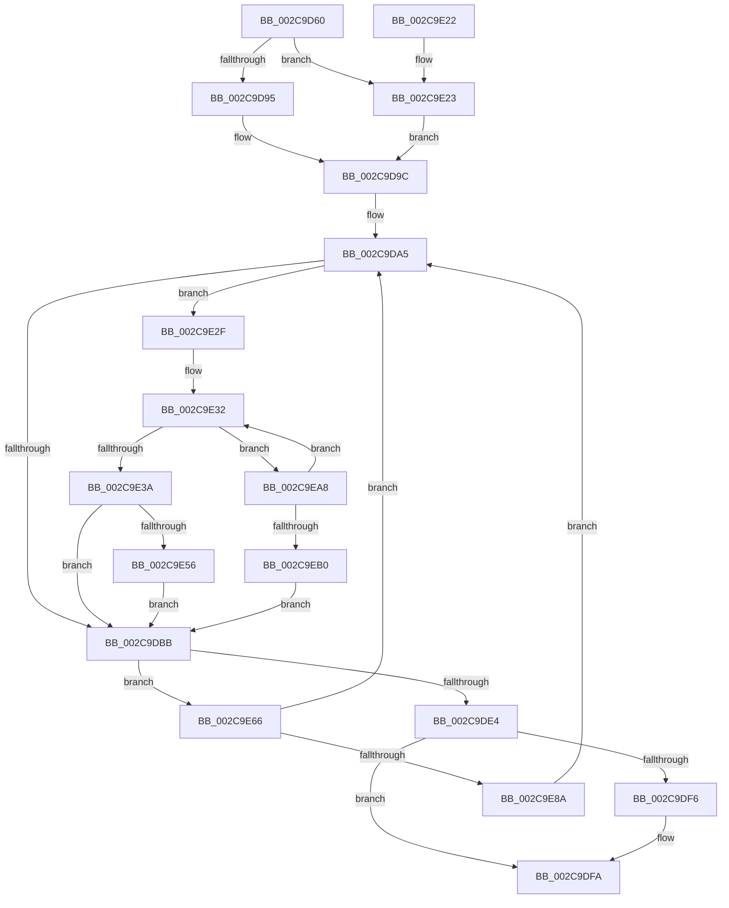

# MiLockControlAreaSectionExtend

- RVA: `0x002C9D60`–`0x002C9EB5` (길이 `341` bytes)
- VA: `0x00000001402C9D60`
- 실행 섹션: `.text`
- PDB 이름 있음: `예`; PDB Function 태그: `아니요`
- unwind 정보 RVA: `0x0006F100`
- 디코드: `95`개 명령, `341/341` bytes 표시
- 미해석 바이트: `0` (있으면 어셈블리에 `.byte`로 보존)

> 이 문서는 커널 이미지의 기계어와 PDB 기호를 분석해 생성했습니다. 4번과 5번은 함수 원형과 자료형을 바이너리 사용 방식에서 추정한 C 해석이며 원본 소스 복구 결과는 아닙니다.

## 1. Dependencies

- 직접 호출 지점: **9**; 고유 호출 대상: **6**
- 직접 호출자로 확인된 함수: **1**
- RIP 상대 이미지 참조: **0**

### Outgoing calls
- `0x002C9DAA` → [ExAcquireSpinLockExclusive](../24/ExAcquireSpinLockExclusive_function_00248690.md) (function, `0x00248690`)
- `0x002C9DEC` → [KeAbPreAcquire](../21/KeAbPreAcquire_function_00210230.md) (function, `0x00210230`)
- `0x002C9E00` → [MiReleaseSpinLockExclusive](../24/MiReleaseSpinLockExclusive_function_002482C0.md) (function, `0x002482C0`)
- `0x002C9E42` → [KeAbPreAcquire](../21/KeAbPreAcquire_function_00210230.md) (function, `0x00210230`)
- `0x002C9E59` → [KeAbPreWait](../20/KeAbPreWait_function_0020E560.md) (function, `0x0020E560`)
- `0x002C9E6C` → [MiReleaseSpinLockExclusive](../24/MiReleaseSpinLockExclusive_function_002482C0.md) (function, `0x002482C0`)
- `0x002C9E7C` → [KeWaitForGate](KeWaitForGate_function_002CA794.md) (function, `0x002CA794`)
- `0x002C9E93` → [KeAbPreAcquire](../21/KeAbPreAcquire_function_00210230.md) (function, `0x00210230`)
- `0x002C9E9E` → [KeAbPostReleaseEx](../26/KeAbPostReleaseEx_function_00262210.md) (function, `0x00262210`)

### Direct callers
- [MmExtendSection](../../page/98/MmExtendSection_function_00982C38.md) at `0x00982CC0`
- [MmExtendSection](../../page/98/MmExtendSection_function_00982C38.md) at `0x00982DF0`
- [MmExtendSection](../../page/98/MmExtendSection_function_00982C38.md) at `0x00982E45`

### Static image references
- 디코드된 RIP-relative 메모리 참조가 없습니다.

## 2. Other-region calls and transfers

- 다른 실행 섹션으로 향하는 call: **0**
- 별도 외부 분기/꼬리 이동을 확인하지 못했습니다.

## 3. Assembly (complete function range)

```asm
002C9D60  48 89 5C 24 08                  mov qword ptr [rsp + 8], rbx
002C9D65  48 89 6C 24 10                  mov qword ptr [rsp + 0x10], rbp
002C9D6A  48 89 74 24 18                  mov qword ptr [rsp + 0x18], rsi
002C9D6F  57                              push rdi
002C9D70  41 54                           push r12
002C9D72  41 55                           push r13
002C9D74  41 56                           push r14
002C9D76  41 57                           push r15
002C9D78  48 83 EC 20                     sub rsp, 0x20
002C9D7C  65 48 8B 04 25 88 01 00 00      mov rax, qword ptr gs:[0x188]
002C9D85  48 8B FA                        mov rdi, rdx
002C9D88  83 7A 08 10                     cmp dword ptr [rdx + 8], 0x10
002C9D8C  48 8B D9                        mov rbx, rcx
002C9D8F  0F 85 8E 00 00 00               jne 0x1402c9e23
002C9D95  66 FF 88 E6 01 00 00            dec word ptr [rax + 0x1e6]
002C9D9C  90                              nop
002C9D9D  4C 8D 71 48                     lea r14, [rcx + 0x48]
002C9DA1  4C 8D 7A 18                     lea r15, [rdx + 0x18]
002C9DA5  49 8B CE                        mov rcx, r14
002C9DA8  33 ED                           xor ebp, ebp
002C9DAA  E8 E1 E8 F7 FF                  call 0x140248690
002C9DAF  48 8B 4B 50                     mov rcx, qword ptr [rbx + 0x50]
002C9DB3  44 8A E8                        mov r13b, al
002C9DB6  48 85 C9                        test rcx, rcx
002C9DB9  75 74                           jne 0x1402c9e2f
002C9DBB  83 67 14 00                     and dword ptr [rdi + 0x14], 0
002C9DBF  66 C7 47 10 07 01               mov word ptr [rdi + 0x10], 0x107
002C9DC5  C6 47 12 06                     mov byte ptr [rdi + 0x12], 6
002C9DC9  4D 89 7F 08                     mov qword ptr [r15 + 8], r15
002C9DCD  4D 89 3F                        mov qword ptr [r15], r15
002C9DD0  48 8B 43 50                     mov rax, qword ptr [rbx + 0x50]
002C9DD4  48 89 07                        mov qword ptr [rdi], rax
002C9DD7  48 89 7B 50                     mov qword ptr [rbx + 0x50], rdi
002C9DDB  48 85 C9                        test rcx, rcx
002C9DDE  0F 85 82 00 00 00               jne 0x1402c9e66
002C9DE4  45 33 C0                        xor r8d, r8d
002C9DE7  33 D2                           xor edx, edx
002C9DE9  48 8B CB                        mov rcx, rbx
002C9DEC  E8 3F 64 F4 FF                  call 0x140210230
002C9DF1  48 85 C0                        test rax, rax
002C9DF4  74 04                           je 0x1402c9dfa
002C9DF6  C6 40 0A 01                     mov byte ptr [rax + 0xa], 1
002C9DFA  41 8A D5                        mov dl, r13b
002C9DFD  49 8B CE                        mov rcx, r14
002C9E00  E8 BB E4 F7 FF                  call 0x1402482c0
002C9E05  48 8B 5C 24 50                  mov rbx, qword ptr [rsp + 0x50]
002C9E0A  48 8B 6C 24 58                  mov rbp, qword ptr [rsp + 0x58]
002C9E0F  48 8B 74 24 60                  mov rsi, qword ptr [rsp + 0x60]
002C9E14  48 83 C4 20                     add rsp, 0x20
002C9E18  41 5F                           pop r15
002C9E1A  41 5E                           pop r14
002C9E1C  41 5D                           pop r13
002C9E1E  41 5C                           pop r12
002C9E20  5F                              pop rdi
002C9E21  C3                              ret
002C9E22  CC                              int3
002C9E23  66 FF 88 E4 01 00 00            dec word ptr [rax + 0x1e4]
002C9E2A  E9 6D FF FF FF                  jmp 0x1402c9d9c
002C9E2F  8B 57 08                        mov edx, dword ptr [rdi + 8]
002C9E32  4C 8B E1                        mov r12, rcx
002C9E35  85 51 08                        test dword ptr [rcx + 8], edx
002C9E38  74 6E                           je 0x1402c9ea8
002C9E3A  45 33 C0                        xor r8d, r8d
002C9E3D  33 D2                           xor edx, edx
002C9E3F  48 8B CB                        mov rcx, rbx
002C9E42  E8 E9 63 F4 FF                  call 0x140210230
002C9E47  48 8B E8                        mov rbp, rax
002C9E4A  49 8B CC                        mov rcx, r12
002C9E4D  48 85 C0                        test rax, rax
002C9E50  0F 84 65 FF FF FF               je 0x1402c9dbb
002C9E56  48 8B C8                        mov rcx, rax
002C9E59  E8 02 47 F4 FF                  call 0x14020e560
002C9E5E  49 8B CC                        mov rcx, r12
002C9E61  E9 55 FF FF FF                  jmp 0x1402c9dbb
002C9E66  41 8A D5                        mov dl, r13b
002C9E69  49 8B CE                        mov rcx, r14
002C9E6C  E8 4F E4 F7 FF                  call 0x1402482c0
002C9E71  45 33 C0                        xor r8d, r8d
002C9E74  48 8D 4F 10                     lea rcx, [rdi + 0x10]
002C9E78  41 8D 50 12                     lea edx, [r8 + 0x12]
002C9E7C  E8 13 09 00 00                  call 0x1402ca794
002C9E81  48 85 ED                        test rbp, rbp
002C9E84  0F 84 1B FF FF FF               je 0x1402c9da5
002C9E8A  45 33 C0                        xor r8d, r8d
002C9E8D  48 8B D5                        mov rdx, rbp
002C9E90  48 8B CB                        mov rcx, rbx
002C9E93  E8 98 63 F4 FF                  call 0x140210230
002C9E98  48 8B D5                        mov rdx, rbp
002C9E9B  48 8B CB                        mov rcx, rbx
002C9E9E  E8 6D 83 F9 FF                  call 0x140262210
002C9EA3  E9 FD FE FF FF                  jmp 0x1402c9da5
002C9EA8  48 8B 09                        mov rcx, qword ptr [rcx]
002C9EAB  48 85 C9                        test rcx, rcx
002C9EAE  75 82                           jne 0x1402c9e32
002C9EB0  E9 06 FF FF FF                  jmp 0x1402c9dbb
```

## 4. C-style interpretation (structured pseudocode)

```c
__int64 __fastcall MiLockControlAreaSectionExtend(__int64 a1, __int64 a2, int a3)
{
    __int64 result;
    __int64 v_rbp;
    __int64 v_rsp;
    unsigned __int64 v_stack_p10;
    unsigned __int64 v_stack_p18;
    unsigned __int64 v_stack_p8;

    v_stack_p8 = v_rbx;
    v_stack_p10 = v_rbp;
    v_stack_p18 = v_rsi;
    v_rsp = (v_rsp) - (32);
    if ((*(unsigned int *)(a2 + 8)) != 16) goto loc_002C9E23;
loc_002C9D9C:
loc_002C9DA5:
    v_rbp = 0;
    result = ExAcquireSpinLockExclusive(a1 + 72, a2, a3, a4);
    if (*(unsigned __int64 *)(a1 + 80) != 0) goto loc_002C9E2F;
loc_002C9DBB:
    *(unsigned __int16 *)(a2 + 16) = 263;
    *(unsigned __int8 *)(a2 + 18) = 6;
    *(unsigned __int64 *)(a2 + 24 + 8) = a2 + 24;
    *(unsigned __int64 *)(a2 + 24) = a2 + 24;
    *(unsigned __int64 *)(a2) = *(unsigned __int64 *)(a1 + 80);
    *(unsigned __int64 *)(a1 + 80) = a2;
    if (*(unsigned __int64 *)(a1 + 80) != 0) goto loc_002C9E66;
    a3 = 0;
    a2 = 0;
    result = KeAbPreAcquire(a1, a2, a3, a4);
    if (result != 0) {
        *(unsigned __int8 *)(result + 10) = 1;
    }
    result = MiReleaseSpinLockExclusive(a1 + 72, (unsigned __int8)((unsigned __int8)(result)), a3, a4);
    v_rsp = (v_rsp) + (32);
    return result;
loc_002C9E23:
    goto loc_002C9D9C;
loc_002C9E2F:
loc_002C9E32:
    if (((*(unsigned int *)(a1 + 72 + 8)) & ((unsigned int)((unsigned int)(*(unsigned int *)(a2 + 8))))) == 0) goto loc_002C9EA8;
    a3 = 0;
    a2 = 0;
    result = KeAbPreAcquire(v_stack_p8, a2, a3, a4);
    if (result == 0) goto loc_002C9DBB;
    result = KeAbPreWait(result, a2, a3, a4);
    goto loc_002C9DBB;
loc_002C9E66:
    result = MiReleaseSpinLockExclusive(a1 + 72, (unsigned __int8)((unsigned __int8)(result)), a3, a4);
    a3 = 0;
    result = KeWaitForGate(a2 + 16, a3 + 18, a3, a4);
    if (result == 0) goto loc_002C9DA5;
    a3 = 0;
    result = KeAbPreAcquire(v_stack_p8, result, a3, a4);
    result = KeAbPostReleaseEx(v_stack_p8, result, a3, a4);
    goto loc_002C9DA5;
loc_002C9EA8:
    if (*(unsigned __int64 *)(v_stack_p8) != 0) goto loc_002C9E32;
    goto loc_002C9DBB;
}
```

## 5. (Beta) C Style

```c
int64_t MiLockControlAreaSectionExtend(void *Arg1, void *Arg2, int32_t Arg3)
{
    uint8_t *arg1 = (uint8_t *)Arg1;
    uint8_t *arg2 = (uint8_t *)Arg2;

    int64_t result;
    int64_t local_rbp;
    int64_t local_rsp;
    uint64_t v_stack_p10;
    uint64_t v_stack_p18;
    uint64_t v_stack_p8;

    v_stack_p8 = local_rbx;
    v_stack_p10 = local_rbp;
    v_stack_p18 = local_rsi;
    local_rsp = (local_rsp) - (32);
    if ((*(uint32_t *)(arg2 + 0x8)) != 16) goto loc_002C9E23;
loc_002C9D9C:
loc_002C9DA5:
    local_rbp = 0;
    result = ExAcquireSpinLockExclusive(Arg1 + 72, Arg2, Arg3, a4);
    if (*(uint64_t *)(arg1 + 0x50) != 0) goto loc_002C9E2F;
loc_002C9DBB:
    *(uint16_t *)(arg2 + 0x10) = 263;
    *(uint8_t *)(arg2 + 0x12) = 6;
    *(void **)(arg2 + 0x18 + 0x8) = Arg2 + 24;
    *(void **)(arg2 + 0x18) = Arg2 + 24;
    *(uint64_t *)(arg2) = *(uint64_t *)(arg1 + 0x50);
    *(void **)(arg1 + 0x50) = Arg2;
    if (*(uint64_t *)(arg1 + 0x50) != 0) goto loc_002C9E66;
    Arg3 = 0;
    Arg2 = 0;
    result = KeAbPreAcquire(Arg1, Arg2, Arg3, a4);
    if (result != 0) {
        *(uint8_t *)(result + 0xA) = 1;
    }
    result = MiReleaseSpinLockExclusive(Arg1 + 72, (uint8_t)((uint8_t)(result)), Arg3, a4);
    local_rsp = (local_rsp) + (32);
    return result;
loc_002C9E23:
    goto loc_002C9D9C;
loc_002C9E2F:
loc_002C9E32:
    if (((*(uint32_t *)(arg1 + 0x48 + 0x8)) & ((uint32_t)((uint32_t)(*(uint32_t *)(arg2 + 0x8))))) == 0) goto loc_002C9EA8;
    Arg3 = 0;
    Arg2 = 0;
    result = KeAbPreAcquire(v_stack_p8, Arg2, Arg3, a4);
    if (result == 0) goto loc_002C9DBB;
    result = KeAbPreWait(result, Arg2, Arg3, a4);
    goto loc_002C9DBB;
loc_002C9E66:
    result = MiReleaseSpinLockExclusive(Arg1 + 72, (uint8_t)((uint8_t)(result)), Arg3, a4);
    Arg3 = 0;
    result = KeWaitForGate(Arg2 + 16, Arg3 + 18, Arg3, a4);
    if (result == 0) goto loc_002C9DA5;
    Arg3 = 0;
    result = KeAbPreAcquire(v_stack_p8, result, Arg3, a4);
    result = KeAbPostReleaseEx(v_stack_p8, result, Arg3, a4);
    goto loc_002C9DA5;
loc_002C9EA8:
    if (*(uint64_t *)(v_stack_p8) != 0) goto loc_002C9E32;
    goto loc_002C9DBB;
}
```

### 관측된 메모리 오프셋

구조체 형식이 확인되지 않은 접근은 인자 기준의 오프셋으로만 기록했습니다.

| 기준 인자 | 오프셋 표현 | 폭 (bit) | 접근 |
|---|---:|---:|---|
| `Arg1` | `+ 0x48` | `64` | `R` |
| `Arg1` | `+ 0x50` | `64` | `R` |
| `Arg1` | `+ 0x50` | `64` | `W` |
| `Arg2` | `+ 0x0` | `64` | `W` |
| `Arg2` | `+ 0x8` | `32` | `R` |
| `Arg2` | `+ 0x8` | `64` | `W` |
| `Arg2` | `+ 0x10` | `16` | `W` |
| `Arg2` | `+ 0x10` | `64` | `R` |
| `Arg2` | `+ 0x12` | `8` | `W` |
| `Arg2` | `+ 0x14` | `32` | `R/W` |
| `Arg2` | `+ 0x18` | `64` | `R` |

## 6. Execution-region graph

[열기: 2D/3D 그래프와 함수 탐색 컨트롤 패널](../../../control-panel.html?section=text&rva=0x002C9D60&view=graph)

- 2D 그래프는 위에서 아래로 흐르고, 3D 그래프는 빈 공간을 드래그해 회전합니다. Shift+드래그는 이동, 휠은 확대·축소, 함수 노드 선택은 대상 보고서 이동입니다.

### Static fallback


