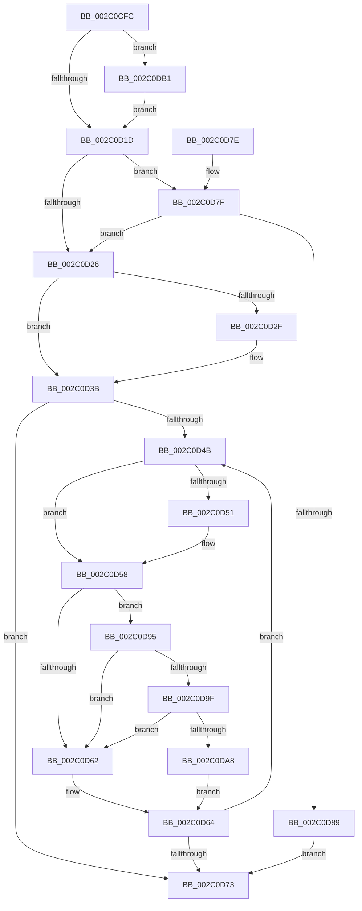

# MiLockWorkingSetCoreExclusive

- RVA: `0x002C0CFC`–`0x002C0DBD` (길이 `193` bytes)
- VA: `0x00000001402C0CFC`
- 실행 섹션: `.text`
- PDB 이름 있음: `예`; PDB Function 태그: `아니요`
- unwind 정보 RVA: `0x0006E670`
- 디코드: `57`개 명령, `193/193` bytes 표시
- 미해석 바이트: `0` (있으면 어셈블리에 `.byte`로 보존)

> 이 문서는 커널 이미지의 기계어와 PDB 기호를 분석해 생성했습니다. 4번과 5번은 함수 원형과 자료형을 바이너리 사용 방식에서 추정한 C 해석이며 원본 소스 복구 결과는 아닙니다.

## 1. Dependencies

- 직접 호출 지점: **4**; 고유 호출 대상: **4**
- 직접 호출자로 확인된 함수: **7**
- RIP 상대 이미지 참조: **5**

### Outgoing calls
- `0x002C0D34` → [ExpWaitForSpinLockExclusiveAndAcquire](../32/ExpWaitForSpinLockExclusiveAndAcquire_function_003239A0.md) (function, `0x003239A0`)
- `0x002C0D8E` → [ExpAcquireSpinLockExclusiveAtDpcLevelInstrumented](../32/ExpAcquireSpinLockExclusiveAtDpcLevelInstrumented_function_00323A70.md) (function, `0x00323A70`)
- `0x002C0D9F` → [KiCheckVpBackingLongSpinWaitHypercall](../30/KiCheckVpBackingLongSpinWaitHypercall_function_0030F490.md) (function, `0x0030F490`)
- `0x002C0DAA` → [HvlNotifyLongSpinWait](../30/HvlNotifyLongSpinWait_function_0030F460.md) (function, `0x0030F460`)

### Direct callers
- [MiLogPageAccess](../24/MiLogPageAccess_function_00240870.md) at `0x002408F7`
- [MiSetVaAgeList](../29/MiSetVaAgeList_function_00290A20.md) at `0x00291420`
- [MiSetVaAgeList](../29/MiSetVaAgeList_function_00290A20.md) at `0x002916CC`
- [MmQuerySystemWorkingSetInformation](MmQuerySystemWorkingSetInformation_function_002C0710.md) at `0x002C07BB`
- [MiDrainOldAccessBuffers](MiDrainOldAccessBuffers_function_002C0C30.md) at `0x002C0C86`
- [MiDrainSystemAccessLog](../47/MiDrainSystemAccessLog_function_00474144.md) at `0x004741B0`
- [MmAdjustWorkingSetSizeEx](../47/MmAdjustWorkingSetSizeEx_function_0047D8D4.md) at `0x0047D967`
- [MiCopyWorkingSetFields](../66/MiCopyWorkingSetFields_function_0066F0F4.md) at `0x0066F16C`

### Static image references
- `0x002C0D0C` → RVA `0x00E38880` (`.data`; read)
- `0x002C0D1D` → RVA `0x00FC6B06` (`ALMOSTRO`; read)
- `0x002C0D5A` → RVA `0x00FC52AC` (`ALMOSTRO`; reference)
- `0x002C0D7F` → RVA `0x00F0DE58` (`.data`; read)
- `0x002C0D95` → RVA `0x00FC6AB8` (`ALMOSTRO`; read)

## 2. Other-region calls and transfers

- 다른 실행 섹션으로 향하는 call: **0**
- 별도 외부 분기/꼬리 이동을 확인하지 못했습니다.

## 3. Assembly (complete function range)

```asm
002C0CFC  48 89 5C 24 10                  mov qword ptr [rsp + 0x10], rbx
002C0D01  57                              push rdi
002C0D02  48 83 EC 20                     sub rsp, 0x20
002C0D06  8B 81 B8 00 00 00               mov eax, dword ptr [rcx + 0xb8]
002C0D0C  48 8D 1D 6D 7B B7 00            lea rbx, [rip + 0xb77b6d]
002C0D13  24 0F                           and al, 0xf
002C0D15  3C 01                           cmp al, 1
002C0D17  0F 85 94 00 00 00               jne 0x1402c0db1
002C0D1D  F6 05 E2 5D D0 00 21            test byte ptr [rip + 0xd05de2], 0x21
002C0D24  75 59                           jne 0x1402c0d7f
002C0D26  33 FF                           xor edi, edi
002C0D28  F0 0F BA 2B 1F                  lock bts dword ptr [rbx], 0x1f
002C0D2D  73 0C                           jae 0x1402c0d3b
002C0D2F  B2 FF                           mov dl, 0xff
002C0D31  48 8B CB                        mov rcx, rbx
002C0D34  E8 67 2C 06 00                  call 0x1403239a0
002C0D39  8B F8                           mov edi, eax
002C0D3B  8B 13                           mov edx, dword ptr [rbx]
002C0D3D  8B CA                           mov ecx, edx
002C0D3F  0F BA F1 1E                     btr ecx, 0x1e
002C0D43  81 F9 00 00 00 80               cmp ecx, 0x80000000
002C0D49  74 28                           je 0x1402c0d73
002C0D4B  0F BA E2 1E                     bt edx, 0x1e
002C0D4F  72 07                           jb 0x1402c0d58
002C0D51  F0 81 0B 00 00 00 40            lock or dword ptr [rbx], 0x40000000
002C0D58  FF C7                           inc edi
002C0D5A  85 3D 4C 45 D0 00               test dword ptr [rip + 0xd0454c], edi
002C0D60  74 33                           je 0x1402c0d95
002C0D62  F3 90                           pause
002C0D64  8B 13                           mov edx, dword ptr [rbx]
002C0D66  8B C2                           mov eax, edx
002C0D68  0F BA F0 1E                     btr eax, 0x1e
002C0D6C  3D 00 00 00 80                  cmp eax, 0x80000000
002C0D71  75 D8                           jne 0x1402c0d4b
002C0D73  48 8B 5C 24 38                  mov rbx, qword ptr [rsp + 0x38]
002C0D78  48 83 C4 20                     add rsp, 0x20
002C0D7C  5F                              pop rdi
002C0D7D  C3                              ret
002C0D7E  CC                              int3
002C0D7F  8B 05 D3 D0 C4 00               mov eax, dword ptr [rip + 0xc4d0d3]
002C0D85  85 C0                           test eax, eax
002C0D87  75 9D                           jne 0x1402c0d26
002C0D89  B2 FF                           mov dl, 0xff
002C0D8B  48 8B CB                        mov rcx, rbx
002C0D8E  E8 DD 2C 06 00                  call 0x140323a70
002C0D93  EB DE                           jmp 0x1402c0d73
002C0D95  8B 05 1D 5D D0 00               mov eax, dword ptr [rip + 0xd05d1d]
002C0D9B  A8 40                           test al, 0x40
002C0D9D  74 C3                           je 0x1402c0d62
002C0D9F  E8 EC E6 04 00                  call 0x14030f490
002C0DA4  84 C0                           test al, al
002C0DA6  74 BA                           je 0x1402c0d62
002C0DA8  8B CF                           mov ecx, edi
002C0DAA  E8 B1 E6 04 00                  call 0x14030f460
002C0DAF  EB B3                           jmp 0x1402c0d64
002C0DB1  48 8D 99 00 01 00 00            lea rbx, [rcx + 0x100]
002C0DB8  E9 60 FF FF FF                  jmp 0x1402c0d1d
```

## 4. C-style interpretation (structured pseudocode)

```c
__int64 __fastcall MiLockWorkingSetCoreExclusive(__int64 a1)
{
    __int64 result;
    __int64 v_rdi;
    __int64 v_rsp;
    unsigned __int64 v_stack_p10;

    v_stack_p10 = v_rbx;
    v_rsp = (v_rsp) - (32);
    result = (unsigned __int8)(((unsigned int)(*(unsigned int *)(a1 + 184))) & (15));
    if (((unsigned __int8)(result)) != 1) goto loc_002C0DB1;
loc_002C0D1D:
    if (((*(unsigned __int8 *)(v_rip + 13655522)) & (33)) != 0) goto loc_002C0D7F;
loc_002C0D26:
    v_rdi = 0;
    if (!(condition_is_above_or_equal)) {
        a2 = 255;
        a1 = v_rip + 12024685;
        result = ExpWaitForSpinLockExclusiveAndAcquire(a1, a2, a3, a4);
        v_rdi = (unsigned int)(result);
    }
    if (((unsigned int)((unsigned int)((unsigned int)((unsigned int)(*(unsigned int *)(v_rip + 12024685)))))) == 0x80000000ULL) goto loc_002C0D73;
loc_002C0D4B:
    if (((unsigned int)((unsigned int)((unsigned int)((unsigned int)(*(unsigned int *)(v_rip + 12024685)))))) >= 0x80000000ULL) {
    }
    v_rdi = (unsigned int)((v_rdi) + 1);
    if (((*(unsigned int *)(v_rip + 13649228)) & ((unsigned int)(v_rdi))) == 0) goto loc_002C0D95;
loc_002C0D62:
loc_002C0D64:
    if (((unsigned int)((unsigned int)((unsigned int)((unsigned int)(*(unsigned int *)(v_rip + 12024685)))))) != 0x80000000ULL) goto loc_002C0D4B;
loc_002C0D73:
    v_rsp = (v_rsp) + (32);
    return (unsigned int)((unsigned int)((unsigned int)(*(unsigned int *)(v_rip + 12024685))));
loc_002C0D7F:
    if ((unsigned int)((unsigned int)(*(unsigned int *)(v_rip + 12898515))) != 0) goto loc_002C0D26;
    result = ExpAcquireSpinLockExclusiveAtDpcLevelInstrumented(v_stack_p10, 255, a3, a4);
    goto loc_002C0D73;
loc_002C0D95:
    if ((((unsigned __int8)((unsigned int)(*(unsigned int *)(v_rip + 13655325)))) & (64)) == 0) goto loc_002C0D62;
    result = KiCheckVpBackingLongSpinWaitHypercall(v_stack_p10, 255, a3, a4);
    if ((unsigned __int8)(result) == 0) goto loc_002C0D62;
    result = HvlNotifyLongSpinWait((unsigned int)((unsigned int)(v_rdi)), 255, a3, a4);
    goto loc_002C0D64;
loc_002C0DB1:
    goto loc_002C0D1D;
}
```

## 5. (Beta) C Style

```c
int64_t MiLockWorkingSetCoreExclusive(void *Arg1)
{
    uint8_t *arg1 = (uint8_t *)Arg1;

    int64_t result;
    int64_t local_rdi;
    int64_t local_rsp;
    uint64_t v_stack_p10;

    v_stack_p10 = local_rbx;
    local_rsp = (local_rsp) - (32);
    result = (uint8_t)(((uint32_t)(*(uint32_t *)(arg1 + 0xB8))) & (15));
    if (((uint8_t)(result)) != 1) goto loc_002C0DB1;
loc_002C0D1D:
    if (((*(uint8_t *)(v_rip + 0xD05DE2)) & (33)) != 0) goto loc_002C0D7F;
loc_002C0D26:
    local_rdi = 0;
    if (!(condition_is_above_or_equal)) {
        a2 = 255;
        Arg1 = v_rip + 12024685;
        result = ExpWaitForSpinLockExclusiveAndAcquire(Arg1, a2, a3, a4);
        local_rdi = (uint32_t)(result);
    }
    if (((uint32_t)((uint32_t)((uint32_t)((uint32_t)(*(uint32_t *)(v_rip + 0xB77B6D)))))) == 0x80000000ULL) goto loc_002C0D73;
loc_002C0D4B:
    if (((uint32_t)((uint32_t)((uint32_t)((uint32_t)(*(uint32_t *)(v_rip + 0xB77B6D)))))) >= 0x80000000ULL) {
    }
    local_rdi = (uint32_t)((local_rdi) + 1);
    if (((*(uint32_t *)(v_rip + 0xD0454C)) & ((uint32_t)(local_rdi))) == 0) goto loc_002C0D95;
loc_002C0D62:
loc_002C0D64:
    if (((uint32_t)((uint32_t)((uint32_t)((uint32_t)(*(uint32_t *)(v_rip + 0xB77B6D)))))) != 0x80000000ULL) goto loc_002C0D4B;
loc_002C0D73:
    local_rsp = (local_rsp) + (32);
    return (uint32_t)((uint32_t)((uint32_t)(*(uint32_t *)(v_rip + 0xB77B6D))));
loc_002C0D7F:
    if ((uint32_t)((uint32_t)(*(uint32_t *)(v_rip + 0xC4D0D3))) != 0) goto loc_002C0D26;
    result = ExpAcquireSpinLockExclusiveAtDpcLevelInstrumented(v_stack_p10, 255, a3, a4);
    goto loc_002C0D73;
loc_002C0D95:
    if ((((uint8_t)((uint32_t)(*(uint32_t *)(v_rip + 0xD05D1D)))) & (64)) == 0) goto loc_002C0D62;
    result = KiCheckVpBackingLongSpinWaitHypercall(v_stack_p10, 255, a3, a4);
    if ((uint8_t)(result) == 0) goto loc_002C0D62;
    result = HvlNotifyLongSpinWait((uint32_t)((uint32_t)(local_rdi)), 255, a3, a4);
    goto loc_002C0D64;
loc_002C0DB1:
    goto loc_002C0D1D;
}
```

### 관측된 메모리 오프셋

구조체 형식이 확인되지 않은 접근은 인자 기준의 오프셋으로만 기록했습니다.

| 기준 인자 | 오프셋 표현 | 폭 (bit) | 접근 |
|---|---:|---:|---|
| `Arg1` | `+ 0xB8` | `32` | `R` |
| `Arg1` | `+ 0x100` | `64` | `R` |

## 6. Execution-region graph

[열기: 2D/3D 그래프와 함수 탐색 컨트롤 패널](../../../control-panel.html?section=text&rva=0x002C0CFC&view=graph)

- 2D 그래프는 위에서 아래로 흐르고, 3D 그래프는 빈 공간을 드래그해 회전합니다. Shift+드래그는 이동, 휠은 확대·축소, 함수 노드 선택은 대상 보고서 이동입니다.

### Static fallback


