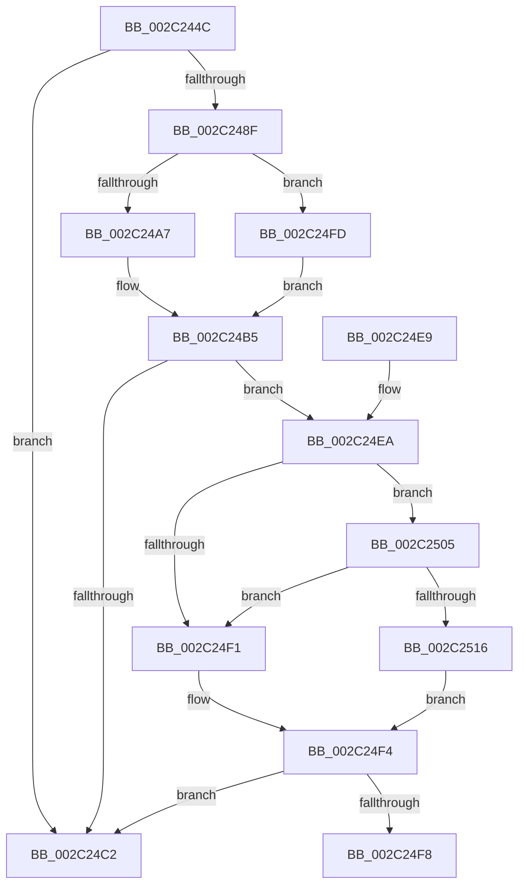

# MiLogWsAging

- RVA: `0x002C244C`–`0x002C2518` (길이 `204` bytes)
- VA: `0x00000001402C244C`
- 실행 섹션: `.text`
- PDB 이름 있음: `예`; PDB Function 태그: `예`
- unwind 정보 RVA: `0x0006E894`
- 디코드: `54`개 명령, `204/204` bytes 표시
- 미해석 바이트: `0` (있으면 어셈블리에 `.byte`로 보존)

> 이 문서는 커널 이미지의 기계어와 PDB 기호를 분석해 생성했습니다. 4번과 5번은 함수 원형과 자료형을 바이너리 사용 방식에서 추정한 C 해석이며 원본 소스 복구 결과는 아닙니다.

## 1. Dependencies

- 직접 호출 지점: **1**; 고유 호출 대상: **1**
- 직접 호출자로 확인된 함수: **1**
- RIP 상대 이미지 참조: **2**

### Outgoing calls
- `0x002C24CC` → [_security_check_cookie](../6A/_security_check_cookie_function_006AC640.md) (function, `0x006AC640`)

### Direct callers
- [MiAgeWorkingSet](MiAgeWorkingSet_function_002C21E0.md) at `0x002C238F`

### Static image references
- `0x002C2469` → RVA `0x00E0A740` (`.data`; read)
- `0x002C2480` → RVA `0x00E37618` (`.data`; read)

## 2. Other-region calls and transfers

- 다른 실행 섹션으로 향하는 call: **0**
- call이 아닌 외부 분기/꼬리 이동: **1**
  - `0x002C24F8` → [sub_006DC222](../6D/Unknown_function_006DC222.md) (`tail-transfer`)

## 3. Assembly (complete function range)

```asm
002C244C  48 89 5C 24 10                  mov qword ptr [rsp + 0x10], rbx
002C2451  48 89 74 24 18                  mov qword ptr [rsp + 0x18], rsi
002C2456  55                              push rbp
002C2457  57                              push rdi
002C2458  41 56                           push r14
002C245A  48 8D AC 24 60 FF FF FF         lea rbp, [rsp - 0xa0]
002C2462  48 81 EC A0 01 00 00            sub rsp, 0x1a0
002C2469  48 8B 05 D0 82 B4 00            mov rax, qword ptr [rip + 0xb482d0]
002C2470  48 33 C4                        xor rax, rsp
002C2473  48 89 85 90 00 00 00            mov qword ptr [rbp + 0x90], rax
002C247A  45 33 F6                        xor r14d, r14d
002C247D  41 8B D8                        mov ebx, r8d
002C2480  4C 39 35 91 51 B7 00            cmp qword ptr [rip + 0xb75191], r14
002C2487  4C 8B DA                        mov r11, rdx
002C248A  4C 8B C9                        mov r9, rcx
002C248D  74 33                           je 0x1402c24c2
002C248F  48 8B B9 90 00 00 00            mov rdi, qword ptr [rcx + 0x90]
002C2496  48 8B B1 98 00 00 00            mov rsi, qword ptr [rcx + 0x98]
002C249D  8B 81 B8 00 00 00               mov eax, dword ptr [rcx + 0xb8]
002C24A3  A8 0F                           test al, 0xf
002C24A5  75 56                           jne 0x1402c24fd
002C24A7  44 8B 91 D0 FD FF FF            mov r10d, dword ptr [rcx - 0x230]
002C24AE  48 8D 91 38 FF FF FF            lea rdx, [rcx - 0xc8]
002C24B5  4C 8B 05 5C 51 B7 00            mov r8, qword ptr [rip + 0xb7515c]
002C24BC  41 83 38 05                     cmp dword ptr [r8], 5
002C24C0  77 28                           ja 0x1402c24ea
002C24C2  48 8B 8D 90 00 00 00            mov rcx, qword ptr [rbp + 0x90]
002C24C9  48 33 CC                        xor rcx, rsp
002C24CC  E8 6F A1 3E 00                  call 0x1406ac640
002C24D1  4C 8D 9C 24 A0 01 00 00         lea r11, [rsp + 0x1a0]
002C24D9  49 8B 5B 28                     mov rbx, qword ptr [r11 + 0x28]
002C24DD  49 8B 73 30                     mov rsi, qword ptr [r11 + 0x30]
002C24E1  49 8B E3                        mov rsp, r11
002C24E4  41 5E                           pop r14
002C24E6  5F                              pop rdi
002C24E7  5D                              pop rbp
002C24E8  C3                              ret
002C24E9  CC                              int3
002C24EA  41 F6 40 10 01                  test byte ptr [r8 + 0x10], 1
002C24EF  75 14                           jne 0x1402c2505
002C24F1  41 8A C6                        mov al, r14b
002C24F4  84 C0                           test al, al
002C24F6  74 CA                           je 0x1402c24c2
002C24F8  E9 25 9D 41 00                  jmp 0x1406dc222
002C24FD  45 8B D6                        mov r10d, r14d
002C2500  49 8B D6                        mov rdx, r14
002C2503  EB B0                           jmp 0x1402c24b5
002C2505  49 8B 48 18                     mov rcx, qword ptr [r8 + 0x18]
002C2509  48 8B C1                        mov rax, rcx
002C250C  83 E0 01                        and eax, 1
002C250F  48 3B C1                        cmp rax, rcx
002C2512  B0 01                           mov al, 1
002C2514  75 DB                           jne 0x1402c24f1
002C2516  EB DC                           jmp 0x1402c24f4
```

## 4. C-style interpretation (structured pseudocode)

```c
__int64 __fastcall MiLogWsAging(__int64 a1, __int64 a2, int a3)
{
    __int64 result;
    __int64 v_r14;
    __int64 v_rsp;
    unsigned __int64 v_stack_m18;
    unsigned __int64 v_stack_m28;
    unsigned __int64 v_stack_mB8;
    unsigned __int64 v_stack_p10;
    unsigned __int64 v_stack_p18;

    v_stack_p10 = v_rbx;
    v_stack_p18 = v_rsi;
    v_rsp = (v_rsp) - (416);
    result = (*(unsigned __int64 *)(v_rip + 11829968)) ^ (v_rsp);
    v_stack_m28 = result;
    v_r14 = 0;
    if ((*(unsigned __int64 *)(v_rip + 12013969)) == 0) goto loc_002C24C2;
    if ((((unsigned __int8)((unsigned int)(*(unsigned int *)(a1 + 184)))) & (15)) != 0) goto loc_002C24FD;
loc_002C24B5:
    if ((*(unsigned int *)(*(unsigned __int64 *)(v_rip + 12013916))) > 5) goto loc_002C24EA;
loc_002C24C2:
    a1 = (v_stack_m28) ^ (v_rsp);
    result = _security_check_cookie(a1, a1 - 200, *(unsigned __int64 *)(v_rip + 12013916), a1);
    return result;
loc_002C24EA:
    if (((*(unsigned __int8 *)(*(unsigned __int64 *)(v_rip + 12013916) + 16)) & (1)) != 0) goto loc_002C2505;
loc_002C24F1:
loc_002C24F4:
    if (0 == 0) goto loc_002C24C2;
loc_002C24FD:
    goto loc_002C24B5;
loc_002C2505:
    result = (unsigned int)((*(unsigned __int64 *)(*(unsigned __int64 *)(v_rip + 12013916) + 24)) & (1));
    if (result != (*(unsigned __int64 *)(*(unsigned __int64 *)(v_rip + 12013916) + 24))) goto loc_002C24F1;
    goto loc_002C24F4;
}
```

## 5. (Beta) C Style

```c
int64_t MiLogWsAging(void *Arg1, int64_t Arg2, int32_t Arg3)
{
    uint8_t *arg1 = (uint8_t *)Arg1;

    int64_t result;
    int64_t local_r14;
    int64_t local_rsp;
    uint64_t v_stack_m18;
    uint64_t v_stack_m28;
    uint64_t v_stack_mB8;
    uint64_t v_stack_p10;
    uint64_t v_stack_p18;

    v_stack_p10 = local_rbx;
    v_stack_p18 = local_rsi;
    local_rsp = (local_rsp) - (416);
    result = (*(uint64_t *)(v_rip + 0xB482D0)) ^ (local_rsp);
    v_stack_m28 = result;
    local_r14 = 0;
    if ((*(uint64_t *)(v_rip + 0xB75191)) == 0) goto loc_002C24C2;
    if ((((uint8_t)((uint32_t)(*(uint32_t *)(arg1 + 0xB8)))) & (15)) != 0) goto loc_002C24FD;
loc_002C24B5:
    if ((*(uint32_t *)(*(uint64_t *)(v_rip + 0xB7515C))) > 5) goto loc_002C24EA;
loc_002C24C2:
    Arg1 = (v_stack_m28) ^ (local_rsp);
    result = _security_check_cookie(Arg1, Arg1 - 200, *(uint64_t *)(v_rip + 0xB7515C), Arg1);
    return result;
loc_002C24EA:
    if (((*(uint8_t *)(*(uint64_t *)(v_rip + 0xB7515C) + 0x10)) & (1)) != 0) goto loc_002C2505;
loc_002C24F1:
loc_002C24F4:
    if (0 == 0) goto loc_002C24C2;
loc_002C24FD:
    goto loc_002C24B5;
loc_002C2505:
    result = (uint32_t)((*(uint64_t *)(*(uint64_t *)(v_rip + 0xB7515C) + 0x18)) & (1));
    if (result != (*(uint64_t *)(*(uint64_t *)(v_rip + 0xB7515C) + 0x18))) goto loc_002C24F1;
    goto loc_002C24F4;
}
```

### 관측된 메모리 오프셋

구조체 형식이 확인되지 않은 접근은 인자 기준의 오프셋으로만 기록했습니다.

| 기준 인자 | 오프셋 표현 | 폭 (bit) | 접근 |
|---|---:|---:|---|
| `Arg1` | `- 0x230` | `32` | `R` |
| `Arg1` | `- 0xC8` | `64` | `R` |
| `Arg1` | `+ 0x90` | `64` | `R` |
| `Arg1` | `+ 0x98` | `64` | `R` |
| `Arg1` | `+ 0xB8` | `32` | `R` |

## 6. Execution-region graph

[열기: 2D/3D 그래프와 함수 탐색 컨트롤 패널](../../../control-panel.html?section=text&rva=0x002C244C&view=graph)

- 2D 그래프는 위에서 아래로 흐르고, 3D 그래프는 빈 공간을 드래그해 회전합니다. Shift+드래그는 이동, 휠은 확대·축소, 함수 노드 선택은 대상 보고서 이동입니다.

### Static fallback


