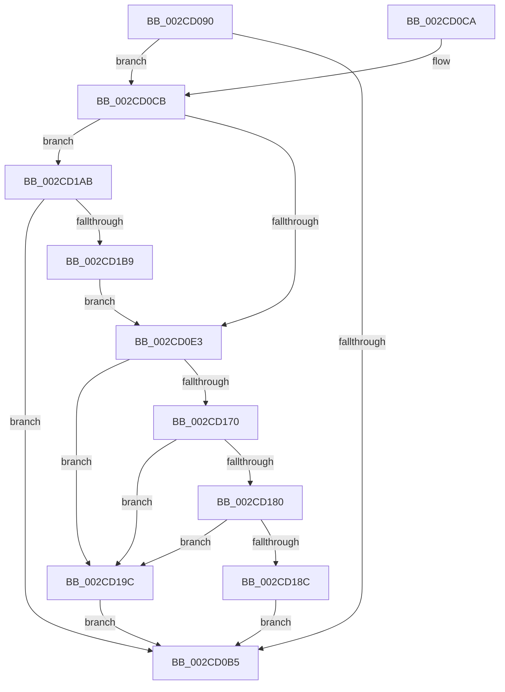

# MiLogZeroPageDecision

- RVA: `0x002CD090`–`0x002CD1BE` (길이 `302` bytes)
- VA: `0x00000001402CD090`
- 실행 섹션: `.text`
- PDB 이름 있음: `예`; PDB Function 태그: `아니요`
- unwind 정보 RVA: `0x0006F4DC`
- 디코드: `83`개 명령, `302/302` bytes 표시
- 미해석 바이트: `0` (있으면 어셈블리에 `.byte`로 보존)

> 이 문서는 커널 이미지의 기계어와 PDB 기호를 분석해 생성했습니다. 4번과 5번은 함수 원형과 자료형을 바이너리 사용 방식에서 추정한 C 해석이며 원본 소스 복구 결과는 아닙니다.

## 1. Dependencies

- 직접 호출 지점: **1**; 고유 호출 대상: **1**
- 직접 호출자로 확인된 함수: **2**
- RIP 상대 이미지 참조: **2**

### Outgoing calls
- `0x002CD177` → [MiZeroPageLogEntriesMergable](MiZeroPageLogEntriesMergable_function_002CBBC4.md) (function, `0x002CBBC4`)

### Direct callers
- [MiReassessZeroThreads](MiReassessZeroThreads_function_002CB0C0.md) at `0x002CB277`
- [MiWakeZeroingThreads](MiWakeZeroingThreads_function_002CBEC0.md) at `0x002CBF25`

### Static image references
- `0x002CD18C` → RVA `0x00EF5024` (`.data`; read/write)
- `0x002CD19C` → RVA `0x00EF5028` (`.data`; read/write)

## 2. Other-region calls and transfers

- 다른 실행 섹션으로 향하는 call: **0**
- 별도 외부 분기/꼬리 이동을 확인하지 못했습니다.

## 3. Assembly (complete function range)

```asm
002CD090  48 89 5C 24 08                  mov qword ptr [rsp + 8], rbx
002CD095  48 89 6C 24 10                  mov qword ptr [rsp + 0x10], rbp
002CD09A  48 89 74 24 18                  mov qword ptr [rsp + 0x18], rsi
002CD09F  57                              push rdi
002CD0A0  48 83 EC 20                     sub rsp, 0x20
002CD0A4  4C 8B 91 28 01 00 00            mov r10, qword ptr [rcx + 0x128]
002CD0AB  8B FA                           mov edi, edx
002CD0AD  48 8B D9                        mov rbx, rcx
002CD0B0  4D 85 D2                        test r10, r10
002CD0B3  75 16                           jne 0x1402cd0cb
002CD0B5  48 8B 5C 24 30                  mov rbx, qword ptr [rsp + 0x30]
002CD0BA  48 8B 6C 24 38                  mov rbp, qword ptr [rsp + 0x38]
002CD0BF  48 8B 74 24 40                  mov rsi, qword ptr [rsp + 0x40]
002CD0C4  48 83 C4 20                     add rsp, 0x20
002CD0C8  5F                              pop rdi
002CD0C9  C3                              ret
002CD0CA  CC                              int3
002CD0CB  41 8B 42 08                     mov eax, dword ptr [r10 + 8]
002CD0CF  BD 01 00 00 00                  mov ebp, 1
002CD0D4  41 01 6A 04                     add dword ptr [r10 + 4], ebp
002CD0D8  41 8B 12                        mov edx, dword ptr [r10]
002CD0DB  3B C2                           cmp eax, edx
002CD0DD  0F 83 C8 00 00 00               jae 0x1402cd1ab
002CD0E3  44 8B D8                        mov r11d, eax
002CD0E6  BA FE FF FF FF                  mov edx, 0xfffffffe
002CD0EB  49 C1 E3 04                     shl r11, 4
002CD0EF  48 BE 00 00 00 00 01 00 00 00   movabs rsi, 0x100000000
002CD0F9  4D 03 DA                        add r11, r10
002CD0FC  41 8B C8                        mov ecx, r8d
002CD0FF  23 CA                           and ecx, edx
002CD101  41 8B C0                        mov eax, r8d
002CD104  0B C5                           or eax, ebp
002CD106  4C 3B C6                        cmp r8, rsi
002CD109  0F 42 C1                        cmovb eax, ecx
002CD10C  41 8B C9                        mov ecx, r9d
002CD10F  41 89 03                        mov dword ptr [r11], eax
002CD112  23 CA                           and ecx, edx
002CD114  41 8B C1                        mov eax, r9d
002CD117  0B C5                           or eax, ebp
002CD119  4C 3B CE                        cmp r9, rsi
002CD11C  0F 42 C1                        cmovb eax, ecx
002CD11F  40 C0 E7 06                     shl dil, 6
002CD123  41 89 43 04                     mov dword ptr [r11 + 4], eax
002CD127  0F B7 44 24 50                  movzx eax, word ptr [rsp + 0x50]
002CD12C  66 41 89 43 08                  mov word ptr [r11 + 8], ax
002CD131  0F B7 43 0C                     movzx eax, word ptr [rbx + 0xc]
002CD135  66 41 89 43 0A                  mov word ptr [r11 + 0xa], ax
002CD13A  41 8A 43 0C                     mov al, byte ptr [r11 + 0xc]
002CD13E  8A C8                           mov cl, al
002CD140  32 4C 24 58                     xor cl, byte ptr [rsp + 0x58]
002CD144  80 E1 0F                        and cl, 0xf
002CD147  32 C8                           xor cl, al
002CD149  41 88 4B 0C                     mov byte ptr [r11 + 0xc], cl
002CD14D  80 E1 0F                        and cl, 0xf
002CD150  8A 03                           mov al, byte ptr [rbx]
002CD152  C0 E0 04                        shl al, 4
002CD155  32 C1                           xor al, cl
002CD157  41 C6 43 0D 00                  mov byte ptr [r11 + 0xd], 0
002CD15C  24 3F                           and al, 0x3f
002CD15E  66 41 89 6B 0E                  mov word ptr [r11 + 0xe], bp
002CD163  40 0A C7                        or al, dil
002CD166  41 88 43 0C                     mov byte ptr [r11 + 0xc], al
002CD16A  41 39 6A 08                     cmp dword ptr [r10 + 8], ebp
002CD16E  74 2C                           je 0x1402cd19c
002CD170  49 8D 53 F0                     lea rdx, [r11 - 0x10]
002CD174  49 8B CB                        mov rcx, r11
002CD177  E8 48 EA FF FF                  call 0x1402cbbc4
002CD17C  85 C0                           test eax, eax
002CD17E  74 1C                           je 0x1402cd19c
002CD180  B8 FF FF 00 00                  mov eax, 0xffff
002CD185  66 41 39 43 FE                  cmp word ptr [r11 - 2], ax
002CD18A  74 10                           je 0x1402cd19c
002CD18C  01 2D 92 7E C2 00               add dword ptr [rip + 0xc27e92], ebp
002CD192  66 41 01 6B FE                  add word ptr [r11 - 2], bp
002CD197  E9 19 FF FF FF                  jmp 0x1402cd0b5
002CD19C  01 2D 86 7E C2 00               add dword ptr [rip + 0xc27e86], ebp
002CD1A2  41 01 6A 08                     add dword ptr [r10 + 8], ebp
002CD1A6  E9 0A FF FF FF                  jmp 0x1402cd0b5
002CD1AB  8B C5                           mov eax, ebp
002CD1AD  41 89 6A 08                     mov dword ptr [r10 + 8], ebp
002CD1B1  3B C2                           cmp eax, edx
002CD1B3  0F 83 FC FE FF FF               jae 0x1402cd0b5
002CD1B9  E9 25 FF FF FF                  jmp 0x1402cd0e3
```

## 4. C-style interpretation (structured pseudocode)

```c
__int64 __fastcall MiLogZeroPageDecision(__int64 a1, int a2, __int64 a3, __int64 a4, unsigned __int16 a5, unsigned __int8 a6)
{
    __int64 result;
    __int64 v_r11;
    __int64 v_rdi;
    __int64 v_rsp;
    unsigned __int64 v_stack_p10;
    unsigned __int64 v_stack_p18;
    unsigned __int64 v_stack_p8;

    v_stack_p8 = v_rbx;
    v_stack_p10 = v_rbp;
    v_stack_p18 = v_rsi;
    v_rsp = (v_rsp) - (32);
    if (*(unsigned __int64 *)(a1 + 296) != 0) goto loc_002CD0CB;
loc_002CD0B5:
    v_rsp = (v_rsp) + (32);
    return result;
loc_002CD0CB:
    if (((unsigned int)((unsigned int)(*(unsigned int *)(*(unsigned __int64 *)(a1 + 296) + 8)))) >= ((unsigned int)((unsigned int)(*(unsigned int *)(*(unsigned __int64 *)(a1 + 296)))))) goto loc_002CD1AB;
loc_002CD0E3:
    v_r11 = ((unsigned int)((unsigned int)((unsigned int)(*(unsigned int *)(*(unsigned __int64 *)(a1 + 296) + 8))))) << (4);
    v_r11 = (v_r11) + (*(unsigned __int64 *)(a1 + 296));
    a1 = (unsigned int)(((unsigned int)((unsigned int)(a3))) & ((unsigned int)((unsigned int)(0xFFFFFFFEULL))));
    result = (unsigned int)(((unsigned int)((unsigned int)(a3))) | (1));
    if (a3 < v_stack_p18) { result = (unsigned int)(a1); }
    *(unsigned int *)(v_r11) = (unsigned int)(result);
    a1 = (unsigned int)(((unsigned int)((unsigned int)(a4))) & ((unsigned int)((unsigned int)(0xFFFFFFFEULL))));
    result = (unsigned int)(((unsigned int)((unsigned int)(a4))) | (1));
    if (a4 < v_stack_p18) { result = (unsigned int)(a1); }
    v_rdi = (unsigned __int8)(((unsigned int)(a2)) << (6));
    *(unsigned int *)(v_r11 + 4) = (unsigned int)(result);
    *(unsigned __int16 *)(v_r11 + 8) = a5;
    *(unsigned __int16 *)(v_r11 + 10) = (unsigned __int16)(*(unsigned __int16 *)(v_stack_p8 + 12));
    a1 = (unsigned __int8)(((unsigned __int8)(*(unsigned __int8 *)(v_r11 + 12))) ^ (a6));
    a1 = (unsigned __int8)((a1) & (15));
    a1 = (unsigned __int8)((a1) ^ ((unsigned __int8)(*(unsigned __int8 *)(v_r11 + 12))));
    *(unsigned __int8 *)(v_r11 + 12) = (unsigned __int8)(a1);
    a1 = (unsigned __int8)((a1) & (15));
    result = (unsigned __int8)((*(unsigned __int8 *)(v_stack_p8)) << (4));
    result = (unsigned __int8)((result) ^ ((unsigned __int8)(a1)));
    *(unsigned __int8 *)(v_r11 + 13) = 0;
    result = (unsigned __int8)((result) & (63));
    *(unsigned __int16 *)(v_r11 + 14) = 1;
    result = (unsigned __int8)((result) | ((unsigned __int8)(v_rdi)));
    *(unsigned __int8 *)(v_r11 + 12) = (unsigned __int8)(result);
    if ((*(unsigned int *)(*(unsigned __int64 *)(a1 + 296) + 8)) == 1) goto loc_002CD19C;
    result = MiZeroPageLogEntriesMergable(v_r11, v_r11 - 16, a3, a4);
    if ((unsigned int)(result) == 0) goto loc_002CD19C;
    if ((*(unsigned __int16 *)(v_r11 - 2)) == ((unsigned __int16)((unsigned int)(0xFFFFULL)))) goto loc_002CD19C;
    goto loc_002CD0B5;
loc_002CD19C:
    goto loc_002CD0B5;
loc_002CD1AB:
    *(unsigned int *)(*(unsigned __int64 *)(a1 + 296) + 8) = 1;
    if (1 >= ((unsigned int)(v_r11 - 16))) goto loc_002CD0B5;
    goto loc_002CD0E3;
}
```

## 5. (Beta) C Style

```c
int64_t MiLogZeroPageDecision(void *Arg1, int32_t Arg2, int64_t Arg3, int64_t Arg4, uint16_t Arg5, uint8_t Arg6)
{
    uint8_t *arg1 = (uint8_t *)Arg1;

    int64_t result;
    int64_t local_r11;
    int64_t local_rdi;
    int64_t local_rsp;
    uint64_t v_stack_p10;
    uint64_t v_stack_p18;
    uint64_t v_stack_p8;

    v_stack_p8 = local_rbx;
    v_stack_p10 = local_rbp;
    v_stack_p18 = local_rsi;
    local_rsp = (local_rsp) - (32);
    if (*(uint64_t *)(arg1 + 0x128) != 0) goto loc_002CD0CB;
loc_002CD0B5:
    local_rsp = (local_rsp) + (32);
    return result;
loc_002CD0CB:
    if (((uint32_t)((uint32_t)(*(uint32_t *)(*(uint64_t *)(arg1 + 0x128) + 0x8)))) >= ((uint32_t)((uint32_t)(*(uint32_t *)(*(uint64_t *)(arg1 + 0x128)))))) goto loc_002CD1AB;
loc_002CD0E3:
    local_r11 = ((uint32_t)((uint32_t)((uint32_t)(*(uint32_t *)(*(uint64_t *)(arg1 + 0x128) + 0x8))))) << (4);
    local_r11 = (local_r11) + (*(uint64_t *)(arg1 + 0x128));
    Arg1 = (uint32_t)(((uint32_t)((uint32_t)(Arg3))) & ((uint32_t)((uint32_t)(0xFFFFFFFEULL))));
    result = (uint32_t)(((uint32_t)((uint32_t)(Arg3))) | (1));
    if (Arg3 < v_stack_p18) { result = (uint32_t)(Arg1); }
    *(uint32_t *)(local_r11) = (uint32_t)(result);
    Arg1 = (uint32_t)(((uint32_t)((uint32_t)(Arg4))) & ((uint32_t)((uint32_t)(0xFFFFFFFEULL))));
    result = (uint32_t)(((uint32_t)((uint32_t)(Arg4))) | (1));
    if (Arg4 < v_stack_p18) { result = (uint32_t)(Arg1); }
    local_rdi = (uint8_t)(((uint32_t)(Arg2)) << (6));
    *(uint32_t *)(local_r11 + 0x4) = (uint32_t)(result);
    *(uint16_t *)(local_r11 + 0x8) = Arg5;
    *(uint16_t *)(local_r11 + 0xA) = (uint16_t)(*(uint16_t *)(v_stack_p8 + 0xC));
    Arg1 = (uint8_t)(((uint8_t)(*(uint8_t *)(local_r11 + 0xC))) ^ (Arg6));
    Arg1 = (uint8_t)((Arg1) & (15));
    Arg1 = (uint8_t)((Arg1) ^ ((uint8_t)(*(uint8_t *)(local_r11 + 0xC))));
    *(uint8_t *)(local_r11 + 0xC) = (uint8_t)(Arg1);
    Arg1 = (uint8_t)((Arg1) & (15));
    result = (uint8_t)((*(uint8_t *)(v_stack_p8)) << (4));
    result = (uint8_t)((result) ^ ((uint8_t)(Arg1)));
    *(uint8_t *)(local_r11 + 0xD) = 0;
    result = (uint8_t)((result) & (63));
    *(uint16_t *)(local_r11 + 0xE) = 1;
    result = (uint8_t)((result) | ((uint8_t)(local_rdi)));
    *(uint8_t *)(local_r11 + 0xC) = (uint8_t)(result);
    if ((*(uint32_t *)(*(uint64_t *)(arg1 + 0x128) + 0x8)) == 1) goto loc_002CD19C;
    result = MiZeroPageLogEntriesMergable(local_r11, local_r11 - 16, Arg3, Arg4);
    if ((uint32_t)(result) == 0) goto loc_002CD19C;
    if ((*(uint16_t *)(local_r11 - 0x2)) == ((uint16_t)((uint32_t)(0xFFFFULL)))) goto loc_002CD19C;
    goto loc_002CD0B5;
loc_002CD19C:
    goto loc_002CD0B5;
loc_002CD1AB:
    *(uint32_t *)(*(uint64_t *)(arg1 + 0x128) + 0x8) = 1;
    if (1 >= ((uint32_t)(local_r11 - 16))) goto loc_002CD0B5;
    goto loc_002CD0E3;
}
```

### 관측된 메모리 오프셋

구조체 형식이 확인되지 않은 접근은 인자 기준의 오프셋으로만 기록했습니다.

| 기준 인자 | 오프셋 표현 | 폭 (bit) | 접근 |
|---|---:|---:|---|
| `Arg1` | `+ 0x0` | `8` | `R` |
| `Arg1` | `+ 0xC` | `16` | `R` |
| `Arg1` | `+ 0x128` | `64` | `R` |

## 6. Execution-region graph

[열기: 2D/3D 그래프와 함수 탐색 컨트롤 패널](../../../control-panel.html?section=text&rva=0x002CD090&view=graph)

- 2D 그래프는 위에서 아래로 흐르고, 3D 그래프는 빈 공간을 드래그해 회전합니다. Shift+드래그는 이동, 휠은 확대·축소, 함수 노드 선택은 대상 보고서 이동입니다.

### Static fallback


