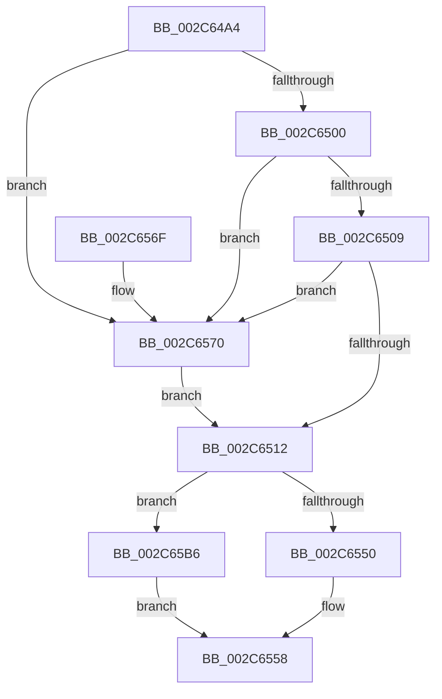

# MiMakeProtoPrivate

- RVA: `0x002C64A4`–`0x002C65F9` (길이 `341` bytes)
- VA: `0x00000001402C64A4`
- 실행 섹션: `.text`
- PDB 이름 있음: `예`; PDB Function 태그: `아니요`
- unwind 정보 RVA: `0x0006EBEC`
- 디코드: `89`개 명령, `341/341` bytes 표시
- 미해석 바이트: `0` (있으면 어셈블리에 `.byte`로 보존)

> 이 문서는 커널 이미지의 기계어와 PDB 기호를 분석해 생성했습니다. 4번과 5번은 함수 원형과 자료형을 바이너리 사용 방식에서 추정한 C 해석이며 원본 소스 복구 결과는 아닙니다.

## 1. Dependencies

- 직접 호출 지점: **5**; 고유 호출 대상: **5**
- 직접 호출자로 확인된 함수: **1**
- RIP 상대 이미지 참조: **0**

### Outgoing calls
- `0x002C6545` → [MiCopyOnWrite](../36/MiCopyOnWrite_function_00362A0C.md) (function, `0x00362A0C`)
- `0x002C6591` → [MiLocateCloneAddress](../3D/MiLocateCloneAddress_function_003D26B4.md) (function, `0x003D26B4`)
- `0x002C65D0` → [MiUnlockPageTable](../21/MiUnlockPageTable_function_00216EC0.md) (function, `0x00216EC0`)
- `0x002C65DB` → [MiUnlockWorkingSetShared](../27/MiUnlockWorkingSetShared_function_0027D690.md) (function, `0x0027D690`)
- `0x002C65EA` → [MiCopyOnWriteCheckConditions](../2A/MiCopyOnWriteCheckConditions_function_002A750C.md) (function, `0x002A750C`)

### Direct callers
- [MiProtectPrivateMemory](MiProtectPrivateMemory_function_002C45B0.md) at `0x002C4D27`

### Static image references
- 디코드된 RIP-relative 메모리 참조가 없습니다.

## 2. Other-region calls and transfers

- 다른 실행 섹션으로 향하는 call: **0**
- 별도 외부 분기/꼬리 이동을 확인하지 못했습니다.

## 3. Assembly (complete function range)

```asm
002C64A4  48 89 5C 24 08                  mov qword ptr [rsp + 8], rbx
002C64A9  48 89 6C 24 10                  mov qword ptr [rsp + 0x10], rbp
002C64AE  56                              push rsi
002C64AF  57                              push rdi
002C64B0  41 54                           push r12
002C64B2  41 56                           push r14
002C64B4  41 57                           push r15
002C64B6  48 83 EC 30                     sub rsp, 0x30
002C64BA  49 8B 00                        mov rax, qword ptr [r8]
002C64BD  44 8A FA                        mov r15b, dl
002C64C0  33 DB                           xor ebx, ebx
002C64C2  48 C1 E8 0C                     shr rax, 0xc
002C64C6  4C 8B F1                        mov r14, rcx
002C64C9  48 89 5C 24 70                  mov qword ptr [rsp + 0x70], rbx
002C64CE  48 B9 FF FF FF FF FF 00 00 00   movabs rcx, 0xffffffffff
002C64D8  49 8B F8                        mov rdi, r8
002C64DB  48 23 C1                        and rax, rcx
002C64DE  8B F3                           mov esi, ebx
002C64E0  48 8D 14 40                     lea rdx, [rax + rax*2]
002C64E4  48 C1 E2 04                     shl rdx, 4
002C64E8  48 B8 00 00 00 00 00 DE FF FF   movabs rax, 0xffffde0000000000
002C64F2  48 03 D0                        add rdx, rax
002C64F5  48 8B 42 28                     mov rax, qword ptr [rdx + 0x28]
002C64F9  48 0F BA E0 28                  bt rax, 0x28
002C64FE  72 70                           jb 0x1402c6570
002C6500  48 8B 42 08                     mov rax, qword ptr [rdx + 8]
002C6504  48 85 C0                        test rax, rax
002C6507  78 67                           js 0x1402c6570
002C6509  48 8B 42 08                     mov rax, qword ptr [rdx + 8]
002C650D  48 85 C0                        test rax, rax
002C6510  74 5E                           je 0x1402c6570
002C6512  49 BC 00 00 00 00 80 F6 FF FF   movabs r12, 0xfffff68000000000
002C651C  49 8B C4                        mov rax, r12
002C651F  48 C1 E0 19                     shl rax, 0x19
002C6523  48 8B CF                        mov rcx, rdi
002C6526  48 C1 E1 19                     shl rcx, 0x19
002C652A  45 33 C9                        xor r9d, r9d
002C652D  48 2B C8                        sub rcx, rax
002C6530  49 83 C8 FF                     or r8, 0xffffffffffffffff
002C6534  48 8D 44 24 70                  lea rax, [rsp + 0x70]
002C6539  48 C1 F9 10                     sar rcx, 0x10
002C653D  48 8B D7                        mov rdx, rdi
002C6540  48 89 44 24 20                  mov qword ptr [rsp + 0x20], rax
002C6545  E8 C2 C4 09 00                  call 0x140362a0c
002C654A  8B E8                           mov ebp, eax
002C654C  85 C0                           test eax, eax
002C654E  78 66                           js 0x1402c65b6
002C6550  48 85 F6                        test rsi, rsi
002C6553  0F 95 C3                        setne bl
002C6556  8B C3                           mov eax, ebx
002C6558  48 8B 5C 24 60                  mov rbx, qword ptr [rsp + 0x60]
002C655D  48 8B 6C 24 68                  mov rbp, qword ptr [rsp + 0x68]
002C6562  48 83 C4 30                     add rsp, 0x30
002C6566  41 5F                           pop r15
002C6568  41 5E                           pop r14
002C656A  41 5C                           pop r12
002C656C  5F                              pop rdi
002C656D  5E                              pop rsi
002C656E  C3                              ret
002C656F  CC                              int3
002C6570  65 48 8B 04 25 88 01 00 00      mov rax, qword ptr gs:[0x188]
002C6579  48 8B 52 08                     mov rdx, qword ptr [rdx + 8]
002C657D  48 8B 88 B8 00 00 00            mov rcx, qword ptr [rax + 0xb8]
002C6584  48 B8 00 00 00 00 00 00 00 80   movabs rax, 0x8000000000000000
002C658E  48 0B D0                        or rdx, rax
002C6591  E8 1E C1 10 00                  call 0x1403d26b4
002C6596  48 8B D0                        mov rdx, rax
002C6599  48 8B 81 10 04 00 00            mov rax, qword ptr [rcx + 0x410]
002C65A0  48 8B 88 28 04 00 00            mov rcx, qword ptr [rax + 0x428]
002C65A7  48 39 4A 60                     cmp qword ptr [rdx + 0x60], rcx
002C65AB  48 1B F6                        sbb rsi, rsi
002C65AE  48 23 F2                        and rsi, rdx
002C65B1  E9 5C FF FF FF                  jmp 0x1402c6512
002C65B6  48 C1 EF 09                     shr rdi, 9
002C65BA  48 BA F8 FF FF FF 7F 00 00 00   movabs rdx, 0x7ffffffff8
002C65C4  48 23 D7                        and rdx, rdi
002C65C7  49 8B C4                        mov rax, r12
002C65CA  48 03 D0                        add rdx, rax
002C65CD  49 8B CE                        mov rcx, r14
002C65D0  E8 EB 08 F5 FF                  call 0x140216ec0
002C65D5  41 8A D7                        mov dl, r15b
002C65D8  49 8B CE                        mov rcx, r14
002C65DB  E8 B0 70 FB FF                  call 0x14027d690
002C65E0  4C 8B 44 24 70                  mov r8, qword ptr [rsp + 0x70]
002C65E5  8B D5                           mov edx, ebp
002C65E7  49 8B CE                        mov rcx, r14
002C65EA  E8 1D 0F FE FF                  call 0x1402a750c
002C65EF  B8 02 00 00 00                  mov eax, 2
002C65F4  E9 5F FF FF FF                  jmp 0x1402c6558
```

## 4. C-style interpretation (structured pseudocode)

```c
__int64 __fastcall MiMakeProtoPrivate(__int64 a1, unsigned __int8 a2, __int64 a3, int a4)
{
    __int64 result;
    __int64 v_rbx;
    __int64 v_rdi;
    __int64 v_rsi;
    __int64 v_rsp;
    unsigned __int64 v_stack_m38;
    unsigned __int64 v_stack_p10;
    unsigned __int64 v_stack_p18;
    unsigned __int64 v_stack_p70;
    unsigned __int64 v_stack_p8;

    v_stack_p8 = v_rbx;
    v_stack_p10 = v_rbp;
    v_rsp = (v_rsp) - (48);
    v_rbx = 0;
    result = (*(unsigned __int64 *)(a3)) >> (12);
    v_stack_p18 = 0;
    result = (result) & (a1);
    a2 = (result + result * 2) << (4);
    a2 = (a2) + (result);
    if (condition_is_below) goto loc_002C6570;
    if (sign_flag) goto loc_002C6570;
    if (*(unsigned __int64 *)(a2 + 8) == 0) goto loc_002C6570;
loc_002C6512:
    result = (v_r12) << (25);
    a1 = (a3) << (25);
    a4 = 0;
    a1 = (a1) - (result);
    a3 = (a3) | (-1);
    a1 = (a1) >> (16);
    v_stack_m38 = v_stack_p18;
    result = MiCopyOnWrite(a1, a3, a3, a4);
    if (sign_flag) goto loc_002C65B6;
    v_rbx = (0 != 0) ? 1 : 0;
loc_002C6558:
    v_rsp = (v_rsp) + (48);
    return (unsigned int)((unsigned int)(v_rbx));
loc_002C6570:
    a2 = (*(unsigned __int64 *)(a3 + 8)) | (*(unsigned __int64 *)(gs_base + (0 + 392)));
    result = MiLocateCloneAddress(*(unsigned __int64 *)(*(unsigned __int64 *)(gs_base + (0 + 392)) + 184), a2, a3, a4);
    v_rsi = (0) & (result);
    goto loc_002C6512;
loc_002C65B6:
    v_rdi = (a3) >> (9);
    a2 = (result) & (v_rdi);
    a2 = (a2) + (v_r12);
    result = MiUnlockPageTable(a1, a2, a3, a4);
    result = MiUnlockWorkingSetShared(a1, a2, a3, a4);
    result = MiCopyOnWriteCheckConditions(a1, (unsigned int)((unsigned int)(v_stack_p10)), v_stack_p70, a4);
    goto loc_002C6558;
}
```

## 5. (Beta) C Style

```c
int64_t MiMakeProtoPrivate(int64_t Arg1, uint8_t Arg2, void *Arg3, int32_t Arg4)
{
    uint8_t *arg3 = (uint8_t *)Arg3;

    int64_t result;
    int64_t local_rbx;
    int64_t local_rdi;
    int64_t local_rsi;
    int64_t local_rsp;
    uint64_t v_stack_m38;
    uint64_t v_stack_p10;
    uint64_t v_stack_p18;
    uint64_t v_stack_p70;
    uint64_t v_stack_p8;

    v_stack_p8 = local_rbx;
    v_stack_p10 = local_rbp;
    local_rsp = (local_rsp) - (48);
    local_rbx = 0;
    result = (*(uint64_t *)(arg3)) >> (12);
    v_stack_p18 = 0;
    result = (result) & (Arg1);
    Arg2 = (result + result * 2) << (4);
    Arg2 = (Arg2) + (result);
    if (condition_is_below) goto loc_002C6570;
    if (sign_flag) goto loc_002C6570;
    if (*(uint64_t *)(Arg2 + 0x8) == 0) goto loc_002C6570;
loc_002C6512:
    result = (local_r12) << (25);
    Arg1 = (Arg3) << (25);
    Arg4 = 0;
    Arg1 = (Arg1) - (result);
    Arg3 = (Arg3) | (-1);
    Arg1 = (Arg1) >> (16);
    v_stack_m38 = v_stack_p18;
    result = MiCopyOnWrite(Arg1, Arg3, Arg3, Arg4);
    if (sign_flag) goto loc_002C65B6;
    local_rbx = (0 != 0) ? 1 : 0;
loc_002C6558:
    local_rsp = (local_rsp) + (48);
    return (uint32_t)((uint32_t)(local_rbx));
loc_002C6570:
    Arg2 = (*(uint64_t *)(arg3 + 0x8)) | (*(uint64_t *)(gs_base + (0 + 0x188)));
    result = MiLocateCloneAddress(*(uint64_t *)(*(uint64_t *)(gs_base + (0 + 0x188)) + 0xB8), Arg2, Arg3, Arg4);
    local_rsi = (0) & (result);
    goto loc_002C6512;
loc_002C65B6:
    local_rdi = (Arg3) >> (9);
    Arg2 = (result) & (local_rdi);
    Arg2 = (Arg2) + (local_r12);
    result = MiUnlockPageTable(Arg1, Arg2, Arg3, Arg4);
    result = MiUnlockWorkingSetShared(Arg1, Arg2, Arg3, Arg4);
    result = MiCopyOnWriteCheckConditions(Arg1, (uint32_t)((uint32_t)(v_stack_p10)), v_stack_p70, Arg4);
    goto loc_002C6558;
}
```

### 관측된 메모리 오프셋

구조체 형식이 확인되지 않은 접근은 인자 기준의 오프셋으로만 기록했습니다.

| 기준 인자 | 오프셋 표현 | 폭 (bit) | 접근 |
|---|---:|---:|---|
| `Arg3` | `+ 0x0` | `64` | `R` |

## 6. Execution-region graph

[열기: 2D/3D 그래프와 함수 탐색 컨트롤 패널](../../../control-panel.html?section=text&rva=0x002C64A4&view=graph)

- 2D 그래프는 위에서 아래로 흐르고, 3D 그래프는 빈 공간을 드래그해 회전합니다. Shift+드래그는 이동, 휠은 확대·축소, 함수 노드 선택은 대상 보고서 이동입니다.

### Static fallback


