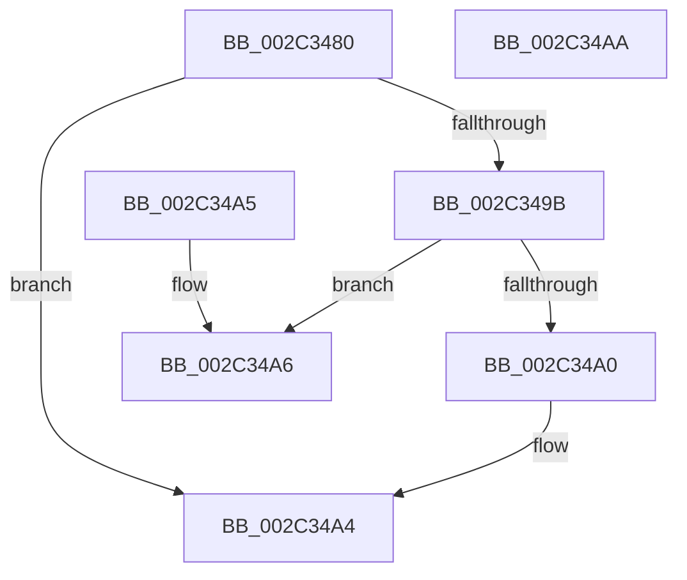

# MiMakePrototypePteVadLookup

- RVA: `0x002C3480`–`0x002C34AB` (길이 `43` bytes)
- VA: `0x00000001402C3480`
- 실행 섹션: `.text`
- PDB 이름 있음: `예`; PDB Function 태그: `아니요`
- unwind 정보 RVA: `0x000DB714`
- 디코드: `15`개 명령, `43/43` bytes 표시
- 미해석 바이트: `0` (있으면 어셈블리에 `.byte`로 보존)

> 이 문서는 커널 이미지의 기계어와 PDB 기호를 분석해 생성했습니다. 4번과 5번은 함수 원형과 자료형을 바이너리 사용 방식에서 추정한 C 해석이며 원본 소스 복구 결과는 아닙니다.

## 1. Dependencies

- 직접 호출 지점: **0**; 고유 호출 대상: **0**
- 직접 호출자로 확인된 함수: **7**
- RIP 상대 이미지 참조: **1**

### Outgoing calls
- 직접 디코드된 call 명령이 없습니다.

### Direct callers
- [MiBuildForkPte](../22/MiBuildForkPte_function_0022E32C.md) at `0x0022EF06`
- [MiSetReadOnlyOnSectionView](../29/MiSetReadOnlyOnSectionView_function_00294538.md) at `0x002948FC`
- [MiPteForTrimmedProto](../29/MiPteForTrimmedProto_function_0029496C.md) at `0x00294A3C`
- [MiSplitPrivatePage](../2A/MiSplitPrivatePage_function_002A6210.md) at `0x002A6600`
- [sub_002C3A7C](Unknown_function_002C3A7C.md) at `0x002C3E72`
- [sub_002C3A7C](Unknown_function_002C3A7C.md) at `0x002C40B8`
- [sub_0032DD4A](../32/Unknown_function_0032DD4A.md) at `0x0032DD77`
- [MiExpandSharedZeroCluster](../36/MiExpandSharedZeroCluster_function_0036F20C.md) at `0x0036F46C`

### Static image references
- `0x002C3482` → RVA `0x00E2DC80` (`.data`; read)

## 2. Other-region calls and transfers

- 다른 실행 섹션으로 향하는 call: **0**
- 별도 외부 분기/꼬리 이동을 확인하지 못했습니다.

## 3. Assembly (complete function range)

```asm
002C3480  8B C1                           mov eax, ecx
002C3482  48 8B 0D F7 A7 B6 00            mov rcx, qword ptr [rip + 0xb6a7f7]
002C3489  83 E0 1F                        and eax, 0x1f
002C348C  48 0D 20 00 00 F8               or rax, 0xfffffffff8000020
002C3492  48 C1 E0 05                     shl rax, 5
002C3496  48 85 C9                        test rcx, rcx
002C3499  74 09                           je 0x1402c34a4
002C349B  48 85 C8                        test rax, rcx
002C349E  74 06                           je 0x1402c34a6
002C34A0  48 83 C8 10                     or rax, 0x10
002C34A4  C3                              ret
002C34A5  CC                              int3
002C34A6  48 0B C1                        or rax, rcx
002C34A9  C3                              ret
002C34AA  CC                              int3
```

## 4. C-style interpretation (structured pseudocode)

```c
__int64 __fastcall MiMakePrototypePteVadLookup(int a1)
{
    __int64 result;

    result = (unsigned int)(((unsigned int)(a1)) & (31));
    result = (result) | (0xFFFFFFFFF8000020ULL);
    result = (result) << (5);
    if (*(unsigned __int64 *)(v_rip + 11970551) == 0) goto loc_002C34A4;
    if (((result) & (*(unsigned __int64 *)(v_rip + 11970551))) == 0) goto loc_002C34A6;
    result = (result) | (16);
loc_002C34A4:
    return result;
loc_002C34A6:
    result = (result) | (*(unsigned __int64 *)(v_rip + 11970551));
    return result;
}
```

## 5. (Beta) C Style

```c
int64_t MiMakePrototypePteVadLookup(int32_t Arg1)
{
    int64_t result;

    result = (uint32_t)(((uint32_t)(Arg1)) & (31));
    result = (result) | (0xFFFFFFFFF8000020ULL);
    result = (result) << (5);
    if (*(uint64_t *)(v_rip + 0xB6A7F7) == 0) goto loc_002C34A4;
    if (((result) & (*(uint64_t *)(v_rip + 0xB6A7F7))) == 0) goto loc_002C34A6;
    result = (result) | (16);
loc_002C34A4:
    return result;
loc_002C34A6:
    result = (result) | (*(uint64_t *)(v_rip + 0xB6A7F7));
    return result;
}
```

## 6. Execution-region graph

[열기: 2D/3D 그래프와 함수 탐색 컨트롤 패널](../../../control-panel.html?section=text&rva=0x002C3480&view=graph)

- 2D 그래프는 위에서 아래로 흐르고, 3D 그래프는 빈 공간을 드래그해 회전합니다. Shift+드래그는 이동, 휠은 확대·축소, 함수 노드 선택은 대상 보고서 이동입니다.

### Static fallback


