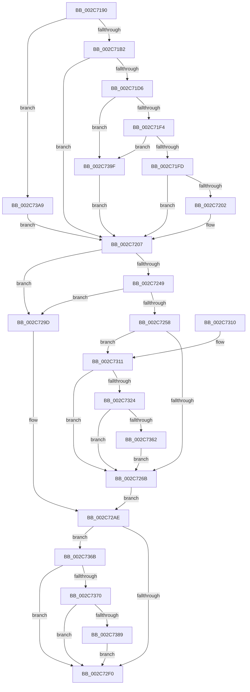

# MiMapFrame

- RVA: `0x002C7190`–`0x002C73B3` (길이 `547` bytes)
- VA: `0x00000001402C7190`
- 실행 섹션: `.text`
- PDB 이름 있음: `예`; PDB Function 태그: `아니요`
- unwind 정보 RVA: `0x0006ED90`
- 디코드: `124`개 명령, `547/547` bytes 표시
- 미해석 바이트: `0` (있으면 어셈블리에 `.byte`로 보존)

> 이 문서는 커널 이미지의 기계어와 PDB 기호를 분석해 생성했습니다. 4번과 5번은 함수 원형과 자료형을 바이너리 사용 방식에서 추정한 C 해석이며 원본 소스 복구 결과는 아닙니다.

## 1. Dependencies

- 직접 호출 지점: **2**; 고유 호출 대상: **2**
- 직접 호출자로 확인된 함수: **3**
- RIP 상대 이미지 참조: **4**

### Outgoing calls
- `0x002C7355` → [MiUserPdeOrAbove](MiUserPdeOrAbove_function_002C57F0.md) (function, `0x002C57F0`)
- `0x002C7395` → [MiCheckLinearProtectedPteAccessedBit](../29/MiCheckLinearProtectedPteAccessedBit_function_00292D80.md) (function, `0x00292D80`)

### Direct callers
- [MiMakePageAvoidRead](../2B/MiMakePageAvoidRead_function_002B7DE0.md) at `0x002B8064`
- [MmCopyToCachedPage](../34/MmCopyToCachedPage_function_00347B44.md) at `0x003481C1`
- [MiMapSystemCachePage](../4D/MiMapSystemCachePage_function_004D3588.md) at `0x004D3647`

### Static image references
- `0x002C71A2` → RVA `0x00E2DCE0` (`.data`; read)
- `0x002C7207` → RVA `0x00010990` (`.rdata`; read)
- `0x002C72AE` → RVA `0x00E2EE84` (`.data`; read)
- `0x002C72E5` → RVA `0x00FC6A88` (`ALMOSTRO`; read)

## 2. Other-region calls and transfers

- 다른 실행 섹션으로 향하는 call: **0**
- 별도 외부 분기/꼬리 이동을 확인하지 못했습니다.

## 3. Assembly (complete function range)

```asm
002C7190  48 89 5C 24 10                  mov qword ptr [rsp + 0x10], rbx
002C7195  48 89 6C 24 18                  mov qword ptr [rsp + 0x18], rbp
002C719A  56                              push rsi
002C719B  57                              push rdi
002C719C  41 56                           push r14
002C719E  48 83 EC 20                     sub rsp, 0x20
002C71A2  48 3B 15 37 6B B6 00            cmp rdx, qword ptr [rip + 0xb66b37]
002C71A9  48 8B F9                        mov rdi, rcx
002C71AC  0F 87 F7 01 00 00               ja 0x1402c73a9
002C71B2  48 8D 0C 52                     lea rcx, [rdx + rdx*2]
002C71B6  48 03 C9                        add rcx, rcx
002C71B9  48 B8 28 00 00 00 00 DE FF FF   movabs rax, 0xffffde0000000028
002C71C3  48 8B 04 C8                     mov rax, qword ptr [rax + rcx*8]
002C71C7  BB 04 00 00 00                  mov ebx, 4
002C71CC  48 C1 E8 36                     shr rax, 0x36
002C71D0  0F BA E0 00                     bt eax, 0
002C71D4  73 31                           jae 0x1402c7207
002C71D6  48 B8 20 00 00 00 00 DE FF FF   movabs rax, 0xffffde0000000020
002C71E0  8B 04 C8                        mov eax, dword ptr [rax + rcx*8]
002C71E3  C1 E8 10                        shr eax, 0x10
002C71E6  0F B6 C8                        movzx ecx, al
002C71E9  C1 E9 06                        shr ecx, 6
002C71EC  85 C9                           test ecx, ecx
002C71EE  0F 84 AB 01 00 00               je 0x1402c739f
002C71F4  83 F9 03                        cmp ecx, 3
002C71F7  0F 84 A2 01 00 00               je 0x1402c739f
002C71FD  83 F9 02                        cmp ecx, 2
002C7200  75 05                           jne 0x1402c7207
002C7202  BB 1C 00 00 00                  mov ebx, 0x1c
002C7207  48 8D 05 82 97 D4 FF            lea rax, [rip - 0x2b687e]
002C720E  49 BE 00 00 00 00 80 F6 FF FF   movabs r14, 0xfffff68000000000
002C7218  48 8B 1C D8                     mov rbx, qword ptr [rax + rbx*8]
002C721C  48 B8 7F 0E 00 00 00 00 F0 FF   movabs rax, 0xfff0000000000e7f
002C7226  48 23 D8                        and rbx, rax
002C7229  48 B8 FF FF FF FF FF 00 00 00   movabs rax, 0xffffffffff
002C7233  48 23 D0                        and rdx, rax
002C7236  48 C1 E2 0C                     shl rdx, 0xc
002C723A  48 0B DA                        or rbx, rdx
002C723D  48 83 CB 21                     or rbx, 0x21
002C7241  49 8B C6                        mov rax, r14
002C7244  48 3B F8                        cmp rdi, rax
002C7247  72 54                           jb 0x1402c729d
002C7249  48 B8 FF FF FF FF FF F6 FF FF   movabs rax, 0xfffff6ffffffffff
002C7253  48 3B F8                        cmp rdi, rax
002C7256  77 45                           ja 0x1402c729d
002C7258  48 B8 00 00 00 40 FB F6 FF FF   movabs rax, 0xfffff6fb40000000
002C7262  48 3B F8                        cmp rdi, rax
002C7265  0F 83 A6 00 00 00               jae 0x1402c7311
002C726B  48 8B F7                        mov rsi, rdi
002C726E  48 C1 E6 19                     shl rsi, 0x19
002C7272  49 8B EE                        mov rbp, r14
002C7275  48 C1 E5 19                     shl rbp, 0x19
002C7279  48 8B CE                        mov rcx, rsi
002C727C  48 2B CD                        sub rcx, rbp
002C727F  48 8B C3                        mov rax, rbx
002C7282  48 83 C8 04                     or rax, 4
002C7286  48 C1 F9 10                     sar rcx, 0x10
002C728A  48 BA FF FF FE FF FF 7F 00 00   movabs rdx, 0x7ffffffeffff
002C7294  48 3B CA                        cmp rcx, rdx
002C7297  48 0F 47 C3                     cmova rax, rbx
002C729B  EB 11                           jmp 0x1402c72ae
002C729D  48 8B F7                        mov rsi, rdi
002C72A0  48 8B C3                        mov rax, rbx
002C72A3  48 C1 E6 19                     shl rsi, 0x19
002C72A7  49 8B EE                        mov rbp, r14
002C72AA  48 C1 E5 19                     shl rbp, 0x19
002C72AE  0F B6 0D CF 7B B6 00            movzx ecx, byte ptr [rip + 0xb67bcf]
002C72B5  48 83 C8 42                     or rax, 0x42
002C72B9  48 C1 E1 08                     shl rcx, 8
002C72BD  48 8B D9                        mov rbx, rcx
002C72C0  48 33 D8                        xor rbx, rax
002C72C3  48 B8 FF FF FF FF FF FF FF FA   movabs rax, 0xfaffffffffffffff
002C72CD  48 0F BA F3 08                  btr rbx, 8
002C72D2  48 33 D9                        xor rbx, rcx
002C72D5  48 23 D8                        and rbx, rax
002C72D8  48 B8 00 00 00 00 00 00 00 0A   movabs rax, 0xa00000000000000
002C72E2  48 0B D8                        or rbx, rax
002C72E5  48 0F BA 25 9A F7 CF 00 24      bt qword ptr [rip + 0xcff79a], 0x24
002C72EE  72 7B                           jb 0x1402c736b
002C72F0  48 2B F5                        sub rsi, rbp
002C72F3  48 89 1F                        mov qword ptr [rdi], rbx
002C72F6  48 8B 5C 24 48                  mov rbx, qword ptr [rsp + 0x48]
002C72FB  48 8B 6C 24 50                  mov rbp, qword ptr [rsp + 0x50]
002C7300  48 C1 FE 10                     sar rsi, 0x10
002C7304  48 8B C6                        mov rax, rsi
002C7307  48 83 C4 20                     add rsp, 0x20
002C730B  41 5E                           pop r14
002C730D  5F                              pop rdi
002C730E  5E                              pop rsi
002C730F  C3                              ret
002C7310  CC                              int3
002C7311  48 B8 FF FF FF 7F FB F6 FF FF   movabs rax, 0xfffff6fb7fffffff
002C731B  48 3B F8                        cmp rdi, rax
002C731E  0F 87 47 FF FF FF               ja 0x1402c726b
002C7324  48 BA 68 DF BE 7D FB F6 FF FF   movabs rdx, 0xfffff6fb7dbedf68
002C732E  48 8B C3                        mov rax, rbx
002C7331  48 B9 FF FF FF FF FF FF FF 7F   movabs rcx, 0x7fffffffffffffff
002C733B  48 23 C1                        and rax, rcx
002C733E  48 B9 00 00 00 00 00 00 00 80   movabs rcx, 0x8000000000000000
002C7348  48 0B D9                        or rbx, rcx
002C734B  48 8B CF                        mov rcx, rdi
002C734E  48 3B FA                        cmp rdi, rdx
002C7351  48 0F 45 D8                     cmovne rbx, rax
002C7355  E8 96 E4 FF FF                  call 0x1402c57f0
002C735A  85 C0                           test eax, eax
002C735C  0F 84 09 FF FF FF               je 0x1402c726b
002C7362  48 83 CB 04                     or rbx, 4
002C7366  E9 00 FF FF FF                  jmp 0x1402c726b
002C736B  F6 C3 20                        test bl, 0x20
002C736E  75 80                           jne 0x1402c72f0
002C7370  49 8B CE                        mov rcx, r14
002C7373  48 B8 00 00 00 00 40 00 00 00   movabs rax, 0x4000000000
002C737D  48 03 C8                        add rcx, rax
002C7380  48 3B F9                        cmp rdi, rcx
002C7383  0F 82 67 FF FF FF               jb 0x1402c72f0
002C7389  41 B8 80 00 00 00               mov r8d, 0x80
002C738F  48 8B D3                        mov rdx, rbx
002C7392  48 8B CF                        mov rcx, rdi
002C7395  E8 E6 B9 FC FF                  call 0x140292d80
002C739A  E9 51 FF FF FF                  jmp 0x1402c72f0
002C739F  BB 0C 00 00 00                  mov ebx, 0xc
002C73A4  E9 5E FE FF FF                  jmp 0x1402c7207
002C73A9  BB 04 00 00 00                  mov ebx, 4
002C73AE  E9 54 FE FF FF                  jmp 0x1402c7207
```

## 4. C-style interpretation (structured pseudocode)

```c
__int64 __fastcall MiMapFrame(__int64 a1, __int64 a2)
{
    __int64 result;
    __int64 v_rbp;
    __int64 v_rbx;
    __int64 v_rsi;
    __int64 v_rsp;
    unsigned __int64 v_stack_p10;
    unsigned __int64 v_stack_p18;

    v_stack_p10 = v_rbx;
    v_stack_p18 = v_rbp;
    v_rsp = (v_rsp) - (32);
    if (a2 > (*(unsigned __int64 *)(v_rip + 11954999))) goto loc_002C73A9;
    a1 = (a2 + a2 * 2) + (a2 + a2 * 2);
    result = (*(unsigned __int64 *)(result + a1 * 8)) >> (54);
    if (condition_is_above_or_equal) goto loc_002C7207;
    result = (unsigned int)(((unsigned int)(*(unsigned int *)(result + a1 * 8))) >> (16));
    a1 = (unsigned int)(((unsigned __int8)(result)) >> (6));
    if ((unsigned int)(a1) == 0) goto loc_002C739F;
    if (((unsigned int)(a1)) == 3) goto loc_002C739F;
    v_rbx = 4;
    if (((unsigned int)(a1)) == 2) {
        v_rbx = 28;
    }
    v_rbx = (*(unsigned __int64 *)(v_rip - 2844798 + v_rbx * 8)) & (v_rip - 2844798);
    a2 = (a2) & (v_rip - 2844798);
    a2 = (a2) << (12);
    v_rbx = (v_rbx) | (a2);
    v_rbx = (v_rbx) | (33);
    if (a1 < v_r14) goto loc_002C729D;
    if (a1 > v_r14) goto loc_002C729D;
    if (a1 >= v_r14) goto loc_002C7311;
loc_002C726B:
    v_rsi = (a1) << (25);
    v_rbp = (v_r14) << (25);
    a1 = (v_rsi) - (v_rbp);
    result = (v_rbx) | (4);
    a1 = (a1) >> (16);
    if (a1 > a2) { result = v_rbx; }
    goto loc_002C72AE;
loc_002C729D:
    v_rsi = (a1) << (25);
    v_rbp = (v_r14) << (25);
loc_002C72AE:
    result = (v_rbx) | (66);
    a1 = (*(unsigned __int8 *)(v_rip + 11959247)) << (8);
    v_rbx = (a1) ^ (result);
    v_rbx = (v_rbx) ^ (a1);
    v_rbx = (v_rbx) & (result);
    v_rbx = (v_rbx) | (result);
    if (condition_is_below) goto loc_002C736B;
loc_002C72F0:
    v_rsi = (v_rsi) - (v_rbp);
    *(unsigned __int64 *)(a1) = v_rbx;
    v_rsi = (v_rsi) >> (16);
    v_rsp = (v_rsp) + (32);
    return v_rsi;
loc_002C7311:
    if (a1 > v_rsi) goto loc_002C726B;
    result = (v_stack_p10) & (a1);
    v_rbx = (v_stack_p10) | (a1);
    if (a1 != a2) { v_rbx = result; }
    result = MiUserPdeOrAbove(a1, a2, a3, a4);
    if ((unsigned int)(result) == 0) goto loc_002C726B;
    v_rbx = (v_rbx) | (4);
    goto loc_002C726B;
loc_002C736B:
    if ((((unsigned __int8)(v_rbx)) & (32)) != 0) goto loc_002C72F0;
    a1 = (v_r14) + (result);
    if (a1 < a1) goto loc_002C72F0;
    result = MiCheckLinearProtectedPteAccessedBit(a1, v_rbx, 128, a4);
    goto loc_002C72F0;
loc_002C739F:
    goto loc_002C7207;
loc_002C73A9:
    goto loc_002C7207;
}
```

## 5. (Beta) C Style

```c
int64_t MiMapFrame(int64_t Arg1, int64_t Arg2)
{
    int64_t result;
    int64_t local_rbp;
    int64_t local_rbx;
    int64_t local_rsi;
    int64_t local_rsp;
    uint64_t v_stack_p10;
    uint64_t v_stack_p18;

    v_stack_p10 = local_rbx;
    v_stack_p18 = local_rbp;
    local_rsp = (local_rsp) - (32);
    if (Arg2 > (*(uint64_t *)(v_rip + 0xB66B37))) goto loc_002C73A9;
    Arg1 = (Arg2 + Arg2 * 2) + (Arg2 + Arg2 * 2);
    result = (*(uint64_t *)(result + Arg1 * 8)) >> (54);
    if (condition_is_above_or_equal) goto loc_002C7207;
    result = (uint32_t)(((uint32_t)(*(uint32_t *)(result + Arg1 * 8))) >> (16));
    Arg1 = (uint32_t)(((uint8_t)(result)) >> (6));
    if ((uint32_t)(Arg1) == 0) goto loc_002C739F;
    if (((uint32_t)(Arg1)) == 3) goto loc_002C739F;
    local_rbx = 4;
    if (((uint32_t)(Arg1)) == 2) {
        local_rbx = 28;
    }
    local_rbx = (*(uint64_t *)(v_rip - 0x2B687E + local_rbx * 8)) & (v_rip - 2844798);
    Arg2 = (Arg2) & (v_rip - 2844798);
    Arg2 = (Arg2) << (12);
    local_rbx = (local_rbx) | (Arg2);
    local_rbx = (local_rbx) | (33);
    if (Arg1 < local_r14) goto loc_002C729D;
    if (Arg1 > local_r14) goto loc_002C729D;
    if (Arg1 >= local_r14) goto loc_002C7311;
loc_002C726B:
    local_rsi = (Arg1) << (25);
    local_rbp = (local_r14) << (25);
    Arg1 = (local_rsi) - (local_rbp);
    result = (local_rbx) | (4);
    Arg1 = (Arg1) >> (16);
    if (Arg1 > Arg2) { result = local_rbx; }
    goto loc_002C72AE;
loc_002C729D:
    local_rsi = (Arg1) << (25);
    local_rbp = (local_r14) << (25);
loc_002C72AE:
    result = (local_rbx) | (66);
    Arg1 = (*(uint8_t *)(v_rip + 0xB67BCF)) << (8);
    local_rbx = (Arg1) ^ (result);
    local_rbx = (local_rbx) ^ (Arg1);
    local_rbx = (local_rbx) & (result);
    local_rbx = (local_rbx) | (result);
    if (condition_is_below) goto loc_002C736B;
loc_002C72F0:
    local_rsi = (local_rsi) - (local_rbp);
    *(uint64_t *)(Arg1) = local_rbx;
    local_rsi = (local_rsi) >> (16);
    local_rsp = (local_rsp) + (32);
    return local_rsi;
loc_002C7311:
    if (Arg1 > local_rsi) goto loc_002C726B;
    result = (v_stack_p10) & (Arg1);
    local_rbx = (v_stack_p10) | (Arg1);
    if (Arg1 != Arg2) { local_rbx = result; }
    result = MiUserPdeOrAbove(Arg1, Arg2, a3, a4);
    if ((uint32_t)(result) == 0) goto loc_002C726B;
    local_rbx = (local_rbx) | (4);
    goto loc_002C726B;
loc_002C736B:
    if ((((uint8_t)(local_rbx)) & (32)) != 0) goto loc_002C72F0;
    Arg1 = (local_r14) + (result);
    if (Arg1 < Arg1) goto loc_002C72F0;
    result = MiCheckLinearProtectedPteAccessedBit(Arg1, local_rbx, 128, a4);
    goto loc_002C72F0;
loc_002C739F:
    goto loc_002C7207;
loc_002C73A9:
    goto loc_002C7207;
}
```

## 6. Execution-region graph

[열기: 2D/3D 그래프와 함수 탐색 컨트롤 패널](../../../control-panel.html?section=text&rva=0x002C7190&view=graph)

- 2D 그래프는 위에서 아래로 흐르고, 3D 그래프는 빈 공간을 드래그해 회전합니다. Shift+드래그는 이동, 휠은 확대·축소, 함수 노드 선택은 대상 보고서 이동입니다.

### Static fallback


