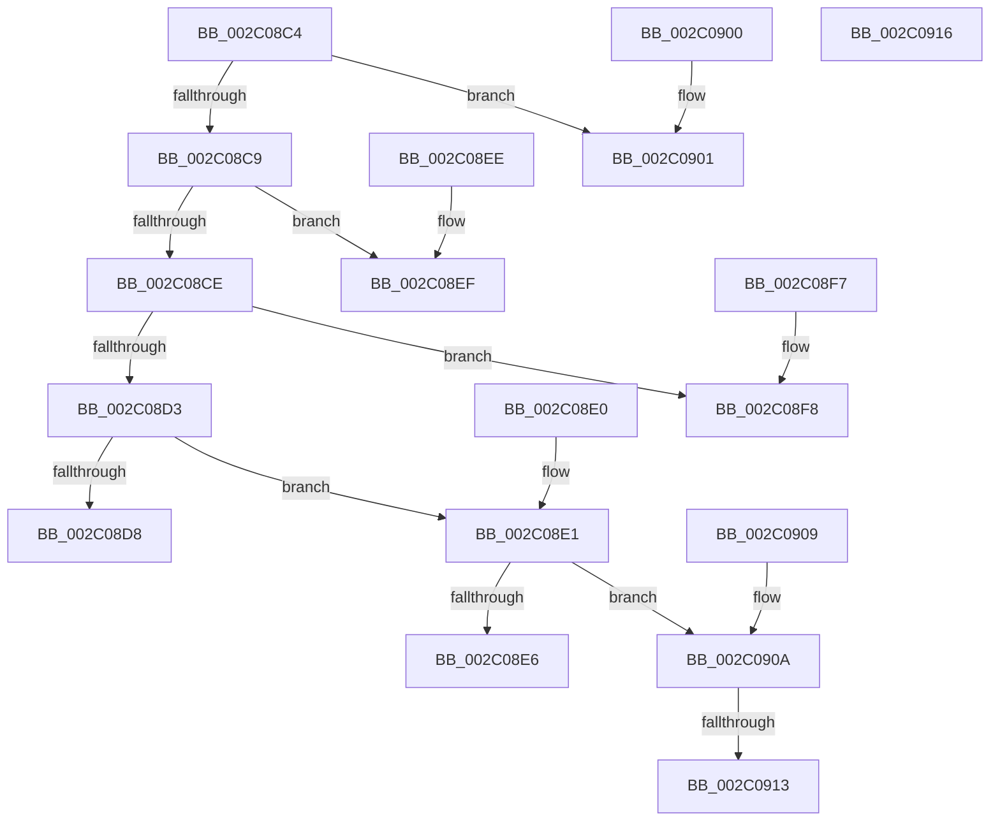

# MiMapWorkingSetTypeToVm

- RVA: `0x002C08C4`–`0x002C0917` (길이 `83` bytes)
- VA: `0x00000001402C08C4`
- 실행 섹션: `.text`
- PDB 이름 있음: `예`; PDB Function 태그: `예`
- unwind 정보 RVA: `0x000DB714`
- 디코드: `30`개 명령, `83/83` bytes 표시
- 미해석 바이트: `0` (있으면 어셈블리에 `.byte`로 보존)

> 이 문서는 커널 이미지의 기계어와 PDB 기호를 분석해 생성했습니다. 4번과 5번은 함수 원형과 자료형을 바이너리 사용 방식에서 추정한 C 해석이며 원본 소스 복구 결과는 아닙니다.

## 1. Dependencies

- 직접 호출 지점: **0**; 고유 호출 대상: **0**
- 직접 호출자로 확인된 함수: **3**
- RIP 상대 이미지 참조: **5**

### Outgoing calls
- 직접 디코드된 call 명령이 없습니다.

### Direct callers
- [MmQuerySystemWorkingSetInformation](MmQuerySystemWorkingSetInformation_function_002C0710.md) at `0x002C0748`
- [MiPfCompleteInPageSupport](../36/MiPfCompleteInPageSupport_function_0036D738.md) at `0x0036D823`
- [MmAdjustWorkingSetSizeEx](../47/MmAdjustWorkingSetSizeEx_function_0047D8D4.md) at `0x0047DCB2`

### Static image references
- `0x002C08D8` → RVA `0x00E37F80` (`.data`; read)
- `0x002C08E6` → RVA `0x00E38340` (`.data`; read)
- `0x002C08EF` → RVA `0x00E380C0` (`.data`; read)
- `0x002C08F8` → RVA `0x00E37E40` (`.data`; read)
- `0x002C0901` → RVA `0x00E3D680` (`.data`; read)

## 2. Other-region calls and transfers

- 다른 실행 섹션으로 향하는 call: **0**
- call이 아닌 외부 분기/꼬리 이동: **1**
  - `0x002C090D` → `0x006DC17C` (`tail-transfer`)

## 3. Assembly (complete function range)

```asm
002C08C4  83 E9 01                        sub ecx, 1
002C08C7  74 38                           je 0x1402c0901
002C08C9  83 E9 01                        sub ecx, 1
002C08CC  74 21                           je 0x1402c08ef
002C08CE  83 E9 01                        sub ecx, 1
002C08D1  74 25                           je 0x1402c08f8
002C08D3  83 E9 01                        sub ecx, 1
002C08D6  75 09                           jne 0x1402c08e1
002C08D8  48 8D 05 A1 76 B7 00            lea rax, [rip + 0xb776a1]
002C08DF  C3                              ret
002C08E0  CC                              int3
002C08E1  83 E9 02                        sub ecx, 2
002C08E4  75 24                           jne 0x1402c090a
002C08E6  48 8D 05 53 7A B7 00            lea rax, [rip + 0xb77a53]
002C08ED  C3                              ret
002C08EE  CC                              int3
002C08EF  48 8D 05 CA 77 B7 00            lea rax, [rip + 0xb777ca]
002C08F6  C3                              ret
002C08F7  CC                              int3
002C08F8  48 8D 05 41 75 B7 00            lea rax, [rip + 0xb77541]
002C08FF  C3                              ret
002C0900  CC                              int3
002C0901  48 8D 05 78 CD B7 00            lea rax, [rip + 0xb7cd78]
002C0908  C3                              ret
002C0909  CC                              int3
002C090A  83 F9 03                        cmp ecx, 3
002C090D  0F 84 69 B8 41 00               je 0x1406dc17c
002C0913  33 C0                           xor eax, eax
002C0915  C3                              ret
002C0916  CC                              int3
```

## 4. C-style interpretation (structured pseudocode)

```c
__int64 __fastcall MiMapWorkingSetTypeToVm(int a1)
{
    __int64 result;

    a1 = (unsigned int)((a1) - (1));
    if (condition_is_equal) goto loc_002C0901;
    a1 = (unsigned int)((a1) - (1));
    if (condition_is_equal) goto loc_002C08EF;
    a1 = (unsigned int)((a1) - (1));
    if (condition_is_equal) goto loc_002C08F8;
    a1 = (unsigned int)((a1) - (1));
    if (condition_is_not_equal) goto loc_002C08E1;
    return v_rip + 12023457;
loc_002C08E1:
    a1 = (unsigned int)((a1) - (2));
    if (condition_is_not_equal) goto loc_002C090A;
    return v_rip + 12024403;
loc_002C08EF:
    return v_rip + 12023754;
loc_002C08F8:
    return v_rip + 12023105;
loc_002C0901:
    return v_rip + 12045688;
loc_002C090A:
    result = 0;
    return result;
}
```

## 5. (Beta) C Style

```c
int64_t MiMapWorkingSetTypeToVm(int32_t Arg1)
{
    int64_t result;

    Arg1 = (uint32_t)((Arg1) - (1));
    if (condition_is_equal) goto loc_002C0901;
    Arg1 = (uint32_t)((Arg1) - (1));
    if (condition_is_equal) goto loc_002C08EF;
    Arg1 = (uint32_t)((Arg1) - (1));
    if (condition_is_equal) goto loc_002C08F8;
    Arg1 = (uint32_t)((Arg1) - (1));
    if (condition_is_not_equal) goto loc_002C08E1;
    return v_rip + 12023457;
loc_002C08E1:
    Arg1 = (uint32_t)((Arg1) - (2));
    if (condition_is_not_equal) goto loc_002C090A;
    return v_rip + 12024403;
loc_002C08EF:
    return v_rip + 12023754;
loc_002C08F8:
    return v_rip + 12023105;
loc_002C0901:
    return v_rip + 12045688;
loc_002C090A:
    result = 0;
    return result;
}
```

## 6. Execution-region graph

[열기: 2D/3D 그래프와 함수 탐색 컨트롤 패널](../../../control-panel.html?section=text&rva=0x002C08C4&view=graph)

- 2D 그래프는 위에서 아래로 흐르고, 3D 그래프는 빈 공간을 드래그해 회전합니다. Shift+드래그는 이동, 휠은 확대·축소, 함수 노드 선택은 대상 보고서 이동입니다.

### Static fallback


