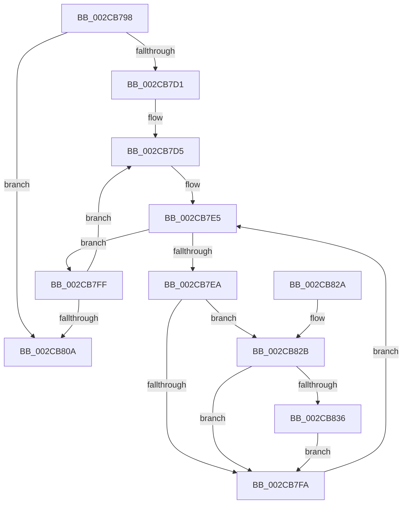

# MiMoveZeroThreadsToOtherCores

- RVA: `0x002CB798`–`0x002CB84C` (길이 `180` bytes)
- VA: `0x00000001402CB798`
- 실행 섹션: `.text`
- PDB 이름 있음: `예`; PDB Function 태그: `아니요`
- unwind 정보 RVA: `0x0006F2E8`
- 디코드: `55`개 명령, `180/180` bytes 표시
- 미해석 바이트: `0` (있으면 어셈블리에 `.byte`로 보존)

> 이 문서는 커널 이미지의 기계어와 PDB 기호를 분석해 생성했습니다. 4번과 5번은 함수 원형과 자료형을 바이너리 사용 방식에서 추정한 C 해석이며 원본 소스 복구 결과는 아닙니다.

## 1. Dependencies

- 직접 호출 지점: **3**; 고유 호출 대상: **3**
- 직접 호출자로 확인된 함수: **1**
- RIP 상대 이미지 참조: **0**

### Outgoing calls
- `0x002CB7BA` → [MiEngineAffinity](MiEngineAffinity_function_002CCB64.md) (function, `0x002CCB64`)
- `0x002CB7DA` → [MiGetIdleProcessorCount](MiGetIdleProcessorCount_function_002CB694.md) (function, `0x002CB694`)
- `0x002CB7F1` → [MiZeroThreadContending](MiZeroThreadContending_function_002CB854.md) (function, `0x002CB854`)

### Direct callers
- [MiReduceZeroingThreads](MiReduceZeroingThreads_function_002CACF8.md) at `0x002CAD9F`

### Static image references
- 디코드된 RIP-relative 메모리 참조가 없습니다.

## 2. Other-region calls and transfers

- 다른 실행 섹션으로 향하는 call: **0**
- 별도 외부 분기/꼬리 이동을 확인하지 못했습니다.

## 3. Assembly (complete function range)

```asm
002CB798  48 89 5C 24 08                  mov qword ptr [rsp + 8], rbx
002CB79D  48 89 6C 24 10                  mov qword ptr [rsp + 0x10], rbp
002CB7A2  48 89 74 24 18                  mov qword ptr [rsp + 0x18], rsi
002CB7A7  57                              push rdi
002CB7A8  41 54                           push r12
002CB7AA  41 55                           push r13
002CB7AC  41 56                           push r14
002CB7AE  41 57                           push r15
002CB7B0  48 83 EC 20                     sub rsp, 0x20
002CB7B4  48 8B D9                        mov rbx, rcx
002CB7B7  45 33 FF                        xor r15d, r15d
002CB7BA  E8 A5 13 00 00                  call 0x1402ccb64
002CB7BF  48 8B BB 88 00 00 00            mov rdi, qword ptr [rbx + 0x88]
002CB7C6  33 ED                           xor ebp, ebp
002CB7C8  44 8B 60 08                     mov r12d, dword ptr [rax + 8]
002CB7CC  45 85 E4                        test r12d, r12d
002CB7CF  74 39                           je 0x1402cb80a
002CB7D1  48 83 C7 10                     add rdi, 0x10
002CB7D5  8B D5                           mov edx, ebp
002CB7D7  48 8B CB                        mov rcx, rbx
002CB7DA  E8 B5 FE FF FF                  call 0x1402cb694
002CB7DF  48 8B 37                        mov rsi, qword ptr [rdi]
002CB7E2  44 8B F0                        mov r14d, eax
002CB7E5  48 3B F7                        cmp rsi, rdi
002CB7E8  74 15                           je 0x1402cb7ff
002CB7EA  48 8D 8E 60 FE FF FF            lea rcx, [rsi - 0x1a0]
002CB7F1  E8 5E 00 00 00                  call 0x1402cb854
002CB7F6  85 C0                           test eax, eax
002CB7F8  75 31                           jne 0x1402cb82b
002CB7FA  48 8B 36                        mov rsi, qword ptr [rsi]
002CB7FD  EB E6                           jmp 0x1402cb7e5
002CB7FF  48 83 C7 30                     add rdi, 0x30
002CB803  FF C5                           inc ebp
002CB805  41 3B EC                        cmp ebp, r12d
002CB808  72 CB                           jb 0x1402cb7d5
002CB80A  48 8B 5C 24 50                  mov rbx, qword ptr [rsp + 0x50]
002CB80F  41 8B C7                        mov eax, r15d
002CB812  48 8B 6C 24 58                  mov rbp, qword ptr [rsp + 0x58]
002CB817  48 8B 74 24 60                  mov rsi, qword ptr [rsp + 0x60]
002CB81C  48 83 C4 20                     add rsp, 0x20
002CB820  41 5F                           pop r15
002CB822  41 5E                           pop r14
002CB824  41 5D                           pop r13
002CB826  41 5C                           pop r12
002CB828  5F                              pop rdi
002CB829  C3                              ret
002CB82A  CC                              int3
002CB82B  FF 83 E0 00 00 00               inc dword ptr [rbx + 0xe0]
002CB831  45 85 F6                        test r14d, r14d
002CB834  74 C4                           je 0x1402cb7fa
002CB836  FF 83 E8 00 00 00               inc dword ptr [rbx + 0xe8]
002CB83C  41 FF CE                        dec r14d
002CB83F  48 83 66 D0 00                  and qword ptr [rsi - 0x30], 0
002CB844  41 BF 01 00 00 00               mov r15d, 1
002CB84A  EB AE                           jmp 0x1402cb7fa
```

## 4. C-style interpretation (structured pseudocode)

```c
__int64 __fastcall MiMoveZeroThreadsToOtherCores(__int64 a1)
{
    __int64 result;
    __int64 v_r14;
    __int64 v_r15;
    __int64 v_rbp;
    __int64 v_rdi;
    __int64 v_rsp;
    unsigned __int64 v_stack_p10;
    unsigned __int64 v_stack_p18;
    unsigned __int64 v_stack_p8;

    v_stack_p8 = v_rbx;
    v_stack_p10 = v_rbp;
    v_stack_p18 = v_rsi;
    v_rsp = (v_rsp) - (32);
    v_r15 = 0;
    result = MiEngineAffinity(a1, a2, a3, a4);
    v_rbp = 0;
    if ((unsigned int)((unsigned int)(*(unsigned int *)(result + 8))) == 0) goto loc_002CB80A;
    v_rdi = (*(unsigned __int64 *)(a1 + 136)) + (16);
loc_002CB7D5:
    result = MiGetIdleProcessorCount(a1, 0, a3, a4);
loc_002CB7E5:
    if ((*(unsigned __int64 *)(v_rdi)) == v_rdi) goto loc_002CB7FF;
    result = MiZeroThreadContending(*(unsigned __int64 *)(v_rdi) - 416, 0, a3, a4);
    if ((unsigned int)(result) != 0) goto loc_002CB82B;
loc_002CB7FA:
    goto loc_002CB7E5;
loc_002CB7FF:
    v_rdi = (v_rdi) + (48);
    v_rbp = (unsigned int)((v_rbp) + 1);
    if (((unsigned int)(v_rbp)) < ((unsigned int)((unsigned int)(*(unsigned int *)(result + 8))))) goto loc_002CB7D5;
loc_002CB80A:
    v_rsp = (v_rsp) + (32);
    return 0;
loc_002CB82B:
    if ((unsigned int)((unsigned int)((unsigned int)(result))) == 0) goto loc_002CB7FA;
    v_r14 = (unsigned int)(((unsigned int)((unsigned int)(result))) - 1);
    goto loc_002CB7FA;
}
```

## 5. (Beta) C Style

```c
int64_t MiMoveZeroThreadsToOtherCores(void *Arg1)
{
    uint8_t *arg1 = (uint8_t *)Arg1;

    int64_t result;
    int64_t local_r14;
    int64_t local_r15;
    int64_t local_rbp;
    int64_t local_rdi;
    int64_t local_rsp;
    uint64_t v_stack_p10;
    uint64_t v_stack_p18;
    uint64_t v_stack_p8;

    v_stack_p8 = local_rbx;
    v_stack_p10 = local_rbp;
    v_stack_p18 = local_rsi;
    local_rsp = (local_rsp) - (32);
    local_r15 = 0;
    result = MiEngineAffinity(Arg1, a2, a3, a4);
    local_rbp = 0;
    if ((uint32_t)((uint32_t)(*(uint32_t *)(result + 0x8))) == 0) goto loc_002CB80A;
    local_rdi = (*(uint64_t *)(arg1 + 0x88)) + (16);
loc_002CB7D5:
    result = MiGetIdleProcessorCount(Arg1, 0, a3, a4);
loc_002CB7E5:
    if ((*(uint64_t *)(local_rdi)) == local_rdi) goto loc_002CB7FF;
    result = MiZeroThreadContending(*(uint64_t *)(local_rdi) - 416, 0, a3, a4);
    if ((uint32_t)(result) != 0) goto loc_002CB82B;
loc_002CB7FA:
    goto loc_002CB7E5;
loc_002CB7FF:
    local_rdi = (local_rdi) + (48);
    local_rbp = (uint32_t)((local_rbp) + 1);
    if (((uint32_t)(local_rbp)) < ((uint32_t)((uint32_t)(*(uint32_t *)(result + 0x8))))) goto loc_002CB7D5;
loc_002CB80A:
    local_rsp = (local_rsp) + (32);
    return 0;
loc_002CB82B:
    if ((uint32_t)((uint32_t)((uint32_t)(result))) == 0) goto loc_002CB7FA;
    local_r14 = (uint32_t)(((uint32_t)((uint32_t)(result))) - 1);
    goto loc_002CB7FA;
}
```

### 관측된 메모리 오프셋

구조체 형식이 확인되지 않은 접근은 인자 기준의 오프셋으로만 기록했습니다.

| 기준 인자 | 오프셋 표현 | 폭 (bit) | 접근 |
|---|---:|---:|---|
| `Arg1` | `+ 0x88` | `64` | `R` |
| `Arg1` | `+ 0xE0` | `32` | `R/W` |
| `Arg1` | `+ 0xE8` | `32` | `R/W` |

## 6. Execution-region graph

[열기: 2D/3D 그래프와 함수 탐색 컨트롤 패널](../../../control-panel.html?section=text&rva=0x002CB798&view=graph)

- 2D 그래프는 위에서 아래로 흐르고, 3D 그래프는 빈 공간을 드래그해 회전합니다. Shift+드래그는 이동, 휠은 확대·축소, 함수 노드 선택은 대상 보고서 이동입니다.

### Static fallback


