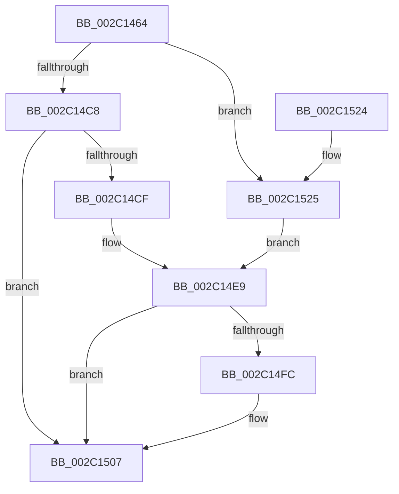

# MiOutSwapWorkingSet

- RVA: `0x002C1464`–`0x002C152B` (길이 `199` bytes)
- VA: `0x00000001402C1464`
- 실행 섹션: `.text`
- PDB 이름 있음: `예`; PDB Function 태그: `아니요`
- unwind 정보 RVA: `0x0006E704`
- 디코드: `53`개 명령, `199/199` bytes 표시
- 미해석 바이트: `0` (있으면 어셈블리에 `.byte`로 보존)

> 이 문서는 커널 이미지의 기계어와 PDB 기호를 분석해 생성했습니다. 4번과 5번은 함수 원형과 자료형을 바이너리 사용 방식에서 추정한 C 해석이며 원본 소스 복구 결과는 아닙니다.

## 1. Dependencies

- 직접 호출 지점: **4**; 고유 호출 대상: **4**
- 직접 호출자로 확인된 함수: **3**
- RIP 상대 이미지 참조: **1**

### Outgoing calls
- `0x002C149B` → [memset](../6C/memset_function_006C6C40.md) (function, `0x006C6C40`)
- `0x002C14E1` → [MiLockWorkingSetExclusive](../32/MiLockWorkingSetExclusive_function_003238A0.md) (function, `0x003238A0`)
- `0x002C14ED` → [MiWalkPageTables](MiWalkPageTables_function_002C2710.md) (function, `0x002C2710`)
- `0x002C1502` → [MiUnlockWorkingSetExclusive](../27/MiUnlockWorkingSetExclusive_function_0027EC70.md) (function, `0x0027EC70`)

### Direct callers
- [MiOutSwapKernelStackPage](../2A/MiOutSwapKernelStackPage_function_002A29BC.md) at `0x002A2A6C`
- [MmOutSwapWorkingSet](../2A/MmOutSwapWorkingSet_function_002A6BC8.md) at `0x002A6E9C`
- [MmOutSwapVirtualAddresses](../2A/MmOutSwapVirtualAddresses_function_002A8C30.md) at `0x002A8E7F`

### Static image references
- `0x002C14A8` → RVA `0x00372190` (`MiOutSwapWorkingSetPte`; read)

## 2. Other-region calls and transfers

- 다른 실행 섹션으로 향하는 call: **0**
- 별도 외부 분기/꼬리 이동을 확인하지 못했습니다.

## 3. Assembly (complete function range)

```asm
002C1464  48 8B C4                        mov rax, rsp
002C1467  48 89 58 08                     mov qword ptr [rax + 8], rbx
002C146B  48 89 70 10                     mov qword ptr [rax + 0x10], rsi
002C146F  48 89 78 18                     mov qword ptr [rax + 0x18], rdi
002C1473  4C 89 70 20                     mov qword ptr [rax + 0x20], r14
002C1477  55                              push rbp
002C1478  48 8D 68 A9                     lea rbp, [rax - 0x57]
002C147C  48 81 EC E0 00 00 00            sub rsp, 0xe0
002C1483  4D 8B F0                        mov r14, r8
002C1486  48 8B FA                        mov rdi, rdx
002C1489  48 8B D9                        mov rbx, rcx
002C148C  33 D2                           xor edx, edx
002C148E  41 B8 C0 00 00 00               mov r8d, 0xc0
002C1494  48 8D 4D 8F                     lea rcx, [rbp - 0x71]
002C1498  49 8B F1                        mov rsi, r9
002C149B  E8 A0 57 40 00                  call 0x1406c6c40
002C14A0  48 8B 45 7F                     mov rax, qword ptr [rbp + 0x7f]
002C14A4  48 89 45 47                     mov qword ptr [rbp + 0x47], rax
002C14A8  48 8D 05 E1 0C 0B 00            lea rax, [rip + 0xb0ce1]
002C14AF  48 89 45 37                     mov qword ptr [rbp + 0x37], rax
002C14B3  8B 83 B8 00 00 00               mov eax, dword ptr [rbx + 0xb8]
002C14B9  48 89 5D AF                     mov qword ptr [rbp - 0x51], rbx
002C14BD  C7 45 8F 81 00 00 00            mov dword ptr [rbp - 0x71], 0x81
002C14C4  A8 0F                           test al, 0xf
002C14C6  75 5D                           jne 0x1402c1525
002C14C8  8B 47 30                        mov eax, dword ptr [rdi + 0x30]
002C14CB  A8 04                           test al, 4
002C14CD  75 38                           jne 0x1402c1507
002C14CF  48 8B CB                        mov rcx, rbx
002C14D2  C7 45 8F 83 00 00 00            mov dword ptr [rbp - 0x71], 0x83
002C14D9  4C 89 75 B7                     mov qword ptr [rbp - 0x49], r14
002C14DD  48 89 75 BF                     mov qword ptr [rbp - 0x41], rsi
002C14E1  E8 BA 23 06 00                  call 0x1403238a0
002C14E6  88 45 98                        mov byte ptr [rbp - 0x68], al
002C14E9  48 8D 4D 8F                     lea rcx, [rbp - 0x71]
002C14ED  E8 1E 12 00 00                  call 0x1402c2710
002C14F2  8B 83 B8 00 00 00               mov eax, dword ptr [rbx + 0xb8]
002C14F8  A8 0F                           test al, 0xf
002C14FA  75 0B                           jne 0x1402c1507
002C14FC  8A 55 98                        mov dl, byte ptr [rbp - 0x68]
002C14FF  48 8B CB                        mov rcx, rbx
002C1502  E8 69 D7 FB FF                  call 0x14027ec70
002C1507  4C 8D 9C 24 E0 00 00 00         lea r11, [rsp + 0xe0]
002C150F  49 8B 5B 10                     mov rbx, qword ptr [r11 + 0x10]
002C1513  49 8B 73 18                     mov rsi, qword ptr [r11 + 0x18]
002C1517  49 8B 7B 20                     mov rdi, qword ptr [r11 + 0x20]
002C151B  4D 8B 73 28                     mov r14, qword ptr [r11 + 0x28]
002C151F  49 8B E3                        mov rsp, r11
002C1522  5D                              pop rbp
002C1523  C3                              ret
002C1524  CC                              int3
002C1525  C6 45 98 11                     mov byte ptr [rbp - 0x68], 0x11
002C1529  EB BE                           jmp 0x1402c14e9
```

## 4. C-style interpretation (structured pseudocode)

```c
__int64 __fastcall MiOutSwapWorkingSet(__int64 a1, __int64 a2, __int64 a3, __int64 a4)
{
    __int64 result;
    __int64 v_rsp;
    unsigned __int64 v_stack_m8;

    *(unsigned __int64 *)(v_rsp + 8) = v_rbx;
    *(unsigned __int64 *)(v_rsp + 16) = v_rsi;
    *(unsigned __int64 *)(v_rsp + 24) = v_rdi;
    *(unsigned __int64 *)(v_rsp + 32) = v_r14;
    v_rsp = (v_rsp) - (224);
    a2 = 0;
    result = memset(v_rsp - 87 - 113, a2, 192, a4);
    *(unsigned __int64 *)(v_rsp - 87 + 71) = *(unsigned __int64 *)(v_rsp - 87 + 127);
    *(unsigned __int64 *)(v_rsp - 87 + 55) = v_rip + 724193;
    *(unsigned __int64 *)(v_rsp - 87 - 81) = a1;
    *(unsigned int *)(v_rsp - 87 - 113) = 129;
    if ((((unsigned __int8)((unsigned int)(*(unsigned int *)(a1 + 184)))) & (15)) != 0) goto loc_002C1525;
    if ((((unsigned __int8)((unsigned int)(*(unsigned int *)(a2 + 48)))) & (4)) != 0) goto loc_002C1507;
    *(unsigned int *)(v_rsp - 87 - 113) = 131;
    *(unsigned __int64 *)(v_rsp - 87 - 73) = a3;
    *(unsigned __int64 *)(v_rsp - 87 - 65) = a4;
    result = MiLockWorkingSetExclusive(a1, a2, 192, a4);
    *(unsigned __int8 *)(v_rsp - 87 - 104) = (unsigned __int8)(result);
loc_002C14E9:
    result = MiWalkPageTables(v_rsp - 87 - 113, a2, 192, a4);
    result = (unsigned int)(*(unsigned int *)(a1 + 184));
    if ((((unsigned __int8)((unsigned int)(*(unsigned int *)(a1 + 184)))) & (15)) == 0) {
        a2 = *(unsigned __int8 *)(v_rsp - 87 - 104);
        a1 = a1;
        result = MiUnlockWorkingSetExclusive(a1, a2, 192, a4);
    }
    return result;
loc_002C1525:
    *(unsigned __int8 *)(v_rsp - 87 - 104) = 17;
    goto loc_002C14E9;
}
```

## 5. (Beta) C Style

```c
int64_t MiOutSwapWorkingSet(void *Arg1, void *Arg2, int64_t Arg3, int64_t Arg4)
{
    uint8_t *arg1 = (uint8_t *)Arg1;
    uint8_t *arg2 = (uint8_t *)Arg2;

    int64_t result;
    int64_t local_rsp;
    uint64_t v_stack_m8;

    *(uint64_t *)(local_rsp + 0x8) = local_rbx;
    *(uint64_t *)(local_rsp + 0x10) = local_rsi;
    *(uint64_t *)(local_rsp + 0x18) = local_rdi;
    *(uint64_t *)(local_rsp + 0x20) = local_r14;
    local_rsp = (local_rsp) - (224);
    Arg2 = 0;
    result = memset(local_rsp - 87 - 113, Arg2, 192, Arg4);
    *(uint64_t *)(local_rsp - 0x57 + 0x47) = *(uint64_t *)(local_rsp - 0x57 + 0x7F);
    *(uint64_t *)(local_rsp - 0x57 + 0x37) = v_rip + 724193;
    *(void **)(local_rsp - 0x57 - 0x51) = Arg1;
    *(uint32_t *)(local_rsp - 0x57 - 0x71) = 129;
    if ((((uint8_t)((uint32_t)(*(uint32_t *)(arg1 + 0xB8)))) & (15)) != 0) goto loc_002C1525;
    if ((((uint8_t)((uint32_t)(*(uint32_t *)(arg2 + 0x30)))) & (4)) != 0) goto loc_002C1507;
    *(uint32_t *)(local_rsp - 0x57 - 0x71) = 131;
    *(uint64_t *)(local_rsp - 0x57 - 0x49) = Arg3;
    *(uint64_t *)(local_rsp - 0x57 - 0x41) = Arg4;
    result = MiLockWorkingSetExclusive(Arg1, Arg2, 192, Arg4);
    *(uint8_t *)(local_rsp - 0x57 - 0x68) = (uint8_t)(result);
loc_002C14E9:
    result = MiWalkPageTables(local_rsp - 87 - 113, Arg2, 192, Arg4);
    result = (uint32_t)(*(uint32_t *)(arg1 + 0xB8));
    if ((((uint8_t)((uint32_t)(*(uint32_t *)(arg1 + 0xB8)))) & (15)) == 0) {
        Arg2 = *(uint8_t *)(local_rsp - 0x57 - 0x68);
        Arg1 = Arg1;
        result = MiUnlockWorkingSetExclusive(Arg1, Arg2, 192, Arg4);
    }
    return result;
loc_002C1525:
    *(uint8_t *)(local_rsp - 0x57 - 0x68) = 17;
    goto loc_002C14E9;
}
```

### 관측된 메모리 오프셋

구조체 형식이 확인되지 않은 접근은 인자 기준의 오프셋으로만 기록했습니다.

| 기준 인자 | 오프셋 표현 | 폭 (bit) | 접근 |
|---|---:|---:|---|
| `Arg1` | `+ 0xB8` | `32` | `R` |
| `Arg2` | `+ 0x30` | `32` | `R` |

## 6. Execution-region graph

[열기: 2D/3D 그래프와 함수 탐색 컨트롤 패널](../../../control-panel.html?section=text&rva=0x002C1464&view=graph)

- 2D 그래프는 위에서 아래로 흐르고, 3D 그래프는 빈 공간을 드래그해 회전합니다. Shift+드래그는 이동, 휠은 확대·축소, 함수 노드 선택은 대상 보고서 이동입니다.

### Static fallback


