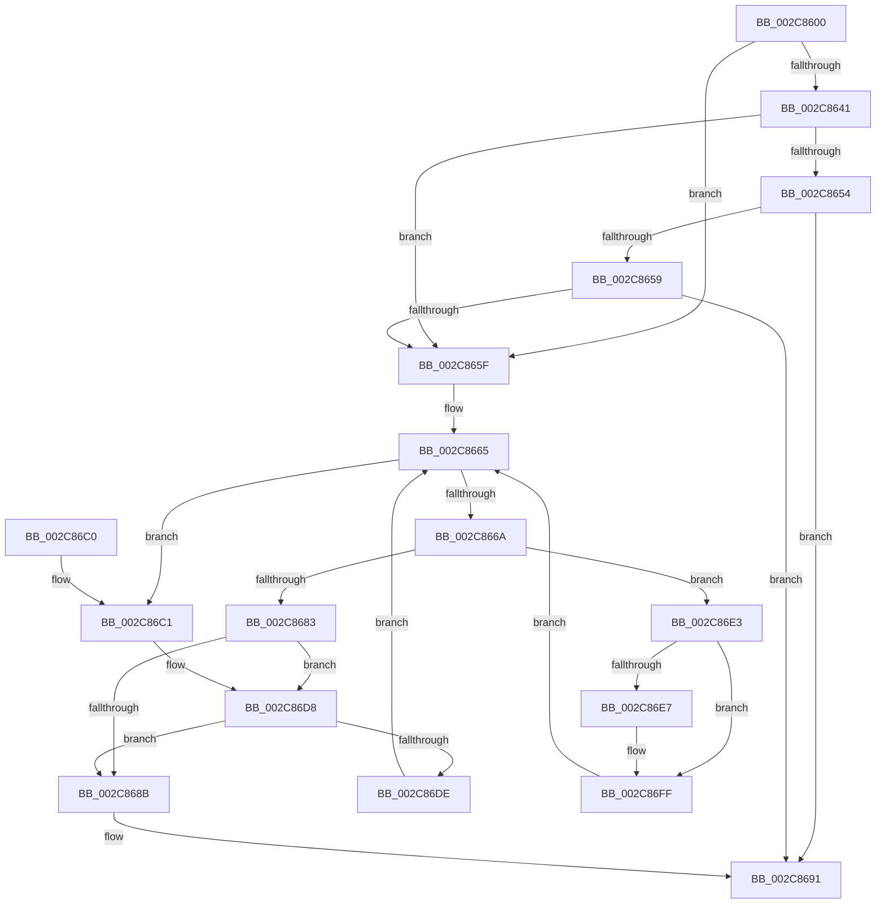

# MiPfnBestZeroAttribute

- RVA: `0x002C8600`–`0x002C8708` (길이 `264` bytes)
- VA: `0x00000001402C8600`
- 실행 섹션: `.text`
- PDB 이름 있음: `예`; PDB Function 태그: `아니요`
- unwind 정보 RVA: `0x0006EF30`
- 디코드: `71`개 명령, `264/264` bytes 표시
- 미해석 바이트: `0` (있으면 어셈블리에 `.byte`로 보존)

> 이 문서는 커널 이미지의 기계어와 PDB 기호를 분석해 생성했습니다. 4번과 5번은 함수 원형과 자료형을 바이너리 사용 방식에서 추정한 C 해석이며 원본 소스 복구 결과는 아닙니다.

## 1. Dependencies

- 직접 호출 지점: **2**; 고유 호출 대상: **1**
- 직접 호출자로 확인된 함수: **5**
- RIP 상대 이미지 참조: **5**

### Outgoing calls
- `0x002C86D2` → [KeBugCheckEx](../4F/KeBugCheckEx_function_004FD660.md) (function, `0x004FD660`)
- `0x002C86F9` → [KeBugCheckEx](../4F/KeBugCheckEx_function_004FD660.md) (function, `0x004FD660`)

### Direct callers
- [MiGetPage](../28/MiGetPage_function_002884C0.md) at `0x002895DD`
- [MiGetPage](../28/MiGetPage_function_002884C0.md) at `0x002898A3`
- [MiZeroAndConvertPage](MiZeroAndConvertPage_function_002C8480.md) at `0x002C8596`
- [MiZeroAndConvertPage](MiZeroAndConvertPage_function_002C8480.md) at `0x002C85B8`
- [MiUpdateCacheAttributeListsForPage](MiUpdateCacheAttributeListsForPage_function_002C97CC.md) at `0x002C989D`
- [MiZeroAndReleasePages](../37/MiZeroAndReleasePages_function_003748D0.md) at `0x00374CB5`
- [MiAllocateLargeZeroPages](../3B/MiAllocateLargeZeroPages_function_003B743C.md) at `0x003B76CD`

### Static image references
- `0x002C8616` → RVA `0x00E2DBC0` (`.data`; read)
- `0x002C8620` → RVA `0x00E2DBC4` (`.data`; read)
- `0x002C8648` → RVA `0x00E2DC20` (`.data`; read)
- `0x002C868B` → RVA `0x00E2DBC0` (`.data`; write)
- `0x002C86A6` → RVA `0x00E2DBF8` (`.data`; read)

## 2. Other-region calls and transfers

- 다른 실행 섹션으로 향하는 call: **0**
- 별도 외부 분기/꼬리 이동을 확인하지 못했습니다.

## 3. Assembly (complete function range)

```asm
002C8600  40 53                           push rbx
002C8602  48 83 EC 30                     sub rsp, 0x30
002C8606  48 63 DA                        movsxd rbx, edx
002C8609  4C 8B D9                        mov r11, rcx
002C860C  48 B8 00 00 00 00 00 DE FF FF   movabs rax, 0xffffde0000000000
002C8616  4C 63 15 A3 55 B6 00            movsxd r10, dword ptr [rip + 0xb655a3]
002C861D  4C 8B C1                        mov r8, rcx
002C8620  44 8B 0D 9D 55 B6 00            mov r9d, dword ptr [rip + 0xb6559d]
002C8627  4C 2B C0                        sub r8, rax
002C862A  49 C1 F8 04                     sar r8, 4
002C862E  48 B8 AB AA AA AA AA AA AA AA   movabs rax, 0xaaaaaaaaaaaaaaab
002C8638  4C 0F AF C0                     imul r8, rax
002C863C  45 3B D1                        cmp r10d, r9d
002C863F  77 1E                           ja 0x1402c865f
002C8641  49 8B C2                        mov rax, r10
002C8644  48 C1 E0 04                     shl rax, 4
002C8648  48 03 05 D1 55 B6 00            add rax, qword ptr [rip + 0xb655d1]
002C864F  4C 3B 00                        cmp r8, qword ptr [rax]
002C8652  72 0B                           jb 0x1402c865f
002C8654  45 3B D1                        cmp r10d, r9d
002C8657  74 38                           je 0x1402c8691
002C8659  4C 3B 40 10                     cmp r8, qword ptr [rax + 0x10]
002C865D  72 32                           jb 0x1402c8691
002C865F  45 33 D2                        xor r10d, r10d
002C8662  41 8B D2                        mov edx, r10d
002C8665  44 3B CA                        cmp r9d, edx
002C8668  7C 57                           jl 0x1402c86c1
002C866A  42 8D 0C 0A                     lea ecx, [rdx + r9]
002C866E  D1 F9                           sar ecx, 1
002C8670  48 63 C1                        movsxd rax, ecx
002C8673  48 C1 E0 04                     shl rax, 4
002C8677  48 03 05 A2 55 B6 00            add rax, qword ptr [rip + 0xb655a2]
002C867E  4C 3B 00                        cmp r8, qword ptr [rax]
002C8681  72 60                           jb 0x1402c86e3
002C8683  3B 0D 3B 55 B6 00               cmp ecx, dword ptr [rip + 0xb6553b]
002C8689  75 4D                           jne 0x1402c86d8
002C868B  89 0D 2F 55 B6 00               mov dword ptr [rip + 0xb6552f], ecx
002C8691  8B 40 08                        mov eax, dword ptr [rax + 8]
002C8694  41 8B 4B 20                     mov ecx, dword ptr [r11 + 0x20]
002C8698  C1 E9 10                        shr ecx, 0x10
002C869B  0F B6 D1                        movzx edx, cl
002C869E  4C 8D 04 40                     lea r8, [rax + rax*2]
002C86A2  49 C1 E0 07                     shl r8, 7
002C86A6  4C 03 05 4B 55 B6 00            add r8, qword ptr [rip + 0xb6554b]
002C86AD  48 C1 EA 06                     shr rdx, 6
002C86B1  48 8D 04 93                     lea rax, [rbx + rdx*4]
002C86B5  41 8B 44 80 78                  mov eax, dword ptr [r8 + rax*4 + 0x78]
002C86BA  48 83 C4 30                     add rsp, 0x30
002C86BE  5B                              pop rbx
002C86BF  C3                              ret
002C86C0  CC                              int3
002C86C1  45 33 C9                        xor r9d, r9d
002C86C4  4C 89 54 24 20                  mov qword ptr [rsp + 0x20], r10
002C86C9  BA 80 51 00 00                  mov edx, 0x5180
002C86CE  41 8D 49 1A                     lea ecx, [r9 + 0x1a]
002C86D2  E8 89 4F 23 00                  call 0x1404fd660
002C86D7  CC                              int3
002C86D8  4C 3B 40 10                     cmp r8, qword ptr [rax + 0x10]
002C86DC  72 AD                           jb 0x1402c868b
002C86DE  8D 51 01                        lea edx, [rcx + 1]
002C86E1  EB 82                           jmp 0x1402c8665
002C86E3  85 C9                           test ecx, ecx
002C86E5  75 18                           jne 0x1402c86ff
002C86E7  4C 8B C8                        mov r9, rax
002C86EA  4C 89 54 24 20                  mov qword ptr [rsp + 0x20], r10
002C86EF  BA 80 51 00 00                  mov edx, 0x5180
002C86F4  B9 1A 00 00 00                  mov ecx, 0x1a
002C86F9  E8 62 4F 23 00                  call 0x1404fd660
002C86FE  CC                              int3
002C86FF  44 8D 49 FF                     lea r9d, [rcx - 1]
002C8703  E9 5D FF FF FF                  jmp 0x1402c8665
```

## 4. C-style interpretation (structured pseudocode)

```c
__int64 __fastcall MiPfnBestZeroAttribute(__int64 a1, int a2)
{
    __int64 result;
    __int64 v_r10;
    __int64 v_rsp;
    unsigned __int64 v_stack_p20;

    v_rsp = (v_rsp) - (48);
    a3 = (a1) - (result);
    a3 = (a3) >> (4);
    a3 = (a3) * (result);
    if (((unsigned int)((int)(*(unsigned int *)(v_rip + 11949475)))) > ((unsigned int)((unsigned int)(*(unsigned int *)(v_rip + 11949469))))) goto loc_002C865F;
    result = ((int)(*(unsigned int *)(v_rip + 11949475))) << (4);
    result = (result) + (*(unsigned __int64 *)(v_rip + 11949521));
    if (a3 < (*(unsigned __int64 *)(result))) goto loc_002C865F;
    if (((unsigned int)((int)(*(unsigned int *)(v_rip + 11949475)))) == ((unsigned int)((unsigned int)(*(unsigned int *)(v_rip + 11949469))))) goto loc_002C8691;
    if (a3 < (*(unsigned __int64 *)(result + 16))) goto loc_002C8691;
loc_002C865F:
    v_r10 = 0;
loc_002C8665:
    if (((unsigned int)((unsigned int)(*(unsigned int *)(v_rip + 11949469)))) < 0) goto loc_002C86C1;
    a1 = (unsigned int)((0 + (unsigned int)(*(unsigned int *)(v_rip + 11949469)) * 1) >> (1));
    result = ((int)((unsigned int)(a1))) << (4);
    result = (result) + (*(unsigned __int64 *)(v_rip + 11949474));
    if (a3 < (*(unsigned __int64 *)(result))) goto loc_002C86E3;
    if (((unsigned int)(a1)) != (*(unsigned int *)(v_rip + 11949371))) goto loc_002C86D8;
loc_002C868B:
    *(unsigned int *)(v_rip + 11949359) = (unsigned int)(a1);
loc_002C8691:
    a1 = (unsigned int)(((unsigned int)(*(unsigned int *)(a1 + 32))) >> (16));
    a3 = ((unsigned int)(*(unsigned int *)(result + 8)) + (unsigned int)(*(unsigned int *)(result + 8)) * 2) << (7);
    a3 = (a3) + (*(unsigned __int64 *)(v_rip + 11949387));
    a2 = ((unsigned __int8)(a1)) >> (6);
    v_rsp = (v_rsp) + (48);
    return (unsigned int)(*(unsigned int *)(a3 + (int)(a2) + a2 * 4 * 4 + 120));
loc_002C86C1:
    a4 = 0;
    v_stack_p20 = 0;
    result = KeBugCheckEx(a4 + 26, (unsigned int)(0x5180ULL), a3, a4);
loc_002C86D8:
    if (a3 < (*(unsigned __int64 *)(result + 16))) goto loc_002C868B;
    goto loc_002C8665;
loc_002C86E3:
    if ((unsigned int)(a4 + 26) == 0) {
        a4 = result;
        v_stack_p20 = 0;
        a2 = 0x5180ULL;
        a1 = 26;
        result = KeBugCheckEx(a1, a2, a3, a4);
    }
    goto loc_002C8665;
}
```

## 5. (Beta) C Style

```c
int64_t MiPfnBestZeroAttribute(int64_t Arg1, void *Arg2)
{
    uint8_t *arg2 = (uint8_t *)Arg2;

    int64_t result;
    int64_t local_r10;
    int64_t local_rsp;
    uint64_t v_stack_p20;

    local_rsp = (local_rsp) - (48);
    a3 = (Arg1) - (result);
    a3 = (a3) >> (4);
    a3 = (a3) * (result);
    if (((uint32_t)((int32_t)(*(uint32_t *)(v_rip + 0xB655A3)))) > ((uint32_t)((uint32_t)(*(uint32_t *)(v_rip + 0xB6559D))))) goto loc_002C865F;
    result = ((int32_t)(*(uint32_t *)(v_rip + 0xB655A3))) << (4);
    result = (result) + (*(uint64_t *)(v_rip + 0xB655D1));
    if (a3 < (*(uint64_t *)(result))) goto loc_002C865F;
    if (((uint32_t)((int32_t)(*(uint32_t *)(v_rip + 0xB655A3)))) == ((uint32_t)((uint32_t)(*(uint32_t *)(v_rip + 0xB6559D))))) goto loc_002C8691;
    if (a3 < (*(uint64_t *)(result + 0x10))) goto loc_002C8691;
loc_002C865F:
    local_r10 = 0;
loc_002C8665:
    if (((uint32_t)((uint32_t)(*(uint32_t *)(v_rip + 0xB6559D)))) < 0) goto loc_002C86C1;
    Arg1 = (uint32_t)((0 + (uint32_t)(*(uint32_t *)(v_rip + 0xB6559D)) * 1) >> (1));
    result = ((int32_t)((uint32_t)(Arg1))) << (4);
    result = (result) + (*(uint64_t *)(v_rip + 0xB655A2));
    if (a3 < (*(uint64_t *)(result))) goto loc_002C86E3;
    if (((uint32_t)(Arg1)) != (*(uint32_t *)(v_rip + 0xB6553B))) goto loc_002C86D8;
loc_002C868B:
    *(uint32_t *)(v_rip + 0xB6552F) = (uint32_t)(Arg1);
loc_002C8691:
    Arg1 = (uint32_t)(((uint32_t)(*(uint32_t *)(Arg1 + 0x20))) >> (16));
    a3 = ((uint32_t)(*(uint32_t *)(result + 0x8)) + (uint32_t)(*(uint32_t *)(result + 0x8)) * 2) << (7);
    a3 = (a3) + (*(uint64_t *)(v_rip + 0xB6554B));
    Arg2 = ((uint8_t)(Arg1)) >> (6);
    local_rsp = (local_rsp) + (48);
    return (uint32_t)(*(uint32_t *)(a3 + (int32_t)(arg2) + arg2 * 4 * 4 + 0x78));
loc_002C86C1:
    a4 = 0;
    v_stack_p20 = 0;
    result = KeBugCheckEx(a4 + 26, (uint32_t)(0x5180ULL), a3, a4);
loc_002C86D8:
    if (a3 < (*(uint64_t *)(result + 0x10))) goto loc_002C868B;
    goto loc_002C8665;
loc_002C86E3:
    if ((uint32_t)(a4 + 26) == 0) {
        a4 = result;
        v_stack_p20 = 0;
        Arg2 = 0x5180ULL;
        Arg1 = 26;
        result = KeBugCheckEx(Arg1, Arg2, a3, a4);
    }
    goto loc_002C8665;
}
```

### 관측된 메모리 오프셋

구조체 형식이 확인되지 않은 접근은 인자 기준의 오프셋으로만 기록했습니다.

| 기준 인자 | 오프셋 표현 | 폭 (bit) | 접근 |
|---|---:|---:|---|
| `Arg2` | `+ 0x0 + rdx*4` | `64` | `R` |

## 6. Execution-region graph

[열기: 2D/3D 그래프와 함수 탐색 컨트롤 패널](../../../control-panel.html?section=text&rva=0x002C8600&view=graph)

- 2D 그래프는 위에서 아래로 흐르고, 3D 그래프는 빈 공간을 드래그해 회전합니다. Shift+드래그는 이동, 휠은 확대·축소, 함수 노드 선택은 대상 보고서 이동입니다.

### Static fallback


