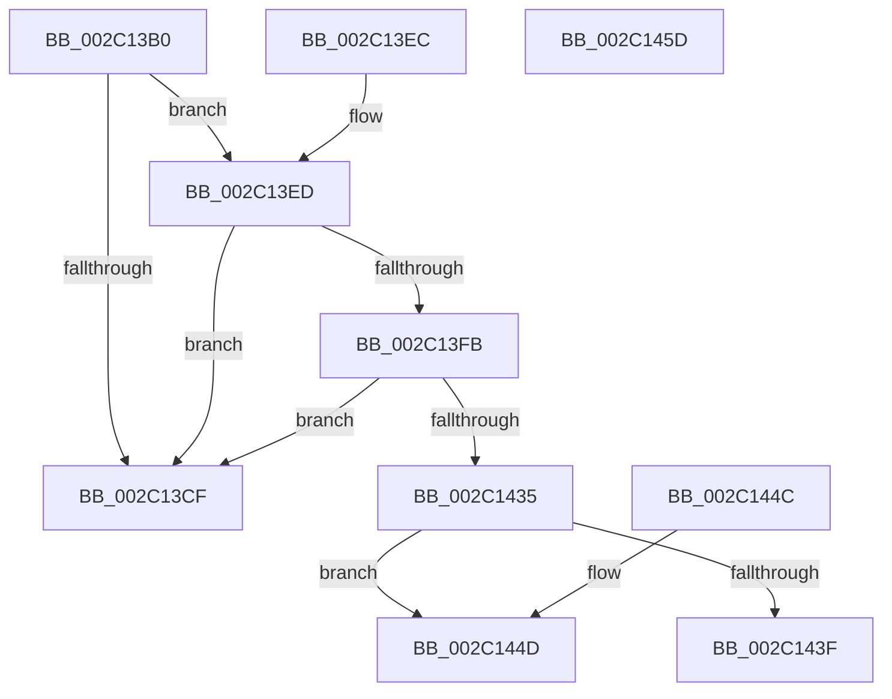

# MiPteNeedsCommitCharge

- RVA: `0x002C13B0`–`0x002C145E` (길이 `174` bytes)
- VA: `0x00000001402C13B0`
- 실행 섹션: `.text`
- PDB 이름 있음: `예`; PDB Function 태그: `아니요`
- unwind 정보 RVA: `0x0006E6F0`
- 디코드: `53`개 명령, `174/174` bytes 표시
- 미해석 바이트: `0` (있으면 어셈블리에 `.byte`로 보존)

> 이 문서는 커널 이미지의 기계어와 PDB 기호를 분석해 생성했습니다. 4번과 5번은 함수 원형과 자료형을 바이너리 사용 방식에서 추정한 C 해석이며 원본 소스 복구 결과는 아닙니다.

## 1. Dependencies

- 직접 호출 지점: **1**; 고유 호출 대상: **1**
- 직접 호출자로 확인된 함수: **3**
- RIP 상대 이미지 참조: **0**

### Outgoing calls
- `0x002C1426` → [MiGetProtoPteAddress](../32/MiGetProtoPteAddress_function_0032E970.md) (function, `0x0032E970`)

### Direct callers
- [MiCountSharedPages](MiCountSharedPages_function_002C30A4.md) at `0x002C324D`
- [MiCountSharedPages](MiCountSharedPages_function_002C30A4.md) at `0x002C32E4`
- [sub_002C3A7C](Unknown_function_002C3A7C.md) at `0x002C3F0D`
- [sub_006DC3C4](../6D/Unknown_function_006DC3C4.md) at `0x006DC403`

### Static image references
- 디코드된 RIP-relative 메모리 참조가 없습니다.

## 2. Other-region calls and transfers

- 다른 실행 섹션으로 향하는 call: **0**
- 별도 외부 분기/꼬리 이동을 확인하지 못했습니다.

## 3. Assembly (complete function range)

```asm
002C13B0  48 89 5C 24 10                  mov qword ptr [rsp + 0x10], rbx
002C13B5  57                              push rdi
002C13B6  48 83 EC 20                     sub rsp, 0x20
002C13BA  33 DB                           xor ebx, ebx
002C13BC  48 8B F9                        mov rdi, rcx
002C13BF  8B 49 30                        mov ecx, dword ptr [rcx + 0x30]
002C13C2  8B C1                           mov eax, ecx
002C13C4  24 70                           and al, 0x70
002C13C6  48 89 5C 24 30                  mov qword ptr [rsp + 0x30], rbx
002C13CB  3C 20                           cmp al, 0x20
002C13CD  74 1E                           je 0x1402c13ed
002C13CF  8B 47 30                        mov eax, dword ptr [rdi + 0x30]
002C13D2  25 80 02 00 00                  and eax, 0x280
002C13D7  3D 80 02 00 00                  cmp eax, 0x280
002C13DC  0F 95 C3                        setne bl
002C13DF  8B C3                           mov eax, ebx
002C13E1  48 8B 5C 24 38                  mov rbx, qword ptr [rsp + 0x38]
002C13E6  48 83 C4 20                     add rsp, 0x20
002C13EA  5F                              pop rdi
002C13EB  C3                              ret
002C13EC  CC                              int3
002C13ED  81 E1 80 0F 00 00               and ecx, 0xf80
002C13F3  81 F9 80 00 00 00               cmp ecx, 0x80
002C13F9  74 D4                           je 0x1402c13cf
002C13FB  48 C1 E2 19                     shl rdx, 0x19
002C13FF  48 B8 00 00 00 00 80 F6 FF FF   movabs rax, 0xfffff68000000000
002C1409  48 C1 E0 19                     shl rax, 0x19
002C140D  4C 8D 4C 24 30                  lea r9, [rsp + 0x30]
002C1412  48 2B D0                        sub rdx, rax
002C1415  41 B8 0C 00 00 00               mov r8d, 0xc
002C141B  48 C1 FA 10                     sar rdx, 0x10
002C141F  48 8B CF                        mov rcx, rdi
002C1422  48 C1 EA 0C                     shr rdx, 0xc
002C1426  E8 45 D5 06 00                  call 0x14032e970
002C142B  48 8B 44 24 30                  mov rax, qword ptr [rsp + 0x30]
002C1430  48 85 C0                        test rax, rax
002C1433  74 9A                           je 0x1402c13cf
002C1435  8B 40 20                        mov eax, dword ptr [rax + 0x20]
002C1438  83 E0 0A                        and eax, 0xa
002C143B  3C 0A                           cmp al, 0xa
002C143D  75 0E                           jne 0x1402c144d
002C143F  33 C0                           xor eax, eax
002C1441  48 8B 5C 24 38                  mov rbx, qword ptr [rsp + 0x38]
002C1446  48 83 C4 20                     add rsp, 0x20
002C144A  5F                              pop rdi
002C144B  C3                              ret
002C144C  CC                              int3
002C144D  48 8B 5C 24 38                  mov rbx, qword ptr [rsp + 0x38]
002C1452  B8 01 00 00 00                  mov eax, 1
002C1457  48 83 C4 20                     add rsp, 0x20
002C145B  5F                              pop rdi
002C145C  C3                              ret
002C145D  CC                              int3
```

## 4. C-style interpretation (structured pseudocode)

```c
__int64 __fastcall MiPteNeedsCommitCharge(__int64 a1, __int64 a2)
{
    __int64 result;
    __int64 v_rbx;
    __int64 v_rsp;
    unsigned __int64 v_stack_p10;
    unsigned __int64 v_stack_p30;
    unsigned __int64 v_stack_p38;
    unsigned __int64 v_stack_p60;
    unsigned __int64 v_stack_p8;

    v_stack_p10 = v_rbx;
    v_rsp = (v_rsp) - (32);
    v_rbx = 0;
    result = (unsigned __int8)(((unsigned int)((unsigned int)((unsigned int)(*(unsigned int *)(a1 + 48))))) & (112));
    v_stack_p8 = 0;
    if (((unsigned __int8)(result)) == 32) goto loc_002C13ED;
loc_002C13CF:
    result = (unsigned int)(((unsigned int)(*(unsigned int *)(a1 + 48))) & (640));
    v_rbx = (((unsigned int)(result)) != 640) ? 1 : 0;
    v_rsp = (v_rsp) + (32);
    return (unsigned int)((unsigned int)(v_rbx));
loc_002C13ED:
    a1 = (unsigned int)(((unsigned int)(*(unsigned int *)(a1 + 48))) & (0xF80ULL));
    if (((unsigned int)(a1)) == 128) goto loc_002C13CF;
    a2 = (a2) << (25);
    result = ((unsigned int)((unsigned int)(v_rbx))) << (25);
    a2 = (a2) - (result);
    a2 = (a2) >> (16);
    a2 = (a2) >> (12);
    result = MiGetProtoPteAddress(a1, a2, 12, v_stack_p30);
    if (v_stack_p30 == 0) goto loc_002C13CF;
    result = (unsigned int)(((unsigned int)(*(unsigned int *)(v_stack_p30 + 32))) & (10));
    if (((unsigned __int8)(result)) != 10) goto loc_002C144D;
    result = 0;
    v_rsp = (v_rsp) + (32);
    return result;
loc_002C144D:
    v_rsp = (v_rsp) + (32);
    return 1;
}
```

## 5. (Beta) C Style

```c
int64_t MiPteNeedsCommitCharge(void *Arg1, int64_t Arg2)
{
    uint8_t *arg1 = (uint8_t *)Arg1;

    int64_t result;
    int64_t local_rbx;
    int64_t local_rsp;
    uint64_t v_stack_p10;
    uint64_t v_stack_p30;
    uint64_t v_stack_p38;
    uint64_t v_stack_p60;
    uint64_t v_stack_p8;

    v_stack_p10 = local_rbx;
    local_rsp = (local_rsp) - (32);
    local_rbx = 0;
    result = (uint8_t)(((uint32_t)((uint32_t)((uint32_t)(*(uint32_t *)(arg1 + 0x30))))) & (112));
    v_stack_p8 = 0;
    if (((uint8_t)(result)) == 32) goto loc_002C13ED;
loc_002C13CF:
    result = (uint32_t)(((uint32_t)(*(uint32_t *)(arg1 + 0x30))) & (640));
    local_rbx = (((uint32_t)(result)) != 640) ? 1 : 0;
    local_rsp = (local_rsp) + (32);
    return (uint32_t)((uint32_t)(local_rbx));
loc_002C13ED:
    Arg1 = (uint32_t)(((uint32_t)(*(uint32_t *)(arg1 + 0x30))) & (0xF80ULL));
    if (((uint32_t)(Arg1)) == 128) goto loc_002C13CF;
    Arg2 = (Arg2) << (25);
    result = ((uint32_t)((uint32_t)(local_rbx))) << (25);
    Arg2 = (Arg2) - (result);
    Arg2 = (Arg2) >> (16);
    Arg2 = (Arg2) >> (12);
    result = MiGetProtoPteAddress(Arg1, Arg2, 12, v_stack_p30);
    if (v_stack_p30 == 0) goto loc_002C13CF;
    result = (uint32_t)(((uint32_t)(*(uint32_t *)(v_stack_p30 + 0x20))) & (10));
    if (((uint8_t)(result)) != 10) goto loc_002C144D;
    result = 0;
    local_rsp = (local_rsp) + (32);
    return result;
loc_002C144D:
    local_rsp = (local_rsp) + (32);
    return 1;
}
```

### 관측된 메모리 오프셋

구조체 형식이 확인되지 않은 접근은 인자 기준의 오프셋으로만 기록했습니다.

| 기준 인자 | 오프셋 표현 | 폭 (bit) | 접근 |
|---|---:|---:|---|
| `Arg1` | `+ 0x30` | `32` | `R` |

## 6. Execution-region graph

[열기: 2D/3D 그래프와 함수 탐색 컨트롤 패널](../../../control-panel.html?section=text&rva=0x002C13B0&view=graph)

- 2D 그래프는 위에서 아래로 흐르고, 3D 그래프는 빈 공간을 드래그해 회전합니다. Shift+드래그는 이동, 휠은 확대·축소, 함수 노드 선택은 대상 보고서 이동입니다.

### Static fallback


