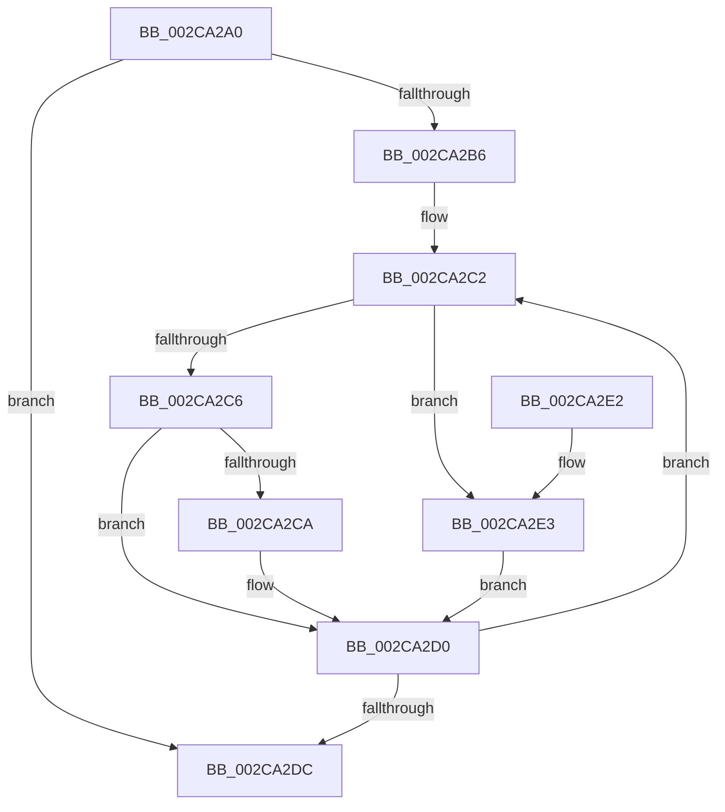

# MiQuantifyZeroWork

- RVA: `0x002CA2A0`–`0x002CA2E8` (길이 `72` bytes)
- VA: `0x00000001402CA2A0`
- 실행 섹션: `.text`
- PDB 이름 있음: `예`; PDB Function 태그: `아니요`
- unwind 정보 RVA: `0x0006F174`
- 디코드: `26`개 명령, `72/72` bytes 표시
- 미해석 바이트: `0` (있으면 어셈블리에 `.byte`로 보존)

> 이 문서는 커널 이미지의 기계어와 PDB 기호를 분석해 생성했습니다. 4번과 5번은 함수 원형과 자료형을 바이너리 사용 방식에서 추정한 C 해석이며 원본 소스 복구 결과는 아닙니다.

## 1. Dependencies

- 직접 호출 지점: **1**; 고유 호출 대상: **1**
- 직접 호출자로 확인된 함수: **1**
- RIP 상대 이미지 참조: **0**

### Outgoing calls
- `0x002CA2A9` → [MiComputeSoloZeroingTime](MiComputeSoloZeroingTime_function_002CA3F8.md) (function, `0x002CA3F8`)

### Direct callers
- [MiInitializeZeroGroup](MiInitializeZeroGroup_function_002CA00C.md) at `0x002CA038`

### Static image references
- 디코드된 RIP-relative 메모리 참조가 없습니다.

## 2. Other-region calls and transfers

- 다른 실행 섹션으로 향하는 call: **0**
- 별도 외부 분기/꼬리 이동을 확인하지 못했습니다.

## 3. Assembly (complete function range)

```asm
002CA2A0  40 53                           push rbx
002CA2A2  48 83 EC 20                     sub rsp, 0x20
002CA2A6  48 8B D9                        mov rbx, rcx
002CA2A9  E8 4A 01 00 00                  call 0x1402ca3f8
002CA2AE  48 3D 88 13 00 00               cmp rax, 0x1388
002CA2B4  77 26                           ja 0x1402ca2dc
002CA2B6  33 D2                           xor edx, edx
002CA2B8  48 8D 43 60                     lea rax, [rbx + 0x60]
002CA2BC  33 C9                           xor ecx, ecx
002CA2BE  44 8D 42 01                     lea r8d, [rdx + 1]
002CA2C2  85 D2                           test edx, edx
002CA2C4  75 1D                           jne 0x1402ca2e3
002CA2C6  39 10                           cmp dword ptr [rax], edx
002CA2C8  74 06                           je 0x1402ca2d0
002CA2CA  44 89 00                        mov dword ptr [rax], r8d
002CA2CD  41 8B D0                        mov edx, r8d
002CA2D0  41 03 C8                        add ecx, r8d
002CA2D3  48 83 C0 04                     add rax, 4
002CA2D7  83 F9 03                        cmp ecx, 3
002CA2DA  72 E6                           jb 0x1402ca2c2
002CA2DC  48 83 C4 20                     add rsp, 0x20
002CA2E0  5B                              pop rbx
002CA2E1  C3                              ret
002CA2E2  CC                              int3
002CA2E3  83 20 00                        and dword ptr [rax], 0
002CA2E6  EB E8                           jmp 0x1402ca2d0
```

## 4. C-style interpretation (structured pseudocode)

```c
__int64 __fastcall MiQuantifyZeroWork(__int64 a1, int a2)
{
    __int64 result;
    __int64 v_rsp;

    v_rsp = (v_rsp) - (32);
    result = MiComputeSoloZeroingTime(a1, a2, a3, a4);
    if (result > 0x1388ULL) goto loc_002CA2DC;
    a2 = 0;
    a1 = 0;
loc_002CA2C2:
    if (0 != 0) goto loc_002CA2E3;
    if ((*(unsigned int *)(a1 + 96)) != 0) {
        *(unsigned int *)(a1 + 96) = (unsigned int)(a2 + 1);
        a2 = (unsigned int)(a2 + 1);
    }
    a1 = (unsigned int)((a1) + ((unsigned int)(a2 + 1)));
    result = (a1 + 96) + (4);
    if (((unsigned int)(a1)) < 3) goto loc_002CA2C2;
loc_002CA2DC:
    v_rsp = (v_rsp) + (32);
    return result;
loc_002CA2E3:
    goto loc_002CA2D0;
}
```

## 5. (Beta) C Style

```c
int64_t MiQuantifyZeroWork(void *Arg1, int32_t Arg2)
{
    uint8_t *arg1 = (uint8_t *)Arg1;

    int64_t result;
    int64_t local_rsp;

    local_rsp = (local_rsp) - (32);
    result = MiComputeSoloZeroingTime(Arg1, Arg2, a3, a4);
    if (result > 0x1388ULL) goto loc_002CA2DC;
    Arg2 = 0;
    Arg1 = 0;
loc_002CA2C2:
    if (0 != 0) goto loc_002CA2E3;
    if ((*(uint32_t *)(arg1 + 0x60)) != 0) {
        *(uint32_t *)(arg1 + 0x60) = (uint32_t)(Arg2 + 1);
        Arg2 = (uint32_t)(Arg2 + 1);
    }
    Arg1 = (uint32_t)((Arg1) + ((uint32_t)(Arg2 + 1)));
    result = (Arg1 + 96) + (4);
    if (((uint32_t)(Arg1)) < 3) goto loc_002CA2C2;
loc_002CA2DC:
    local_rsp = (local_rsp) + (32);
    return result;
loc_002CA2E3:
    goto loc_002CA2D0;
}
```

### 관측된 메모리 오프셋

구조체 형식이 확인되지 않은 접근은 인자 기준의 오프셋으로만 기록했습니다.

| 기준 인자 | 오프셋 표현 | 폭 (bit) | 접근 |
|---|---:|---:|---|
| `Arg1` | `+ 0x0` | `32` | `R` |
| `Arg1` | `+ 0x0` | `32` | `R/W` |
| `Arg1` | `+ 0x0` | `32` | `W` |
| `Arg1` | `+ 0x60` | `64` | `R` |

## 6. Execution-region graph

[열기: 2D/3D 그래프와 함수 탐색 컨트롤 패널](../../../control-panel.html?section=text&rva=0x002CA2A0&view=graph)

- 2D 그래프는 위에서 아래로 흐르고, 3D 그래프는 빈 공간을 드래그해 회전합니다. Shift+드래그는 이동, 휠은 확대·축소, 함수 노드 선택은 대상 보고서 이동입니다.

### Static fallback


