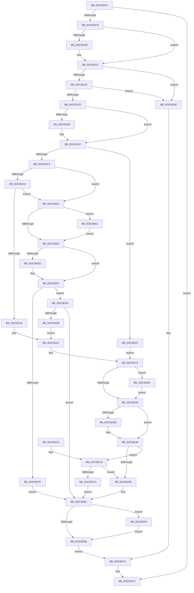

# MiReassessZeroThreads

- RVA: `0x002CB0C0`–`0x002CB377` (길이 `695` bytes)
- VA: `0x00000001402CB0C0`
- 실행 섹션: `.text`
- PDB 이름 있음: `예`; PDB Function 태그: `아니요`
- unwind 정보 RVA: `0x0006F27C`
- 디코드: `176`개 명령, `695/695` bytes 표시
- 미해석 바이트: `0` (있으면 어셈블리에 `.byte`로 보존)

> 이 문서는 커널 이미지의 기계어와 PDB 기호를 분석해 생성했습니다. 4번과 5번은 함수 원형과 자료형을 바이너리 사용 방식에서 추정한 C 해석이며 원본 소스 복구 결과는 아닙니다.

## 1. Dependencies

- 직접 호출 지점: **11**; 고유 호출 대상: **11**
- 직접 호출자로 확인된 함수: **1**
- RIP 상대 이미지 참조: **5**

### Outgoing calls
- `0x002CB10D` → [MiReplenishUltraPageTables](MiReplenishUltraPageTables_function_002CB4EC.md) (function, `0x002CB4EC`)
- `0x002CB122` → [ExAcquireSpinLockExclusive](../24/ExAcquireSpinLockExclusive_function_00248690.md) (function, `0x00248690`)
- `0x002CB173` → [KeQueryPerformanceCounter](../37/KeQueryPerformanceCounter_function_0037E7E0.md) (function, `0x0037E7E0`)
- `0x002CB1CB` → [ExAcquireSpinLockSharedAtDpcLevel](../24/ExAcquireSpinLockSharedAtDpcLevel_function_00248E30.md) (function, `0x00248E30`)
- `0x002CB1D9` → [MiGetDesiredZeroTime](MiGetDesiredZeroTime_function_002CB068.md) (function, `0x002CB068`)
- `0x002CB1E5` → [ExReleaseSpinLockSharedFromDpcLevel](../24/ExReleaseSpinLockSharedFromDpcLevel_function_0024A590.md) (function, `0x0024A590`)
- `0x002CB25B` → [MiReduceZeroingThreads](MiReduceZeroingThreads_function_002CACF8.md) (function, `0x002CACF8`)
- `0x002CB277` → [MiLogZeroPageDecision](MiLogZeroPageDecision_function_002CD090.md) (function, `0x002CD090`)
- `0x002CB288` → [MiRestartZeroingPass](MiRestartZeroingPass_function_002CBB54.md) (function, `0x002CBB54`)
- `0x002CB2AA` → [MiReleaseSpinLockExclusive](../24/MiReleaseSpinLockExclusive_function_002482C0.md) (function, `0x002482C0`)
- `0x002CB31B` → [MiAddZeroingThreads](MiAddZeroingThreads_function_002CBF78.md) (function, `0x002CBF78`)

### Direct callers
- [MiBackgroundZeroLocalPages](../31/MiBackgroundZeroLocalPages_function_0031EF30.md) at `0x0031F451`

### Static image references
- `0x002CB0DD` → RVA `0x00E2DC41` (`.data`; read)
- `0x002CB1AD` → RVA `0x00E2DBF8` (`.data`; read)
- `0x002CB221` → RVA `0x00EF5020` (`.data`; read/write)
- `0x002CB2D8` → RVA `0x00EF501C` (`.data`; read/write)
- `0x002CB337` → RVA `0x00010850` (`.rdata`; read)

## 2. Other-region calls and transfers

- 다른 실행 섹션으로 향하는 call: **0**
- 별도 외부 분기/꼬리 이동을 확인하지 못했습니다.

## 3. Assembly (complete function range)

```asm
002CB0C0  48 85 D2                        test rdx, rdx
002CB0C3  0F 84 FA 01 00 00               je 0x1402cb2c3
002CB0C9  48 89 5C 24 08                  mov qword ptr [rsp + 8], rbx
002CB0CE  55                              push rbp
002CB0CF  56                              push rsi
002CB0D0  57                              push rdi
002CB0D1  41 54                           push r12
002CB0D3  41 55                           push r13
002CB0D5  41 56                           push r14
002CB0D7  41 57                           push r15
002CB0D9  48 83 EC 30                     sub rsp, 0x30
002CB0DD  80 3D 5D 2B B6 00 00            cmp byte ptr [rip + 0xb62b5d], 0
002CB0E4  4C 8B F2                        mov r14, rdx
002CB0E7  48 8B B1 50 01 00 00            mov rsi, qword ptr [rcx + 0x150]
002CB0EE  48 8B F9                        mov rdi, rcx
002CB0F1  48 8B 86 B0 00 00 00            mov rax, qword ptr [rsi + 0xb0]
002CB0F8  44 8B 2E                        mov r13d, dword ptr [rsi]
002CB0FB  48 89 84 24 88 00 00 00         mov qword ptr [rsp + 0x88], rax
002CB103  8B 58 38                        mov ebx, dword ptr [rax + 0x38]
002CB106  74 0A                           je 0x1402cb112
002CB108  8B 4E 70                        mov ecx, dword ptr [rsi + 0x70]
002CB10B  33 D2                           xor edx, edx
002CB10D  E8 DA 03 00 00                  call 0x1402cb4ec
002CB112  48 8B 8E D0 00 00 00            mov rcx, qword ptr [rsi + 0xd0]
002CB119  41 BF B0 3B 00 00               mov r15d, 0x3bb0
002CB11F  49 03 CF                        add rcx, r15
002CB122  E8 69 D5 F7 FF                  call 0x140248690
002CB127  8B 8F 84 01 00 00               mov ecx, dword ptr [rdi + 0x184]
002CB12D  44 8A E0                        mov r12b, al
002CB130  81 F9 00 10 00 00               cmp ecx, 0x1000
002CB136  0F 82 61 01 00 00               jb 0x1402cb29d
002CB13C  4C 01 76 60                     add qword ptr [rsi + 0x60], r14
002CB140  B9 01 00 00 00                  mov ecx, 1
002CB145  8B 46 10                        mov eax, dword ptr [rsi + 0x10]
002CB148  8B 6E 0C                        mov ebp, dword ptr [rsi + 0xc]
002CB14B  FF C0                           inc eax
002CB14D  85 ED                           test ebp, ebp
002CB14F  89 46 10                        mov dword ptr [rsi + 0x10], eax
002CB152  0F 44 E9                        cmove ebp, ecx
002CB155  3B C5                           cmp eax, ebp
002CB157  0F 82 40 01 00 00               jb 0x1402cb29d
002CB15D  48 83 A4 24 80 00 00 00 00      and qword ptr [rsp + 0x80], 0
002CB166  48 8D 8C 24 80 00 00 00         lea rcx, [rsp + 0x80]
002CB16E  44 89 6C 24 78                  mov dword ptr [rsp + 0x78], r13d
002CB173  E8 68 36 0B 00                  call 0x14037e7e0
002CB178  48 81 BC 24 80 00 00 00 80 96 98 00  cmp qword ptr [rsp + 0x80], 0x989680
002CB184  74 11                           je 0x1402cb197
002CB186  48 69 C0 80 96 98 00            imul rax, rax, 0x989680
002CB18D  48 99                           cqo
002CB18F  48 F7 BC 24 80 00 00 00         idiv qword ptr [rsp + 0x80]
002CB197  48 89 46 68                     mov qword ptr [rsi + 0x68], rax
002CB19B  33 D2                           xor edx, edx
002CB19D  48 8B 46 60                     mov rax, qword ptr [rsi + 0x60]
002CB1A1  8B CD                           mov ecx, ebp
002CB1A3  C1 E1 0C                        shl ecx, 0xc
002CB1A6  48 C1 E9 09                     shr rcx, 9
002CB1AA  48 F7 F1                        div rcx
002CB1AD  48 8B 0D 44 2A B6 00            mov rcx, qword ptr [rip + 0xb62a44]
002CB1B4  48 8D 14 5B                     lea rdx, [rbx + rbx*2]
002CB1B8  48 C1 E2 07                     shl rdx, 7
002CB1BC  4C 8B F0                        mov r14, rax
002CB1BF  48 8B 9C 0A 78 01 00 00         mov rbx, qword ptr [rdx + rcx + 0x178]
002CB1C7  48 8D 4B 40                     lea rcx, [rbx + 0x40]
002CB1CB  E8 60 DC F7 FF                  call 0x140248e30
002CB1D0  44 8B C5                        mov r8d, ebp
002CB1D3  41 8B D5                        mov edx, r13d
002CB1D6  48 8B CB                        mov rcx, rbx
002CB1D9  E8 8A FE FF FF                  call 0x1402cb068
002CB1DE  48 8D 4B 40                     lea rcx, [rbx + 0x40]
002CB1E2  4C 8B F8                        mov r15, rax
002CB1E5  E8 A6 F3 F7 FF                  call 0x14024a590
002CB1EA  3B 6E 08                        cmp ebp, dword ptr [rsi + 8]
002CB1ED  0F 87 44 01 00 00               ja 0x1402cb337
002CB1F3  48 B8 CD CC CC CC CC CC CC CC   movabs rax, 0xcccccccccccccccd
002CB1FD  49 F7 E7                        mul r15
002CB200  48 C1 EA 03                     shr rdx, 3
002CB204  49 03 D7                        add rdx, r15
002CB207  4C 3B F2                        cmp r14, rdx
002CB20A  0F 86 C1 00 00 00               jbe 0x1402cb2d1
002CB210  49 83 FF FF                     cmp r15, -1
002CB214  0F 84 B7 00 00 00               je 0x1402cb2d1
002CB21A  33 FF                           xor edi, edi
002CB21C  B9 01 00 00 00                  mov ecx, 1
002CB221  01 0D F9 9D C2 00               add dword ptr [rip + 0xc29df9], ecx
002CB227  39 4E 28                        cmp dword ptr [rsi + 0x28], ecx
002CB22A  0F 85 3A 01 00 00               jne 0x1402cb36a
002CB230  48 8D 5E 2C                     lea rbx, [rsi + 0x2c]
002CB234  8B 03                           mov eax, dword ptr [rbx]
002CB236  83 F8 06                        cmp eax, 6
002CB239  73 05                           jae 0x1402cb240
002CB23B  4C 89 74 C6 30                  mov qword ptr [rsi + rax*8 + 0x30], r14
002CB240  8B 03                           mov eax, dword ptr [rbx]
002CB242  03 C1                           add eax, ecx
002CB244  89 03                           mov dword ptr [rbx], eax
002CB246  83 F8 03                        cmp eax, 3
002CB249  75 7A                           jne 0x1402cb2c5
002CB24B  01 8E 24 01 00 00               add dword ptr [rsi + 0x124], ecx
002CB251  4C 8D 44 24 78                  lea r8, [rsp + 0x78]
002CB256  48 8B CE                        mov rcx, rsi
002CB259  33 D2                           xor edx, edx
002CB25B  E8 98 FA FF FF                  call 0x1402cacf8
002CB260  89 3B                           mov dword ptr [rbx], edi
002CB262  8B 54 24 78                     mov edx, dword ptr [rsp + 0x78]
002CB266  4D 8B CF                        mov r9, r15
002CB269  89 44 24 28                     mov dword ptr [rsp + 0x28], eax
002CB26D  4D 8B C6                        mov r8, r14
002CB270  48 8B CE                        mov rcx, rsi
002CB273  89 6C 24 20                     mov dword ptr [rsp + 0x20], ebp
002CB277  E8 14 1E 00 00                  call 0x1402cd090
002CB27C  39 6E 0C                        cmp dword ptr [rsi + 0xc], ebp
002CB27F  0F 85 AB 00 00 00               jne 0x1402cb330
002CB285  48 8B CE                        mov rcx, rsi
002CB288  E8 C7 08 00 00                  call 0x1402cbb54
002CB28D  48 8B 8E D0 00 00 00            mov rcx, qword ptr [rsi + 0xd0]
002CB294  48 81 C1 B0 3B 00 00            add rcx, 0x3bb0
002CB29B  EB 0A                           jmp 0x1402cb2a7
002CB29D  48 8B 8E D0 00 00 00            mov rcx, qword ptr [rsi + 0xd0]
002CB2A4  49 03 CF                        add rcx, r15
002CB2A7  41 8A D4                        mov dl, r12b
002CB2AA  E8 11 D0 F7 FF                  call 0x1402482c0
002CB2AF  48 8B 5C 24 70                  mov rbx, qword ptr [rsp + 0x70]
002CB2B4  48 83 C4 30                     add rsp, 0x30
002CB2B8  41 5F                           pop r15
002CB2BA  41 5E                           pop r14
002CB2BC  41 5D                           pop r13
002CB2BE  41 5C                           pop r12
002CB2C0  5F                              pop rdi
002CB2C1  5E                              pop rsi
002CB2C2  5D                              pop rbp
002CB2C3  C3                              ret
002CB2C4  CC                              int3
002CB2C5  3B 6E 08                        cmp ebp, dword ptr [rsi + 8]
002CB2C8  77 81                           ja 0x1402cb24b
002CB2CA  B8 06 00 00 00                  mov eax, 6
002CB2CF  EB 91                           jmp 0x1402cb262
002CB2D1  B9 01 00 00 00                  mov ecx, 1
002CB2D6  33 FF                           xor edi, edi
002CB2D8  01 0D 3E 9D C2 00               add dword ptr [rip + 0xc29d3e], ecx
002CB2DE  39 7E 28                        cmp dword ptr [rsi + 0x28], edi
002CB2E1  75 7E                           jne 0x1402cb361
002CB2E3  48 8D 5E 2C                     lea rbx, [rsi + 0x2c]
002CB2E7  8B 03                           mov eax, dword ptr [rbx]
002CB2E9  83 F8 06                        cmp eax, 6
002CB2EC  73 05                           jae 0x1402cb2f3
002CB2EE  4C 89 74 C6 30                  mov qword ptr [rsi + rax*8 + 0x30], r14
002CB2F3  8B 03                           mov eax, dword ptr [rbx]
002CB2F5  03 C1                           add eax, ecx
002CB2F7  89 03                           mov dword ptr [rbx], eax
002CB2F9  83 F8 06                        cmp eax, 6
002CB2FC  74 07                           je 0x1402cb305
002CB2FE  8B C1                           mov eax, ecx
002CB300  E9 5D FF FF FF                  jmp 0x1402cb262
002CB305  01 8E 20 01 00 00               add dword ptr [rsi + 0x120], ecx
002CB30B  4C 8D 44 24 78                  lea r8, [rsp + 0x78]
002CB310  48 8B 8C 24 88 00 00 00         mov rcx, qword ptr [rsp + 0x88]
002CB318  41 8B D5                        mov edx, r13d
002CB31B  E8 58 0C 00 00                  call 0x1402cbf78
002CB320  89 3B                           mov dword ptr [rbx], edi
002CB322  83 F8 05                        cmp eax, 5
002CB325  0F 85 37 FF FF FF               jne 0x1402cb262
002CB32B  E9 EC FE FF FF                  jmp 0x1402cb21c
002CB330  89 3B                           mov dword ptr [rbx], edi
002CB332  E9 4E FF FF FF                  jmp 0x1402cb285
002CB337  66 0F 6F 05 11 55 D4 FF         movdqa xmm0, xmmword ptr [rip - 0x2baaef]
002CB33F  B9 01 00 00 00                  mov ecx, 1
002CB344  89 4E 28                        mov dword ptr [rsi + 0x28], ecx
002CB347  33 FF                           xor edi, edi
002CB349  C7 46 2C 02 00 00 00            mov dword ptr [rsi + 0x2c], 2
002CB350  0F 11 46 30                     movups xmmword ptr [rsi + 0x30], xmm0
002CB354  0F 11 46 40                     movups xmmword ptr [rsi + 0x40], xmm0
002CB358  0F 11 46 50                     movups xmmword ptr [rsi + 0x50], xmm0
002CB35C  E9 C0 FE FF FF                  jmp 0x1402cb221
002CB361  48 89 7E 28                     mov qword ptr [rsi + 0x28], rdi
002CB365  E9 79 FF FF FF                  jmp 0x1402cb2e3
002CB36A  48 C7 46 28 01 00 00 00         mov qword ptr [rsi + 0x28], 1
002CB372  E9 B9 FE FF FF                  jmp 0x1402cb230
```

## 4. C-style interpretation (structured pseudocode)

```c
__int64 __fastcall MiReassessZeroThreads(__int64 a1, __int64 a2)
{
    __int64 result;
    __int64 v_rbp;
    __int64 v_rdi;
    __int64 v_rsp;
    unsigned int v_stack_m40;
    unsigned int v_stack_m48;
    unsigned int v_stack_p10;
    unsigned __int64 v_stack_p18;
    unsigned __int64 v_stack_p20;
    unsigned __int64 v_stack_p78;
    unsigned __int64 v_stack_p8;
    unsigned __int64 v_stack_p88;

    if (a2 == 0) goto loc_002CB2C3;
    v_stack_p8 = v_rbx;
    v_rsp = (v_rsp) - (48);
    v_stack_p20 = *(unsigned __int64 *)(*(unsigned __int64 *)(a1 + 336) + 176);
    result = *(unsigned __int64 *)(*(unsigned __int64 *)(a1 + 336) + 176);
    if ((*(unsigned __int8 *)(v_rip + 11938653)) != 0) {
        a1 = *(unsigned int *)(*(unsigned __int64 *)(a1 + 336) + 112);
        a2 = 0;
        result = MiReplenishUltraPageTables(a1, a2, a3, a4);
    }
    a1 = (*(unsigned __int64 *)(*(unsigned __int64 *)(a1 + 336) + 208)) + ((unsigned int)(0x3BB0ULL));
    result = ExAcquireSpinLockExclusive(a1, a2, a3, a4);
    if (((unsigned int)((unsigned int)(*(unsigned int *)(a1 + 388)))) < 0x1000ULL) goto loc_002CB29D;
    result = (unsigned int)(((unsigned int)(*(unsigned int *)(*(unsigned __int64 *)(a1 + 336) + 16))) + 1);
    *(unsigned int *)(*(unsigned __int64 *)(a1 + 336) + 16) = (unsigned int)(result);
    v_rbp = (unsigned int)(*(unsigned int *)(*(unsigned __int64 *)(a1 + 336) + 12));
    if ((unsigned int)((unsigned int)(*(unsigned int *)(*(unsigned __int64 *)(a1 + 336) + 12))) == 0) { v_rbp = 1; }
    if (((unsigned int)(result)) < ((unsigned int)(v_rbp))) goto loc_002CB29D;
    v_stack_p10 = (unsigned int)((unsigned int)(*(unsigned int *)(*(unsigned __int64 *)(a1 + 336))));
    result = KeQueryPerformanceCounter(v_stack_p18, a2, a3, a4);
    if (v_stack_p18 != 0x989680ULL) {
        result = (result) * (result);
    }
    *(unsigned __int64 *)(*(unsigned __int64 *)(a1 + 336) + 104) = result;
    a2 = 0;
    a1 = (unsigned int)(((unsigned int)((unsigned int)(v_rbp))) << (12));
    a1 = (a1) >> (9);
    a2 = ((unsigned int)(*(unsigned int *)(*(unsigned __int64 *)(*(unsigned __int64 *)(a1 + 336) + 176) + 56)) + (unsigned int)(*(unsigned int *)(*(unsigned __int64 *)(*(unsigned __int64 *)(a1 + 336) + 176) + 56)) * 2) << (7);
    result = ExAcquireSpinLockSharedAtDpcLevel(*(unsigned __int64 *)(a2 + *(unsigned __int64 *)(v_rip + 11938372) * 1 + 376) + 64, a2, a3, a4);
    result = MiGetDesiredZeroTime(*(unsigned __int64 *)(a2 + *(unsigned __int64 *)(v_rip + 11938372) * 1 + 376), (unsigned int)((unsigned int)((unsigned int)(*(unsigned int *)(*(unsigned __int64 *)(a1 + 336))))), (unsigned int)((unsigned int)(v_rbp)), a4);
    result = ExReleaseSpinLockSharedFromDpcLevel(*(unsigned __int64 *)(a2 + *(unsigned __int64 *)(v_rip + 11938372) * 1 + 376) + 64, (unsigned int)((unsigned int)((unsigned int)(*(unsigned int *)(*(unsigned __int64 *)(a1 + 336))))), (unsigned int)((unsigned int)(v_rbp)), a4);
    if (((unsigned int)(v_rbp)) > (*(unsigned int *)(*(unsigned __int64 *)(a1 + 336) + 8))) goto loc_002CB337;
    a2 = ((unsigned int)((unsigned int)((unsigned int)(*(unsigned int *)(*(unsigned __int64 *)(a1 + 336)))))) >> (3);
    a2 = (a2) + (result);
    if ((*(unsigned __int64 *)(*(unsigned __int64 *)(a1 + 336) + 96)) <= a2) goto loc_002CB2D1;
    if (result == -1) goto loc_002CB2D1;
    v_rdi = 0;
loc_002CB21C:
loc_002CB221:
    if ((*(unsigned int *)(*(unsigned __int64 *)(a1 + 336) + 40)) != 1) goto loc_002CB36A;
loc_002CB230:
    if (((unsigned int)((unsigned int)(*(unsigned int *)(*(unsigned __int64 *)(a1 + 336) + 44)))) < 6) {
        *(unsigned __int64 *)(*(unsigned __int64 *)(a1 + 336) + (unsigned int)(*(unsigned int *)(*(unsigned __int64 *)(a1 + 336) + 44)) * 8 + 48) = *(unsigned __int64 *)(*(unsigned __int64 *)(a1 + 336) + 96);
    }
    result = (unsigned int)(((unsigned int)(*(unsigned int *)(*(unsigned __int64 *)(a1 + 336) + 44))) + (1));
    *(unsigned int *)(*(unsigned __int64 *)(a1 + 336) + 44) = (unsigned int)(result);
    if (((unsigned int)(result)) != 3) goto loc_002CB2C5;
loc_002CB24B:
    a2 = 0;
    result = MiReduceZeroingThreads(*(unsigned __int64 *)(a1 + 336), a2, v_stack_p10, a4);
    *(unsigned int *)(*(unsigned __int64 *)(a1 + 336) + 44) = 0;
loc_002CB262:
    v_stack_m40 = (unsigned int)(result);
    v_stack_m48 = (unsigned int)(v_rbp);
    result = MiLogZeroPageDecision(*(unsigned __int64 *)(a1 + 336), (unsigned int)(v_stack_p10), *(unsigned __int64 *)(*(unsigned __int64 *)(a1 + 336) + 96), result);
    if ((*(unsigned int *)(*(unsigned __int64 *)(a1 + 336) + 12)) != ((unsigned int)(v_rbp))) goto loc_002CB330;
loc_002CB285:
    result = MiRestartZeroingPass(*(unsigned __int64 *)(a1 + 336), (unsigned int)(v_stack_p10), *(unsigned __int64 *)(*(unsigned __int64 *)(a1 + 336) + 96), result);
    a1 = (*(unsigned __int64 *)(*(unsigned __int64 *)(a1 + 336) + 208)) + (0x3BB0ULL);
    goto loc_002CB2A7;
loc_002CB29D:
    a1 = (*(unsigned __int64 *)(*(unsigned __int64 *)(a1 + 336) + 208)) + (result);
loc_002CB2A7:
    result = MiReleaseSpinLockExclusive(a1, (unsigned __int8)((unsigned __int8)(result)), *(unsigned __int64 *)(*(unsigned __int64 *)(a1 + 336) + 96), result);
    v_rsp = (v_rsp) + (48);
loc_002CB2C3:
    return result;
loc_002CB2C5:
    if (((unsigned int)(v_rbp)) > (*(unsigned int *)(*(unsigned __int64 *)(a1 + 336) + 8))) goto loc_002CB24B;
    goto loc_002CB262;
loc_002CB2D1:
    v_rdi = 0;
    if ((*(unsigned int *)(*(unsigned __int64 *)(a1 + 336) + 40)) != 0) goto loc_002CB361;
loc_002CB2E3:
    if (((unsigned int)((unsigned int)(*(unsigned int *)(*(unsigned __int64 *)(a1 + 336) + 44)))) < 6) {
        *(unsigned __int64 *)(*(unsigned __int64 *)(a1 + 336) + (unsigned int)(*(unsigned int *)(*(unsigned __int64 *)(a1 + 336) + 44)) * 8 + 48) = *(unsigned __int64 *)(*(unsigned __int64 *)(a1 + 336) + 96);
    }
    result = (unsigned int)(((unsigned int)(*(unsigned int *)(*(unsigned __int64 *)(a1 + 336) + 44))) + (1));
    *(unsigned int *)(*(unsigned __int64 *)(a1 + 336) + 44) = (unsigned int)(result);
    if (((unsigned int)(result)) == 6) goto loc_002CB305;
    goto loc_002CB262;
loc_002CB305:
    result = MiAddZeroingThreads(v_stack_p88, (unsigned int)((unsigned int)((unsigned int)(*(unsigned int *)(*(unsigned __int64 *)(a1 + 336))))), v_stack_p78, result);
    *(unsigned int *)(*(unsigned __int64 *)(a1 + 336) + 44) = 0;
    if (((unsigned int)(result)) != 5) goto loc_002CB262;
    goto loc_002CB21C;
loc_002CB330:
    *(unsigned int *)(*(unsigned __int64 *)(a1 + 336) + 44) = 0;
    goto loc_002CB285;
loc_002CB337:
    *(unsigned int *)(*(unsigned __int64 *)(a1 + 336) + 40) = 1;
    v_rdi = 0;
    *(unsigned int *)(*(unsigned __int64 *)(a1 + 336) + 44) = 2;
    *(unsigned __int64 *)(*(unsigned __int64 *)(a1 + 336) + 48) = v_xmm0;
    *(unsigned __int64 *)(*(unsigned __int64 *)(a1 + 336) + 64) = v_xmm0;
    *(unsigned __int64 *)(*(unsigned __int64 *)(a1 + 336) + 80) = v_xmm0;
    goto loc_002CB221;
loc_002CB361:
    *(unsigned __int64 *)(*(unsigned __int64 *)(a1 + 336) + 40) = 0;
    goto loc_002CB2E3;
loc_002CB36A:
    *(unsigned __int64 *)(*(unsigned __int64 *)(a1 + 336) + 40) = 1;
    goto loc_002CB230;
}
```

## 5. (Beta) C Style

```c
int64_t MiReassessZeroThreads(void *Arg1, int64_t Arg2)
{
    uint8_t *arg1 = (uint8_t *)Arg1;

    int64_t result;
    int64_t local_rbp;
    int64_t local_rdi;
    int64_t local_rsp;
    uint32_t v_stack_m40;
    uint32_t v_stack_m48;
    uint32_t v_stack_p10;
    uint64_t v_stack_p18;
    uint64_t v_stack_p20;
    uint64_t v_stack_p78;
    uint64_t v_stack_p8;
    uint64_t v_stack_p88;

    if (Arg2 == 0) goto loc_002CB2C3;
    v_stack_p8 = local_rbx;
    local_rsp = (local_rsp) - (48);
    v_stack_p20 = *(uint64_t *)(*(uint64_t *)(arg1 + 0x150) + 0xB0);
    result = *(uint64_t *)(*(uint64_t *)(arg1 + 0x150) + 0xB0);
    if ((*(uint8_t *)(v_rip + 0xB62B5D)) != 0) {
        Arg1 = *(uint32_t *)(*(uint64_t *)(arg1 + 0x150) + 0x70);
        Arg2 = 0;
        result = MiReplenishUltraPageTables(Arg1, Arg2, a3, a4);
    }
    Arg1 = (*(uint64_t *)(*(uint64_t *)(arg1 + 0x150) + 0xD0)) + ((uint32_t)(0x3BB0ULL));
    result = ExAcquireSpinLockExclusive(Arg1, Arg2, a3, a4);
    if (((uint32_t)((uint32_t)(*(uint32_t *)(arg1 + 0x184)))) < 0x1000ULL) goto loc_002CB29D;
    result = (uint32_t)(((uint32_t)(*(uint32_t *)(*(uint64_t *)(arg1 + 0x150) + 0x10))) + 1);
    *(uint32_t *)(*(uint64_t *)(arg1 + 0x150) + 0x10) = (uint32_t)(result);
    local_rbp = (uint32_t)(*(uint32_t *)(*(uint64_t *)(arg1 + 0x150) + 0xC));
    if ((uint32_t)((uint32_t)(*(uint32_t *)(*(uint64_t *)(arg1 + 0x150) + 0xC))) == 0) { local_rbp = 1; }
    if (((uint32_t)(result)) < ((uint32_t)(local_rbp))) goto loc_002CB29D;
    v_stack_p10 = (uint32_t)((uint32_t)(*(uint32_t *)(*(uint64_t *)(arg1 + 0x150))));
    result = KeQueryPerformanceCounter(v_stack_p18, Arg2, a3, a4);
    if (v_stack_p18 != 0x989680ULL) {
        result = (result) * (result);
    }
    *(uint64_t *)(*(uint64_t *)(arg1 + 0x150) + 0x68) = result;
    Arg2 = 0;
    Arg1 = (uint32_t)(((uint32_t)((uint32_t)(local_rbp))) << (12));
    Arg1 = (Arg1) >> (9);
    Arg2 = ((uint32_t)(*(uint32_t *)(*(uint64_t *)(*(uint64_t *)(arg1 + 0x150) + 0xB0) + 0x38)) + (uint32_t)(*(uint32_t *)(*(uint64_t *)(*(uint64_t *)(arg1 + 0x150) + 0xB0) + 0x38)) * 2) << (7);
    result = ExAcquireSpinLockSharedAtDpcLevel(*(uint64_t *)(Arg2 + *(uint64_t *)(v_rip + 0xB62A44) * 1 + 0x178) + 64, Arg2, a3, a4);
    result = MiGetDesiredZeroTime(*(uint64_t *)(Arg2 + *(uint64_t *)(v_rip + 0xB62A44) * 1 + 0x178), (uint32_t)((uint32_t)((uint32_t)(*(uint32_t *)(*(uint64_t *)(arg1 + 0x150))))), (uint32_t)((uint32_t)(local_rbp)), a4);
    result = ExReleaseSpinLockSharedFromDpcLevel(*(uint64_t *)(Arg2 + *(uint64_t *)(v_rip + 0xB62A44) * 1 + 0x178) + 64, (uint32_t)((uint32_t)((uint32_t)(*(uint32_t *)(*(uint64_t *)(arg1 + 0x150))))), (uint32_t)((uint32_t)(local_rbp)), a4);
    if (((uint32_t)(local_rbp)) > (*(uint32_t *)(*(uint64_t *)(arg1 + 0x150) + 0x8))) goto loc_002CB337;
    Arg2 = ((uint32_t)((uint32_t)((uint32_t)(*(uint32_t *)(*(uint64_t *)(arg1 + 0x150)))))) >> (3);
    Arg2 = (Arg2) + (result);
    if ((*(uint64_t *)(*(uint64_t *)(arg1 + 0x150) + 0x60)) <= Arg2) goto loc_002CB2D1;
    if (result == -1) goto loc_002CB2D1;
    local_rdi = 0;
loc_002CB21C:
loc_002CB221:
    if ((*(uint32_t *)(*(uint64_t *)(arg1 + 0x150) + 0x28)) != 1) goto loc_002CB36A;
loc_002CB230:
    if (((uint32_t)((uint32_t)(*(uint32_t *)(*(uint64_t *)(arg1 + 0x150) + 0x2C)))) < 6) {
        *(uint64_t *)(*(uint64_t *)(arg1 + 0x150) + (uint32_t)(*(uint32_t *)(*(uint64_t *)(arg1 + 0x150) + 0x2C)) * 8 + 0x30) = *(uint64_t *)(*(uint64_t *)(arg1 + 0x150) + 0x60);
    }
    result = (uint32_t)(((uint32_t)(*(uint32_t *)(*(uint64_t *)(arg1 + 0x150) + 0x2C))) + (1));
    *(uint32_t *)(*(uint64_t *)(arg1 + 0x150) + 0x2C) = (uint32_t)(result);
    if (((uint32_t)(result)) != 3) goto loc_002CB2C5;
loc_002CB24B:
    Arg2 = 0;
    result = MiReduceZeroingThreads(*(uint64_t *)(arg1 + 0x150), Arg2, v_stack_p10, a4);
    *(uint32_t *)(*(uint64_t *)(arg1 + 0x150) + 0x2C) = 0;
loc_002CB262:
    v_stack_m40 = (uint32_t)(result);
    v_stack_m48 = (uint32_t)(local_rbp);
    result = MiLogZeroPageDecision(*(uint64_t *)(arg1 + 0x150), (uint32_t)(v_stack_p10), *(uint64_t *)(*(uint64_t *)(arg1 + 0x150) + 0x60), result);
    if ((*(uint32_t *)(*(uint64_t *)(arg1 + 0x150) + 0xC)) != ((uint32_t)(local_rbp))) goto loc_002CB330;
loc_002CB285:
    result = MiRestartZeroingPass(*(uint64_t *)(arg1 + 0x150), (uint32_t)(v_stack_p10), *(uint64_t *)(*(uint64_t *)(arg1 + 0x150) + 0x60), result);
    Arg1 = (*(uint64_t *)(*(uint64_t *)(arg1 + 0x150) + 0xD0)) + (0x3BB0ULL);
    goto loc_002CB2A7;
loc_002CB29D:
    Arg1 = (*(uint64_t *)(*(uint64_t *)(arg1 + 0x150) + 0xD0)) + (result);
loc_002CB2A7:
    result = MiReleaseSpinLockExclusive(Arg1, (uint8_t)((uint8_t)(result)), *(uint64_t *)(*(uint64_t *)(arg1 + 0x150) + 0x60), result);
    local_rsp = (local_rsp) + (48);
loc_002CB2C3:
    return result;
loc_002CB2C5:
    if (((uint32_t)(local_rbp)) > (*(uint32_t *)(*(uint64_t *)(arg1 + 0x150) + 0x8))) goto loc_002CB24B;
    goto loc_002CB262;
loc_002CB2D1:
    local_rdi = 0;
    if ((*(uint32_t *)(*(uint64_t *)(arg1 + 0x150) + 0x28)) != 0) goto loc_002CB361;
loc_002CB2E3:
    if (((uint32_t)((uint32_t)(*(uint32_t *)(*(uint64_t *)(arg1 + 0x150) + 0x2C)))) < 6) {
        *(uint64_t *)(*(uint64_t *)(arg1 + 0x150) + (uint32_t)(*(uint32_t *)(*(uint64_t *)(arg1 + 0x150) + 0x2C)) * 8 + 0x30) = *(uint64_t *)(*(uint64_t *)(arg1 + 0x150) + 0x60);
    }
    result = (uint32_t)(((uint32_t)(*(uint32_t *)(*(uint64_t *)(arg1 + 0x150) + 0x2C))) + (1));
    *(uint32_t *)(*(uint64_t *)(arg1 + 0x150) + 0x2C) = (uint32_t)(result);
    if (((uint32_t)(result)) == 6) goto loc_002CB305;
    goto loc_002CB262;
loc_002CB305:
    result = MiAddZeroingThreads(v_stack_p88, (uint32_t)((uint32_t)((uint32_t)(*(uint32_t *)(*(uint64_t *)(arg1 + 0x150))))), v_stack_p78, result);
    *(uint32_t *)(*(uint64_t *)(arg1 + 0x150) + 0x2C) = 0;
    if (((uint32_t)(result)) != 5) goto loc_002CB262;
    goto loc_002CB21C;
loc_002CB330:
    *(uint32_t *)(*(uint64_t *)(arg1 + 0x150) + 0x2C) = 0;
    goto loc_002CB285;
loc_002CB337:
    *(uint32_t *)(*(uint64_t *)(arg1 + 0x150) + 0x28) = 1;
    local_rdi = 0;
    *(uint32_t *)(*(uint64_t *)(arg1 + 0x150) + 0x2C) = 2;
    *(uint64_t *)(*(uint64_t *)(arg1 + 0x150) + 0x30) = v_xmm0;
    *(uint64_t *)(*(uint64_t *)(arg1 + 0x150) + 0x40) = v_xmm0;
    *(uint64_t *)(*(uint64_t *)(arg1 + 0x150) + 0x50) = v_xmm0;
    goto loc_002CB221;
loc_002CB361:
    *(uint64_t *)(*(uint64_t *)(arg1 + 0x150) + 0x28) = 0;
    goto loc_002CB2E3;
loc_002CB36A:
    *(uint64_t *)(*(uint64_t *)(arg1 + 0x150) + 0x28) = 1;
    goto loc_002CB230;
}
```

### 관측된 메모리 오프셋

구조체 형식이 확인되지 않은 접근은 인자 기준의 오프셋으로만 기록했습니다.

| 기준 인자 | 오프셋 표현 | 폭 (bit) | 접근 |
|---|---:|---:|---|
| `Arg1` | `+ 0x150` | `64` | `R` |
| `Arg1` | `+ 0x184` | `32` | `R` |

## 6. Execution-region graph

[열기: 2D/3D 그래프와 함수 탐색 컨트롤 패널](../../../control-panel.html?section=text&rva=0x002CB0C0&view=graph)

- 2D 그래프는 위에서 아래로 흐르고, 3D 그래프는 빈 공간을 드래그해 회전합니다. Shift+드래그는 이동, 휠은 확대·축소, 함수 노드 선택은 대상 보고서 이동입니다.

### Static fallback


