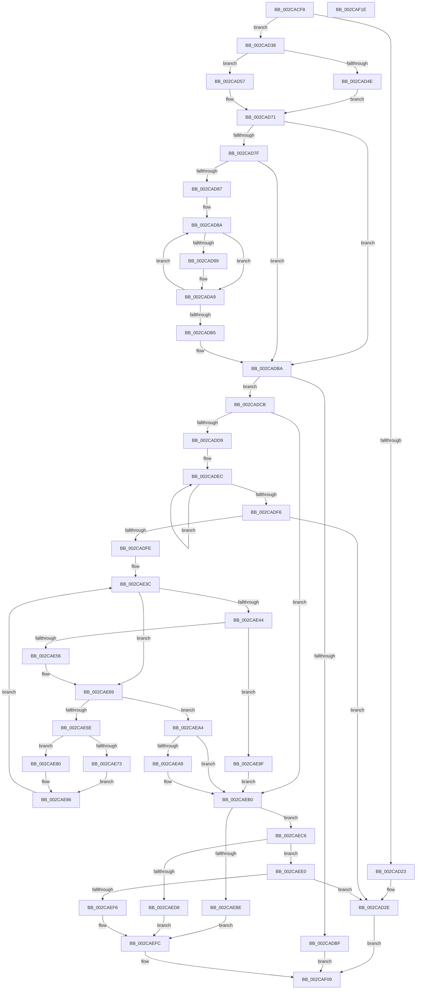

# MiReduceZeroingThreads

- RVA: `0x002CACF8`–`0x002CAF1F` (길이 `551` bytes)
- VA: `0x00000001402CACF8`
- 실행 섹션: `.text`
- PDB 이름 있음: `예`; PDB Function 태그: `아니요`
- unwind 정보 RVA: `0x0006F230`
- 디코드: `160`개 명령, `551/551` bytes 표시
- 미해석 바이트: `0` (있으면 어셈블리에 `.byte`로 보존)

> 이 문서는 커널 이미지의 기계어와 PDB 기호를 분석해 생성했습니다. 4번과 5번은 함수 원형과 자료형을 바이너리 사용 방식에서 추정한 C 해석이며 원본 소스 복구 결과는 아닙니다.

## 1. Dependencies

- 직접 호출 지점: **5**; 고유 호출 대상: **3**
- 직접 호출자로 확인된 함수: **2**
- RIP 상대 이미지 참조: **5**

### Outgoing calls
- `0x002CAD9F` → [MiMoveZeroThreadsToOtherCores](MiMoveZeroThreadsToOtherCores_function_002CB798.md) (function, `0x002CB798`)
- `0x002CAE49` → [MiFindReductionContendingThread](MiFindReductionContendingThread_function_002CABB8.md) (function, `0x002CABB8`)
- `0x002CAECB` → [MiFindReductionContendingThread](MiFindReductionContendingThread_function_002CABB8.md) (function, `0x002CABB8`)
- `0x002CAEE5` → [MiFindReductionContendingThread](MiFindReductionContendingThread_function_002CABB8.md) (function, `0x002CABB8`)
- `0x002CAEFF` → [MiDecrementZeroEngineThread](MiDecrementZeroEngineThread_function_002CBC3C.md) (function, `0x002CBC3C`)

### Direct callers
- [MiReassessZeroThreads](MiReassessZeroThreads_function_002CB0C0.md) at `0x002CB25B`
- [MiScheduleZeroPageThreads](../2D/MiScheduleZeroPageThreads_function_002DB1DC.md) at `0x002DB3EF`

### Static image references
- `0x002CAD4E` → RVA `0x00E2DBD8` (`.data`; read)
- `0x002CAD5E` → RVA `0x00E2DBF8` (`.data`; read)
- `0x002CAEBE` → RVA `0x00EF5010` (`.data`; read/write)
- `0x002CAED8` → RVA `0x00EF5014` (`.data`; read/write)
- `0x002CAEF6` → RVA `0x00EF5018` (`.data`; read/write)

## 2. Other-region calls and transfers

- 다른 실행 섹션으로 향하는 call: **0**
- 별도 외부 분기/꼬리 이동을 확인하지 못했습니다.

## 3. Assembly (complete function range)

```asm
002CACF8  48 89 5C 24 10                  mov qword ptr [rsp + 0x10], rbx
002CACFD  4C 89 44 24 18                  mov qword ptr [rsp + 0x18], r8
002CAD02  55                              push rbp
002CAD03  56                              push rsi
002CAD04  57                              push rdi
002CAD05  41 54                           push r12
002CAD07  41 55                           push r13
002CAD09  41 56                           push r14
002CAD0B  41 57                           push r15
002CAD0D  48 83 EC 20                     sub rsp, 0x20
002CAD11  83 79 0C 00                     cmp dword ptr [rcx + 0xc], 0
002CAD15  44 8B EA                        mov r13d, edx
002CAD18  44 8B 09                        mov r9d, dword ptr [rcx]
002CAD1B  48 8B D9                        mov rbx, rcx
002CAD1E  45 89 08                        mov dword ptr [r8], r9d
002CAD21  75 15                           jne 0x1402cad38
002CAD23  BF 01 00 00 00                  mov edi, 1
002CAD28  01 B9 EC 00 00 00               add dword ptr [rcx + 0xec], edi
002CAD2E  B8 08 00 00 00                  mov eax, 8
002CAD33  E9 D1 01 00 00                  jmp 0x1402caf09
002CAD38  80 79 24 00                     cmp byte ptr [rcx + 0x24], 0
002CAD3C  48 8B A9 B0 00 00 00            mov rbp, qword ptr [rcx + 0xb0]
002CAD43  4C 8B 55 30                     mov r10, qword ptr [rbp + 0x30]
002CAD47  4C 89 54 24 60                  mov qword ptr [rsp + 0x60], r10
002CAD4C  74 09                           je 0x1402cad57
002CAD4E  48 8D 05 83 2E B6 00            lea rax, [rip + 0xb62e83]
002CAD55  EB 1A                           jmp 0x1402cad71
002CAD57  8B 45 38                        mov eax, dword ptr [rbp + 0x38]
002CAD5A  48 8D 0C 40                     lea rcx, [rax + rax*2]
002CAD5E  48 8B 05 93 2E B6 00            mov rax, qword ptr [rip + 0xb62e93]
002CAD65  48 C1 E1 07                     shl rcx, 7
002CAD69  48 8B 84 01 78 01 00 00         mov rax, qword ptr [rcx + rax + 0x178]
002CAD71  44 8B 60 08                     mov r12d, dword ptr [rax + 8]
002CAD75  33 F6                           xor esi, esi
002CAD77  8D 7E 01                        lea edi, [rsi + 1]
002CAD7A  45 85 C9                        test r9d, r9d
002CAD7D  74 3B                           je 0x1402cadba
002CAD7F  45 33 F6                        xor r14d, r14d
002CAD82  45 85 E4                        test r12d, r12d
002CAD85  74 33                           je 0x1402cadba
002CAD87  45 33 FF                        xor r15d, r15d
002CAD8A  48 8B 83 88 00 00 00            mov rax, qword ptr [rbx + 0x88]
002CAD91  41 83 7C 07 20 00               cmp dword ptr [r15 + rax + 0x20], 0
002CAD97  74 10                           je 0x1402cada9
002CAD99  41 8B D6                        mov edx, r14d
002CAD9C  48 8B CB                        mov rcx, rbx
002CAD9F  E8 F4 09 00 00                  call 0x1402cb798
002CADA4  85 C0                           test eax, eax
002CADA6  0F 45 F7                        cmovne esi, edi
002CADA9  44 03 F7                        add r14d, edi
002CADAC  49 83 C7 30                     add r15, 0x30
002CADB0  45 3B F4                        cmp r14d, r12d
002CADB3  72 D5                           jb 0x1402cad8a
002CADB5  4C 8B 54 24 60                  mov r10, qword ptr [rsp + 0x60]
002CADBA  45 85 ED                        test r13d, r13d
002CADBD  74 0C                           je 0x1402cadcb
002CADBF  F7 DE                           neg esi
002CADC1  1B C0                           sbb eax, eax
002CADC3  83 C0 08                        add eax, 8
002CADC6  E9 3E 01 00 00                  jmp 0x1402caf09
002CADCB  8B 43 08                        mov eax, dword ptr [rbx + 8]
002CADCE  33 D2                           xor edx, edx
002CADD0  39 43 0C                        cmp dword ptr [rbx + 0xc], eax
002CADD3  0F 87 D7 00 00 00               ja 0x1402caeb0
002CADD9  33 C0                           xor eax, eax
002CADDB  48 8D 8D 94 00 00 00            lea rcx, [rbp + 0x94]
002CADE2  44 8D 42 03                     lea r8d, [rdx + 3]
002CADE6  41 B9 30 01 00 00               mov r9d, 0x130
002CADEC  03 01                           add eax, dword ptr [rcx]
002CADEE  49 03 C9                        add rcx, r9
002CADF1  4C 2B C7                        sub r8, rdi
002CADF4  75 F6                           jne 0x1402cadec
002CADF6  3B C7                           cmp eax, edi
002CADF8  0F 86 30 FF FF FF               jbe 0x1402cad2e
002CADFE  45 8B BA 54 42 00 00            mov r15d, dword ptr [r10 + 0x4254]
002CAE05  48 8D 8D 94 00 00 00            lea rcx, [rbp + 0x94]
002CAE0C  45 33 E4                        xor r12d, r12d
002CAE0F  48 8D B5 88 00 00 00            lea rsi, [rbp + 0x88]
002CAE16  33 DB                           xor ebx, ebx
002CAE18  44 3B FF                        cmp r15d, edi
002CAE1B  41 0F 95 C4                     setne r12b
002CAE1F  45 33 F6                        xor r14d, r14d
002CAE22  4C 03 E7                        add r12, rdi
002CAE25  44 3B FF                        cmp r15d, edi
002CAE28  41 0F 94 C6                     sete r14b
002CAE2C  4C 03 F7                        add r14, rdi
002CAE2F  49 69 C6 30 01 00 00            imul rax, r14, 0x130
002CAE36  48 03 C8                        add rcx, rax
002CAE39  48 03 F0                        add rsi, rax
002CAE3C  83 39 00                        cmp dword ptr [rcx], 0
002CAE3F  4C 8B E9                        mov r13, rcx
002CAE42  74 25                           je 0x1402cae69
002CAE44  8B D7                           mov edx, edi
002CAE46  48 8B CE                        mov rcx, rsi
002CAE49  E8 6A FD FF FF                  call 0x1402cabb8
002CAE4E  48 8B D0                        mov rdx, rax
002CAE51  48 85 C0                        test rax, rax
002CAE54  75 49                           jne 0x1402cae9f
002CAE56  48 85 DB                        test rbx, rbx
002CAE59  48 8B CE                        mov rcx, rsi
002CAE5C  41 B9 30 01 00 00               mov r9d, 0x130
002CAE62  48 0F 45 CB                     cmovne rcx, rbx
002CAE66  48 8B D9                        mov rbx, rcx
002CAE69  4D 3B F4                        cmp r14, r12
002CAE6C  74 36                           je 0x1402caea4
002CAE6E  44 3B FF                        cmp r15d, edi
002CAE71  75 0D                           jne 0x1402cae80
002CAE73  48 C7 C0 D0 FE FF FF            mov rax, 0xfffffffffffffed0
002CAE7A  49 83 C8 FF                     or r8, 0xffffffffffffffff
002CAE7E  EB 06                           jmp 0x1402cae86
002CAE80  49 8B C1                        mov rax, r9
002CAE83  4C 8B C7                        mov r8, rdi
002CAE86  48 03 F0                        add rsi, rax
002CAE89  48 C7 C1 D0 FE FF FF            mov rcx, 0xfffffffffffffed0
002CAE90  44 3B FF                        cmp r15d, edi
002CAE93  49 0F 45 C9                     cmovne rcx, r9
002CAE97  49 03 CD                        add rcx, r13
002CAE9A  4D 03 F0                        add r14, r8
002CAE9D  EB 9D                           jmp 0x1402cae3c
002CAE9F  48 8B DE                        mov rbx, rsi
002CAEA2  EB 0C                           jmp 0x1402caeb0
002CAEA4  48 85 DB                        test rbx, rbx
002CAEA7  75 07                           jne 0x1402caeb0
002CAEA9  48 8D 9D 88 00 00 00            lea rbx, [rbp + 0x88]
002CAEB0  48 8B 4C 24 70                  mov rcx, qword ptr [rsp + 0x70]
002CAEB5  8B 03                           mov eax, dword ptr [rbx]
002CAEB7  89 01                           mov dword ptr [rcx], eax
002CAEB9  48 85 D2                        test rdx, rdx
002CAEBC  74 08                           je 0x1402caec6
002CAEBE  01 3D 4C A1 C2 00               add dword ptr [rip + 0xc2a14c], edi
002CAEC4  EB 36                           jmp 0x1402caefc
002CAEC6  8B D7                           mov edx, edi
002CAEC8  48 8B CB                        mov rcx, rbx
002CAECB  E8 E8 FC FF FF                  call 0x1402cabb8
002CAED0  48 8B D0                        mov rdx, rax
002CAED3  48 85 C0                        test rax, rax
002CAED6  74 08                           je 0x1402caee0
002CAED8  01 3D 36 A1 C2 00               add dword ptr [rip + 0xc2a136], edi
002CAEDE  EB 1C                           jmp 0x1402caefc
002CAEE0  33 D2                           xor edx, edx
002CAEE2  48 8B CB                        mov rcx, rbx
002CAEE5  E8 CE FC FF FF                  call 0x1402cabb8
002CAEEA  48 8B D0                        mov rdx, rax
002CAEED  48 85 C0                        test rax, rax
002CAEF0  0F 84 38 FE FF FF               je 0x1402cad2e
002CAEF6  01 3D 1C A1 C2 00               add dword ptr [rip + 0xc2a11c], edi
002CAEFC  48 8B CA                        mov rcx, rdx
002CAEFF  E8 38 0D 00 00                  call 0x1402cbc3c
002CAF04  B8 05 00 00 00                  mov eax, 5
002CAF09  48 8B 5C 24 68                  mov rbx, qword ptr [rsp + 0x68]
002CAF0E  48 83 C4 20                     add rsp, 0x20
002CAF12  41 5F                           pop r15
002CAF14  41 5E                           pop r14
002CAF16  41 5D                           pop r13
002CAF18  41 5C                           pop r12
002CAF1A  5F                              pop rdi
002CAF1B  5E                              pop rsi
002CAF1C  5D                              pop rbp
002CAF1D  C3                              ret
002CAF1E  CC                              int3
```

## 4. C-style interpretation (structured pseudocode)

```c
__int64 __fastcall MiReduceZeroingThreads(__int64 a1, int a2, __int64 a3)
{
    __int64 result;
    __int64 v_r12;
    __int64 v_r14;
    __int64 v_r15;
    __int64 v_rbx;
    __int64 v_rsi;
    __int64 v_rsp;
    unsigned __int64 v_stack_p10;
    unsigned __int64 v_stack_p18;
    unsigned __int64 v_stack_p8;

    v_stack_p10 = v_rbx;
    v_stack_p18 = a3;
    v_rsp = (v_rsp) - (32);
    *(unsigned int *)(a3) = (unsigned int)((unsigned int)(*(unsigned int *)(a1)));
    if ((*(unsigned int *)(a1 + 12)) != 0) goto loc_002CAD38;
loc_002CAD2E:
    goto loc_002CAF09;
loc_002CAD38:
    v_stack_p8 = *(unsigned __int64 *)(*(unsigned __int64 *)(a1 + 176) + 48);
    if ((*(unsigned __int8 *)(a1 + 36)) == 0) goto loc_002CAD57;
    goto loc_002CAD71;
loc_002CAD57:
    a1 = ((unsigned int)(*(unsigned int *)(*(unsigned __int64 *)(a1 + 176) + 56)) + (unsigned int)(*(unsigned int *)(*(unsigned __int64 *)(a1 + 176) + 56)) * 2) << (7);
loc_002CAD71:
    v_rsi = 0;
    if ((unsigned int)((unsigned int)(*(unsigned int *)(a1))) == 0) goto loc_002CADBA;
    v_r14 = 0;
    if ((unsigned int)((unsigned int)(*(unsigned int *)(*(unsigned __int64 *)(a1 + *(unsigned __int64 *)(v_rip + 11939475) * 1 + 376) + 8))) == 0) goto loc_002CADBA;
    v_r15 = 0;
loc_002CAD8A:
    result = *(unsigned __int64 *)(a1 + 136);
    if ((*(unsigned int *)(v_r15 + *(unsigned __int64 *)(a1 + 136) * 1 + 32)) != 0) {
        a2 = 0;
        a1 = a1;
        result = MiMoveZeroThreadsToOtherCores(a1, a2, a3, (unsigned int)(*(unsigned int *)(a1)));
        if ((unsigned int)(result) != 0) { v_rsi = (unsigned int)(v_rsi + 1); }
    }
    v_r14 = (unsigned int)((v_r14) + ((unsigned int)(v_rsi + 1)));
    v_r15 = (v_r15) + (48);
    if (((unsigned int)(v_r14)) < ((unsigned int)((unsigned int)(*(unsigned int *)(*(unsigned __int64 *)(a1 + *(unsigned __int64 *)(v_rip + 11939475) * 1 + 376) + 8))))) goto loc_002CAD8A;
loc_002CADBA:
    if ((unsigned int)((unsigned int)(a2)) == 0) goto loc_002CADCB;
    v_rsi = (unsigned int)(-(v_rsi));
    result = (unsigned int)((result) + (8));
    goto loc_002CAF09;
loc_002CADCB:
    a2 = 0;
    if ((*(unsigned int *)(a1 + 12)) > ((unsigned int)((unsigned int)(*(unsigned int *)(a1 + 8))))) goto loc_002CAEB0;
    result = 0;
loc_002CADEC:
    result = (unsigned int)((result) + (*(unsigned int *)(*(unsigned __int64 *)(a1 + 176) + 148)));
    a1 = (*(unsigned __int64 *)(a1 + 176) + 148) + (304);
    a3 = (a2 + 3) - (v_rsi + 1);
    if (condition_is_not_equal) goto loc_002CADEC;
    if (((unsigned int)(result)) <= ((unsigned int)(v_rsi + 1))) goto loc_002CAD2E;
    v_r12 = 0;
    v_rbx = 0;
    v_r12 = (((unsigned int)((unsigned int)(*(unsigned int *)(v_stack_p8 + 16980)))) != ((unsigned int)(v_rsi + 1))) ? 1 : 0;
    v_r14 = 0;
    v_r12 = (v_r12) + (v_rsi + 1);
    v_r14 = (((unsigned int)((unsigned int)(*(unsigned int *)(v_stack_p8 + 16980)))) == ((unsigned int)(v_rsi + 1))) ? 1 : 0;
    v_r14 = (v_r14) + (v_rsi + 1);
    result = (result) * (v_r14);
    a1 = (*(unsigned __int64 *)(a1 + 176) + 148) + (result);
    v_rsi = (*(unsigned __int64 *)(a1 + 176) + 136) + (result);
loc_002CAE3C:
    if ((*(unsigned int *)(a1)) == 0) goto loc_002CAE69;
    result = MiFindReductionContendingThread(v_rsi, (unsigned int)((unsigned int)(v_rsi + 1)), a3, 304);
    if (result != 0) goto loc_002CAE9F;
    a1 = v_rsi;
    if (0 != 0) { a1 = 0; }
loc_002CAE69:
    if (v_r14 == v_r12) goto loc_002CAEA4;
    if (((unsigned int)((unsigned int)(*(unsigned int *)(v_stack_p8 + 16980)))) != ((unsigned int)(v_rsi + 1))) goto loc_002CAE80;
    a3 = (a3) | (-1);
    goto loc_002CAE86;
loc_002CAE80:
loc_002CAE86:
    v_rsi = (v_rsi) + (304);
    a1 = -304;
    if (((unsigned int)((unsigned int)(*(unsigned int *)(v_stack_p8 + 16980)))) != ((unsigned int)(v_rsi + 1))) { a1 = 304; }
    a1 = (a1) + (a1);
    v_r14 = (v_r14) + (v_rsi + 1);
    goto loc_002CAE3C;
loc_002CAE9F:
    goto loc_002CAEB0;
loc_002CAEA4:
    v_rbx = v_rsi;
    if (v_rsi == 0) {
        v_rbx = *(unsigned __int64 *)(a1 + 176) + 136;
    }
    *(unsigned int *)(v_stack_p18) = (unsigned int)((unsigned int)(*(unsigned int *)(v_rbx)));
    if (result == 0) goto loc_002CAEC6;
    goto loc_002CAEFC;
loc_002CAEC6:
    result = MiFindReductionContendingThread(v_rbx, (unsigned int)((unsigned int)(v_rsi + 1)), v_rsi + 1, 304);
    if (result == 0) goto loc_002CAEE0;
    goto loc_002CAEFC;
loc_002CAEE0:
    a2 = 0;
    result = MiFindReductionContendingThread(v_rbx, a2, v_rsi + 1, 304);
    if (result == 0) goto loc_002CAD2E;
loc_002CAEFC:
    result = MiDecrementZeroEngineThread(result, result, v_rsi + 1, 304);
loc_002CAF09:
    v_rsp = (v_rsp) + (32);
    return 5;
}
```

## 5. (Beta) C Style

```c
int64_t MiReduceZeroingThreads(void *Arg1, int32_t Arg2, void *Arg3)
{
    uint8_t *arg1 = (uint8_t *)Arg1;
    uint8_t *arg3 = (uint8_t *)Arg3;

    int64_t result;
    int64_t local_r12;
    int64_t local_r14;
    int64_t local_r15;
    int64_t local_rbx;
    int64_t local_rsi;
    int64_t local_rsp;
    uint64_t v_stack_p10;
    uint64_t v_stack_p18;
    uint64_t v_stack_p8;

    v_stack_p10 = local_rbx;
    v_stack_p18 = Arg3;
    local_rsp = (local_rsp) - (32);
    *(uint32_t *)(arg3) = (uint32_t)((uint32_t)(*(uint32_t *)(arg1)));
    if ((*(uint32_t *)(arg1 + 0xC)) != 0) goto loc_002CAD38;
loc_002CAD2E:
    goto loc_002CAF09;
loc_002CAD38:
    v_stack_p8 = *(uint64_t *)(*(uint64_t *)(arg1 + 0xB0) + 0x30);
    if ((*(uint8_t *)(arg1 + 0x24)) == 0) goto loc_002CAD57;
    goto loc_002CAD71;
loc_002CAD57:
    Arg1 = ((uint32_t)(*(uint32_t *)(*(uint64_t *)(arg1 + 0xB0) + 0x38)) + (uint32_t)(*(uint32_t *)(*(uint64_t *)(arg1 + 0xB0) + 0x38)) * 2) << (7);
loc_002CAD71:
    local_rsi = 0;
    if ((uint32_t)((uint32_t)(*(uint32_t *)(arg1))) == 0) goto loc_002CADBA;
    local_r14 = 0;
    if ((uint32_t)((uint32_t)(*(uint32_t *)(*(uint64_t *)(arg1 + *(uint64_t *)(v_rip + 0xB62E93) * 1 + 0x178) + 0x8))) == 0) goto loc_002CADBA;
    local_r15 = 0;
loc_002CAD8A:
    result = *(uint64_t *)(arg1 + 0x88);
    if ((*(uint32_t *)(local_r15 + *(uint64_t *)(arg1 + 0x88) * 1 + 0x20)) != 0) {
        Arg2 = 0;
        Arg1 = Arg1;
        result = MiMoveZeroThreadsToOtherCores(Arg1, Arg2, Arg3, (uint32_t)(*(uint32_t *)(arg1)));
        if ((uint32_t)(result) != 0) { local_rsi = (uint32_t)(local_rsi + 1); }
    }
    local_r14 = (uint32_t)((local_r14) + ((uint32_t)(local_rsi + 1)));
    local_r15 = (local_r15) + (48);
    if (((uint32_t)(local_r14)) < ((uint32_t)((uint32_t)(*(uint32_t *)(*(uint64_t *)(arg1 + *(uint64_t *)(v_rip + 0xB62E93) * 1 + 0x178) + 0x8))))) goto loc_002CAD8A;
loc_002CADBA:
    if ((uint32_t)((uint32_t)(Arg2)) == 0) goto loc_002CADCB;
    local_rsi = (uint32_t)(-(local_rsi));
    result = (uint32_t)((result) + (8));
    goto loc_002CAF09;
loc_002CADCB:
    Arg2 = 0;
    if ((*(uint32_t *)(arg1 + 0xC)) > ((uint32_t)((uint32_t)(*(uint32_t *)(arg1 + 0x8))))) goto loc_002CAEB0;
    result = 0;
loc_002CADEC:
    result = (uint32_t)((result) + (*(uint32_t *)(*(uint64_t *)(arg1 + 0xB0) + 0x94)));
    Arg1 = (*(uint64_t *)(arg1 + 0xB0) + 148) + (304);
    Arg3 = (Arg2 + 3) - (local_rsi + 1);
    if (condition_is_not_equal) goto loc_002CADEC;
    if (((uint32_t)(result)) <= ((uint32_t)(local_rsi + 1))) goto loc_002CAD2E;
    local_r12 = 0;
    local_rbx = 0;
    local_r12 = (((uint32_t)((uint32_t)(*(uint32_t *)(v_stack_p8 + 0x4254)))) != ((uint32_t)(local_rsi + 1))) ? 1 : 0;
    local_r14 = 0;
    local_r12 = (local_r12) + (local_rsi + 1);
    local_r14 = (((uint32_t)((uint32_t)(*(uint32_t *)(v_stack_p8 + 0x4254)))) == ((uint32_t)(local_rsi + 1))) ? 1 : 0;
    local_r14 = (local_r14) + (local_rsi + 1);
    result = (result) * (local_r14);
    Arg1 = (*(uint64_t *)(arg1 + 0xB0) + 148) + (result);
    local_rsi = (*(uint64_t *)(arg1 + 0xB0) + 136) + (result);
loc_002CAE3C:
    if ((*(uint32_t *)(arg1)) == 0) goto loc_002CAE69;
    result = MiFindReductionContendingThread(local_rsi, (uint32_t)((uint32_t)(local_rsi + 1)), Arg3, 304);
    if (result != 0) goto loc_002CAE9F;
    Arg1 = local_rsi;
    if (0 != 0) { Arg1 = 0; }
loc_002CAE69:
    if (local_r14 == local_r12) goto loc_002CAEA4;
    if (((uint32_t)((uint32_t)(*(uint32_t *)(v_stack_p8 + 0x4254)))) != ((uint32_t)(local_rsi + 1))) goto loc_002CAE80;
    Arg3 = (Arg3) | (-1);
    goto loc_002CAE86;
loc_002CAE80:
loc_002CAE86:
    local_rsi = (local_rsi) + (304);
    Arg1 = -304;
    if (((uint32_t)((uint32_t)(*(uint32_t *)(v_stack_p8 + 0x4254)))) != ((uint32_t)(local_rsi + 1))) { Arg1 = 304; }
    Arg1 = (Arg1) + (Arg1);
    local_r14 = (local_r14) + (local_rsi + 1);
    goto loc_002CAE3C;
loc_002CAE9F:
    goto loc_002CAEB0;
loc_002CAEA4:
    local_rbx = local_rsi;
    if (local_rsi == 0) {
        local_rbx = *(uint64_t *)(arg1 + 0xB0) + 136;
    }
    *(uint32_t *)(v_stack_p18) = (uint32_t)((uint32_t)(*(uint32_t *)(local_rbx)));
    if (result == 0) goto loc_002CAEC6;
    goto loc_002CAEFC;
loc_002CAEC6:
    result = MiFindReductionContendingThread(local_rbx, (uint32_t)((uint32_t)(local_rsi + 1)), local_rsi + 1, 304);
    if (result == 0) goto loc_002CAEE0;
    goto loc_002CAEFC;
loc_002CAEE0:
    Arg2 = 0;
    result = MiFindReductionContendingThread(local_rbx, Arg2, local_rsi + 1, 304);
    if (result == 0) goto loc_002CAD2E;
loc_002CAEFC:
    result = MiDecrementZeroEngineThread(result, result, local_rsi + 1, 304);
loc_002CAF09:
    local_rsp = (local_rsp) + (32);
    return 5;
}
```

### 관측된 메모리 오프셋

구조체 형식이 확인되지 않은 접근은 인자 기준의 오프셋으로만 기록했습니다.

| 기준 인자 | 오프셋 표현 | 폭 (bit) | 접근 |
|---|---:|---:|---|
| `Arg1` | `+ 0x0` | `32` | `R` |
| `Arg1` | `+ 0x8` | `32` | `R` |
| `Arg1` | `+ 0xC` | `32` | `R` |
| `Arg1` | `+ 0x24` | `8` | `R` |
| `Arg1` | `+ 0x88` | `64` | `R` |
| `Arg1` | `+ 0xB0` | `64` | `R` |
| `Arg1` | `+ 0xEC` | `32` | `R/W` |
| `Arg3` | `+ 0x0` | `32` | `W` |

## 6. Execution-region graph

[열기: 2D/3D 그래프와 함수 탐색 컨트롤 패널](../../../control-panel.html?section=text&rva=0x002CACF8&view=graph)

- 2D 그래프는 위에서 아래로 흐르고, 3D 그래프는 빈 공간을 드래그해 회전합니다. Shift+드래그는 이동, 휠은 확대·축소, 함수 노드 선택은 대상 보고서 이동입니다.

### Static fallback


