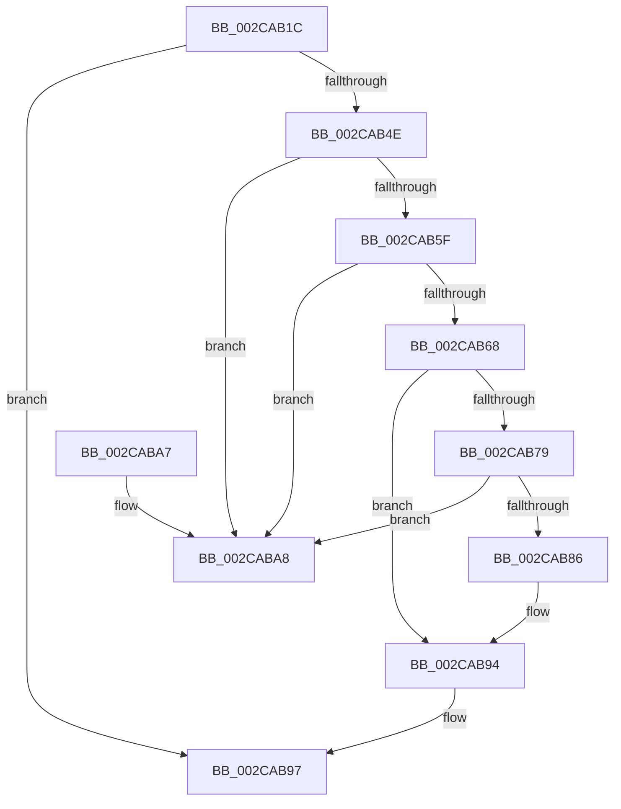

# MiRemoveThreadFromEngineLists

- RVA: `0x002CAB1C`–`0x002CABAF` (길이 `147` bytes)
- VA: `0x00000001402CAB1C`
- 실행 섹션: `.text`
- PDB 이름 있음: `예`; PDB Function 태그: `아니요`
- unwind 정보 RVA: `0x0006383C`
- 디코드: `40`개 명령, `147/147` bytes 표시
- 미해석 바이트: `0` (있으면 어셈블리에 `.byte`로 보존)

> 이 문서는 커널 이미지의 기계어와 PDB 기호를 분석해 생성했습니다. 4번과 5번은 함수 원형과 자료형을 바이너리 사용 방식에서 추정한 C 해석이며 원본 소스 복구 결과는 아닙니다.

## 1. Dependencies

- 직접 호출 지점: **2**; 고유 호출 대상: **2**
- 직접 호출자로 확인된 함수: **2**
- RIP 상대 이미지 참조: **0**

### Outgoing calls
- `0x002CAB3C` → [MiUnlinkZeroThreadFromActiveDomain](MiUnlinkZeroThreadFromActiveDomain_function_002CCB9C.md) (function, `0x002CCB9C`)
- `0x002CAB51` → [MiDecrementZeroEngineThread](MiDecrementZeroEngineThread_function_002CBC3C.md) (function, `0x002CBC3C`)

### Direct callers
- [MiBackgroundZeroNodePages](MiBackgroundZeroNodePages_function_002CB9B0.md) at `0x002CBAE6`
- [MiInsertNewZeroThread](../69/MiInsertNewZeroThread_function_00696140.md) at `0x00696316`

### Static image references
- 디코드된 RIP-relative 메모리 참조가 없습니다.

## 2. Other-region calls and transfers

- 다른 실행 섹션으로 향하는 call: **0**
- 별도 외부 분기/꼬리 이동을 확인하지 못했습니다.

## 3. Assembly (complete function range)

```asm
002CAB1C  48 89 5C 24 08                  mov qword ptr [rsp + 8], rbx
002CAB21  48 89 74 24 10                  mov qword ptr [rsp + 0x10], rsi
002CAB26  57                              push rdi
002CAB27  48 83 EC 20                     sub rsp, 0x20
002CAB2B  48 8B B9 50 01 00 00            mov rdi, qword ptr [rcx + 0x150]
002CAB32  48 8B D9                        mov rbx, rcx
002CAB35  48 8B B7 B0 00 00 00            mov rsi, qword ptr [rdi + 0xb0]
002CAB3C  E8 5B 20 00 00                  call 0x1402ccb9c
002CAB41  4C 8D 8B A0 01 00 00            lea r9, [rbx + 0x1a0]
002CAB48  49 83 39 00                     cmp qword ptr [r9], 0
002CAB4C  74 49                           je 0x1402cab97
002CAB4E  48 8B CB                        mov rcx, rbx
002CAB51  E8 E6 10 00 00                  call 0x1402cbc3c
002CAB56  49 8B 01                        mov rax, qword ptr [r9]
002CAB59  4C 39 48 08                     cmp qword ptr [rax + 8], r9
002CAB5D  75 49                           jne 0x1402caba8
002CAB5F  49 8B 49 08                     mov rcx, qword ptr [r9 + 8]
002CAB63  4C 39 09                        cmp qword ptr [rcx], r9
002CAB66  75 40                           jne 0x1402caba8
002CAB68  48 89 01                        mov qword ptr [rcx], rax
002CAB6B  48 89 48 08                     mov qword ptr [rax + 8], rcx
002CAB6F  48 83 BB 48 01 00 00 00         cmp qword ptr [rbx + 0x148], 0
002CAB77  74 1B                           je 0x1402cab94
002CAB79  48 8D 46 70                     lea rax, [rsi + 0x70]
002CAB7D  48 8B 48 08                     mov rcx, qword ptr [rax + 8]
002CAB81  48 39 01                        cmp qword ptr [rcx], rax
002CAB84  75 22                           jne 0x1402caba8
002CAB86  49 89 01                        mov qword ptr [r9], rax
002CAB89  49 89 49 08                     mov qword ptr [r9 + 8], rcx
002CAB8D  4C 89 09                        mov qword ptr [rcx], r9
002CAB90  4C 89 48 08                     mov qword ptr [rax + 8], r9
002CAB94  FF 4F 04                        dec dword ptr [rdi + 4]
002CAB97  48 8B 5C 24 30                  mov rbx, qword ptr [rsp + 0x30]
002CAB9C  48 8B 74 24 38                  mov rsi, qword ptr [rsp + 0x38]
002CABA1  48 83 C4 20                     add rsp, 0x20
002CABA5  5F                              pop rdi
002CABA6  C3                              ret
002CABA7  CC                              int3
002CABA8  B9 03 00 00 00                  mov ecx, 3
002CABAD  CD 29                           int 0x29
```

## 4. C-style interpretation (structured pseudocode)

```c
__int64 __fastcall MiRemoveThreadFromEngineLists(__int64 a1)
{
    __int64 result;
    __int64 v_rsp;
    unsigned __int64 v_stack_p10;
    unsigned __int64 v_stack_p8;

    v_stack_p8 = v_rbx;
    v_stack_p10 = v_rsi;
    v_rsp = (v_rsp) - (32);
    result = MiUnlinkZeroThreadFromActiveDomain(a1, a2, a3, a4);
    if ((*(unsigned __int64 *)(a1 + 416)) == 0) goto loc_002CAB97;
    result = MiDecrementZeroEngineThread(a1, a2, a3, a1 + 416);
    if ((*(unsigned __int64 *)(*(unsigned __int64 *)(a1 + 416) + 8)) != (a1 + 416)) goto loc_002CABA8;
    if ((*(unsigned __int64 *)(*(unsigned __int64 *)(a1 + 416 + 8))) != (a1 + 416)) goto loc_002CABA8;
    *(unsigned __int64 *)(*(unsigned __int64 *)(a1 + 416 + 8)) = *(unsigned __int64 *)(a1 + 416);
    *(unsigned __int64 *)(*(unsigned __int64 *)(a1 + 416) + 8) = *(unsigned __int64 *)(a1 + 416 + 8);
    if ((*(unsigned __int64 *)(a1 + 328)) == 0) goto loc_002CAB94;
    if ((*(unsigned __int64 *)(*(unsigned __int64 *)(*(unsigned __int64 *)(*(unsigned __int64 *)(a1 + 336) + 176) + 112 + 8))) != (*(unsigned __int64 *)(*(unsigned __int64 *)(a1 + 336) + 176) + 112)) goto loc_002CABA8;
    *(unsigned __int64 *)(a1 + 416) = *(unsigned __int64 *)(*(unsigned __int64 *)(a1 + 336) + 176) + 112;
    *(unsigned __int64 *)(a1 + 416 + 8) = *(unsigned __int64 *)(*(unsigned __int64 *)(*(unsigned __int64 *)(a1 + 336) + 176) + 112 + 8);
    *(unsigned __int64 *)(*(unsigned __int64 *)(*(unsigned __int64 *)(*(unsigned __int64 *)(a1 + 336) + 176) + 112 + 8)) = a1 + 416;
    *(unsigned __int64 *)(*(unsigned __int64 *)(*(unsigned __int64 *)(a1 + 336) + 176) + 112 + 8) = a1 + 416;
loc_002CAB94:
loc_002CAB97:
    v_rsp = (v_rsp) + (32);
    return *(unsigned __int64 *)(*(unsigned __int64 *)(a1 + 336) + 176) + 112;
loc_002CABA8:
    return *(unsigned __int64 *)(*(unsigned __int64 *)(a1 + 336) + 176) + 112;
}
```

## 5. (Beta) C Style

```c
int64_t MiRemoveThreadFromEngineLists(void *Arg1)
{
    uint8_t *arg1 = (uint8_t *)Arg1;

    int64_t result;
    int64_t local_rsp;
    uint64_t v_stack_p10;
    uint64_t v_stack_p8;

    v_stack_p8 = local_rbx;
    v_stack_p10 = local_rsi;
    local_rsp = (local_rsp) - (32);
    result = MiUnlinkZeroThreadFromActiveDomain(Arg1, a2, a3, a4);
    if ((*(uint64_t *)(arg1 + 0x1A0)) == 0) goto loc_002CAB97;
    result = MiDecrementZeroEngineThread(Arg1, a2, a3, Arg1 + 416);
    if ((*(uint64_t *)(*(uint64_t *)(arg1 + 0x1A0) + 0x8)) != (Arg1 + 416)) goto loc_002CABA8;
    if ((*(uint64_t *)(*(uint64_t *)(arg1 + 0x1A0 + 0x8))) != (Arg1 + 416)) goto loc_002CABA8;
    *(uint64_t *)(*(uint64_t *)(arg1 + 0x1A0 + 0x8)) = *(uint64_t *)(arg1 + 0x1A0);
    *(uint64_t *)(*(uint64_t *)(arg1 + 0x1A0) + 0x8) = *(uint64_t *)(arg1 + 0x1A0 + 0x8);
    if ((*(uint64_t *)(arg1 + 0x148)) == 0) goto loc_002CAB94;
    if ((*(uint64_t *)(*(uint64_t *)(*(uint64_t *)(*(uint64_t *)(arg1 + 0x150) + 0xB0) + 0x70 + 0x8))) != (*(uint64_t *)(*(uint64_t *)(arg1 + 0x150) + 0xB0) + 112)) goto loc_002CABA8;
    *(uint64_t *)(arg1 + 0x1A0) = *(uint64_t *)(*(uint64_t *)(arg1 + 0x150) + 0xB0) + 112;
    *(uint64_t *)(arg1 + 0x1A0 + 0x8) = *(uint64_t *)(*(uint64_t *)(*(uint64_t *)(arg1 + 0x150) + 0xB0) + 0x70 + 0x8);
    *(void **)(*(uint64_t *)(*(uint64_t *)(*(uint64_t *)(arg1 + 0x150) + 0xB0) + 0x70 + 0x8)) = Arg1 + 416;
    *(void **)(*(uint64_t *)(*(uint64_t *)(arg1 + 0x150) + 0xB0) + 0x70 + 0x8) = Arg1 + 416;
loc_002CAB94:
loc_002CAB97:
    local_rsp = (local_rsp) + (32);
    return *(uint64_t *)(*(uint64_t *)(arg1 + 0x150) + 0xB0) + 112;
loc_002CABA8:
    return *(uint64_t *)(*(uint64_t *)(arg1 + 0x150) + 0xB0) + 112;
}
```

### 관측된 메모리 오프셋

구조체 형식이 확인되지 않은 접근은 인자 기준의 오프셋으로만 기록했습니다.

| 기준 인자 | 오프셋 표현 | 폭 (bit) | 접근 |
|---|---:|---:|---|
| `Arg1` | `+ 0x0` | `64` | `R` |
| `Arg1` | `+ 0x148` | `64` | `R` |
| `Arg1` | `+ 0x150` | `64` | `R` |
| `Arg1` | `+ 0x1A0` | `64` | `R` |

## 6. Execution-region graph

[열기: 2D/3D 그래프와 함수 탐색 컨트롤 패널](../../../control-panel.html?section=text&rva=0x002CAB1C&view=graph)

- 2D 그래프는 위에서 아래로 흐르고, 3D 그래프는 빈 공간을 드래그해 회전합니다. Shift+드래그는 이동, 휠은 확대·축소, 함수 노드 선택은 대상 보고서 이동입니다.

### Static fallback


