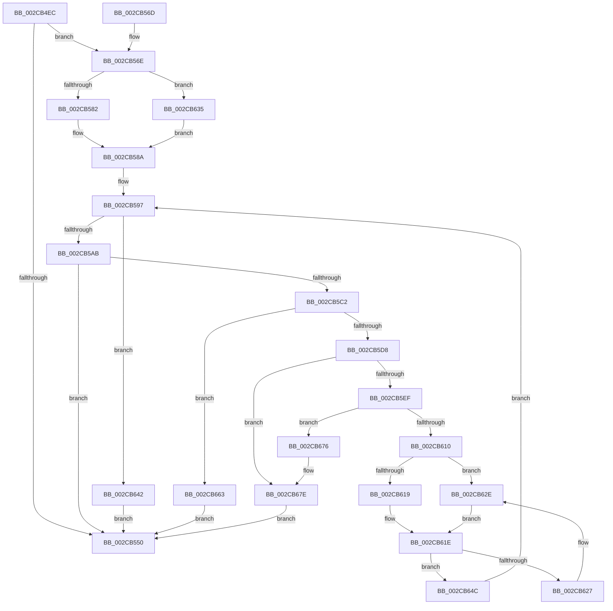

# MiReplenishUltraPageTables

- RVA: `0x002CB4EC`–`0x002CB68E` (길이 `418` bytes)
- VA: `0x00000001402CB4EC`
- 실행 섹션: `.text`
- PDB 이름 있음: `예`; PDB Function 태그: `아니요`
- unwind 정보 RVA: `0x0006F2B4`
- 디코드: `108`개 명령, `418/418` bytes 표시
- 미해석 바이트: `0` (있으면 어셈블리에 `.byte`로 보존)

> 이 문서는 커널 이미지의 기계어와 PDB 기호를 분석해 생성했습니다. 4번과 5번은 함수 원형과 자료형을 바이너리 사용 방식에서 추정한 C 해석이며 원본 소스 복구 결과는 아닙니다.

## 1. Dependencies

- 직접 호출 지점: **14**; 고유 호출 대상: **11**
- 직접 호출자로 확인된 함수: **3**
- RIP 상대 이미지 참조: **2**

### Outgoing calls
- `0x002CB523` → [MiInitializePageColorBase](../32/MiInitializePageColorBase_function_00320410.md) (function, `0x00320410`)
- `0x002CB582` → [ExAcquireSpinLockExclusive](../24/ExAcquireSpinLockExclusive_function_00248690.md) (function, `0x00248690`)
- `0x002CB5AB` → [MiReleaseSpinLockExclusive](../24/MiReleaseSpinLockExclusive_function_002482C0.md) (function, `0x002482C0`)
- `0x002CB5B9` → [MiChargeCommit](../28/MiChargeCommit_function_00286EB0.md) (function, `0x00286EB0`)
- `0x002CB5CB` → [MiChargeResident](../28/MiChargeResident_function_0028A0F0.md) (function, `0x0028A0F0`)
- `0x002CB5E0` → [MiGetUltraPage](../28/MiGetUltraPage_function_002883D0.md) (function, `0x002883D0`)
- `0x002CB607` → [MI_NODE_FROM_PFN](../2B/MI_NODE_FROM_PFN_function_002B0F30.md) (function, `0x002B0F30`)
- `0x002CB619` → [ExAcquireSpinLockExclusive](../24/ExAcquireSpinLockExclusive_function_00248690.md) (function, `0x00248690`)
- `0x002CB62E` → [ExAcquireSpinLockExclusiveAtDpcLevel](../24/ExAcquireSpinLockExclusiveAtDpcLevel_function_00248E80.md) (function, `0x00248E80`)
- `0x002CB638` → [ExAcquireSpinLockExclusiveAtDpcLevel](../24/ExAcquireSpinLockExclusiveAtDpcLevel_function_00248E80.md) (function, `0x00248E80`)
- `0x002CB642` → [MiReleaseSpinLockExclusive](../24/MiReleaseSpinLockExclusive_function_002482C0.md) (function, `0x002482C0`)
- `0x002CB66C` → [MiReturnCommit](../24/MiReturnCommit_function_00248410.md) (function, `0x00248410`)
- `0x002CB679` → [MiReleaseFreshPage](../33/MiReleaseFreshPage_function_00334AE0.md) (function, `0x00334AE0`)
- `0x002CB684` → [MiReleaseNonPagedResources](../32/MiReleaseNonPagedResources_function_0032299C.md) (function, `0x0032299C`)

### Direct callers
- [MiCreateUltraThreadContext](../28/MiCreateUltraThreadContext_function_00288200.md) at `0x00288335`
- [MiReassessZeroThreads](MiReassessZeroThreads_function_002CB0C0.md) at `0x002CB10D`
- [MiCreateUltraThreadContextHelper](MiCreateUltraThreadContextHelper_function_002CB380.md) at `0x002CB46F`

### Static image references
- `0x002CB528` → RVA `0x00E2DBF8` (`.data`; read)
- `0x002CB590` → RVA `0x00E38D00` (`.data`; read)

## 2. Other-region calls and transfers

- 다른 실행 섹션으로 향하는 call: **0**
- 별도 외부 분기/꼬리 이동을 확인하지 못했습니다.

## 3. Assembly (complete function range)

```asm
002CB4EC  48 8B C4                        mov rax, rsp
002CB4EF  48 89 58 08                     mov qword ptr [rax + 8], rbx
002CB4F3  48 89 68 10                     mov qword ptr [rax + 0x10], rbp
002CB4F7  48 89 70 18                     mov qword ptr [rax + 0x18], rsi
002CB4FB  57                              push rdi
002CB4FC  41 54                           push r12
002CB4FE  41 55                           push r13
002CB500  41 56                           push r14
002CB502  41 57                           push r15
002CB504  48 83 EC 30                     sub rsp, 0x30
002CB508  8B D9                           mov ebx, ecx
002CB50A  4C 8D 48 C8                     lea r9, [rax - 0x38]
002CB50E  44 8B FA                        mov r15d, edx
002CB511  0F 57 C0                        xorps xmm0, xmm0
002CB514  BA 03 00 00 00                  mov edx, 3
002CB519  33 C9                           xor ecx, ecx
002CB51B  0F 11 40 C8                     movups xmmword ptr [rax - 0x38], xmm0
002CB51F  44 8D 43 01                     lea r8d, [rbx + 1]
002CB523  E8 E8 4E 05 00                  call 0x140320410
002CB528  48 8B 05 C9 26 B6 00            mov rax, qword ptr [rip + 0xb626c9]
002CB52F  48 8D 0C 5B                     lea rcx, [rbx + rbx*2]
002CB533  48 C1 E1 07                     shl rcx, 7
002CB537  48 8B BC 01 78 01 00 00         mov rdi, qword ptr [rcx + rax + 0x178]
002CB53F  48 8D AF 08 03 00 00            lea rbp, [rdi + 0x308]
002CB546  48 81 7D 10 00 01 00 00         cmp qword ptr [rbp + 0x10], 0x100
002CB54E  72 1E                           jb 0x1402cb56e
002CB550  48 8B 5C 24 60                  mov rbx, qword ptr [rsp + 0x60]
002CB555  48 8B 6C 24 68                  mov rbp, qword ptr [rsp + 0x68]
002CB55A  48 8B 74 24 70                  mov rsi, qword ptr [rsp + 0x70]
002CB55F  48 83 C4 30                     add rsp, 0x30
002CB563  41 5F                           pop r15
002CB565  41 5E                           pop r14
002CB567  41 5D                           pop r13
002CB569  41 5C                           pop r12
002CB56B  5F                              pop rdi
002CB56C  C3                              ret
002CB56D  CC                              int3
002CB56E  48 81 C7 28 03 00 00            add rdi, 0x328
002CB575  48 8B CF                        mov rcx, rdi
002CB578  41 F6 C7 04                     test r15b, 4
002CB57C  0F 85 B3 00 00 00               jne 0x1402cb635
002CB582  E8 09 D1 F7 FF                  call 0x140248690
002CB587  44 8A F0                        mov r14b, al
002CB58A  41 BC 01 00 00 00               mov r12d, 1
002CB590  4C 8D 2D 69 D7 B6 00            lea r13, [rip + 0xb6d769]
002CB597  48 81 7D 10 00 01 00 00         cmp qword ptr [rbp + 0x10], 0x100
002CB59F  41 8A D6                        mov dl, r14b
002CB5A2  48 8B CF                        mov rcx, rdi
002CB5A5  0F 83 97 00 00 00               jae 0x1402cb642
002CB5AB  E8 10 CD F7 FF                  call 0x1402482c0
002CB5B0  45 33 C0                        xor r8d, r8d
002CB5B3  49 8B D4                        mov rdx, r12
002CB5B6  49 8B CD                        mov rcx, r13
002CB5B9  E8 F2 B8 FB FF                  call 0x140286eb0
002CB5BE  85 C0                           test eax, eax
002CB5C0  74 8E                           je 0x1402cb550
002CB5C2  45 33 C0                        xor r8d, r8d
002CB5C5  49 8B D4                        mov rdx, r12
002CB5C8  49 8B CD                        mov rcx, r13
002CB5CB  E8 20 EB FB FF                  call 0x14028a0f0
002CB5D0  85 C0                           test eax, eax
002CB5D2  0F 84 8B 00 00 00               je 0x1402cb663
002CB5D8  41 8B D7                        mov edx, r15d
002CB5DB  48 8D 4C 24 20                  lea rcx, [rsp + 0x20]
002CB5E0  E8 EB CD FB FF                  call 0x1402883d0
002CB5E5  48 83 F8 FF                     cmp rax, -1
002CB5E9  0F 84 8F 00 00 00               je 0x1402cb67e
002CB5EF  48 8D 34 40                     lea rsi, [rax + rax*2]
002CB5F3  48 C1 E6 04                     shl rsi, 4
002CB5F7  48 B8 00 00 00 00 00 DE FF FF   movabs rax, 0xffffde0000000000
002CB601  48 03 F0                        add rsi, rax
002CB604  48 8B CE                        mov rcx, rsi
002CB607  E8 24 59 FE FF                  call 0x1402b0f30
002CB60C  3B C3                           cmp eax, ebx
002CB60E  75 66                           jne 0x1402cb676
002CB610  48 8B CF                        mov rcx, rdi
002CB613  41 80 FE 11                     cmp r14b, 0x11
002CB617  74 15                           je 0x1402cb62e
002CB619  E8 72 D0 F7 FF                  call 0x140248690
002CB61E  48 8B 45 08                     mov rax, qword ptr [rbp + 8]
002CB622  48 39 28                        cmp qword ptr [rax], rbp
002CB625  74 25                           je 0x1402cb64c
002CB627  B9 03 00 00 00                  mov ecx, 3
002CB62C  CD 29                           int 0x29
002CB62E  E8 4D D8 F7 FF                  call 0x140248e80
002CB633  EB E9                           jmp 0x1402cb61e
002CB635  41 B6 11                        mov r14b, 0x11
002CB638  E8 43 D8 F7 FF                  call 0x140248e80
002CB63D  E9 48 FF FF FF                  jmp 0x1402cb58a
002CB642  E8 79 CC F7 FF                  call 0x1402482c0
002CB647  E9 04 FF FF FF                  jmp 0x1402cb550
002CB64C  48 89 2E                        mov qword ptr [rsi], rbp
002CB64F  48 89 46 08                     mov qword ptr [rsi + 8], rax
002CB653  48 89 30                        mov qword ptr [rax], rsi
002CB656  48 89 75 08                     mov qword ptr [rbp + 8], rsi
002CB65A  4C 01 65 10                     add qword ptr [rbp + 0x10], r12
002CB65E  E9 34 FF FF FF                  jmp 0x1402cb597
002CB663  45 33 C0                        xor r8d, r8d
002CB666  49 8B D4                        mov rdx, r12
002CB669  49 8B CD                        mov rcx, r13
002CB66C  E8 9F CD F7 FF                  call 0x140248410
002CB671  E9 DA FE FF FF                  jmp 0x1402cb550
002CB676  48 8B CE                        mov rcx, rsi
002CB679  E8 62 94 06 00                  call 0x140334ae0
002CB67E  49 8B D4                        mov rdx, r12
002CB681  49 8B CD                        mov rcx, r13
002CB684  E8 13 73 05 00                  call 0x14032299c
002CB689  E9 C2 FE FF FF                  jmp 0x1402cb550
```

## 4. C-style interpretation (structured pseudocode)

```c
__int64 __fastcall MiReplenishUltraPageTables(int a1, int a2)
{
    __int64 result;
    __int64 v_rdi;
    __int64 v_rsi;
    __int64 v_rsp;
    unsigned __int64 v_stack_p10;
    unsigned __int64 v_stack_p18;
    unsigned __int64 v_stack_p20;
    unsigned __int64 v_stack_p8;

    *(unsigned __int64 *)(v_rsp + 8) = v_rbx;
    *(unsigned __int64 *)(v_rsp + 16) = v_rbp;
    *(unsigned __int64 *)(v_rsp + 24) = v_rsi;
    v_rsp = (v_rsp) - (48);
    a1 = 0;
    *(unsigned __int64 *)(v_rsp - 56) = v_xmm0;
    result = MiInitializePageColorBase(a1, 3, (unsigned int)(a1) + 1, v_rsp - 56);
    a1 = ((unsigned int)(a1) + (unsigned int)(a1) * 2) << (7);
    if ((*(unsigned __int64 *)(*(unsigned __int64 *)(a1 + *(unsigned __int64 *)(v_rip + 11937481) * 1 + 376) + 776 + 16)) < 256) goto loc_002CB56E;
loc_002CB550:
    v_rsp = (v_rsp) + (48);
    return *(unsigned __int64 *)(v_rip + 11937481);
loc_002CB56E:
    v_rdi = (*(unsigned __int64 *)(a1 + *(unsigned __int64 *)(v_rip + 11937481) * 1 + 376)) + (808);
    if ((((unsigned __int8)((unsigned int)(a2))) & (4)) != 0) goto loc_002CB635;
    result = ExAcquireSpinLockExclusive(v_rdi, 3, (unsigned int)(a1) + 1, v_rsp - 56);
loc_002CB58A:
loc_002CB597:
    if ((*(unsigned __int64 *)(v_stack_p10 + 16)) >= 256) goto loc_002CB642;
    result = MiReleaseSpinLockExclusive(v_rdi, (unsigned __int8)((unsigned __int8)(result)), (unsigned int)(a1) + 1, v_rsp - 56);
    a3 = 0;
    result = MiChargeCommit(v_rip + 11982697, 1, a3, v_rsp - 56);
    if ((unsigned int)(result) == 0) goto loc_002CB550;
    a3 = 0;
    result = MiChargeResident(v_rip + 11982697, 1, a3, v_rsp - 56);
    if ((unsigned int)(result) == 0) goto loc_002CB663;
    result = MiGetUltraPage(v_stack_p20, (unsigned int)((unsigned int)((unsigned int)(a2))), a3, v_rsp - 56);
    if (result == -1) goto loc_002CB67E;
    v_rsi = (result + result * 2) << (4);
    v_rsi = (v_rsi) + (result);
    result = MI_NODE_FROM_PFN(v_rsi, (unsigned int)((unsigned int)((unsigned int)(a2))), a3, v_rsp - 56);
    if (((unsigned int)(result)) != ((unsigned int)(v_stack_p8))) goto loc_002CB676;
    if (((unsigned __int8)((unsigned __int8)(result))) == 17) goto loc_002CB62E;
    result = ExAcquireSpinLockExclusive(v_rdi, (unsigned int)((unsigned int)((unsigned int)(a2))), a3, v_rsp - 56);
loc_002CB61E:
    if ((*(unsigned __int64 *)(*(unsigned __int64 *)(v_stack_p10 + 8))) == v_stack_p10) goto loc_002CB64C;
loc_002CB62E:
    result = ExAcquireSpinLockExclusiveAtDpcLevel(3, (unsigned int)((unsigned int)((unsigned int)(a2))), a3, v_rsp - 56);
    goto loc_002CB61E;
loc_002CB635:
    result = ExAcquireSpinLockExclusiveAtDpcLevel(3, (unsigned int)((unsigned int)((unsigned int)(a2))), a3, v_rsp - 56);
    goto loc_002CB58A;
loc_002CB642:
    result = MiReleaseSpinLockExclusive(3, (unsigned int)((unsigned int)((unsigned int)(a2))), a3, v_rsp - 56);
    goto loc_002CB550;
loc_002CB64C:
    *(unsigned __int64 *)(v_rsi) = v_stack_p10;
    *(unsigned __int64 *)(v_rsi + 8) = result;
    *(unsigned __int64 *)(result) = v_rsi;
    *(unsigned __int64 *)(v_stack_p10 + 8) = v_rsi;
    goto loc_002CB597;
loc_002CB663:
    a3 = 0;
    result = MiReturnCommit(v_rip + 11982697, 1, a3, v_rsp - 56);
    goto loc_002CB550;
loc_002CB676:
    result = MiReleaseFreshPage(v_rsi, 1, a3, v_rsp - 56);
loc_002CB67E:
    result = MiReleaseNonPagedResources(v_rip + 11982697, 1, a3, v_rsp - 56);
    goto loc_002CB550;
}
```

## 5. (Beta) C Style

```c
int64_t MiReplenishUltraPageTables(void *Arg1, int32_t Arg2)
{
    uint8_t *arg1 = (uint8_t *)Arg1;

    int64_t result;
    int64_t local_rdi;
    int64_t local_rsi;
    int64_t local_rsp;
    uint64_t v_stack_p10;
    uint64_t v_stack_p18;
    uint64_t v_stack_p20;
    uint64_t v_stack_p8;

    *(uint64_t *)(local_rsp + 0x8) = local_rbx;
    *(uint64_t *)(local_rsp + 0x10) = local_rbp;
    *(uint64_t *)(local_rsp + 0x18) = local_rsi;
    local_rsp = (local_rsp) - (48);
    Arg1 = 0;
    *(uint64_t *)(local_rsp - 0x38) = v_xmm0;
    result = MiInitializePageColorBase(Arg1, 3, (uint32_t)(Arg1) + 1, local_rsp - 56);
    Arg1 = ((uint32_t)(Arg1) + (uint32_t)(Arg1) * 2) << (7);
    if ((*(uint64_t *)(*(uint64_t *)(arg1 + *(uint64_t *)(v_rip + 0xB626C9) * 1 + 0x178) + 0x308 + 0x10)) < 256) goto loc_002CB56E;
loc_002CB550:
    local_rsp = (local_rsp) + (48);
    return *(uint64_t *)(v_rip + 0xB626C9);
loc_002CB56E:
    local_rdi = (*(uint64_t *)(arg1 + *(uint64_t *)(v_rip + 0xB626C9) * 1 + 0x178)) + (808);
    if ((((uint8_t)((uint32_t)(Arg2))) & (4)) != 0) goto loc_002CB635;
    result = ExAcquireSpinLockExclusive(local_rdi, 3, (uint32_t)(Arg1) + 1, local_rsp - 56);
loc_002CB58A:
loc_002CB597:
    if ((*(uint64_t *)(v_stack_p10 + 0x10)) >= 256) goto loc_002CB642;
    result = MiReleaseSpinLockExclusive(local_rdi, (uint8_t)((uint8_t)(result)), (uint32_t)(Arg1) + 1, local_rsp - 56);
    a3 = 0;
    result = MiChargeCommit(v_rip + 11982697, 1, a3, local_rsp - 56);
    if ((uint32_t)(result) == 0) goto loc_002CB550;
    a3 = 0;
    result = MiChargeResident(v_rip + 11982697, 1, a3, local_rsp - 56);
    if ((uint32_t)(result) == 0) goto loc_002CB663;
    result = MiGetUltraPage(v_stack_p20, (uint32_t)((uint32_t)((uint32_t)(Arg2))), a3, local_rsp - 56);
    if (result == -1) goto loc_002CB67E;
    local_rsi = (result + result * 2) << (4);
    local_rsi = (local_rsi) + (result);
    result = MI_NODE_FROM_PFN(local_rsi, (uint32_t)((uint32_t)((uint32_t)(Arg2))), a3, local_rsp - 56);
    if (((uint32_t)(result)) != ((uint32_t)(v_stack_p8))) goto loc_002CB676;
    if (((uint8_t)((uint8_t)(result))) == 17) goto loc_002CB62E;
    result = ExAcquireSpinLockExclusive(local_rdi, (uint32_t)((uint32_t)((uint32_t)(Arg2))), a3, local_rsp - 56);
loc_002CB61E:
    if ((*(uint64_t *)(*(uint64_t *)(v_stack_p10 + 0x8))) == v_stack_p10) goto loc_002CB64C;
loc_002CB62E:
    result = ExAcquireSpinLockExclusiveAtDpcLevel(3, (uint32_t)((uint32_t)((uint32_t)(Arg2))), a3, local_rsp - 56);
    goto loc_002CB61E;
loc_002CB635:
    result = ExAcquireSpinLockExclusiveAtDpcLevel(3, (uint32_t)((uint32_t)((uint32_t)(Arg2))), a3, local_rsp - 56);
    goto loc_002CB58A;
loc_002CB642:
    result = MiReleaseSpinLockExclusive(3, (uint32_t)((uint32_t)((uint32_t)(Arg2))), a3, local_rsp - 56);
    goto loc_002CB550;
loc_002CB64C:
    *(uint64_t *)(local_rsi) = v_stack_p10;
    *(uint64_t *)(local_rsi + 0x8) = result;
    *(uint64_t *)(result) = local_rsi;
    *(uint64_t *)(v_stack_p10 + 0x8) = local_rsi;
    goto loc_002CB597;
loc_002CB663:
    a3 = 0;
    result = MiReturnCommit(v_rip + 11982697, 1, a3, local_rsp - 56);
    goto loc_002CB550;
loc_002CB676:
    result = MiReleaseFreshPage(local_rsi, 1, a3, local_rsp - 56);
loc_002CB67E:
    result = MiReleaseNonPagedResources(v_rip + 11982697, 1, a3, local_rsp - 56);
    goto loc_002CB550;
}
```

### 관측된 메모리 오프셋

구조체 형식이 확인되지 않은 접근은 인자 기준의 오프셋으로만 기록했습니다.

| 기준 인자 | 오프셋 표현 | 폭 (bit) | 접근 |
|---|---:|---:|---|
| `Arg1` | `+ 0x0 + rbx*2` | `64` | `R` |
| `Arg1` | `+ 0x1` | `32` | `R` |

## 6. Execution-region graph

[열기: 2D/3D 그래프와 함수 탐색 컨트롤 패널](../../../control-panel.html?section=text&rva=0x002CB4EC&view=graph)

- 2D 그래프는 위에서 아래로 흐르고, 3D 그래프는 빈 공간을 드래그해 회전합니다. Shift+드래그는 이동, 휠은 확대·축소, 함수 노드 선택은 대상 보고서 이동입니다.

### Static fallback


