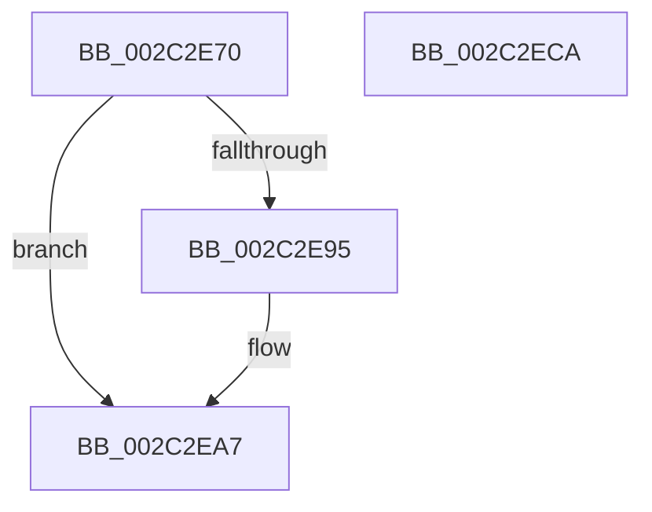

# MiReturnFullProcessCharges

- RVA: `0x002C2E70`–`0x002C2ECB` (길이 `91` bytes)
- VA: `0x00000001402C2E70`
- 실행 섹션: `.text`
- PDB 이름 있음: `예`; PDB Function 태그: `아니요`
- unwind 정보 RVA: `0x00060BC4`
- 디코드: `26`개 명령, `91/91` bytes 표시
- 미해석 바이트: `0` (있으면 어셈블리에 `.byte`로 보존)

> 이 문서는 커널 이미지의 기계어와 PDB 기호를 분석해 생성했습니다. 4번과 5번은 함수 원형과 자료형을 바이너리 사용 방식에서 추정한 C 해석이며 원본 소스 복구 결과는 아닙니다.

## 1. Dependencies

- 직접 호출 지점: **2**; 고유 호출 대상: **2**
- 직접 호출자로 확인된 함수: **6**
- RIP 상대 이미지 참조: **0**

### Outgoing calls
- `0x002C2EA2` → [PspChangeJobMemoryUsageByProcess](../../page/87/PspChangeJobMemoryUsageByProcess_function_0087F030.md) (function, `0x0087F030`)
- `0x002C2EB5` → [PsReturnProcessPageFileQuota](../../page/9E/PsReturnProcessPageFileQuota_function_009EC280.md) (function, `0x009EC280`)

### Direct callers
- [sub_002C37D9](Unknown_function_002C37D9.md) at `0x002C3A09`
- [MiDecommitRegion](../../page/88/MiDecommitRegion_function_008807A0.md) at `0x008808BD`
- [MiDeleteVad](../../page/88/MiDeleteVad_function_00888C80.md) at `0x008891DF`
- [MiRemoveVadCharges](../../page/9B/MiRemoveVadCharges_function_009BAEC4.md) at `0x009BAFF7`
- [MiReturnFullProcessCommitment](../../page/9E/MiReturnFullProcessCommitment_function_009E5D58.md) at `0x009E5D81`
- [MiDeleteVadBitmap](../../page/A4/MiDeleteVadBitmap_function_00A45F18.md) at `0x00A45FFC`

### Static image references
- 디코드된 RIP-relative 메모리 참조가 없습니다.

## 2. Other-region calls and transfers

- 다른 실행 섹션으로 향하는 call: **2**
  - `0x002C2EA2` → [PspChangeJobMemoryUsageByProcess](../../page/87/PspChangeJobMemoryUsageByProcess_function_0087F030.md) (`.text` → `PAGE`)
  - `0x002C2EB5` → [PsReturnProcessPageFileQuota](../../page/9E/PsReturnProcessPageFileQuota_function_009EC280.md) (`.text` → `PAGE`)
- 별도 외부 분기/꼬리 이동을 확인하지 못했습니다.

## 3. Assembly (complete function range)

```asm
002C2E70  48 89 5C 24 08                  mov qword ptr [rsp + 8], rbx
002C2E75  48 89 74 24 10                  mov qword ptr [rsp + 0x10], rsi
002C2E7A  57                              push rdi
002C2E7B  48 83 EC 20                     sub rsp, 0x20
002C2E7F  8B 81 F0 01 00 00               mov eax, dword ptr [rcx + 0x1f0]
002C2E85  48 8B FA                        mov rdi, rdx
002C2E88  48 F7 DF                        neg rdi
002C2E8B  48 8B F2                        mov rsi, rdx
002C2E8E  48 8B D9                        mov rbx, rcx
002C2E91  A8 10                           test al, 0x10
002C2E93  74 12                           je 0x1402c2ea7
002C2E95  45 33 C9                        xor r9d, r9d
002C2E98  4C 8B C1                        mov r8, rcx
002C2E9B  48 8B D7                        mov rdx, rdi
002C2E9E  41 8D 49 02                     lea ecx, [r9 + 2]
002C2EA2  E8 89 C1 5B 00                  call 0x14087f030
002C2EA7  F0 48 01 BB D8 03 00 00         lock add qword ptr [rbx + 0x3d8], rdi
002C2EAF  48 8B D6                        mov rdx, rsi
002C2EB2  48 8B CB                        mov rcx, rbx
002C2EB5  E8 C6 93 72 00                  call 0x1409ec280
002C2EBA  48 8B 5C 24 30                  mov rbx, qword ptr [rsp + 0x30]
002C2EBF  48 8B 74 24 38                  mov rsi, qword ptr [rsp + 0x38]
002C2EC4  48 83 C4 20                     add rsp, 0x20
002C2EC8  5F                              pop rdi
002C2EC9  C3                              ret
002C2ECA  CC                              int3
```

## 4. C-style interpretation (structured pseudocode)

```c
__int64 __fastcall MiReturnFullProcessCharges(__int64 a1, __int64 a2, __int64 a3, int a4)
{
    __int64 result;
    __int64 v_rdi;
    __int64 v_rsp;
    unsigned __int64 v_stack_p10;
    unsigned __int64 v_stack_p8;

    v_stack_p8 = v_rbx;
    v_stack_p10 = v_rsi;
    v_rsp = (v_rsp) - (32);
    v_rdi = -(a2);
    result = (unsigned int)(*(unsigned int *)(a1 + 496));
    if ((((unsigned __int8)((unsigned int)(*(unsigned int *)(a1 + 496)))) & (16)) != 0) {
        a4 = 0;
        a3 = a1;
        a2 = v_rdi;
        a1 = a4 + 2;
        result = PspChangeJobMemoryUsageByProcess(a1, a2, a3, a4);
    }
    result = PsReturnProcessPageFileQuota(a1, a2, a3, a4);
    v_rsp = (v_rsp) + (32);
    return result;
}
```

## 5. (Beta) C Style

```c
int64_t MiReturnFullProcessCharges(void *Arg1, int64_t Arg2, int64_t Arg3, int32_t Arg4)
{
    uint8_t *arg1 = (uint8_t *)Arg1;

    int64_t result;
    int64_t local_rdi;
    int64_t local_rsp;
    uint64_t v_stack_p10;
    uint64_t v_stack_p8;

    v_stack_p8 = local_rbx;
    v_stack_p10 = local_rsi;
    local_rsp = (local_rsp) - (32);
    local_rdi = -(Arg2);
    result = (uint32_t)(*(uint32_t *)(arg1 + 0x1F0));
    if ((((uint8_t)((uint32_t)(*(uint32_t *)(arg1 + 0x1F0)))) & (16)) != 0) {
        Arg4 = 0;
        Arg3 = Arg1;
        Arg2 = local_rdi;
        Arg1 = Arg4 + 2;
        result = PspChangeJobMemoryUsageByProcess(Arg1, Arg2, Arg3, Arg4);
    }
    result = PsReturnProcessPageFileQuota(Arg1, Arg2, Arg3, Arg4);
    local_rsp = (local_rsp) + (32);
    return result;
}
```

### 관측된 메모리 오프셋

구조체 형식이 확인되지 않은 접근은 인자 기준의 오프셋으로만 기록했습니다.

| 기준 인자 | 오프셋 표현 | 폭 (bit) | 접근 |
|---|---:|---:|---|
| `Arg1` | `+ 0x1F0` | `32` | `R` |
| `Arg1` | `+ 0x3D8` | `64` | `R/W` |

## 6. Execution-region graph

[열기: 2D/3D 그래프와 함수 탐색 컨트롤 패널](../../../control-panel.html?section=text&rva=0x002C2E70&view=graph)

- 2D 그래프는 위에서 아래로 흐르고, 3D 그래프는 빈 공간을 드래그해 회전합니다. Shift+드래그는 이동, 휠은 확대·축소, 함수 노드 선택은 대상 보고서 이동입니다.

### Static fallback


