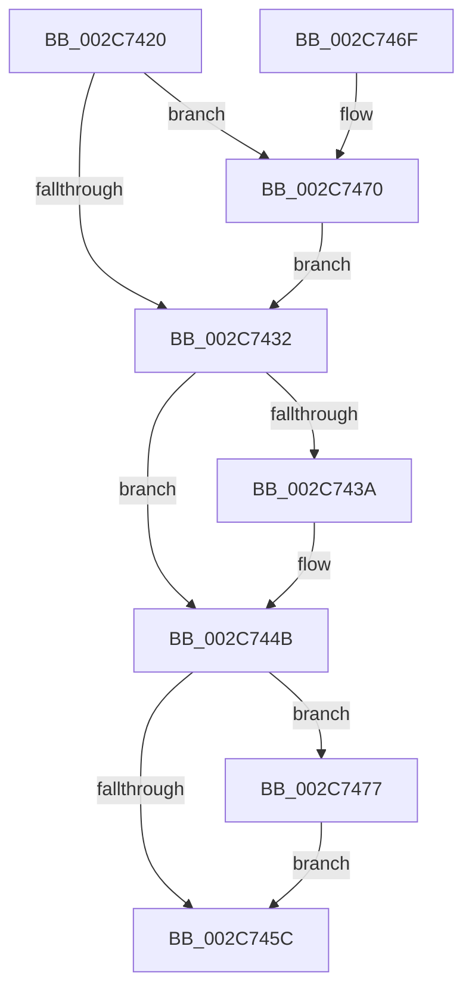

# MiRevertProcessorMove

- RVA: `0x002C7420`–`0x002C7483` (길이 `99` bytes)
- VA: `0x00000001402C7420`
- 실행 섹션: `.text`
- PDB 이름 있음: `예`; PDB Function 태그: `아니요`
- unwind 정보 RVA: `0x0006EDB4`
- 디코드: `29`개 명령, `99/99` bytes 표시
- 미해석 바이트: `0` (있으면 어셈블리에 `.byte`로 보존)

> 이 문서는 커널 이미지의 기계어와 PDB 기호를 분석해 생성했습니다. 4번과 5번은 함수 원형과 자료형을 바이너리 사용 방식에서 추정한 C 해석이며 원본 소스 복구 결과는 아닙니다.

## 1. Dependencies

- 직접 호출 지점: **4**; 고유 호출 대상: **4**
- 직접 호출자로 확인된 함수: **2**
- RIP 상대 이미지 참조: **0**

### Outgoing calls
- `0x002C7446` → [KeSetIdealProcessorThreadEx](../2D/KeSetIdealProcessorThreadEx_function_002DD36C.md) (function, `0x002DD36C`)
- `0x002C7464` → [MiDereferencePageChains](MiDereferencePageChains_function_002C75E4.md) (function, `0x002C75E4`)
- `0x002C7470` → [MiDeleteAcceleratorDescriptor](MiDeleteAcceleratorDescriptor_function_002CA560.md) (function, `0x002CA560`)
- `0x002C747C` → [PsDereferencePartition](../34/PsDereferencePartition_function_00342E70.md) (function, `0x00342E70`)

### Direct callers
- [MiZeroInParallelWorker](MiZeroInParallelWorker_function_002C6600.md) at `0x002C6773`
- [MiZeroHugeRangeWorker](../68/MiZeroHugeRangeWorker_function_0068C960.md) at `0x0068CA55`

### Static image references
- 디코드된 RIP-relative 메모리 참조가 없습니다.

## 2. Other-region calls and transfers

- 다른 실행 섹션으로 향하는 call: **0**
- 별도 외부 분기/꼬리 이동을 확인하지 못했습니다.

## 3. Assembly (complete function range)

```asm
002C7420  40 53                           push rbx
002C7422  48 83 EC 20                     sub rsp, 0x20
002C7426  48 8B D9                        mov rbx, rcx
002C7429  48 8B 49 10                     mov rcx, qword ptr [rcx + 0x10]
002C742D  48 85 C9                        test rcx, rcx
002C7430  75 3E                           jne 0x1402c7470
002C7432  8B 53 08                        mov edx, dword ptr [rbx + 8]
002C7435  83 FA FF                        cmp edx, -1
002C7438  74 11                           je 0x1402c744b
002C743A  65 48 8B 0C 25 88 01 00 00      mov rcx, qword ptr gs:[0x188]
002C7443  45 33 C0                        xor r8d, r8d
002C7446  E8 21 5F 01 00                  call 0x1402dd36c
002C744B  48 8B 43 18                     mov rax, qword ptr [rbx + 0x18]
002C744F  48 8B 48 20                     mov rcx, qword ptr [rax + 0x20]
002C7453  48 8B 49 08                     mov rcx, qword ptr [rcx + 8]
002C7457  48 85 C9                        test rcx, rcx
002C745A  75 1B                           jne 0x1402c7477
002C745C  48 8B 4B 18                     mov rcx, qword ptr [rbx + 0x18]
002C7460  48 8B 49 20                     mov rcx, qword ptr [rcx + 0x20]
002C7464  E8 7B 01 00 00                  call 0x1402c75e4
002C7469  48 83 C4 20                     add rsp, 0x20
002C746D  5B                              pop rbx
002C746E  C3                              ret
002C746F  CC                              int3
002C7470  E8 EB 30 00 00                  call 0x1402ca560
002C7475  EB BB                           jmp 0x1402c7432
002C7477  BA 4D 6D 5A 65                  mov edx, 0x655a6d4d
002C747C  E8 EF B9 07 00                  call 0x140342e70
002C7481  EB D9                           jmp 0x1402c745c
```

## 4. C-style interpretation (structured pseudocode)

```c
__int64 __fastcall MiRevertProcessorMove(__int64 a1, __int64 a2, int a3)
{
    __int64 result;
    __int64 v_rsp;

    v_rsp = (v_rsp) - (32);
    if (*(unsigned __int64 *)(a1 + 16) != 0) goto loc_002C7470;
loc_002C7432:
    if (((unsigned int)((unsigned int)(*(unsigned int *)(a1 + 8)))) != -1) {
        a1 = *(unsigned __int64 *)(gs_base + (0 + 392));
        a3 = 0;
        result = KeSetIdealProcessorThreadEx(a1, (unsigned int)(*(unsigned int *)(a1 + 8)), a3, a4);
    }
    if (*(unsigned __int64 *)(*(unsigned __int64 *)(*(unsigned __int64 *)(a1 + 24) + 32) + 8) != 0) goto loc_002C7477;
loc_002C745C:
    result = MiDereferencePageChains(*(unsigned __int64 *)(*(unsigned __int64 *)(a1 + 24) + 32), (unsigned int)(*(unsigned int *)(a1 + 8)), a3, a4);
    v_rsp = (v_rsp) + (32);
    return result;
loc_002C7470:
    result = MiDeleteAcceleratorDescriptor(*(unsigned __int64 *)(*(unsigned __int64 *)(a1 + 24) + 32), (unsigned int)(*(unsigned int *)(a1 + 8)), a3, a4);
    goto loc_002C7432;
loc_002C7477:
    result = PsDereferencePartition(*(unsigned __int64 *)(*(unsigned __int64 *)(a1 + 24) + 32), (unsigned int)(0x655A6D4DULL), a3, a4);
    goto loc_002C745C;
}
```

## 5. (Beta) C Style

```c
int64_t MiRevertProcessorMove(void *Arg1, int64_t Arg2, int32_t Arg3)
{
    uint8_t *arg1 = (uint8_t *)Arg1;

    int64_t result;
    int64_t local_rsp;

    local_rsp = (local_rsp) - (32);
    if (*(uint64_t *)(arg1 + 0x10) != 0) goto loc_002C7470;
loc_002C7432:
    if (((uint32_t)((uint32_t)(*(uint32_t *)(arg1 + 0x8)))) != -1) {
        Arg1 = *(uint64_t *)(gs_base + (0 + 0x188));
        Arg3 = 0;
        result = KeSetIdealProcessorThreadEx(Arg1, (uint32_t)(*(uint32_t *)(arg1 + 0x8)), Arg3, a4);
    }
    if (*(uint64_t *)(*(uint64_t *)(*(uint64_t *)(arg1 + 0x18) + 0x20) + 0x8) != 0) goto loc_002C7477;
loc_002C745C:
    result = MiDereferencePageChains(*(uint64_t *)(*(uint64_t *)(arg1 + 0x18) + 0x20), (uint32_t)(*(uint32_t *)(arg1 + 0x8)), Arg3, a4);
    local_rsp = (local_rsp) + (32);
    return result;
loc_002C7470:
    result = MiDeleteAcceleratorDescriptor(*(uint64_t *)(*(uint64_t *)(arg1 + 0x18) + 0x20), (uint32_t)(*(uint32_t *)(arg1 + 0x8)), Arg3, a4);
    goto loc_002C7432;
loc_002C7477:
    result = PsDereferencePartition(*(uint64_t *)(*(uint64_t *)(arg1 + 0x18) + 0x20), (uint32_t)(0x655A6D4DULL), Arg3, a4);
    goto loc_002C745C;
}
```

### 관측된 메모리 오프셋

구조체 형식이 확인되지 않은 접근은 인자 기준의 오프셋으로만 기록했습니다.

| 기준 인자 | 오프셋 표현 | 폭 (bit) | 접근 |
|---|---:|---:|---|
| `Arg1` | `+ 0x8` | `32` | `R` |
| `Arg1` | `+ 0x10` | `64` | `R` |
| `Arg1` | `+ 0x18` | `64` | `R` |

## 6. Execution-region graph

[열기: 2D/3D 그래프와 함수 탐색 컨트롤 패널](../../../control-panel.html?section=text&rva=0x002C7420&view=graph)

- 2D 그래프는 위에서 아래로 흐르고, 3D 그래프는 빈 공간을 드래그해 회전합니다. Shift+드래그는 이동, 휠은 확대·축소, 함수 노드 선택은 대상 보고서 이동입니다.

### Static fallback


