# MiRevertValidPte

- RVA: `0x002C5160`–`0x002C5585` (길이 `1,061` bytes)
- VA: `0x00000001402C5160`
- 실행 섹션: `.text`
- PDB 이름 있음: `예`; PDB Function 태그: `예`
- unwind 정보 RVA: `0x0006EA84`
- 디코드: `244`개 명령, `1,061/1,061` bytes 표시
- 미해석 바이트: `0` (있으면 어셈블리에 `.byte`로 보존)

> 이 문서는 커널 이미지의 기계어와 PDB 기호를 분석해 생성했습니다. 4번과 5번은 함수 원형과 자료형을 바이너리 사용 방식에서 추정한 C 해석이며 원본 소스 복구 결과는 아닙니다.

## 1. Dependencies

- 직접 호출 지점: **10**; 고유 호출 대상: **10**
- 직접 호출자로 확인된 함수: **3**
- RIP 상대 이미지 참조: **3**

### Outgoing calls
- `0x002C528B` → [MiMakeValidPte](MiMakeValidPte_function_002C5590.md) (function, `0x002C5590`)
- `0x002C537A` → [MiWriteValidPteNewProtection](../28/MiWriteValidPteNewProtection_function_00281810.md) (function, `0x00281810`)
- `0x002C53EB` → [MI_SET_PTE_SHADOW_STACK](../49/MI_SET_PTE_SHADOW_STACK_function_00494AEC.md) (function, `0x00494AEC`)
- `0x002C5436` → [MiInsertTbFlushEntry](../29/MiInsertTbFlushEntry_function_00293670.md) (function, `0x00293670`)
- `0x002C545E` → [MiLockPageAndSetDirty](../28/MiLockPageAndSetDirty_function_002857A0.md) (function, `0x002857A0`)
- `0x002C5489` → [MiRewritePteWithLockBit](../32/MiRewritePteWithLockBit_function_00322FEC.md) (function, `0x00322FEC`)
- `0x002C5496` → [MiInsertLargeTbFlushEntry](../37/MiInsertLargeTbFlushEntry_function_0037827C.md) (function, `0x0037827C`)
- `0x002C553E` → [MiGetLeafVa](../27/MiGetLeafVa_function_0027C0A0.md) (function, `0x0027C0A0`)
- `0x002C5559` → [MiCaptureWriteWatchDirtyBit](../46/MiCaptureWriteWatchDirtyBit_function_00465224.md) (function, `0x00465224`)
- `0x002C5573` → [MiRotatedToFrameBuffer](MiRotatedToFrameBuffer_function_002C5FE4.md) (function, `0x002C5FE4`)

### Direct callers
- [MiSetReadOnlyOnSectionView](../29/MiSetReadOnlyOnSectionView_function_00294538.md) at `0x0029472A`
- [sub_002C3A7C](Unknown_function_002C3A7C.md) at `0x002C3D7D`
- [MiProtectPrivateMemory](MiProtectPrivateMemory_function_002C45B0.md) at `0x002C499D`

### Static image references
- `0x002C5221` → RVA `0x00E2DCE0` (`.data`; read)
- `0x002C525B` → RVA `0x00FC6A88` (`ALMOSTRO`; read)
- `0x002C54A4` → RVA `0x00000000` (`image boundary/outside`; read)

## 2. Other-region calls and transfers

- 다른 실행 섹션으로 향하는 call: **0**
- call이 아닌 외부 분기/꼬리 이동: **4**
  - `0x002C54C3` → [sub_006DC422](../6D/Unknown_function_006DC422.md) (`tail-transfer`)
  - `0x002C54D8` → [sub_006DC422](../6D/Unknown_function_006DC422.md) (`tail-transfer`)
  - `0x002C5506` → [sub_006DC422 + 0x92](../6D/Unknown_function_006DC422.md) (`tail-transfer`)
  - `0x002C5513` → [sub_006DC422 + 0x33](../6D/Unknown_function_006DC422.md) (`tail-transfer`)

## 3. Assembly (complete function range)

```asm
002C5160  48 89 5C 24 18                  mov qword ptr [rsp + 0x18], rbx
002C5165  48 89 54 24 10                  mov qword ptr [rsp + 0x10], rdx
002C516A  55                              push rbp
002C516B  56                              push rsi
002C516C  57                              push rdi
002C516D  41 54                           push r12
002C516F  41 55                           push r13
002C5171  41 56                           push r14
002C5173  41 57                           push r15
002C5175  48 83 EC 60                     sub rsp, 0x60
002C5179  45 33 DB                        xor r11d, r11d
002C517C  4D 8B F1                        mov r14, r9
002C517F  45 8B C8                        mov r9d, r8d
002C5182  4C 89 5C 24 28                  mov qword ptr [rsp + 0x28], r11
002C5187  41 8B F8                        mov edi, r8d
002C518A  44 89 9C 24 B8 00 00 00         mov dword ptr [rsp + 0xb8], r11d
002C5192  44 8B 41 30                     mov r8d, dword ptr [rcx + 0x30]
002C5196  4C 8B E2                        mov r12, rdx
002C5199  41 8B C0                        mov eax, r8d
002C519C  48 8B E9                        mov rbp, rcx
002C519F  25 00 00 A0 00                  and eax, 0xa00000
002C51A4  3D 00 00 A0 00                  cmp eax, 0xa00000
002C51A9  0F 84 F1 02 00 00               je 0x1402c54a0
002C51AF  BA 01 00 00 00                  mov edx, 1
002C51B4  41 BA 03 00 00 00               mov r10d, 3
002C51BA  44 89 94 24 A0 00 00 00         mov dword ptr [rsp + 0xa0], r10d
002C51C2  44 8B C2                        mov r8d, edx
002C51C5  48 89 54 24 30                  mov qword ptr [rsp + 0x30], rdx
002C51CA  48 89 54 24 48                  mov qword ptr [rsp + 0x48], rdx
002C51CF  48 89 54 24 38                  mov qword ptr [rsp + 0x38], rdx
002C51D4  49 8B CC                        mov rcx, r12
002C51D7  48 C1 E1 19                     shl rcx, 0x19
002C51DB  48 B8 00 00 00 00 80 F6 FF FF   movabs rax, 0xfffff68000000000
002C51E5  49 8B 1C 24                     mov rbx, qword ptr [r12]
002C51E9  48 C1 E0 19                     shl rax, 0x19
002C51ED  48 2B C8                        sub rcx, rax
002C51F0  48 89 5C 24 40                  mov qword ptr [rsp + 0x40], rbx
002C51F5  48 C1 F9 10                     sar rcx, 0x10
002C51F9  0F B6 C3                        movzx eax, bl
002C51FC  48 89 4C 24 50                  mov qword ptr [rsp + 0x50], rcx
002C5201  24 18                           and al, 0x18
002C5203  8B CF                           mov ecx, edi
002C5205  83 E1 18                        and ecx, 0x18
002C5208  3C 08                           cmp al, 8
002C520A  0F 84 E5 01 00 00               je 0x1402c53f5
002C5210  F6 C3 10                        test bl, 0x10
002C5213  0F 85 C4 02 00 00               jne 0x1402c54dd
002C5219  85 C9                           test ecx, ecx
002C521B  0F 85 D0 02 00 00               jne 0x1402c54f1
002C5221  4C 3B 35 B8 8A B6 00            cmp r14, qword ptr [rip + 0xb68ab8]
002C5228  0F 87 D6 01 00 00               ja 0x1402c5404
002C522E  4B 8D 0C 76                     lea rcx, [r14 + r14*2]
002C5232  48 03 C9                        add rcx, rcx
002C5235  48 B8 28 00 00 00 00 DE FF FF   movabs rax, 0xffffde0000000028
002C523F  48 8B 04 C8                     mov rax, qword ptr [rax + rcx*8]
002C5243  48 C1 E8 36                     shr rax, 0x36
002C5247  0F BA E0 00                     bt eax, 0
002C524B  0F 83 B3 01 00 00               jae 0x1402c5404
002C5251  48 B8 00 00 00 00 00 DE FF FF   movabs rax, 0xffffde0000000000
002C525B  48 F7 05 22 18 D0 00 00 00 02 00  test qword ptr [rip + 0xd01822], 0x20000
002C5266  4C 8D 3C C8                     lea r15, [rax + rcx*8]
002C526A  4C 89 7C 24 20                  mov qword ptr [rsp + 0x20], r15
002C526F  0F 85 84 02 00 00               jne 0x1402c54f9
002C5275  8B F7                           mov esi, edi
002C5277  49 8B D6                        mov rdx, r14
002C527A  0F BA EE 1A                     bts esi, 0x1a
002C527E  49 8B CC                        mov rcx, r12
002C5281  41 83 FA 01                     cmp r10d, 1
002C5285  0F 47 F7                        cmova esi, edi
002C5288  44 8B C6                        mov r8d, esi
002C528B  E8 00 03 00 00                  call 0x1402c5590
002C5290  48 89 44 24 28                  mov qword ptr [rsp + 0x28], rax
002C5295  4D 85 FF                        test r15, r15
002C5298  0F 84 7A 02 00 00               je 0x1402c5518
002C529E  48 F7 05 DF 17 D0 00 00 00 00 01  test qword ptr [rip + 0xd017df], 0x1000000
002C52A9  0F 85 2A 01 00 00               jne 0x1402c53d9
002C52AF  8B 45 30                        mov eax, dword ptr [rbp + 0x30]
002C52B2  45 33 ED                        xor r13d, r13d
002C52B5  4C 8B 7C 24 38                  mov r15, qword ptr [rsp + 0x38]
002C52BA  25 00 00 60 00                  and eax, 0x600000
002C52BF  33 FF                           xor edi, edi
002C52C1  BB 01 00 00 00                  mov ebx, 1
002C52C6  3D 00 00 60 00                  cmp eax, 0x600000
002C52CB  49 8B F4                        mov rsi, r12
002C52CE  44 8B A4 24 A0 00 00 00         mov r12d, dword ptr [rsp + 0xa0]
002C52D6  48 B9 00 00 00 00 00 00 00 80   movabs rcx, 0x8000000000000000
002C52E0  44 0F 44 EB                     cmove r13d, ebx
002C52E4  48 8B 06                        mov rax, qword ptr [rsi]
002C52E7  45 85 ED                        test r13d, r13d
002C52EA  0F 85 40 02 00 00               jne 0x1402c5530
002C52F0  48 B8 FF FF FF FF FF 00 00 00   movabs rax, 0xffffffffff
002C52FA  49 8B D6                        mov rdx, r14
002C52FD  48 23 D0                        and rdx, rax
002C5300  49 B8 FF 0F 00 00 00 00 F0 FF   movabs r8, 0xfff0000000000fff
002C530A  48 8B 44 24 28                  mov rax, qword ptr [rsp + 0x28]
002C530F  49 23 C0                        and rax, r8
002C5312  48 C1 E2 0C                     shl rdx, 0xc
002C5316  48 0B D0                        or rdx, rax
002C5319  48 89 54 24 28                  mov qword ptr [rsp + 0x28], rdx
002C531E  85 FF                           test edi, edi
002C5320  75 49                           jne 0x1402c536b
002C5322  48 8B 05 5F 17 D0 00            mov rax, qword ptr [rip + 0xd0175f]
002C5329  48 0F BA E0 08                  bt rax, 8
002C532E  72 0B                           jb 0x1402c533b
002C5330  48 0F BA E0 09                  bt rax, 9
002C5335  0F 83 D6 00 00 00               jae 0x1402c5411
002C533B  48 8B 06                        mov rax, qword ptr [rsi]
002C533E  48 8B 54 24 28                  mov rdx, qword ptr [rsp + 0x28]
002C5343  F6 C2 40                        test dl, 0x40
002C5346  75 08                           jne 0x1402c5350
002C5348  A8 40                           test al, 0x40
002C534A  0F 85 C1 00 00 00               jne 0x1402c5411
002C5350  F6 C2 02                        test dl, 2
002C5353  75 08                           jne 0x1402c535d
002C5355  A8 02                           test al, 2
002C5357  0F 85 B4 00 00 00               jne 0x1402c5411
002C535D  48 85 D1                        test rcx, rdx
002C5360  74 09                           je 0x1402c536b
002C5362  48 85 C0                        test rax, rax
002C5365  0F 89 A6 00 00 00               jns 0x1402c5411
002C536B  49 FF C6                        inc r14
002C536E  44 3B E3                        cmp r12d, ebx
002C5371  0F 86 F1 00 00 00               jbe 0x1402c5468
002C5377  48 8B CE                        mov rcx, rsi
002C537A  E8 91 C4 FB FF                  call 0x140281810
002C537F  48 83 C6 08                     add rsi, 8
002C5383  48 B9 00 00 00 00 00 00 00 80   movabs rcx, 0x8000000000000000
002C538D  4C 2B FB                        sub r15, rbx
002C5390  0F 85 4E FF FF FF               jne 0x1402c52e4
002C5396  48 8B 5C 24 40                  mov rbx, qword ptr [rsp + 0x40]
002C539B  4C 8B 7C 24 20                  mov r15, qword ptr [rsp + 0x20]
002C53A0  4C 8B A4 24 A8 00 00 00         mov r12, qword ptr [rsp + 0xa8]
002C53A8  4C 8B 6C 24 48                  mov r13, qword ptr [rsp + 0x48]
002C53AD  85 FF                           test edi, edi
002C53AF  75 67                           jne 0x1402c5418
002C53B1  49 83 FD 01                     cmp r13, 1
002C53B5  75 09                           jne 0x1402c53c0
002C53B7  F6 C3 42                        test bl, 0x42
002C53BA  0F 85 80 00 00 00               jne 0x1402c5440
002C53C0  48 8B 9C 24 B0 00 00 00         mov rbx, qword ptr [rsp + 0xb0]
002C53C8  48 83 C4 60                     add rsp, 0x60
002C53CC  41 5F                           pop r15
002C53CE  41 5E                           pop r14
002C53D0  41 5D                           pop r13
002C53D2  41 5C                           pop r12
002C53D4  5F                              pop rdi
002C53D5  5E                              pop rsi
002C53D6  5D                              pop rbp
002C53D7  C3                              ret
002C53D8  CC                              int3
002C53D9  0F B6 C3                        movzx eax, bl
002C53DC  24 42                           and al, 0x42
002C53DE  3C 40                           cmp al, 0x40
002C53E0  0F 85 C9 FE FF FF               jne 0x1402c52af
002C53E6  48 8D 4C 24 28                  lea rcx, [rsp + 0x28]
002C53EB  E8 FC F6 1C 00                  call 0x140494aec
002C53F0  E9 BA FE FF FF                  jmp 0x1402c52af
002C53F5  83 CF 18                        or edi, 0x18
002C53F8  83 F9 18                        cmp ecx, 0x18
002C53FB  41 0F 44 F9                     cmove edi, r9d
002C53FF  E9 1D FE FF FF                  jmp 0x1402c5221
002C5404  4D 8B FB                        mov r15, r11
002C5407  4C 89 7C 24 20                  mov qword ptr [rsp + 0x20], r15
002C540C  E9 64 FE FF FF                  jmp 0x1402c5275
002C5411  8B FB                           mov edi, ebx
002C5413  E9 53 FF FF FF                  jmp 0x1402c536b
002C5418  8B 94 24 B8 00 00 00            mov edx, dword ptr [rsp + 0xb8]
002C541F  48 8B 8C 24 C0 00 00 00         mov rcx, qword ptr [rsp + 0xc0]
002C5427  85 D2                           test edx, edx
002C5429  75 68                           jne 0x1402c5493
002C542B  48 8B 54 24 50                  mov rdx, qword ptr [rsp + 0x50]
002C5430  45 33 C9                        xor r9d, r9d
002C5433  4D 8B C5                        mov r8, r13
002C5436  E8 35 E2 FC FF                  call 0x140293670
002C543B  E9 71 FF FF FF                  jmp 0x1402c53b1
002C5440  4D 85 FF                        test r15, r15
002C5443  0F 84 77 FF FF FF               je 0x1402c53c0
002C5449  8B 45 30                        mov eax, dword ptr [rbp + 0x30]
002C544C  24 70                           and al, 0x70
002C544E  3C 40                           cmp al, 0x40
002C5450  0F 84 1A 01 00 00               je 0x1402c5570
002C5456  BA 01 00 00 00                  mov edx, 1
002C545B  49 8B CF                        mov rcx, r15
002C545E  E8 3D 03 FC FF                  call 0x1402857a0
002C5463  E9 58 FF FF FF                  jmp 0x1402c53c0
002C5468  65 48 8B 04 25 88 01 00 00      mov rax, qword ptr gs:[0x188]
002C5471  4C 8B C6                        mov r8, rsi
002C5474  4C 8B 4C 24 28                  mov r9, qword ptr [rsp + 0x28]
002C5479  33 D2                           xor edx, edx
002C547B  48 8B 88 B8 00 00 00            mov rcx, qword ptr [rax + 0xb8]
002C5482  48 81 C1 00 04 00 00            add rcx, 0x400
002C5489  E8 5E DB 05 00                  call 0x140322fec
002C548E  E9 EC FE FF FF                  jmp 0x1402c537f
002C5493  4D 8B C4                        mov r8, r12
002C5496  E8 E1 2D 0B 00                  call 0x14037827c
002C549B  E9 11 FF FF FF                  jmp 0x1402c53b1
002C54A0  49 C1 E8 13                     shr r8, 0x13
002C54A4  4C 8D 2D 55 AB D3 FF            lea r13, [rip - 0x2c54ab]
002C54AB  41 83 E0 03                     and r8d, 3
002C54AF  47 8B 94 85 10 3F 01 00         mov r10d, dword ptr [r13 + r8*4 + 0x13f10]
002C54B7  44 89 94 24 A0 00 00 00         mov dword ptr [rsp + 0xa0], r10d
002C54BF  41 83 FA 01                     cmp r10d, 1
002C54C3  0F 87 59 6F 41 00               ja 0x1406dc422
002C54C9  B8 02 00 00 00                  mov eax, 2
002C54CE  41 2B C2                        sub eax, r10d
002C54D1  89 84 24 B8 00 00 00            mov dword ptr [rsp + 0xb8], eax
002C54D8  E9 45 6F 41 00                  jmp 0x1406dc422
002C54DD  83 F9 08                        cmp ecx, 8
002C54E0  0F 84 3B FD FF FF               je 0x1402c5221
002C54E6  83 E7 EF                        and edi, 0xffffffef
002C54E9  83 CF 08                        or edi, 8
002C54EC  E9 30 FD FF FF                  jmp 0x1402c5221
002C54F1  83 E7 E7                        and edi, 0xffffffe7
002C54F4  E9 28 FD FF FF                  jmp 0x1402c5221
002C54F9  40 F6 C7 02                     test dil, 2
002C54FD  0F 84 72 FD FF FF               je 0x1402c5275
002C5503  4D 85 C0                        test r8, r8
002C5506  0F 84 A8 6F 41 00               je 0x1406dc4b4
002C550C  49 8D 5F 18                     lea rbx, [r15 + 0x18]
002C5510  49 8B F0                        mov rsi, r8
002C5513  E9 3D 6F 41 00                  jmp 0x1406dc455
002C5518  40 F6 C6 04                     test sil, 4
002C551C  0F 84 8D FD FF FF               je 0x1402c52af
002C5522  48 83 C8 42                     or rax, 0x42
002C5526  48 89 44 24 28                  mov qword ptr [rsp + 0x28], rax
002C552B  E9 7F FD FF FF                  jmp 0x1402c52af
002C5530  48 8B 06                        mov rax, qword ptr [rsi]
002C5533  A8 42                           test al, 0x42
002C5535  0F 84 B5 FD FF FF               je 0x1402c52f0
002C553B  48 8B CE                        mov rcx, rsi
002C553E  E8 5D 6B FB FF                  call 0x14027c0a0
002C5543  65 48 8B 0C 25 88 01 00 00      mov rcx, qword ptr gs:[0x188]
002C554C  48 8B D0                        mov rdx, rax
002C554F  4C 8B C5                        mov r8, rbp
002C5552  48 8B 89 B8 00 00 00            mov rcx, qword ptr [rcx + 0xb8]
002C5559  E8 C6 FC 19 00                  call 0x140465224
002C555E  45 33 ED                        xor r13d, r13d
002C5561  48 B9 00 00 00 00 00 00 00 80   movabs rcx, 0x8000000000000000
002C556B  E9 80 FD FF FF                  jmp 0x1402c52f0
002C5570  49 8B CC                        mov rcx, r12
002C5573  E8 6C 0A 00 00                  call 0x1402c5fe4
002C5578  85 C0                           test eax, eax
002C557A  0F 84 40 FE FF FF               je 0x1402c53c0
002C5580  E9 D1 FE FF FF                  jmp 0x1402c5456
```

## 4. C-style interpretation (structured pseudocode)

```c
__int64 __fastcall MiRevertValidPte(__int64 a1, __int64 a2, int a3, __int64 a4, __int64 a5)
{
    __int64 result;
    __int64 v_r11;
    __int64 v_r13;
    __int64 v_r14;
    __int64 v_r15;
    __int64 v_rdi;
    __int64 v_rsi;
    __int64 v_rsp;
    unsigned __int64 v_stack_m48;
    unsigned __int64 v_stack_m50;
    unsigned __int64 v_stack_m58;
    unsigned __int64 v_stack_m60;
    unsigned __int64 v_stack_m68;
    unsigned __int64 v_stack_m70;
    unsigned __int64 v_stack_m78;
    unsigned __int64 v_stack_p10;
    unsigned __int64 v_stack_p18;
    unsigned int v_stack_p20;
    unsigned __int64 v_stack_p28;
    unsigned __int64 v_stack_p50;
    unsigned int v_stack_p8;
    unsigned int v_stack_pA0;
    unsigned int v_stack_pB8;

    v_stack_p18 = v_rbx;
    v_stack_p10 = a2;
    v_rsp = (v_rsp) - (96);
    v_r11 = 0;
    v_stack_m70 = 0;
    v_stack_p20 = 0;
    result = (unsigned int)(((unsigned int)((unsigned int)((unsigned int)(*(unsigned int *)(a1 + 48))))) & (0xA00000ULL));
    if (((unsigned int)(result)) == 0xA00000ULL) goto loc_002C54A0;
    v_stack_p8 = 3;
    v_stack_m68 = 1;
    v_stack_m50 = 1;
    v_stack_m60 = 1;
    a1 = (a2) << (25);
    result = (result) << (25);
    a1 = (a1) - (result);
    v_stack_m58 = *(unsigned __int64 *)(a2);
    a1 = (a1) >> (16);
    v_stack_m48 = a1;
    result = (unsigned __int8)(((unsigned __int8)(*(unsigned __int64 *)(a2))) & (24));
    a1 = (unsigned int)(((unsigned int)((unsigned int)((unsigned int)(a3)))) & (24));
    if (((unsigned __int8)(result)) == 8) goto loc_002C53F5;
    if ((((unsigned __int8)(*(unsigned __int64 *)(a2))) & (16)) != 0) goto loc_002C54DD;
    if ((unsigned int)(a1) != 0) goto loc_002C54F1;
loc_002C5221:
    if (a4 > (*(unsigned __int64 *)(v_rip + 11963064))) goto loc_002C5404;
    a1 = (a4 + a4 * 2) + (a4 + a4 * 2);
    result = (*(unsigned __int64 *)(result + a1 * 8)) >> (54);
    if (condition_is_above_or_equal) goto loc_002C5404;
    v_stack_m78 = result + a1 * 8;
    if (((*(unsigned __int64 *)(v_rip + 13637666)) & (0x20000ULL)) != 0) goto loc_002C54F9;
loc_002C5275:
    v_rsi = (unsigned int)((unsigned int)((unsigned int)(a3)));
    if (3 > 1) { v_rsi = (unsigned int)((unsigned int)(a3)); }
    result = MiMakeValidPte(a2, a4, (unsigned int)((unsigned int)(v_rsi)), (unsigned int)(a3));
    v_stack_m70 = result;
    if (result + a1 * 8 == 0) goto loc_002C5518;
    if (((*(unsigned __int64 *)(v_rip + 13637599)) & (0x1000000ULL)) != 0) goto loc_002C53D9;
loc_002C52AF:
    v_r13 = 0;
    result = (unsigned int)(((unsigned int)(*(unsigned int *)(a1 + 48))) & (0x600000ULL));
    v_rdi = 0;
    if (((unsigned int)(result)) == 0x600000ULL) { v_r13 = 1; }
loc_002C52E4:
    if ((unsigned int)(v_r13) != 0) goto loc_002C5530;
loc_002C52F0:
    a2 = (a4) & (*(unsigned __int64 *)(a2));
    result = (v_stack_m70) & ((unsigned int)((unsigned int)(v_rsi)));
    a2 = (a2) << (12);
    a2 = (a2) | (result);
    v_stack_m70 = a2;
    if (0 != 0) goto loc_002C536B;
    if (condition_is_below) goto loc_002C533B;
    if (condition_is_above_or_equal) goto loc_002C5411;
loc_002C533B:
    if ((((unsigned __int8)(v_stack_m70)) & (64)) != 0) goto loc_002C5350;
    if ((((unsigned __int8)(*(unsigned __int64 *)(a2))) & (64)) != 0) goto loc_002C5411;
loc_002C5350:
    if ((((unsigned __int8)(v_stack_m70)) & (2)) != 0) goto loc_002C535D;
    if ((((unsigned __int8)(*(unsigned __int64 *)(a2))) & (2)) != 0) goto loc_002C5411;
loc_002C535D:
    if (((a2) & (v_stack_m70)) == 0) goto loc_002C536B;
    if (!sign_flag) goto loc_002C5411;
loc_002C536B:
    v_r14 = (a4) + 1;
    if (((unsigned int)((unsigned int)(v_stack_p8))) <= 1) goto loc_002C5468;
    result = MiWriteValidPteNewProtection(a2, v_stack_m70, (unsigned int)((unsigned int)(v_rsi)), (unsigned int)(a3));
loc_002C537F:
    v_rsi = (a2) + (8);
    v_r15 = (v_stack_m60) - (1);
    if (condition_is_not_equal) goto loc_002C52E4;
    if (0 != 0) goto loc_002C5418;
loc_002C53B1:
    if (v_stack_m50 != 1) goto loc_002C53C0;
    if ((((unsigned __int8)(v_stack_m58)) & (66)) != 0) goto loc_002C5440;
loc_002C53C0:
    v_rsp = (v_rsp) + (96);
    return result;
loc_002C53D9:
    result = (unsigned __int8)(((unsigned __int8)(v_stack_p18)) & (66));
    if (((unsigned __int8)(result)) != 64) goto loc_002C52AF;
    result = MI_SET_PTE_SHADOW_STACK(v_stack_p28, v_stack_m70, (unsigned int)((unsigned int)(v_rsi)), (unsigned int)(a3));
    goto loc_002C52AF;
loc_002C53F5:
    v_rdi = (unsigned int)((v_rdi) | (24));
    if (((unsigned int)(v_stack_p28)) == 24) { v_rdi = (unsigned int)((unsigned int)(a3)); }
    goto loc_002C5221;
loc_002C5404:
    v_stack_p20 = 0;
    goto loc_002C5275;
loc_002C5411:
    goto loc_002C536B;
loc_002C5418:
    if ((unsigned int)((unsigned int)(v_stack_pB8)) != 0) goto loc_002C5493;
    a4 = 0;
    result = MiInsertTbFlushEntry(a5, v_stack_p50, v_stack_m50, a4);
    goto loc_002C53B1;
loc_002C5440:
    if (0 == 0) goto loc_002C53C0;
    result = (unsigned __int8)(((unsigned int)(*(unsigned int *)(a1 + 48))) & (112));
    if (((unsigned __int8)(result)) == 64) goto loc_002C5570;
loc_002C5456:
    result = MiLockPageAndSetDirty(0, 1, v_stack_m50, a4);
    goto loc_002C53C0;
loc_002C5468:
    a2 = 0;
    a1 = (*(unsigned __int64 *)(*(unsigned __int64 *)(gs_base + (0 + 392)) + 184)) + (0x400ULL);
    result = MiRewritePteWithLockBit(a1, a2, v_rsi, v_stack_p28);
    goto loc_002C537F;
loc_002C5493:
    result = MiInsertLargeTbFlushEntry(a1, a2, v_stack_p10, v_stack_p28);
    goto loc_002C53B1;
loc_002C54A0:
    a3 = (v_stack_p10) >> (19);
    a3 = (unsigned int)((a3) & (3));
    v_stack_pA0 = (unsigned int)((unsigned int)(*(unsigned int *)(v_rip - 2905259 + a3 * 4 + 81680)));
    result = (unsigned int)((2) - ((unsigned int)((unsigned int)(*(unsigned int *)(v_rip - 2905259 + a3 * 4 + 81680)))));
    v_stack_pB8 = (unsigned int)(result);
loc_002C54DD:
    if (((unsigned int)(a1)) == 8) goto loc_002C5221;
    v_rdi = (unsigned int)(((unsigned int)((unsigned int)(v_stack_p18))) & (0xFFFFFFEFULL));
    v_rdi = (unsigned int)((v_rdi) | (8));
    goto loc_002C5221;
loc_002C54F1:
    v_rdi = (unsigned int)((v_rdi) & (0xFFFFFFE7ULL));
    goto loc_002C5221;
loc_002C54F9:
    if ((((unsigned __int8)(v_rdi)) & (2)) == 0) goto loc_002C5275;
loc_002C5518:
    if ((((unsigned __int8)(a3)) & (4)) == 0) goto loc_002C52AF;
    result = (result) | (66);
    v_stack_p28 = result;
    goto loc_002C52AF;
loc_002C5530:
    if ((((unsigned __int8)(*(unsigned __int64 *)(a3))) & (66)) == 0) goto loc_002C52F0;
    result = MiGetLeafVa(a3, a2, a3, v_stack_p28);
    result = MiCaptureWriteWatchDirtyBit(*(unsigned __int64 *)(*(unsigned __int64 *)(gs_base + (0 + 392)) + 184), result, a1, v_stack_p28);
    v_r13 = 0;
    goto loc_002C52F0;
loc_002C5570:
    result = MiRotatedToFrameBuffer(v_stack_p10, result, a1, v_stack_p28);
    if ((unsigned int)(result) == 0) goto loc_002C53C0;
    goto loc_002C5456;
}
```

## 5. (Beta) C Style

```c
int64_t MiRevertValidPte(void *Arg1, void *Arg2, int32_t Arg3, int64_t Arg4, int64_t Arg5)
{
    uint8_t *arg1 = (uint8_t *)Arg1;
    uint8_t *arg2 = (uint8_t *)Arg2;

    int64_t result;
    int64_t local_r11;
    int64_t local_r13;
    int64_t local_r14;
    int64_t local_r15;
    int64_t local_rdi;
    int64_t local_rsi;
    int64_t local_rsp;
    uint64_t v_stack_m48;
    uint64_t v_stack_m50;
    uint64_t v_stack_m58;
    uint64_t v_stack_m60;
    uint64_t v_stack_m68;
    uint64_t v_stack_m70;
    uint64_t v_stack_m78;
    uint64_t v_stack_p10;
    uint64_t v_stack_p18;
    uint32_t v_stack_p20;
    uint64_t v_stack_p28;
    uint64_t v_stack_p50;
    uint32_t v_stack_p8;
    uint32_t v_stack_pA0;
    uint32_t v_stack_pB8;

    v_stack_p18 = local_rbx;
    v_stack_p10 = Arg2;
    local_rsp = (local_rsp) - (96);
    local_r11 = 0;
    v_stack_m70 = 0;
    v_stack_p20 = 0;
    result = (uint32_t)(((uint32_t)((uint32_t)((uint32_t)(*(uint32_t *)(arg1 + 0x30))))) & (0xA00000ULL));
    if (((uint32_t)(result)) == 0xA00000ULL) goto loc_002C54A0;
    v_stack_p8 = 3;
    v_stack_m68 = 1;
    v_stack_m50 = 1;
    v_stack_m60 = 1;
    Arg1 = (Arg2) << (25);
    result = (result) << (25);
    Arg1 = (Arg1) - (result);
    v_stack_m58 = *(uint64_t *)(arg2);
    Arg1 = (Arg1) >> (16);
    v_stack_m48 = Arg1;
    result = (uint8_t)(((uint8_t)(*(uint64_t *)(arg2))) & (24));
    Arg1 = (uint32_t)(((uint32_t)((uint32_t)((uint32_t)(Arg3)))) & (24));
    if (((uint8_t)(result)) == 8) goto loc_002C53F5;
    if ((((uint8_t)(*(uint64_t *)(arg2))) & (16)) != 0) goto loc_002C54DD;
    if ((uint32_t)(Arg1) != 0) goto loc_002C54F1;
loc_002C5221:
    if (Arg4 > (*(uint64_t *)(v_rip + 0xB68AB8))) goto loc_002C5404;
    Arg1 = (Arg4 + Arg4 * 2) + (Arg4 + Arg4 * 2);
    result = (*(uint64_t *)(result + arg1 * 8)) >> (54);
    if (condition_is_above_or_equal) goto loc_002C5404;
    v_stack_m78 = result + Arg1 * 8;
    if (((*(uint64_t *)(v_rip + 0xD01822)) & (0x20000ULL)) != 0) goto loc_002C54F9;
loc_002C5275:
    local_rsi = (uint32_t)((uint32_t)((uint32_t)(Arg3)));
    if (3 > 1) { local_rsi = (uint32_t)((uint32_t)(Arg3)); }
    result = MiMakeValidPte(Arg2, Arg4, (uint32_t)((uint32_t)(local_rsi)), (uint32_t)(Arg3));
    v_stack_m70 = result;
    if (result + Arg1 * 8 == 0) goto loc_002C5518;
    if (((*(uint64_t *)(v_rip + 0xD017DF)) & (0x1000000ULL)) != 0) goto loc_002C53D9;
loc_002C52AF:
    local_r13 = 0;
    result = (uint32_t)(((uint32_t)(*(uint32_t *)(arg1 + 0x30))) & (0x600000ULL));
    local_rdi = 0;
    if (((uint32_t)(result)) == 0x600000ULL) { local_r13 = 1; }
loc_002C52E4:
    if ((uint32_t)(local_r13) != 0) goto loc_002C5530;
loc_002C52F0:
    Arg2 = (Arg4) & (*(uint64_t *)(arg2));
    result = (v_stack_m70) & ((uint32_t)((uint32_t)(local_rsi)));
    Arg2 = (Arg2) << (12);
    Arg2 = (Arg2) | (result);
    v_stack_m70 = Arg2;
    if (0 != 0) goto loc_002C536B;
    if (condition_is_below) goto loc_002C533B;
    if (condition_is_above_or_equal) goto loc_002C5411;
loc_002C533B:
    if ((((uint8_t)(v_stack_m70)) & (64)) != 0) goto loc_002C5350;
    if ((((uint8_t)(*(uint64_t *)(arg2))) & (64)) != 0) goto loc_002C5411;
loc_002C5350:
    if ((((uint8_t)(v_stack_m70)) & (2)) != 0) goto loc_002C535D;
    if ((((uint8_t)(*(uint64_t *)(arg2))) & (2)) != 0) goto loc_002C5411;
loc_002C535D:
    if (((Arg2) & (v_stack_m70)) == 0) goto loc_002C536B;
    if (!sign_flag) goto loc_002C5411;
loc_002C536B:
    local_r14 = (Arg4) + 1;
    if (((uint32_t)((uint32_t)(v_stack_p8))) <= 1) goto loc_002C5468;
    result = MiWriteValidPteNewProtection(Arg2, v_stack_m70, (uint32_t)((uint32_t)(local_rsi)), (uint32_t)(Arg3));
loc_002C537F:
    local_rsi = (Arg2) + (8);
    local_r15 = (v_stack_m60) - (1);
    if (condition_is_not_equal) goto loc_002C52E4;
    if (0 != 0) goto loc_002C5418;
loc_002C53B1:
    if (v_stack_m50 != 1) goto loc_002C53C0;
    if ((((uint8_t)(v_stack_m58)) & (66)) != 0) goto loc_002C5440;
loc_002C53C0:
    local_rsp = (local_rsp) + (96);
    return result;
loc_002C53D9:
    result = (uint8_t)(((uint8_t)(v_stack_p18)) & (66));
    if (((uint8_t)(result)) != 64) goto loc_002C52AF;
    result = MI_SET_PTE_SHADOW_STACK(v_stack_p28, v_stack_m70, (uint32_t)((uint32_t)(local_rsi)), (uint32_t)(Arg3));
    goto loc_002C52AF;
loc_002C53F5:
    local_rdi = (uint32_t)((local_rdi) | (24));
    if (((uint32_t)(v_stack_p28)) == 24) { local_rdi = (uint32_t)((uint32_t)(Arg3)); }
    goto loc_002C5221;
loc_002C5404:
    v_stack_p20 = 0;
    goto loc_002C5275;
loc_002C5411:
    goto loc_002C536B;
loc_002C5418:
    if ((uint32_t)((uint32_t)(v_stack_pB8)) != 0) goto loc_002C5493;
    Arg4 = 0;
    result = MiInsertTbFlushEntry(Arg5, v_stack_p50, v_stack_m50, Arg4);
    goto loc_002C53B1;
loc_002C5440:
    if (0 == 0) goto loc_002C53C0;
    result = (uint8_t)(((uint32_t)(*(uint32_t *)(arg1 + 0x30))) & (112));
    if (((uint8_t)(result)) == 64) goto loc_002C5570;
loc_002C5456:
    result = MiLockPageAndSetDirty(0, 1, v_stack_m50, Arg4);
    goto loc_002C53C0;
loc_002C5468:
    Arg2 = 0;
    Arg1 = (*(uint64_t *)(*(uint64_t *)(gs_base + (0 + 0x188)) + 0xB8)) + (0x400ULL);
    result = MiRewritePteWithLockBit(Arg1, Arg2, local_rsi, v_stack_p28);
    goto loc_002C537F;
loc_002C5493:
    result = MiInsertLargeTbFlushEntry(Arg1, Arg2, v_stack_p10, v_stack_p28);
    goto loc_002C53B1;
loc_002C54A0:
    Arg3 = (v_stack_p10) >> (19);
    Arg3 = (uint32_t)((Arg3) & (3));
    v_stack_pA0 = (uint32_t)((uint32_t)(*(uint32_t *)(v_rip - 0x2C54AB + Arg3 * 4 + 0x13F10)));
    result = (uint32_t)((2) - ((uint32_t)((uint32_t)(*(uint32_t *)(v_rip - 0x2C54AB + Arg3 * 4 + 0x13F10)))));
    v_stack_pB8 = (uint32_t)(result);
loc_002C54DD:
    if (((uint32_t)(Arg1)) == 8) goto loc_002C5221;
    local_rdi = (uint32_t)(((uint32_t)((uint32_t)(v_stack_p18))) & (0xFFFFFFEFULL));
    local_rdi = (uint32_t)((local_rdi) | (8));
    goto loc_002C5221;
loc_002C54F1:
    local_rdi = (uint32_t)((local_rdi) & (0xFFFFFFE7ULL));
    goto loc_002C5221;
loc_002C54F9:
    if ((((uint8_t)(local_rdi)) & (2)) == 0) goto loc_002C5275;
loc_002C5518:
    if ((((uint8_t)(Arg3)) & (4)) == 0) goto loc_002C52AF;
    result = (result) | (66);
    v_stack_p28 = result;
    goto loc_002C52AF;
loc_002C5530:
    if ((((uint8_t)(*(uint64_t *)(Arg3))) & (66)) == 0) goto loc_002C52F0;
    result = MiGetLeafVa(Arg3, Arg2, Arg3, v_stack_p28);
    result = MiCaptureWriteWatchDirtyBit(*(uint64_t *)(*(uint64_t *)(gs_base + (0 + 0x188)) + 0xB8), result, Arg1, v_stack_p28);
    local_r13 = 0;
    goto loc_002C52F0;
loc_002C5570:
    result = MiRotatedToFrameBuffer(v_stack_p10, result, Arg1, v_stack_p28);
    if ((uint32_t)(result) == 0) goto loc_002C53C0;
    goto loc_002C5456;
}
```

### 관측된 메모리 오프셋

구조체 형식이 확인되지 않은 접근은 인자 기준의 오프셋으로만 기록했습니다.

| 기준 인자 | 오프셋 표현 | 폭 (bit) | 접근 |
|---|---:|---:|---|
| `Arg1` | `+ 0x30` | `32` | `R` |
| `Arg2` | `+ 0x0` | `64` | `R` |

## 6. Execution-region graph

[열기: 2D/3D 그래프와 함수 탐색 컨트롤 패널](../../../control-panel.html?section=text&rva=0x002C5160&view=graph)

- 2D 그래프는 위에서 아래로 흐르고, 3D 그래프는 빈 공간을 드래그해 회전합니다. Shift+드래그는 이동, 휠은 확대·축소, 함수 노드 선택은 대상 보고서 이동입니다.

### Static fallback

```mermaid
flowchart TD
  bb_002C5160[BB_002C5160]
  bb_002C51AF[BB_002C51AF]
  bb_002C5210[BB_002C5210]
  bb_002C5219[BB_002C5219]
  bb_002C5221[BB_002C5221]
  bb_002C522E[BB_002C522E]
  bb_002C5251[BB_002C5251]
  bb_002C5275[BB_002C5275]
  bb_002C529E[BB_002C529E]
  bb_002C52AF[BB_002C52AF]
  bb_002C52E4[BB_002C52E4]
  bb_002C52F0[BB_002C52F0]
  bb_002C5322[BB_002C5322]
  bb_002C5330[BB_002C5330]
  bb_002C533B[BB_002C533B]
  bb_002C5348[BB_002C5348]
  bb_002C5350[BB_002C5350]
  bb_002C5355[BB_002C5355]
  bb_002C535D[BB_002C535D]
  bb_002C5362[BB_002C5362]
  bb_002C536B[BB_002C536B]
  bb_002C5377[BB_002C5377]
  bb_002C537F[BB_002C537F]
  bb_002C5396[BB_002C5396]
  bb_002C53B1[BB_002C53B1]
  bb_002C53B7[BB_002C53B7]
  bb_002C53C0[BB_002C53C0]
  bb_002C53D8[BB_002C53D8]
  bb_002C53D9[BB_002C53D9]
  bb_002C53E6[BB_002C53E6]
  bb_002C53F5[BB_002C53F5]
  bb_002C5404[BB_002C5404]
  bb_002C5411[BB_002C5411]
  bb_002C5418[BB_002C5418]
  bb_002C542B[BB_002C542B]
  bb_002C5440[BB_002C5440]
  bb_002C5449[BB_002C5449]
  bb_002C5456[BB_002C5456]
  bb_002C5468[BB_002C5468]
  bb_002C5493[BB_002C5493]
  bb_002C54A0[BB_002C54A0]
  bb_002C54C9[BB_002C54C9]
  bb_002C54DD[BB_002C54DD]
  bb_002C54E6[BB_002C54E6]
  bb_002C54F1[BB_002C54F1]
  bb_002C54F9[BB_002C54F9]
  bb_002C5503[BB_002C5503]
  bb_002C550C[BB_002C550C]
  bb_002C5518[BB_002C5518]
  bb_002C5522[BB_002C5522]
  bb_002C5530[BB_002C5530]
  bb_002C553B[BB_002C553B]
  bb_002C5570[BB_002C5570]
  bb_002C5580[BB_002C5580]
  bb_002C5160 -->|branch| bb_002C54A0
  bb_002C5160 -->|fallthrough| bb_002C51AF
  bb_002C51AF -->|branch| bb_002C53F5
  bb_002C51AF -->|fallthrough| bb_002C5210
  bb_002C5210 -->|branch| bb_002C54DD
  bb_002C5210 -->|fallthrough| bb_002C5219
  bb_002C5219 -->|branch| bb_002C54F1
  bb_002C5219 -->|fallthrough| bb_002C5221
  bb_002C5221 -->|branch| bb_002C5404
  bb_002C5221 -->|fallthrough| bb_002C522E
  bb_002C522E -->|branch| bb_002C5404
  bb_002C522E -->|fallthrough| bb_002C5251
  bb_002C5251 -->|branch| bb_002C54F9
  bb_002C5251 -->|fallthrough| bb_002C5275
  bb_002C5275 -->|branch| bb_002C5518
  bb_002C5275 -->|fallthrough| bb_002C529E
  bb_002C529E -->|branch| bb_002C53D9
  bb_002C529E -->|fallthrough| bb_002C52AF
  bb_002C52AF -->|flow| bb_002C52E4
  bb_002C52E4 -->|branch| bb_002C5530
  bb_002C52E4 -->|fallthrough| bb_002C52F0
  bb_002C52F0 -->|branch| bb_002C536B
  bb_002C52F0 -->|fallthrough| bb_002C5322
  bb_002C5322 -->|branch| bb_002C533B
  bb_002C5322 -->|fallthrough| bb_002C5330
  bb_002C5330 -->|branch| bb_002C5411
  bb_002C5330 -->|fallthrough| bb_002C533B
  bb_002C533B -->|branch| bb_002C5350
  bb_002C533B -->|fallthrough| bb_002C5348
  bb_002C5348 -->|branch| bb_002C5411
  bb_002C5348 -->|fallthrough| bb_002C5350
  bb_002C5350 -->|branch| bb_002C535D
  bb_002C5350 -->|fallthrough| bb_002C5355
  bb_002C5355 -->|branch| bb_002C5411
  bb_002C5355 -->|fallthrough| bb_002C535D
  bb_002C535D -->|branch| bb_002C536B
  bb_002C535D -->|fallthrough| bb_002C5362
  bb_002C5362 -->|branch| bb_002C5411
  bb_002C5362 -->|fallthrough| bb_002C536B
  bb_002C536B -->|branch| bb_002C5468
  bb_002C536B -->|fallthrough| bb_002C5377
  bb_002C5377 -->|flow| bb_002C537F
  bb_002C537F -->|branch| bb_002C52E4
  bb_002C537F -->|fallthrough| bb_002C5396
  bb_002C5396 -->|branch| bb_002C5418
  bb_002C5396 -->|fallthrough| bb_002C53B1
  bb_002C53B1 -->|branch| bb_002C53C0
  bb_002C53B1 -->|fallthrough| bb_002C53B7
  bb_002C53B7 -->|branch| bb_002C5440
  bb_002C53B7 -->|fallthrough| bb_002C53C0
  bb_002C53D8 -->|flow| bb_002C53D9
  bb_002C53D9 -->|branch| bb_002C52AF
  bb_002C53D9 -->|fallthrough| bb_002C53E6
  bb_002C53E6 -->|branch| bb_002C52AF
  bb_002C53F5 -->|branch| bb_002C5221
  bb_002C5404 -->|branch| bb_002C5275
  bb_002C5411 -->|branch| bb_002C536B
  bb_002C5418 -->|branch| bb_002C5493
  bb_002C5418 -->|fallthrough| bb_002C542B
  bb_002C542B -->|branch| bb_002C53B1
  bb_002C5440 -->|branch| bb_002C53C0
  bb_002C5440 -->|fallthrough| bb_002C5449
  bb_002C5449 -->|branch| bb_002C5570
  bb_002C5449 -->|fallthrough| bb_002C5456
  bb_002C5456 -->|branch| bb_002C53C0
  bb_002C5468 -->|branch| bb_002C537F
  bb_002C5493 -->|branch| bb_002C53B1
  bb_002C54A0 -->|fallthrough| bb_002C54C9
  bb_002C54DD -->|branch| bb_002C5221
  bb_002C54DD -->|fallthrough| bb_002C54E6
  bb_002C54E6 -->|branch| bb_002C5221
  bb_002C54F1 -->|branch| bb_002C5221
  bb_002C54F9 -->|branch| bb_002C5275
  bb_002C54F9 -->|fallthrough| bb_002C5503
  bb_002C5503 -->|fallthrough| bb_002C550C
  bb_002C5518 -->|branch| bb_002C52AF
  bb_002C5518 -->|fallthrough| bb_002C5522
  bb_002C5522 -->|branch| bb_002C52AF
  bb_002C5530 -->|branch| bb_002C52F0
  bb_002C5530 -->|fallthrough| bb_002C553B
  bb_002C553B -->|branch| bb_002C52F0
  bb_002C5570 -->|branch| bb_002C53C0
  bb_002C5570 -->|fallthrough| bb_002C5580
  bb_002C5580 -->|branch| bb_002C5456
```


