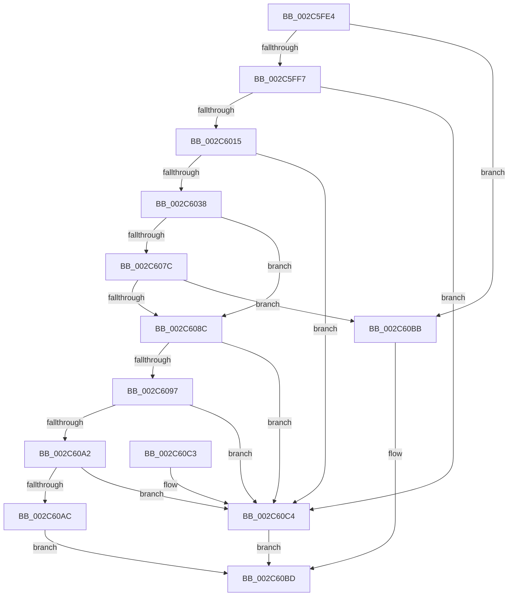

# MiRotatedToFrameBuffer

- RVA: `0x002C5FE4`–`0x002C60CB` (길이 `231` bytes)
- VA: `0x00000001402C5FE4`
- 실행 섹션: `.text`
- PDB 이름 있음: `예`; PDB Function 태그: `아니요`
- unwind 정보 RVA: `0x0006EBC4`
- 디코드: `55`개 명령, `231/231` bytes 표시
- 미해석 바이트: `0` (있으면 어셈블리에 `.byte`로 보존)

> 이 문서는 커널 이미지의 기계어와 PDB 기호를 분석해 생성했습니다. 4번과 5번은 함수 원형과 자료형을 바이너리 사용 방식에서 추정한 C 해석이며 원본 소스 복구 결과는 아닙니다.

## 1. Dependencies

- 직접 호출 지점: **0**; 고유 호출 대상: **0**
- 직접 호출자로 확인된 함수: **11**
- RIP 상대 이미지 참조: **1**

### Outgoing calls
- 직접 디코드된 call 명령이 없습니다.

### Direct callers
- [MiActOnPte](../24/MiActOnPte_function_00244C90.md) at `0x0024525E`
- [MiGetWorkingSetInfoList](../2A/MiGetWorkingSetInfoList_function_002AF770.md) at `0x002B042E`
- [MiLockStealUserVm](../2B/MiLockStealUserVm_function_002B3EDC.md) at `0x002B4415`
- [MiProtectPrivateMemory](MiProtectPrivateMemory_function_002C45B0.md) at `0x002C4C8E`
- [MiRevertValidPte](MiRevertValidPte_function_002C5160.md) at `0x002C5573`
- [MiDeleteRotateVa](MiDeleteRotateVa_function_002C79D4.md) at `0x002C7A03`
- [sub_0032BD21](../32/Unknown_function_0032BD21.md) at `0x0032C137`
- [MiMakeVaRangeNoAccess](../4A/MiMakeVaRangeNoAccess_function_004A3CE0.md) at `0x004A3E68`
- [NtUnlockVirtualMemory](../4E/NtUnlockVirtualMemory_function_004EE890.md) at `0x004EEC1B`
- [MiCheckCommitReleaseFromVad](../66/MiCheckCommitReleaseFromVad_function_0066EB90.md) at `0x0066ED21`
- [sub_006E1C8E](../6E/Unknown_function_006E1C8E.md) at `0x006E1C97`

### Static image references
- `0x002C6008` → RVA `0x00E2DCE0` (`.data`; read)

## 2. Other-region calls and transfers

- 다른 실행 섹션으로 향하는 call: **0**
- 별도 외부 분기/꼬리 이동을 확인하지 못했습니다.

## 3. Assembly (complete function range)

```asm
002C5FE4  48 89 5C 24 10                  mov qword ptr [rsp + 0x10], rbx
002C5FE9  48 8B 01                        mov rax, qword ptr [rcx]
002C5FEC  4C 8B C9                        mov r9, rcx
002C5FEF  A8 01                           test al, 1
002C5FF1  0F 84 C4 00 00 00               je 0x1402c60bb
002C5FF7  48 C1 E8 0C                     shr rax, 0xc
002C5FFB  48 BB FF FF FF FF FF 00 00 00   movabs rbx, 0xffffffffff
002C6005  48 23 C3                        and rax, rbx
002C6008  48 3B 05 D1 7C B6 00            cmp rax, qword ptr [rip + 0xb67cd1]
002C600F  0F 87 AF 00 00 00               ja 0x1402c60c4
002C6015  4C 8D 04 40                     lea r8, [rax + rax*2]
002C6019  4D 03 C0                        add r8, r8
002C601C  48 B8 28 00 00 00 00 DE FF FF   movabs rax, 0xffffde0000000028
002C6026  4A 8B 04 C0                     mov rax, qword ptr [rax + r8*8]
002C602A  48 C1 E8 36                     shr rax, 0x36
002C602E  0F BA E0 00                     bt eax, 0
002C6032  0F 83 8C 00 00 00               jae 0x1402c60c4
002C6038  49 BB 00 00 00 00 00 DE FF FF   movabs r11, 0xffffde0000000000
002C6042  48 C1 E9 09                     shr rcx, 9
002C6046  48 B8 F8 FF FF FF 7F 00 00 00   movabs rax, 0x7ffffffff8
002C6050  48 23 C8                        and rcx, rax
002C6053  48 B8 00 00 00 00 80 F6 FF FF   movabs rax, 0xfffff68000000000
002C605D  48 8B 0C 01                     mov rcx, qword ptr [rcx + rax]
002C6061  4B 8D 14 C3                     lea rdx, [r11 + r8*8]
002C6065  4B 8B 44 C3 08                  mov rax, qword ptr [r11 + r8*8 + 8]
002C606A  49 BA 00 00 00 00 00 00 00 80   movabs r10, 0x8000000000000000
002C6074  49 0B C2                        or rax, r10
002C6077  49 3B C1                        cmp rax, r9
002C607A  75 10                           jne 0x1402c608c
002C607C  48 8B 42 28                     mov rax, qword ptr [rdx + 0x28]
002C6080  48 C1 E9 0C                     shr rcx, 0xc
002C6084  48 33 C8                        xor rcx, rax
002C6087  48 85 CB                        test rbx, rcx
002C608A  74 2F                           je 0x1402c60bb
002C608C  48 8B 42 28                     mov rax, qword ptr [rdx + 0x28]
002C6090  33 C9                           xor ecx, ecx
002C6092  48 85 C0                        test rax, rax
002C6095  79 2D                           jns 0x1402c60c4
002C6097  48 8B 42 28                     mov rax, qword ptr [rdx + 0x28]
002C609B  48 0F BA E0 28                  bt rax, 0x28
002C60A0  72 22                           jb 0x1402c60c4
002C60A2  4B 8B 44 C3 08                  mov rax, qword ptr [r11 + r8*8 + 8]
002C60A7  48 85 C0                        test rax, rax
002C60AA  78 18                           js 0x1402c60c4
002C60AC  4B 8B 44 C3 08                  mov rax, qword ptr [r11 + r8*8 + 8]
002C60B1  48 85 C0                        test rax, rax
002C60B4  0F 94 C1                        sete cl
002C60B7  8B C1                           mov eax, ecx
002C60B9  EB 02                           jmp 0x1402c60bd
002C60BB  33 C0                           xor eax, eax
002C60BD  48 8B 5C 24 10                  mov rbx, qword ptr [rsp + 0x10]
002C60C2  C3                              ret
002C60C3  CC                              int3
002C60C4  B8 01 00 00 00                  mov eax, 1
002C60C9  EB F2                           jmp 0x1402c60bd
```

## 4. C-style interpretation (structured pseudocode)

```c
__int64 __fastcall MiRotatedToFrameBuffer(__int64 a1)
{
    __int64 result;
    unsigned __int64 v_stack_p10;

    v_stack_p10 = v_rbx;
    if ((((unsigned __int8)(*(unsigned __int64 *)(a1))) & (1)) == 0) goto loc_002C60BB;
    result = (*(unsigned __int64 *)(a1)) >> (12);
    result = (result) & (v_rbx);
    if (result > (*(unsigned __int64 *)(v_rip + 11959505))) goto loc_002C60C4;
    a3 = (result + result * 2) + (result + result * 2);
    result = (*(unsigned __int64 *)(result + a3 * 8)) >> (54);
    if (condition_is_above_or_equal) goto loc_002C60C4;
    a1 = (a1) >> (9);
    a1 = (a1) & (result);
    result = (*(unsigned __int64 *)(v_r11 + a3 * 8 + 8)) | (v_r10);
    if (result != a1) goto loc_002C608C;
    a1 = (*(unsigned __int64 *)(a1 + result * 1)) >> (12);
    a1 = (a1) ^ (*(unsigned __int64 *)(v_r11 + a3 * 8 + 40));
    if (((v_rbx) & (a1)) == 0) goto loc_002C60BB;
loc_002C608C:
    a1 = 0;
    if (!sign_flag) goto loc_002C60C4;
    if (condition_is_below) goto loc_002C60C4;
    if (sign_flag) goto loc_002C60C4;
    a1 = (*(unsigned __int64 *)(v_r11 + a3 * 8 + 8) == 0) ? 1 : 0;
    goto loc_002C60BD;
loc_002C60BB:
    result = 0;
loc_002C60BD:
    return result;
loc_002C60C4:
    goto loc_002C60BD;
}
```

## 5. (Beta) C Style

```c
int64_t MiRotatedToFrameBuffer(void *Arg1)
{
    uint8_t *arg1 = (uint8_t *)Arg1;

    int64_t result;
    uint64_t v_stack_p10;

    v_stack_p10 = local_rbx;
    if ((((uint8_t)(*(uint64_t *)(arg1))) & (1)) == 0) goto loc_002C60BB;
    result = (*(uint64_t *)(arg1)) >> (12);
    result = (result) & (local_rbx);
    if (result > (*(uint64_t *)(v_rip + 0xB67CD1))) goto loc_002C60C4;
    a3 = (result + result * 2) + (result + result * 2);
    result = (*(uint64_t *)(result + a3 * 8)) >> (54);
    if (condition_is_above_or_equal) goto loc_002C60C4;
    Arg1 = (Arg1) >> (9);
    Arg1 = (Arg1) & (result);
    result = (*(uint64_t *)(local_r11 + a3 * 8 + 0x8)) | (local_r10);
    if (result != Arg1) goto loc_002C608C;
    Arg1 = (*(uint64_t *)(arg1 + result * 1)) >> (12);
    Arg1 = (Arg1) ^ (*(uint64_t *)(local_r11 + a3 * 8 + 0x28));
    if (((local_rbx) & (Arg1)) == 0) goto loc_002C60BB;
loc_002C608C:
    Arg1 = 0;
    if (!sign_flag) goto loc_002C60C4;
    if (condition_is_below) goto loc_002C60C4;
    if (sign_flag) goto loc_002C60C4;
    Arg1 = (*(uint64_t *)(local_r11 + a3 * 8 + 0x8) == 0) ? 1 : 0;
    goto loc_002C60BD;
loc_002C60BB:
    result = 0;
loc_002C60BD:
    return result;
loc_002C60C4:
    goto loc_002C60BD;
}
```

### 관측된 메모리 오프셋

구조체 형식이 확인되지 않은 접근은 인자 기준의 오프셋으로만 기록했습니다.

| 기준 인자 | 오프셋 표현 | 폭 (bit) | 접근 |
|---|---:|---:|---|
| `Arg1` | `+ 0x0` | `64` | `R` |

## 6. Execution-region graph

[열기: 2D/3D 그래프와 함수 탐색 컨트롤 패널](../../../control-panel.html?section=text&rva=0x002C5FE4&view=graph)

- 2D 그래프는 위에서 아래로 흐르고, 3D 그래프는 빈 공간을 드래그해 회전합니다. Shift+드래그는 이동, 휠은 확대·축소, 함수 노드 선택은 대상 보고서 이동입니다.

### Static fallback


