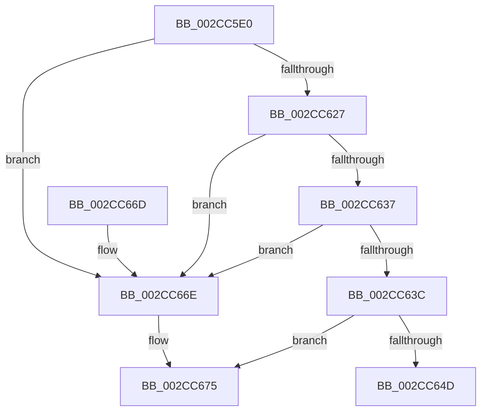

# MiSelectBestZeroingProcessor

- RVA: `0x002CC5E0`–`0x002CC67B` (길이 `155` bytes)
- VA: `0x00000001402CC5E0`
- 실행 섹션: `.text`
- PDB 이름 있음: `예`; PDB Function 태그: `아니요`
- unwind 정보 RVA: `0x0006F44C`
- 디코드: `40`개 명령, `155/155` bytes 표시
- 미해석 바이트: `0` (있으면 어셈블리에 `.byte`로 보존)

> 이 문서는 커널 이미지의 기계어와 PDB 기호를 분석해 생성했습니다. 4번과 5번은 함수 원형과 자료형을 바이너리 사용 방식에서 추정한 C 해석이며 원본 소스 복구 결과는 아닙니다.

## 1. Dependencies

- 직접 호출 지점: **0**; 고유 호출 대상: **0**
- 직접 호출자로 확인된 함수: **2**
- RIP 상대 이미지 참조: **3**

### Outgoing calls
- 직접 디코드된 call 명령이 없습니다.

### Direct callers
- [MiBackgroundZeroNodePages](MiBackgroundZeroNodePages_function_002CB9B0.md) at `0x002CBA2F`
- [MiMoveBackgroundZeroThreads](../30/MiMoveBackgroundZeroThreads_function_00305810.md) at `0x00305A55`

### Static image references
- `0x002CC63C` → RVA `0x00000000` (`image boundary/outside`; read)
- `0x002CC64D` → RVA `0x00EF5080` (`.data`; read/write)
- `0x002CC675` → RVA `0x00EF5084` (`.data`; read/write)

## 2. Other-region calls and transfers

- 다른 실행 섹션으로 향하는 call: **0**
- 별도 외부 분기/꼬리 이동을 확인하지 못했습니다.

## 3. Assembly (complete function range)

```asm
002CC5E0  48 89 5C 24 10                  mov qword ptr [rsp + 0x10], rbx
002CC5E5  48 89 6C 24 18                  mov qword ptr [rsp + 0x18], rbp
002CC5EA  56                              push rsi
002CC5EB  57                              push rdi
002CC5EC  41 56                           push r14
002CC5EE  48 83 EC 60                     sub rsp, 0x60
002CC5F2  0F 57 C0                        xorps xmm0, xmm0
002CC5F5  48 8B DA                        mov rbx, rdx
002CC5F8  48 8B 92 60 01 00 00            mov rdx, qword ptr [rdx + 0x160]
002CC5FF  33 C0                           xor eax, eax
002CC601  45 8B F1                        mov r14d, r9d
002CC604  48 89 44 24 50                  mov qword ptr [rsp + 0x50], rax
002CC609  41 8B E8                        mov ebp, r8d
002CC60C  48 8B F1                        mov rsi, rcx
002CC60F  0F 11 44 24 20                  movups xmmword ptr [rsp + 0x20], xmm0
002CC614  0F 11 44 24 30                  movups xmmword ptr [rsp + 0x30], xmm0
002CC619  0F 11 44 24 40                  movups xmmword ptr [rsp + 0x40], xmm0
002CC61E  48 3B 93 70 01 00 00            cmp rdx, qword ptr [rbx + 0x170]
002CC625  75 47                           jne 0x1402cc66e
002CC627  0F B7 83 68 01 00 00            movzx eax, word ptr [rbx + 0x168]
002CC62E  66 3B 83 78 01 00 00            cmp ax, word ptr [rbx + 0x178]
002CC635  75 37                           jne 0x1402cc66e
002CC637  48 85 D2                        test rdx, rdx
002CC63A  74 32                           je 0x1402cc66e
002CC63C  48 8D 3D BD 39 D3 FF            lea rdi, [rip - 0x2cc643]
002CC643  48 85 94 C7 50 ED E2 00         test qword ptr [rdi + rax*8 + 0xe2ed50], rdx
002CC64B  75 28                           jne 0x1402cc675
002CC64D  FF 05 2D 8A C2 00               inc dword ptr [rip + 0xc28a2d]
002CC653  B8 01 00 00 00                  mov eax, 1
002CC658  4C 8D 5C 24 60                  lea r11, [rsp + 0x60]
002CC65D  49 8B 5B 28                     mov rbx, qword ptr [r11 + 0x28]
002CC661  49 8B 6B 30                     mov rbp, qword ptr [r11 + 0x30]
002CC665  49 8B E3                        mov rsp, r11
002CC668  41 5E                           pop r14
002CC66A  5F                              pop rdi
002CC66B  5E                              pop rsi
002CC66C  C3                              ret
002CC66D  CC                              int3
002CC66E  48 8D 3D 8B 39 D3 FF            lea rdi, [rip - 0x2cc675]
002CC675  FF 05 09 8A C2 00               inc dword ptr [rip + 0xc28a09]
```

## 4. C-style interpretation (structured pseudocode)

```c
__int64 __fastcall MiSelectBestZeroingProcessor(__int64 a1, __int64 a2, int a3, int a4)
{
    __int64 result;
    __int64 v_rsp;
    unsigned __int64 v_stack_m18;
    unsigned __int64 v_stack_m28;
    unsigned __int64 v_stack_m38;
    unsigned __int64 v_stack_m48;
    unsigned __int64 v_stack_m58;
    unsigned __int64 v_stack_p10;
    unsigned __int64 v_stack_p18;

    v_stack_p10 = v_rbx;
    v_stack_p18 = v_rbp;
    v_rsp = (v_rsp) - (96);
    result = 0;
    v_stack_m28 = 0;
    v_stack_m58 = v_xmm0;
    v_stack_m48 = v_xmm0;
    v_stack_m38 = v_xmm0;
    if ((*(unsigned __int64 *)(a2 + 352)) != (*(unsigned __int64 *)(a2 + 368))) goto loc_002CC66E;
    if (((unsigned __int16)(*(unsigned __int16 *)(a2 + 360))) != (*(unsigned __int16 *)(a2 + 376))) goto loc_002CC66E;
    if (*(unsigned __int64 *)(a2 + 352) == 0) goto loc_002CC66E;
    if (((*(unsigned __int64 *)(v_rip - 2934339 + *(unsigned __int16 *)(a2 + 360) * 8 + 14871888)) & (*(unsigned __int64 *)(a2 + 352))) != 0) goto loc_002CC675;
    return 1;
loc_002CC66E:
loc_002CC675:
    return 1;
}
```

## 5. (Beta) C Style

```c
int64_t MiSelectBestZeroingProcessor(int64_t Arg1, void *Arg2, int32_t Arg3, int32_t Arg4)
{
    uint8_t *arg2 = (uint8_t *)Arg2;

    int64_t result;
    int64_t local_rsp;
    uint64_t v_stack_m18;
    uint64_t v_stack_m28;
    uint64_t v_stack_m38;
    uint64_t v_stack_m48;
    uint64_t v_stack_m58;
    uint64_t v_stack_p10;
    uint64_t v_stack_p18;

    v_stack_p10 = local_rbx;
    v_stack_p18 = local_rbp;
    local_rsp = (local_rsp) - (96);
    result = 0;
    v_stack_m28 = 0;
    v_stack_m58 = v_xmm0;
    v_stack_m48 = v_xmm0;
    v_stack_m38 = v_xmm0;
    if ((*(uint64_t *)(arg2 + 0x160)) != (*(uint64_t *)(arg2 + 0x170))) goto loc_002CC66E;
    if (((uint16_t)(*(uint16_t *)(arg2 + 0x168))) != (*(uint16_t *)(arg2 + 0x178))) goto loc_002CC66E;
    if (*(uint64_t *)(arg2 + 0x160) == 0) goto loc_002CC66E;
    if (((*(uint64_t *)(v_rip - 0x2CC643 + *(uint16_t *)(arg2 + 0x168) * 8 + 0xE2ED50)) & (*(uint64_t *)(arg2 + 0x160))) != 0) goto loc_002CC675;
    return 1;
loc_002CC66E:
loc_002CC675:
    return 1;
}
```

### 관측된 메모리 오프셋

구조체 형식이 확인되지 않은 접근은 인자 기준의 오프셋으로만 기록했습니다.

| 기준 인자 | 오프셋 표현 | 폭 (bit) | 접근 |
|---|---:|---:|---|
| `Arg2` | `+ 0x160` | `64` | `R` |
| `Arg2` | `+ 0x168` | `16` | `R` |
| `Arg2` | `+ 0x170` | `64` | `R` |
| `Arg2` | `+ 0x178` | `16` | `R` |

## 6. Execution-region graph

[열기: 2D/3D 그래프와 함수 탐색 컨트롤 패널](../../../control-panel.html?section=text&rva=0x002CC5E0&view=graph)

- 2D 그래프는 위에서 아래로 흐르고, 3D 그래프는 빈 공간을 드래그해 회전합니다. Shift+드래그는 이동, 휠은 확대·축소, 함수 노드 선택은 대상 보고서 이동입니다.

### Static fallback


