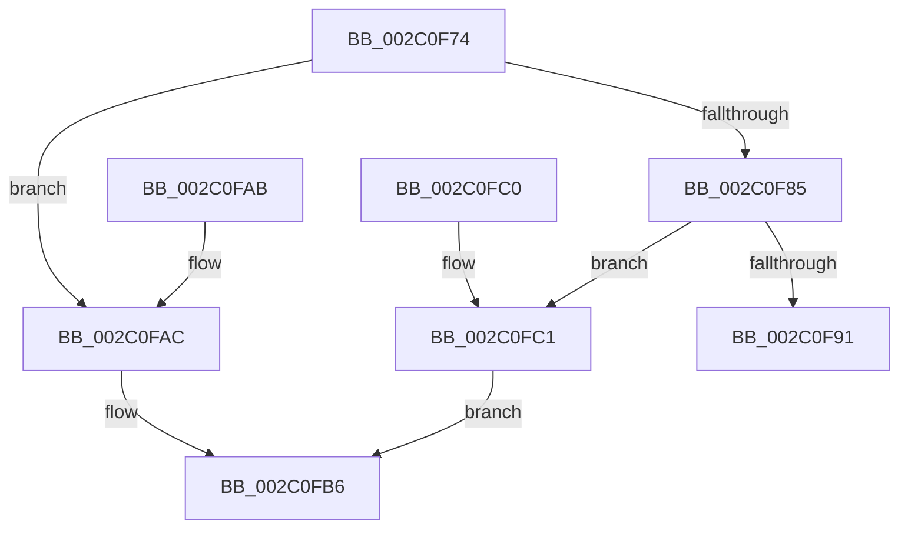

# MiSetExclusionWalkBounds

- RVA: `0x002C0F74`–`0x002C0FCD` (길이 `89` bytes)
- VA: `0x00000001402C0F74`
- 실행 섹션: `.text`
- PDB 이름 있음: `예`; PDB Function 태그: `아니요`
- unwind 정보 RVA: `0x000DB714`
- 디코드: `28`개 명령, `89/89` bytes 표시
- 미해석 바이트: `0` (있으면 어셈블리에 `.byte`로 보존)

> 이 문서는 커널 이미지의 기계어와 PDB 기호를 분석해 생성했습니다. 4번과 5번은 함수 원형과 자료형을 바이너리 사용 방식에서 추정한 C 해석이며 원본 소스 복구 결과는 아닙니다.

## 1. Dependencies

- 직접 호출 지점: **0**; 고유 호출 대상: **0**
- 직접 호출자로 확인된 함수: **2**
- RIP 상대 이미지 참조: **0**

### Outgoing calls
- 직접 디코드된 call 명령이 없습니다.

### Direct callers
- [MiInitializeWalkBounds](MiInitializeWalkBounds_function_002C2BCC.md) at `0x002C2C5D`
- [sub_006DC396](../6D/Unknown_function_006DC396.md) at `0x006DC3B7`

### Static image references
- 디코드된 RIP-relative 메모리 참조가 없습니다.

## 2. Other-region calls and transfers

- 다른 실행 섹션으로 향하는 call: **0**
- 별도 외부 분기/꼬리 이동을 확인하지 못했습니다.

## 3. Assembly (complete function range)

```asm
002C0F74  4C 8B 54 24 28                  mov r10, qword ptr [rsp + 0x28]
002C0F79  49 8B C1                        mov rax, r9
002C0F7C  4F 8D 1C 08                     lea r11, [r8 + r9]
002C0F80  4C 3B C1                        cmp r8, rcx
002C0F83  74 27                           je 0x1402c0fac
002C0F85  4C 8D 0C 11                     lea r9, [rcx + rdx]
002C0F89  49 89 0A                        mov qword ptr [r10], rcx
002C0F8C  4D 3B D9                        cmp r11, r9
002C0F8F  74 30                           je 0x1402c0fc1
002C0F91  49 8D 40 FF                     lea rax, [r8 - 1]
002C0F95  4D 89 5A 10                     mov qword ptr [r10 + 0x10], r11
002C0F99  49 89 42 08                     mov qword ptr [r10 + 8], rax
002C0F9D  49 8D 41 FF                     lea rax, [r9 - 1]
002C0FA1  49 89 42 18                     mov qword ptr [r10 + 0x18], rax
002C0FA5  B8 02 00 00 00                  mov eax, 2
002C0FAA  C3                              ret
002C0FAB  CC                              int3
002C0FAC  49 8D 40 FF                     lea rax, [r8 - 1]
002C0FB0  4D 89 1A                        mov qword ptr [r10], r11
002C0FB3  48 03 C2                        add rax, rdx
002C0FB6  49 89 42 08                     mov qword ptr [r10 + 8], rax
002C0FBA  B8 01 00 00 00                  mov eax, 1
002C0FBF  C3                              ret
002C0FC0  CC                              int3
002C0FC1  48 2B C8                        sub rcx, rax
002C0FC4  48 8D 42 FF                     lea rax, [rdx - 1]
002C0FC8  48 03 C1                        add rax, rcx
002C0FCB  EB E9                           jmp 0x1402c0fb6
```

## 4. C-style interpretation (structured pseudocode)

```c
__int64 __fastcall MiSetExclusionWalkBounds(__int64 a1, __int64 a2, __int64 a3, __int64 a4, __int64 a5)
{
    __int64 result;

    if (a3 == a1) goto loc_002C0FAC;
    *(unsigned __int64 *)(a5) = a1;
    if ((a3 + a4 * 1) == (a1 + a2 * 1)) goto loc_002C0FC1;
    *(unsigned __int64 *)(a5 + 16) = a3 + a4 * 1;
    *(unsigned __int64 *)(a5 + 8) = a3 - 1;
    *(unsigned __int64 *)(a5 + 24) = a1 + a2 * 1 - 1;
    return 2;
loc_002C0FAC:
    *(unsigned __int64 *)(a5) = a3 + a4 * 1;
    result = (a3 - 1) + (a2);
loc_002C0FB6:
    *(unsigned __int64 *)(a5 + 8) = result;
    return 1;
loc_002C0FC1:
    a1 = (a1) - (1);
    result = (a2 - 1) + (a1);
    goto loc_002C0FB6;
}
```

## 5. (Beta) C Style

```c
int64_t MiSetExclusionWalkBounds(void *Arg1, void *Arg2, void *Arg3, int64_t Arg4, void *Arg5)
{
    uint8_t *arg1 = (uint8_t *)Arg1;
    uint8_t *arg2 = (uint8_t *)Arg2;
    uint8_t *arg3 = (uint8_t *)Arg3;
    uint8_t *arg5 = (uint8_t *)Arg5;

    int64_t result;

    if (Arg3 == Arg1) goto loc_002C0FAC;
    *(void **)(arg5) = Arg1;
    if ((Arg3 + Arg4 * 1) == (Arg1 + Arg2 * 1)) goto loc_002C0FC1;
    *(void **)(arg5 + 0x10) = Arg3 + Arg4 * 1;
    *(void **)(arg5 + 0x8) = Arg3 - 1;
    *(void **)(arg5 + 0x18) = Arg1 + Arg2 * 1 - 1;
    return 2;
loc_002C0FAC:
    *(void **)(arg5) = Arg3 + Arg4 * 1;
    result = (Arg3 - 1) + (Arg2);
loc_002C0FB6:
    *(uint64_t *)(arg5 + 0x8) = result;
    return 1;
loc_002C0FC1:
    Arg1 = (Arg1) - (1);
    result = (Arg2 - 1) + (Arg1);
    goto loc_002C0FB6;
}
```

### 관측된 메모리 오프셋

구조체 형식이 확인되지 않은 접근은 인자 기준의 오프셋으로만 기록했습니다.

| 기준 인자 | 오프셋 표현 | 폭 (bit) | 접근 |
|---|---:|---:|---|
| `Arg1` | `- 0x1` | `64` | `R` |
| `Arg1` | `+ 0x0 + rdx*1` | `64` | `R` |
| `Arg2` | `- 0x1` | `64` | `R` |
| `Arg3` | `+ 0x0 + r9*1` | `64` | `R` |
| `Arg5` | `+ 0x0` | `64` | `W` |
| `Arg5` | `+ 0x8` | `64` | `W` |
| `Arg5` | `+ 0x10` | `64` | `W` |
| `Arg5` | `+ 0x18` | `64` | `W` |

## 6. Execution-region graph

[열기: 2D/3D 그래프와 함수 탐색 컨트롤 패널](../../../control-panel.html?section=text&rva=0x002C0F74&view=graph)

- 2D 그래프는 위에서 아래로 흐르고, 3D 그래프는 빈 공간을 드래그해 회전합니다. Shift+드래그는 이동, 휠은 확대·축소, 함수 노드 선택은 대상 보고서 이동입니다.

### Static fallback


