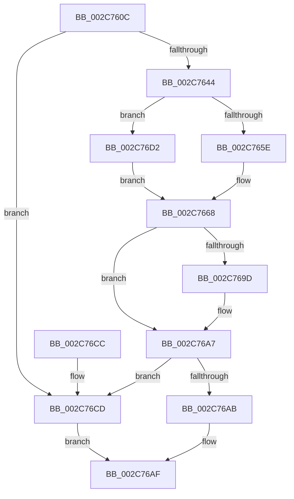

# MiSetIdealProcessorThread

- RVA: `0x002C760C`–`0x002C76D7` (길이 `203` bytes)
- VA: `0x00000001402C760C`
- 실행 섹션: `.text`
- PDB 이름 있음: `예`; PDB Function 태그: `아니요`
- unwind 정보 RVA: `0x0006EDEC`
- 디코드: `55`개 명령, `203/203` bytes 표시
- 미해석 바이트: `0` (있으면 어셈블리에 `.byte`로 보존)

> 이 문서는 커널 이미지의 기계어와 PDB 기호를 분석해 생성했습니다. 4번과 5번은 함수 원형과 자료형을 바이너리 사용 방식에서 추정한 C 해석이며 원본 소스 복구 결과는 아닙니다.

## 1. Dependencies

- 직접 호출 지점: **8**; 고유 호출 대상: **7**
- 직접 호출자로 확인된 함수: **1**
- RIP 상대 이미지 참조: **1**

### Outgoing calls
- `0x002C7650` → [KeQueryPriorityThread](../38/KeQueryPriorityThread_function_0038F4F0.md) (function, `0x0038F4F0`)
- `0x002C7661` → [KeSetPriorityThread](KeSetPriorityThread_function_002C76E0.md) (function, `0x002C76E0`)
- `0x002C7670` → [KeSetSystemGroupAffinityThread](../39/KeSetSystemGroupAffinityThread_function_00399140.md) (function, `0x00399140`)
- `0x002C767A` → [KeRevertToUserGroupAffinityThread](../39/KeRevertToUserGroupAffinityThread_function_00398EC0.md) (function, `0x00398EC0`)
- `0x002C7682` → [KeFindFirstSetRightGroupAffinity](KeFindFirstSetRightGroupAffinity_function_002CFB10.md) (function, `0x002CFB10`)
- `0x002C7691` → [KeSetIdealProcessorThreadEx](../2D/KeSetIdealProcessorThreadEx_function_002DD36C.md) (function, `0x002DD36C`)
- `0x002C76A2` → [KeSetPriorityThread](KeSetPriorityThread_function_002C76E0.md) (function, `0x002C76E0`)
- `0x002C76B7` → [_security_check_cookie](../6A/_security_check_cookie_function_006AC640.md) (function, `0x006AC640`)

### Direct callers
- [MiZeroMoveToProcessor](MiZeroMoveToProcessor_function_002C73BC.md) at `0x002C7402`

### Static image references
- `0x002C761B` → RVA `0x00E0A740` (`.data`; read)

## 2. Other-region calls and transfers

- 다른 실행 섹션으로 향하는 call: **0**
- 별도 외부 분기/꼬리 이동을 확인하지 못했습니다.

## 3. Assembly (complete function range)

```asm
002C760C  48 89 5C 24 10                  mov qword ptr [rsp + 0x10], rbx
002C7611  48 89 74 24 18                  mov qword ptr [rsp + 0x18], rsi
002C7616  57                              push rdi
002C7617  48 83 EC 40                     sub rsp, 0x40
002C761B  48 8B 05 1E 31 B4 00            mov rax, qword ptr [rip + 0xb4311e]
002C7622  48 33 C4                        xor rax, rsp
002C7625  48 89 44 24 38                  mov qword ptr [rsp + 0x38], rax
002C762A  83 64 24 20 00                  and dword ptr [rsp + 0x20], 0
002C762F  0F 57 C0                        xorps xmm0, xmm0
002C7632  48 83 39 00                     cmp qword ptr [rcx], 0
002C7636  48 8B F1                        mov rsi, rcx
002C7639  0F 11 44 24 28                  movups xmmword ptr [rsp + 0x28], xmm0
002C763E  0F 84 89 00 00 00               je 0x1402c76cd
002C7644  65 48 8B 1C 25 88 01 00 00      mov rbx, qword ptr gs:[0x188]
002C764D  48 8B CB                        mov rcx, rbx
002C7650  E8 9B 7E 0C 00                  call 0x14038f4f0
002C7655  BA 10 00 00 00                  mov edx, 0x10
002C765A  3B C2                           cmp eax, edx
002C765C  7D 74                           jge 0x1402c76d2
002C765E  48 8B CB                        mov rcx, rbx
002C7661  E8 7A 00 00 00                  call 0x1402c76e0
002C7666  8B F8                           mov edi, eax
002C7668  48 8D 54 24 28                  lea rdx, [rsp + 0x28]
002C766D  48 8B CE                        mov rcx, rsi
002C7670  E8 CB 1A 0D 00                  call 0x140399140
002C7675  48 8D 4C 24 28                  lea rcx, [rsp + 0x28]
002C767A  E8 41 18 0D 00                  call 0x140398ec0
002C767F  48 8B CE                        mov rcx, rsi
002C7682  E8 89 84 00 00                  call 0x1402cfb10
002C7687  4C 8D 44 24 20                  lea r8, [rsp + 0x20]
002C768C  8B D0                           mov edx, eax
002C768E  48 8B CB                        mov rcx, rbx
002C7691  E8 D6 5C 01 00                  call 0x1402dd36c
002C7696  8B F0                           mov esi, eax
002C7698  83 FF FF                        cmp edi, -1
002C769B  74 0A                           je 0x1402c76a7
002C769D  8B D7                           mov edx, edi
002C769F  48 8B CB                        mov rcx, rbx
002C76A2  E8 39 00 00 00                  call 0x1402c76e0
002C76A7  85 F6                           test esi, esi
002C76A9  78 22                           js 0x1402c76cd
002C76AB  8B 44 24 20                     mov eax, dword ptr [rsp + 0x20]
002C76AF  48 8B 4C 24 38                  mov rcx, qword ptr [rsp + 0x38]
002C76B4  48 33 CC                        xor rcx, rsp
002C76B7  E8 84 4F 3E 00                  call 0x1406ac640
002C76BC  48 8B 5C 24 58                  mov rbx, qword ptr [rsp + 0x58]
002C76C1  48 8B 74 24 60                  mov rsi, qword ptr [rsp + 0x60]
002C76C6  48 83 C4 40                     add rsp, 0x40
002C76CA  5F                              pop rdi
002C76CB  C3                              ret
002C76CC  CC                              int3
002C76CD  83 C8 FF                        or eax, 0xffffffff
002C76D0  EB DD                           jmp 0x1402c76af
002C76D2  83 CF FF                        or edi, 0xffffffff
002C76D5  EB 91                           jmp 0x1402c7668
```

## 4. C-style interpretation (structured pseudocode)

```c
__int64 __fastcall MiSetIdealProcessorThread(__int64 a1)
{
    __int64 result;
    __int64 v_rdi;
    __int64 v_rsp;
    unsigned __int64 v_stack_m10;
    unsigned __int64 v_stack_m20;
    unsigned int v_stack_m28;
    unsigned __int64 v_stack_p10;
    unsigned __int64 v_stack_p18;

    v_stack_p10 = v_rbx;
    v_stack_p18 = v_rsi;
    v_rsp = (v_rsp) - (64);
    result = (*(unsigned __int64 *)(v_rip + 11809054)) ^ (v_rsp);
    v_stack_m10 = result;
    v_stack_m20 = v_xmm0;
    if ((*(unsigned __int64 *)(a1)) == 0) goto loc_002C76CD;
    result = KeQueryPriorityThread(*(unsigned __int64 *)(gs_base + (0 + 392)), a2, a3, a4);
    if (((unsigned int)(result)) >= 16) goto loc_002C76D2;
    result = KeSetPriorityThread(*(unsigned __int64 *)(gs_base + (0 + 392)), 16, a3, a4);
loc_002C7668:
    result = KeSetSystemGroupAffinityThread(a1, v_stack_m20, a3, a4);
    result = KeRevertToUserGroupAffinityThread(v_stack_m20, v_stack_m20, a3, a4);
    result = KeFindFirstSetRightGroupAffinity(a1, v_stack_m20, a3, a4);
    result = KeSetIdealProcessorThreadEx(*(unsigned __int64 *)(gs_base + (0 + 392)), (unsigned int)((unsigned int)(result)), v_stack_m28, a4);
    if (((unsigned int)((unsigned int)((unsigned int)(result)))) != -1) {
        a2 = (unsigned int)((unsigned int)((unsigned int)(result)));
        a1 = *(unsigned __int64 *)(gs_base + (0 + 392));
        result = KeSetPriorityThread(a1, a2, v_stack_m28, a4);
    }
    if (sign_flag) goto loc_002C76CD;
loc_002C76AF:
    a1 = (v_stack_m10) ^ (v_rsp);
    result = _security_check_cookie(a1, a2, v_stack_m28, a4);
    v_rsp = (v_rsp) + (64);
    return result;
loc_002C76CD:
    result = (unsigned int)((result) | (0xFFFFFFFFULL));
    goto loc_002C76AF;
loc_002C76D2:
    v_rdi = (unsigned int)(((unsigned int)((unsigned int)(result))) | (0xFFFFFFFFULL));
    goto loc_002C7668;
}
```

## 5. (Beta) C Style

```c
int64_t MiSetIdealProcessorThread(void *Arg1)
{
    uint8_t *arg1 = (uint8_t *)Arg1;

    int64_t result;
    int64_t local_rdi;
    int64_t local_rsp;
    uint64_t v_stack_m10;
    uint64_t v_stack_m20;
    uint32_t v_stack_m28;
    uint64_t v_stack_p10;
    uint64_t v_stack_p18;

    v_stack_p10 = local_rbx;
    v_stack_p18 = local_rsi;
    local_rsp = (local_rsp) - (64);
    result = (*(uint64_t *)(v_rip + 0xB4311E)) ^ (local_rsp);
    v_stack_m10 = result;
    v_stack_m20 = v_xmm0;
    if ((*(uint64_t *)(arg1)) == 0) goto loc_002C76CD;
    result = KeQueryPriorityThread(*(uint64_t *)(gs_base + (0 + 0x188)), a2, a3, a4);
    if (((uint32_t)(result)) >= 16) goto loc_002C76D2;
    result = KeSetPriorityThread(*(uint64_t *)(gs_base + (0 + 0x188)), 16, a3, a4);
loc_002C7668:
    result = KeSetSystemGroupAffinityThread(Arg1, v_stack_m20, a3, a4);
    result = KeRevertToUserGroupAffinityThread(v_stack_m20, v_stack_m20, a3, a4);
    result = KeFindFirstSetRightGroupAffinity(Arg1, v_stack_m20, a3, a4);
    result = KeSetIdealProcessorThreadEx(*(uint64_t *)(gs_base + (0 + 0x188)), (uint32_t)((uint32_t)(result)), v_stack_m28, a4);
    if (((uint32_t)((uint32_t)((uint32_t)(result)))) != -1) {
        a2 = (uint32_t)((uint32_t)((uint32_t)(result)));
        Arg1 = *(uint64_t *)(gs_base + (0 + 0x188));
        result = KeSetPriorityThread(Arg1, a2, v_stack_m28, a4);
    }
    if (sign_flag) goto loc_002C76CD;
loc_002C76AF:
    Arg1 = (v_stack_m10) ^ (local_rsp);
    result = _security_check_cookie(Arg1, a2, v_stack_m28, a4);
    local_rsp = (local_rsp) + (64);
    return result;
loc_002C76CD:
    result = (uint32_t)((result) | (0xFFFFFFFFULL));
    goto loc_002C76AF;
loc_002C76D2:
    local_rdi = (uint32_t)(((uint32_t)((uint32_t)(result))) | (0xFFFFFFFFULL));
    goto loc_002C7668;
}
```

### 관측된 메모리 오프셋

구조체 형식이 확인되지 않은 접근은 인자 기준의 오프셋으로만 기록했습니다.

| 기준 인자 | 오프셋 표현 | 폭 (bit) | 접근 |
|---|---:|---:|---|
| `Arg1` | `+ 0x0` | `64` | `R` |

## 6. Execution-region graph

[열기: 2D/3D 그래프와 함수 탐색 컨트롤 패널](../../../control-panel.html?section=text&rva=0x002C760C&view=graph)

- 2D 그래프는 위에서 아래로 흐르고, 3D 그래프는 빈 공간을 드래그해 회전합니다. Shift+드래그는 이동, 휠은 확대·축소, 함수 노드 선택은 대상 보고서 이동입니다.

### Static fallback


