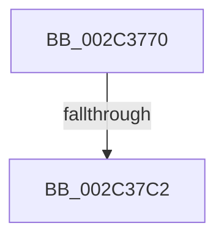

# MiSetProtectionOnSection

- RVA: `0x002C3770`–`0x002C37D9` (길이 `105` bytes)
- VA: `0x00000001402C3770`
- 실행 섹션: `.text`
- PDB 이름 있음: `예`; PDB Function 태그: `아니요`
- unwind 정보 RVA: `0x0006E9FC`
- 디코드: `28`개 명령, `105/105` bytes 표시
- 미해석 바이트: `0` (있으면 어셈블리에 `.byte`로 보존)

> 이 문서는 커널 이미지의 기계어와 PDB 기호를 분석해 생성했습니다. 4번과 5번은 함수 원형과 자료형을 바이너리 사용 방식에서 추정한 C 해석이며 원본 소스 복구 결과는 아닙니다.

## 1. Dependencies

- 직접 호출 지점: **1**; 고유 호출 대상: **1**
- 직접 호출자로 확인된 함수: **5**
- RIP 상대 이미지 참조: **0**

### Outgoing calls
- `0x002C37C8` → [MiMakeProtectionMask](../32/MiMakeProtectionMask_function_00329480.md) (function, `0x00329480`)

### Direct callers
- [MmProtectVirtualMemory](../../page/88/MmProtectVirtualMemory_function_00881050.md) at `0x0088135A`
- [MiCommitFileBackedSection](../../page/88/MiCommitFileBackedSection_function_00882238.md) at `0x00882406`
- [MiCommitPagefileBackedSection](../../page/8C/MiCommitPagefileBackedSection_function_008CECC0.md) at `0x008CEDAB`
- [MiMarkSharedImageCfgBits](../../page/8D/MiMarkSharedImageCfgBits_function_008D0CC4.md) at `0x008D0E48`
- [MiUnsecureVirtualMemoryAgainstWrites](../../page/A2/MiUnsecureVirtualMemoryAgainstWrites_function_00A2601C.md) at `0x00A26066`

### Static image references
- 디코드된 RIP-relative 메모리 참조가 없습니다.

## 2. Other-region calls and transfers

- 다른 실행 섹션으로 향하는 call: **0**
- call이 아닌 외부 분기/꼬리 이동: **2**
  - `0x002C37BC` → [sub_002C3A4B + 0x1](Unknown_function_002C3A4B.md) (`tail-transfer`)
  - `0x002C37D3` → [sub_002C3A4B + 0x1D](Unknown_function_002C3A4B.md) (`tail-transfer`)

## 3. Assembly (complete function range)

```asm
002C3770  48 89 54 24 10                  mov qword ptr [rsp + 0x10], rdx
002C3775  48 89 4C 24 08                  mov qword ptr [rsp + 8], rcx
002C377A  55                              push rbp
002C377B  56                              push rsi
002C377C  41 55                           push r13
002C377E  41 57                           push r15
002C3780  48 8D 6C 24 A8                  lea rbp, [rsp - 0x58]
002C3785  48 81 EC 58 01 00 00            sub rsp, 0x158
002C378C  8B 42 30                        mov eax, dword ptr [rdx + 0x30]
002C378F  4D 8B F9                        mov r15, r9
002C3792  45 33 C9                        xor r9d, r9d
002C3795  24 70                           and al, 0x70
002C3797  4C 89 4D 08                     mov qword ptr [rbp + 8], r9
002C379B  49 8B F0                        mov rsi, r8
002C379E  4C 89 4D 00                     mov qword ptr [rbp], r9
002C37A2  4C 8B EA                        mov r13, rdx
002C37A5  44 89 4C 24 54                  mov dword ptr [rsp + 0x54], r9d
002C37AA  4C 8B C1                        mov r8, rcx
002C37AD  44 89 4D C8                     mov dword ptr [rbp - 0x38], r9d
002C37B1  66 44 89 4D 88                  mov word ptr [rbp - 0x78], r9w
002C37B6  4C 89 4D F8                     mov qword ptr [rbp - 8], r9
002C37BA  3C 20                           cmp al, 0x20
002C37BC  0F 84 8A 02 00 00               je 0x1402c3a4c
002C37C2  8B 8D A0 00 00 00               mov ecx, dword ptr [rbp + 0xa0]
002C37C8  E8 B3 5C 06 00                  call 0x140329480
002C37CD  89 45 8C                        mov dword ptr [rbp - 0x74], eax
002C37D0  83 F8 FF                        cmp eax, -1
002C37D3  0F 84 8F 02 00 00               je 0x1402c3a68
```

## 4. C-style interpretation (structured pseudocode)

```c
__int64 __fastcall MiSetProtectionOnSection(__int64 a1, __int64 a2, __int64 a3, __int64 a4, unsigned int a5)
{
    __int64 result;
    __int64 v_rsp;
    unsigned int v_stack_m124;
    unsigned __int64 v_stack_m70;
    unsigned __int64 v_stack_m78;
    unsigned __int64 v_stack_m80;
    unsigned int v_stack_mB0;
    unsigned int v_stack_mEC;
    unsigned __int16 v_stack_mF0;
    unsigned __int64 v_stack_p10;
    unsigned __int64 v_stack_p8;

    v_stack_p10 = a2;
    v_stack_p8 = a1;
    v_rsp = (v_rsp) - (344);
    a4 = 0;
    result = (unsigned __int8)(((unsigned int)(*(unsigned int *)(a2 + 48))) & (112));
    v_stack_m70 = 0;
    v_stack_m78 = 0;
    v_stack_m124 = 0;
    v_stack_mB0 = 0;
    v_stack_mF0 = 0;
    v_stack_m80 = 0;
    result = MiMakeProtectionMask((unsigned int)(a5), a2, a1, a4);
    v_stack_mEC = (unsigned int)(result);
}
```

## 5. (Beta) C Style

```c
int64_t MiSetProtectionOnSection(int64_t Arg1, void *Arg2, int64_t Arg3, int64_t Arg4, uint32_t Arg5)
{
    uint8_t *arg2 = (uint8_t *)Arg2;

    int64_t result;
    int64_t local_rsp;
    uint32_t v_stack_m124;
    uint64_t v_stack_m70;
    uint64_t v_stack_m78;
    uint64_t v_stack_m80;
    uint32_t v_stack_mB0;
    uint32_t v_stack_mEC;
    uint16_t v_stack_mF0;
    uint64_t v_stack_p10;
    uint64_t v_stack_p8;

    v_stack_p10 = Arg2;
    v_stack_p8 = Arg1;
    local_rsp = (local_rsp) - (344);
    Arg4 = 0;
    result = (uint8_t)(((uint32_t)(*(uint32_t *)(arg2 + 0x30))) & (112));
    v_stack_m70 = 0;
    v_stack_m78 = 0;
    v_stack_m124 = 0;
    v_stack_mB0 = 0;
    v_stack_mF0 = 0;
    v_stack_m80 = 0;
    result = MiMakeProtectionMask((uint32_t)(Arg5), Arg2, Arg1, Arg4);
    v_stack_mEC = (uint32_t)(result);
}
```

### 관측된 메모리 오프셋

구조체 형식이 확인되지 않은 접근은 인자 기준의 오프셋으로만 기록했습니다.

| 기준 인자 | 오프셋 표현 | 폭 (bit) | 접근 |
|---|---:|---:|---|
| `Arg2` | `+ 0x30` | `32` | `R` |

## 6. Execution-region graph

[열기: 2D/3D 그래프와 함수 탐색 컨트롤 패널](../../../control-panel.html?section=text&rva=0x002C3770&view=graph)

- 2D 그래프는 위에서 아래로 흐르고, 3D 그래프는 빈 공간을 드래그해 회전합니다. Shift+드래그는 이동, 휠은 확대·축소, 함수 노드 선택은 대상 보고서 이동입니다.

### Static fallback


