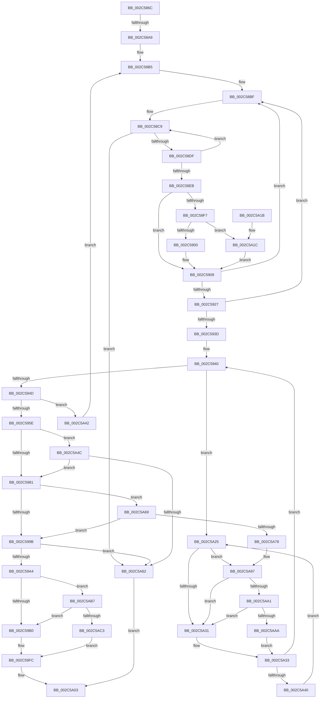

# MiSetProtectionOnTransitionPte

- RVA: `0x002C586C`–`0x002C5ACA` (길이 `606` bytes)
- VA: `0x00000001402C586C`
- 실행 섹션: `.text`
- PDB 이름 있음: `예`; PDB Function 태그: `예`
- unwind 정보 RVA: `0x0006EB54`
- 디코드: `156`개 명령, `606/606` bytes 표시
- 미해석 바이트: `0` (있으면 어셈블리에 `.byte`로 보존)

> 이 문서는 커널 이미지의 기계어와 PDB 기호를 분석해 생성했습니다. 4번과 5번은 함수 원형과 자료형을 바이너리 사용 방식에서 추정한 C 해석이며 원본 소스 복구 결과는 아닙니다.

## 1. Dependencies

- 직접 호출 지점: **8**; 고유 호출 대상: **7**
- 직접 호출자로 확인된 함수: **3**
- RIP 상대 이미지 참조: **5**

### Outgoing calls
- `0x002C58CC` → [MI_READ_PTE_LOCK_FREE](../28/MI_READ_PTE_LOCK_FREE_function_002828A0.md) (function, `0x002828A0`)
- `0x002C58E2` → [MiInvalidPteConforms](../37/MiInvalidPteConforms_function_00372A10.md) (function, `0x00372A10`)
- `0x002C5950` → [MI_READ_PTE_LOCK_FREE](../28/MI_READ_PTE_LOCK_FREE_function_002828A0.md) (function, `0x002828A0`)
- `0x002C59CE` → [MiSanitizePfnProtection](../36/MiSanitizePfnProtection_function_0036C040.md) (function, `0x0036C040`)
- `0x002C5A51` → [MiLockSpecialPurposeMemoryCachedPage](../40/MiLockSpecialPurposeMemoryCachedPage_function_004049F0.md) (function, `0x004049F0`)
- `0x002C5A91` → [KeBugCheckEx](../4F/KeBugCheckEx_function_004FD660.md) (function, `0x004FD660`)
- `0x002C5AA1` → [KiCheckVpBackingLongSpinWaitHypercall](../30/KiCheckVpBackingLongSpinWaitHypercall_function_0030F490.md) (function, `0x0030F490`)
- `0x002C5AAD` → [HvlNotifyLongSpinWait](../30/HvlNotifyLongSpinWait_function_0030F460.md) (function, `0x0030F460`)

### Direct callers
- [MiSetReadOnlyOnSectionView](../29/MiSetReadOnlyOnSectionView_function_00294538.md) at `0x0029492B`
- [sub_002C3A7C](Unknown_function_002C3A7C.md) at `0x002C403A`
- [MiProtectPrivateMemory](MiProtectPrivateMemory_function_002C45B0.md) at `0x002C49ED`

### Static image references
- `0x002C58EB` → RVA `0x00E2DC80` (`.data`; read)
- `0x002C591A` → RVA `0x00E2DCE0` (`.data`; read)
- `0x002C5962` → RVA `0x00E30088` (`.data`; read)
- `0x002C5A28` → RVA `0x00FC52AC` (`ALMOSTRO`; reference)
- `0x002C5A97` → RVA `0x00FC6AB8` (`ALMOSTRO`; read)

## 2. Other-region calls and transfers

- 다른 실행 섹션으로 향하는 call: **0**
- call이 아닌 외부 분기/꼬리 이동: **1**
  - `0x002C58A3` → [sub_006DC4D4](../6D/Unknown_function_006DC4D4.md) (`tail-transfer`)

## 3. Assembly (complete function range)

```asm
002C586C  48 89 5C 24 10                  mov qword ptr [rsp + 0x10], rbx
002C5871  44 89 44 24 18                  mov dword ptr [rsp + 0x18], r8d
002C5876  48 89 4C 24 08                  mov qword ptr [rsp + 8], rcx
002C587B  55                              push rbp
002C587C  56                              push rsi
002C587D  57                              push rdi
002C587E  41 54                           push r12
002C5880  41 55                           push r13
002C5882  41 56                           push r14
002C5884  41 57                           push r15
002C5886  48 83 EC 50                     sub rsp, 0x50
002C588A  4C 8B F2                        mov r14, rdx
002C588D  45 8B E9                        mov r13d, r9d
002C5890  8B 51 30                        mov edx, dword ptr [rcx + 0x30]
002C5893  BD 01 00 00 00                  mov ebp, 1
002C5898  B9 00 00 A0 00                  mov ecx, 0xa00000
002C589D  8B C2                           mov eax, edx
002C589F  23 C1                           and eax, ecx
002C58A1  3B C1                           cmp eax, ecx
002C58A3  0F 84 2B 6C 41 00               je 0x1406dc4d4
002C58A9  33 FF                           xor edi, edi
002C58AB  49 BC FF FF FF FF FF FF FF 7F   movabs r12, 0x7fffffffffffffff
002C58B5  49 BF FF FF FF FF FF 00 00 00   movabs r15, 0xffffffffff
002C58BF  48 BE 00 00 00 00 00 DE FF FF   movabs rsi, 0xffffde0000000000
002C58C9  49 8B CE                        mov rcx, r14
002C58CC  E8 CF CF FB FF                  call 0x1402828a0
002C58D1  48 8B D8                        mov rbx, rax
002C58D4  48 0F BA E0 0B                  bt rax, 0xb
002C58D9  0F 83 83 01 00 00               jae 0x1402c5a62
002C58DF  48 8B C8                        mov rcx, rax
002C58E2  E8 29 D1 0A 00                  call 0x140372a10
002C58E7  85 C0                           test eax, eax
002C58E9  74 DE                           je 0x1402c58c9
002C58EB  48 8B 05 8E 83 B6 00            mov rax, qword ptr [rip + 0xb6838e]
002C58F2  48 85 C0                        test rax, rax
002C58F5  74 12                           je 0x1402c5909
002C58F7  F6 C3 10                        test bl, 0x10
002C58FA  0F 85 1C 01 00 00               jne 0x1402c5a1c
002C5900  48 8B C8                        mov rcx, rax
002C5903  48 F7 D1                        not rcx
002C5906  48 23 CB                        and rcx, rbx
002C5909  48 C1 E9 0C                     shr rcx, 0xc
002C590D  49 23 CF                        and rcx, r15
002C5910  48 8D 14 49                     lea rdx, [rcx + rcx*2]
002C5914  48 03 D2                        add rdx, rdx
002C5917  48 8B C6                        mov rax, rsi
002C591A  48 3B 0D BF 83 B6 00            cmp rcx, qword ptr [rip + 0xb683bf]
002C5921  48 8D 34 D0                     lea rsi, [rax + rdx*8]
002C5925  77 98                           ja 0x1402c58bf
002C5927  48 B8 28 00 00 00 00 DE FF FF   movabs rax, 0xffffde0000000028
002C5931  48 8B 04 D0                     mov rax, qword ptr [rax + rdx*8]
002C5935  48 C1 E8 36                     shr rax, 0x36
002C5939  85 C5                           test ebp, eax
002C593B  74 82                           je 0x1402c58bf
002C593D  44 8B FF                        mov r15d, edi
002C5940  F0 48 0F BA 6E 18 3F            lock bts qword ptr [rsi + 0x18], 0x3f
002C5947  0F 82 D8 00 00 00               jb 0x1402c5a25
002C594D  49 8B CE                        mov rcx, r14
002C5950  E8 4B CF FB FF                  call 0x1402828a0
002C5955  48 3B C3                        cmp rax, rbx
002C5958  0F 85 E4 00 00 00               jne 0x1402c5a42
002C595E  48 8B 46 28                     mov rax, qword ptr [rsi + 0x28]
002C5962  48 8B 15 1F A7 B6 00            mov rdx, qword ptr [rip + 0xb6a71f]
002C5969  48 C1 E8 2B                     shr rax, 0x2b
002C596D  25 FF 03 00 00                  and eax, 0x3ff
002C5972  48 8B 04 C2                     mov rax, qword ptr [rdx + rax*8]
002C5976  8B 40 04                        mov eax, dword ptr [rax + 4]
002C5979  84 C0                           test al, al
002C597B  0F 88 CB 00 00 00               js 0x1402c5a4c
002C5981  48 8B 46 08                     mov rax, qword ptr [rsi + 8]
002C5985  48 B9 00 00 00 00 00 00 00 80   movabs rcx, 0x8000000000000000
002C598F  48 0B C1                        or rax, rcx
002C5992  49 3B C6                        cmp rax, r14
002C5995  0F 85 CE 00 00 00               jne 0x1402c5a69
002C599B  48 85 F6                        test rsi, rsi
002C599E  0F 84 BE 00 00 00               je 0x1402c5a62
002C59A4  4D 8B 16                        mov r10, qword ptr [r14]
002C59A7  45 85 ED                        test r13d, r13d
002C59AA  0F 84 07 01 00 00               je 0x1402c5ab7
002C59B0  4C 8B 4E 10                     mov r9, qword ptr [rsi + 0x10]
002C59B4  44 8B 84 24 A0 00 00 00         mov r8d, dword ptr [rsp + 0xa0]
002C59BC  49 8B D1                        mov rdx, r9
002C59BF  48 8B 8C 24 90 00 00 00         mov rcx, qword ptr [rsp + 0x90]
002C59C7  48 C1 EA 05                     shr rdx, 5
002C59CB  83 E2 1F                        and edx, 0x1f
002C59CE  E8 6D 66 0A 00                  call 0x14036c040
002C59D3  8B C8                           mov ecx, eax
002C59D5  48 C7 C2 1F FC FF FF            mov rdx, 0xfffffffffffffc1f
002C59DC  48 C1 E1 05                     shl rcx, 5
002C59E0  4C 33 D1                        xor r10, rcx
002C59E3  48 8B C1                        mov rax, rcx
002C59E6  49 33 C1                        xor rax, r9
002C59E9  4C 23 D2                        and r10, rdx
002C59EC  48 23 C2                        and rax, rdx
002C59EF  48 33 C1                        xor rax, rcx
002C59F2  4C 33 D1                        xor r10, rcx
002C59F5  48 89 46 10                     mov qword ptr [rsi + 0x10], rax
002C59F9  4D 89 16                        mov qword ptr [r14], r10
002C59FC  F0 4C 21 66 18                  lock and qword ptr [rsi + 0x18], r12
002C5A01  8B C7                           mov eax, edi
002C5A03  48 8B 9C 24 98 00 00 00         mov rbx, qword ptr [rsp + 0x98]
002C5A0B  48 83 C4 50                     add rsp, 0x50
002C5A0F  41 5F                           pop r15
002C5A11  41 5E                           pop r14
002C5A13  41 5D                           pop r13
002C5A15  41 5C                           pop r12
002C5A17  5F                              pop rdi
002C5A18  5E                              pop rsi
002C5A19  5D                              pop rbp
002C5A1A  C3                              ret
002C5A1B  CC                              int3
002C5A1C  48 83 E1 EF                     and rcx, 0xffffffffffffffef
002C5A20  E9 E4 FE FF FF                  jmp 0x1402c5909
002C5A25  44 03 FD                        add r15d, ebp
002C5A28  44 85 3D 7D F8 CF 00            test dword ptr [rip + 0xcff87d], r15d
002C5A2F  74 66                           je 0x1402c5a97
002C5A31  F3 90                           pause
002C5A33  48 8B 46 18                     mov rax, qword ptr [rsi + 0x18]
002C5A37  48 85 C0                        test rax, rax
002C5A3A  0F 89 00 FF FF FF               jns 0x1402c5940
002C5A40  EB E3                           jmp 0x1402c5a25
002C5A42  F0 4C 21 66 18                  lock and qword ptr [rsi + 0x18], r12
002C5A47  E9 69 FE FF FF                  jmp 0x1402c58b5
002C5A4C  33 D2                           xor edx, edx
002C5A4E  48 8B CE                        mov rcx, rsi
002C5A51  E8 9A EF 13 00                  call 0x1404049f0
002C5A56  48 8B F0                        mov rsi, rax
002C5A59  48 85 C0                        test rax, rax
002C5A5C  0F 85 1F FF FF FF               jne 0x1402c5981
002C5A62  B8 02 00 00 00                  mov eax, 2
002C5A67  EB 9A                           jmp 0x1402c5a03
002C5A69  48 8B 46 28                     mov rax, qword ptr [rsi + 0x28]
002C5A6D  48 0F BA E0 28                  bt rax, 0x28
002C5A72  0F 82 23 FF FF FF               jb 0x1402c599b
002C5A78  48 8B 46 08                     mov rax, qword ptr [rsi + 8]
002C5A7C  4C 8B CB                        mov r9, rbx
002C5A7F  4D 8B C6                        mov r8, r14
002C5A82  48 89 44 24 20                  mov qword ptr [rsp + 0x20], rax
002C5A87  BA 11 04 00 00                  mov edx, 0x411
002C5A8C  B9 1A 00 00 00                  mov ecx, 0x1a
002C5A91  E8 CA 7B 23 00                  call 0x1404fd660
002C5A96  CC                              int3
002C5A97  8B 05 1B 10 D0 00               mov eax, dword ptr [rip + 0xd0101b]
002C5A9D  A8 40                           test al, 0x40
002C5A9F  74 90                           je 0x1402c5a31
002C5AA1  E8 EA 99 04 00                  call 0x14030f490
002C5AA6  84 C0                           test al, al
002C5AA8  74 87                           je 0x1402c5a31
002C5AAA  41 8B CF                        mov ecx, r15d
002C5AAD  E8 AE 99 04 00                  call 0x14030f460
002C5AB2  E9 7C FF FF FF                  jmp 0x1402c5a33
002C5AB7  8B 46 20                        mov eax, dword ptr [rsi + 0x20]
002C5ABA  66 85 C0                        test ax, ax
002C5ABD  0F 84 ED FE FF FF               je 0x1402c59b0
002C5AC3  8B FD                           mov edi, ebp
002C5AC5  E9 32 FF FF FF                  jmp 0x1402c59fc
```

## 4. C-style interpretation (structured pseudocode)

```c
__int64 __fastcall MiSetProtectionOnTransitionPte(__int64 a1, __int64 a2, int a3, int a4)
{
    __int64 result;
    __int64 v_r10;
    __int64 v_r15;
    __int64 v_rdi;
    __int64 v_rsp;
    unsigned __int64 v_stack_p10;
    unsigned int v_stack_p18;
    unsigned __int64 v_stack_p20;
    unsigned __int64 v_stack_p8;

    v_stack_p10 = v_rbx;
    v_stack_p18 = a3;
    v_stack_p8 = a1;
    v_rsp = (v_rsp) - (80);
    result = (unsigned int)(((unsigned int)((unsigned int)((unsigned int)(*(unsigned int *)(a1 + 48))))) & ((unsigned int)((unsigned int)(0xA00000ULL))));
    v_rdi = 0;
loc_002C58B5:
loc_002C58BF:
loc_002C58C9:
    result = MI_READ_PTE_LOCK_FREE(a2, (unsigned int)(*(unsigned int *)(a1 + 48)), a3, a4);
    if (condition_is_above_or_equal) goto loc_002C5A62;
    result = MiInvalidPteConforms(result, (unsigned int)(*(unsigned int *)(a1 + 48)), a3, a4);
    if ((unsigned int)(result) == 0) goto loc_002C58C9;
    if (*(unsigned __int64 *)(v_rip + 11961230) == 0) goto loc_002C5909;
    if ((((unsigned __int8)(result)) & (16)) != 0) goto loc_002C5A1C;
    a1 = ~(*(unsigned __int64 *)(v_rip + 11961230));
    a1 = (a1) & (result);
loc_002C5909:
    a1 = (a1) >> (12);
    a1 = (a1) & (v_r15);
    a2 = (a1 + a1 * 2) + (a1 + a1 * 2);
    if (a1 > (*(unsigned __int64 *)(v_rip + 11961279))) goto loc_002C58BF;
    result = (*(unsigned __int64 *)(v_rsi + a2 * 8)) >> (54);
    if (((1) & ((unsigned int)(result))) == 0) goto loc_002C58BF;
loc_002C5940:
    if (condition_is_below) goto loc_002C5A25;
    result = MI_READ_PTE_LOCK_FREE(a2, a2, a3, a4);
    if (result != result) goto loc_002C5A42;
    result = (*(unsigned __int64 *)(v_rsi + a2 * 8 + 40)) >> (43);
    result = (unsigned int)((result) & (0x3FFULL));
    if (sign_flag) goto loc_002C5A4C;
loc_002C5981:
    result = (*(unsigned __int64 *)(v_rsi + a2 * 8 + 8)) | (a2);
    if (result != a2) goto loc_002C5A69;
loc_002C599B:
    if (v_rsi + a2 * 8 == 0) goto loc_002C5A62;
    if ((unsigned int)((unsigned int)(a4)) == 0) goto loc_002C5AB7;
loc_002C59B0:
    a2 = (*(unsigned __int64 *)(v_rsi + a2 * 8 + 16)) >> (5);
    a2 = (unsigned int)((a2) & (31));
    result = MiSanitizePfnProtection(v_stack_p8, a2, (unsigned int)(v_stack_p18), *(unsigned __int64 *)(v_rsi + a2 * 8 + 16));
    a1 = ((unsigned int)((unsigned int)(result))) << (5);
    v_r10 = (*(unsigned __int64 *)(a2)) ^ (a1);
    result = (a1) ^ (*(unsigned __int64 *)(v_rsi + a2 * 8 + 16));
    v_r10 = (v_r10) & (-993);
    result = (result) & (-993);
    result = (result) ^ (a1);
    v_r10 = (v_r10) ^ (a1);
    *(unsigned __int64 *)(v_rsi + a2 * 8 + 16) = result;
    *(unsigned __int64 *)(a2) = v_r10;
loc_002C59FC:
loc_002C5A03:
    v_rsp = (v_rsp) + (80);
    return 0;
loc_002C5A1C:
    a1 = (a1) & (-17);
    goto loc_002C5909;
loc_002C5A25:
    v_r15 = (unsigned int)((0) + (1));
    if (((*(unsigned int *)(v_rip + 13629565)) & ((unsigned int)(v_r15))) == 0) goto loc_002C5A97;
loc_002C5A31:
loc_002C5A33:
    if (!sign_flag) goto loc_002C5940;
    goto loc_002C5A25;
loc_002C5A42:
    goto loc_002C58B5;
loc_002C5A4C:
    a2 = 0;
    result = MiLockSpecialPurposeMemoryCachedPage(v_rsi + a2 * 8, a2, (unsigned int)(v_stack_p18), *(unsigned __int64 *)(v_rsi + a2 * 8 + 16));
    if (result != 0) goto loc_002C5981;
loc_002C5A62:
    goto loc_002C5A03;
loc_002C5A69:
    if (condition_is_below) goto loc_002C599B;
    v_stack_p20 = *(unsigned __int64 *)(result + 8);
    result = KeBugCheckEx(26, (unsigned int)(0x411ULL), 0, v_stack_p10);
loc_002C5A97:
    if ((((unsigned __int8)((unsigned int)(*(unsigned int *)(v_rip + 13635611)))) & (64)) == 0) goto loc_002C5A31;
    result = KiCheckVpBackingLongSpinWaitHypercall(26, (unsigned int)(0x411ULL), 0, v_stack_p10);
    if ((unsigned __int8)(result) == 0) goto loc_002C5A31;
    result = HvlNotifyLongSpinWait((unsigned int)((unsigned int)(v_r15)), (unsigned int)(0x411ULL), 0, v_stack_p10);
    goto loc_002C5A33;
loc_002C5AB7:
    if ((unsigned __int16)((unsigned int)(*(unsigned int *)(result + 32))) == 0) goto loc_002C59B0;
    goto loc_002C59FC;
}
```

## 5. (Beta) C Style

```c
int64_t MiSetProtectionOnTransitionPte(void *Arg1, void *Arg2, int32_t Arg3, int32_t Arg4)
{
    uint8_t *arg1 = (uint8_t *)Arg1;
    uint8_t *arg2 = (uint8_t *)Arg2;

    int64_t result;
    int64_t local_r10;
    int64_t local_r15;
    int64_t local_rdi;
    int64_t local_rsp;
    uint64_t v_stack_p10;
    uint32_t v_stack_p18;
    uint64_t v_stack_p20;
    uint64_t v_stack_p8;

    v_stack_p10 = local_rbx;
    v_stack_p18 = Arg3;
    v_stack_p8 = Arg1;
    local_rsp = (local_rsp) - (80);
    result = (uint32_t)(((uint32_t)((uint32_t)((uint32_t)(*(uint32_t *)(arg1 + 0x30))))) & ((uint32_t)((uint32_t)(0xA00000ULL))));
    local_rdi = 0;
loc_002C58B5:
loc_002C58BF:
loc_002C58C9:
    result = MI_READ_PTE_LOCK_FREE(Arg2, (uint32_t)(*(uint32_t *)(arg1 + 0x30)), Arg3, Arg4);
    if (condition_is_above_or_equal) goto loc_002C5A62;
    result = MiInvalidPteConforms(result, (uint32_t)(*(uint32_t *)(arg1 + 0x30)), Arg3, Arg4);
    if ((uint32_t)(result) == 0) goto loc_002C58C9;
    if (*(uint64_t *)(v_rip + 0xB6838E) == 0) goto loc_002C5909;
    if ((((uint8_t)(result)) & (16)) != 0) goto loc_002C5A1C;
    Arg1 = ~(*(uint64_t *)(v_rip + 0xB6838E));
    Arg1 = (Arg1) & (result);
loc_002C5909:
    Arg1 = (Arg1) >> (12);
    Arg1 = (Arg1) & (local_r15);
    Arg2 = (Arg1 + Arg1 * 2) + (Arg1 + Arg1 * 2);
    if (Arg1 > (*(uint64_t *)(v_rip + 0xB683BF))) goto loc_002C58BF;
    result = (*(uint64_t *)(local_rsi + arg2 * 8)) >> (54);
    if (((1) & ((uint32_t)(result))) == 0) goto loc_002C58BF;
loc_002C5940:
    if (condition_is_below) goto loc_002C5A25;
    result = MI_READ_PTE_LOCK_FREE(Arg2, Arg2, Arg3, Arg4);
    if (result != result) goto loc_002C5A42;
    result = (*(uint64_t *)(local_rsi + arg2 * 8 + 0x28)) >> (43);
    result = (uint32_t)((result) & (0x3FFULL));
    if (sign_flag) goto loc_002C5A4C;
loc_002C5981:
    result = (*(uint64_t *)(local_rsi + arg2 * 8 + 0x8)) | (Arg2);
    if (result != Arg2) goto loc_002C5A69;
loc_002C599B:
    if (local_rsi + Arg2 * 8 == 0) goto loc_002C5A62;
    if ((uint32_t)((uint32_t)(Arg4)) == 0) goto loc_002C5AB7;
loc_002C59B0:
    Arg2 = (*(uint64_t *)(local_rsi + arg2 * 8 + 0x10)) >> (5);
    Arg2 = (uint32_t)((Arg2) & (31));
    result = MiSanitizePfnProtection(v_stack_p8, Arg2, (uint32_t)(v_stack_p18), *(uint64_t *)(local_rsi + arg2 * 8 + 0x10));
    Arg1 = ((uint32_t)((uint32_t)(result))) << (5);
    local_r10 = (*(uint64_t *)(arg2)) ^ (Arg1);
    result = (Arg1) ^ (*(uint64_t *)(local_rsi + arg2 * 8 + 0x10));
    local_r10 = (local_r10) & (-993);
    result = (result) & (-993);
    result = (result) ^ (Arg1);
    local_r10 = (local_r10) ^ (Arg1);
    *(uint64_t *)(local_rsi + arg2 * 8 + 0x10) = result;
    *(uint64_t *)(arg2) = local_r10;
loc_002C59FC:
loc_002C5A03:
    local_rsp = (local_rsp) + (80);
    return 0;
loc_002C5A1C:
    Arg1 = (Arg1) & (-17);
    goto loc_002C5909;
loc_002C5A25:
    local_r15 = (uint32_t)((0) + (1));
    if (((*(uint32_t *)(v_rip + 0xCFF87D)) & ((uint32_t)(local_r15))) == 0) goto loc_002C5A97;
loc_002C5A31:
loc_002C5A33:
    if (!sign_flag) goto loc_002C5940;
    goto loc_002C5A25;
loc_002C5A42:
    goto loc_002C58B5;
loc_002C5A4C:
    Arg2 = 0;
    result = MiLockSpecialPurposeMemoryCachedPage(local_rsi + Arg2 * 8, Arg2, (uint32_t)(v_stack_p18), *(uint64_t *)(local_rsi + arg2 * 8 + 0x10));
    if (result != 0) goto loc_002C5981;
loc_002C5A62:
    goto loc_002C5A03;
loc_002C5A69:
    if (condition_is_below) goto loc_002C599B;
    v_stack_p20 = *(uint64_t *)(result + 0x8);
    result = KeBugCheckEx(26, (uint32_t)(0x411ULL), 0, v_stack_p10);
loc_002C5A97:
    if ((((uint8_t)((uint32_t)(*(uint32_t *)(v_rip + 0xD0101B)))) & (64)) == 0) goto loc_002C5A31;
    result = KiCheckVpBackingLongSpinWaitHypercall(26, (uint32_t)(0x411ULL), 0, v_stack_p10);
    if ((uint8_t)(result) == 0) goto loc_002C5A31;
    result = HvlNotifyLongSpinWait((uint32_t)((uint32_t)(local_r15)), (uint32_t)(0x411ULL), 0, v_stack_p10);
    goto loc_002C5A33;
loc_002C5AB7:
    if ((uint16_t)((uint32_t)(*(uint32_t *)(result + 0x20))) == 0) goto loc_002C59B0;
    goto loc_002C59FC;
}
```

### 관측된 메모리 오프셋

구조체 형식이 확인되지 않은 접근은 인자 기준의 오프셋으로만 기록했습니다.

| 기준 인자 | 오프셋 표현 | 폭 (bit) | 접근 |
|---|---:|---:|---|
| `Arg1` | `+ 0x30` | `32` | `R` |
| `Arg2` | `+ 0x0` | `64` | `R` |
| `Arg2` | `+ 0x0` | `64` | `W` |

## 6. Execution-region graph

[열기: 2D/3D 그래프와 함수 탐색 컨트롤 패널](../../../control-panel.html?section=text&rva=0x002C586C&view=graph)

- 2D 그래프는 위에서 아래로 흐르고, 3D 그래프는 빈 공간을 드래그해 회전합니다. Shift+드래그는 이동, 휠은 확대·축소, 함수 노드 선택은 대상 보고서 이동입니다.

### Static fallback


