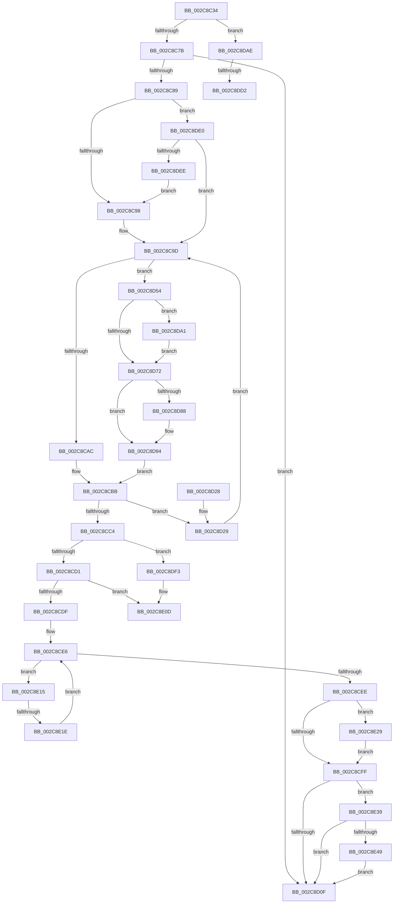

# MiStartDpcGang

- RVA: `0x002C8C34`–`0x002C8E55` (길이 `545` bytes)
- VA: `0x00000001402C8C34`
- 실행 섹션: `.text`
- PDB 이름 있음: `예`; PDB Function 태그: `예`
- unwind 정보 RVA: `0x0006EF94`
- 디코드: `130`개 명령, `545/545` bytes 표시
- 미해석 바이트: `0` (있으면 어셈블리에 `.byte`로 보존)

> 이 문서는 커널 이미지의 기계어와 PDB 기호를 분석해 생성했습니다. 4번과 5번은 함수 원형과 자료형을 바이너리 사용 방식에서 추정한 C 해석이며 원본 소스 복구 결과는 아닙니다.

## 1. Dependencies

- 직접 호출 지점: **9**; 고유 호출 대상: **8**
- 직접 호출자로 확인된 함수: **3**
- RIP 상대 이미지 참조: **2**

### Outgoing calls
- `0x002C8CB6` → [KeGenericCallDpcEx](KeGenericCallDpcEx_function_002C99F4.md) (function, `0x002C99F4`)
- `0x002C8D4A` → [memcpy](../6C/memcpy_function_006C6840.md) (function, `0x006C6840`)
- `0x002C8D5C` → [MiGetGangAssignment](../4F/MiGetGangAssignment_function_004F8080.md) (function, `0x004F8080`)
- `0x002C8D7A` → [MiDoGangAssignment](../4D/MiDoGangAssignment_function_004DE270.md) (function, `0x004DE270`)
- `0x002C8D8F` → [KiLowerIrqlProcessIrqlFlags](../4F/KiLowerIrqlProcessIrqlFlags_function_004F5698.md) (function, `0x004F5698`)
- `0x002C8DA7` → [KiRaiseIrqlProcessIrqlFlags](../4F/KiRaiseIrqlProcessIrqlFlags_function_004F56FC.md) (function, `0x004F56FC`)
- `0x002C8E07` → [KeBugCheckEx](../4F/KeBugCheckEx_function_004FD660.md) (function, `0x004FD660`)
- `0x002C8E2B` → [ExFreePoolWithTag](../../poolcode/B8/ExFreePoolWithTag_function_00B82870.md) (function, `0x00B82870`)
- `0x002C8E4B` → [ExFreePoolWithTag](../../poolcode/B8/ExFreePoolWithTag_function_00B82870.md) (function, `0x00B82870`)

### Direct callers
- [MiAllocateFastLargePagesForMdl](../3B/MiAllocateFastLargePagesForMdl_function_003B701C.md) at `0x003B71CC`
- [MiInitializeDynamicPfns](../67/MiInitializeDynamicPfns_function_00672BD0.md) at `0x00672E7F`
- [MiZeroHotAddMemory](../../page/7F/MiZeroHotAddMemory_function_007FB324.md) at `0x007FB3FB`

### Static image references
- `0x002C8CAF` → RVA `0x00697E60` (`MiDpcGangTarget`; read)
- `0x002C8D69` → RVA `0x00FC6D20` (`ALMOSTRO`; read)

## 2. Other-region calls and transfers

- 다른 실행 섹션으로 향하는 call: **2**
  - `0x002C8E2B` → [ExFreePoolWithTag](../../poolcode/B8/ExFreePoolWithTag_function_00B82870.md) (`.text` → `POOLCODE`)
  - `0x002C8E4B` → [ExFreePoolWithTag](../../poolcode/B8/ExFreePoolWithTag_function_00B82870.md) (`.text` → `POOLCODE`)
- call이 아닌 외부 분기/꼬리 이동: **4**
  - `0x002C8DCC` → [sub_006DC9C6 + 0x23](../6D/Unknown_function_006DC9C6.md) (`tail-transfer`)
  - `0x002C8DDB` → [sub_006DC9C6](../6D/Unknown_function_006DC9C6.md) (`tail-transfer`)
  - `0x002C8E10` → [sub_006DC9C6 + 0x3A](../6D/Unknown_function_006DC9C6.md) (`tail-transfer`)
  - `0x002C8E18` → [sub_006DC9C6 + 0x8F](../6D/Unknown_function_006DC9C6.md) (`tail-transfer`)

## 3. Assembly (complete function range)

```asm
002C8C34  48 8B C4                        mov rax, rsp
002C8C37  48 89 58 10                     mov qword ptr [rax + 0x10], rbx
002C8C3B  48 89 68 18                     mov qword ptr [rax + 0x18], rbp
002C8C3F  48 89 70 20                     mov qword ptr [rax + 0x20], rsi
002C8C43  57                              push rdi
002C8C44  41 56                           push r14
002C8C46  41 57                           push r15
002C8C48  48 83 EC 30                     sub rsp, 0x30
002C8C4C  8B A9 BC 00 00 00               mov ebp, dword ptr [rcx + 0xbc]
002C8C52  45 33 F6                        xor r14d, r14d
002C8C55  44 89 B1 CC 00 00 00            mov dword ptr [rcx + 0xcc], r14d
002C8C5C  48 8B D9                        mov rbx, rcx
002C8C5F  44 89 B1 B0 00 00 00            mov dword ptr [rcx + 0xb0], r14d
002C8C66  48 81 C1 B8 00 00 00            add rcx, 0xb8
002C8C6D  4C 89 70 08                     mov qword ptr [rax + 8], r14
002C8C71  8B 01                           mov eax, dword ptr [rcx]
002C8C73  A8 01                           test al, 1
002C8C75  0F 85 33 01 00 00               jne 0x1402c8dae
002C8C7B  66 44 39 B3 9A 00 00 00         cmp word ptr [rbx + 0x9a], r14w
002C8C83  0F 84 86 00 00 00               je 0x1402c8d0f
002C8C89  41 BF 02 00 00 00               mov r15d, 2
002C8C8F  83 FD 01                        cmp ebp, 1
002C8C92  0F 84 48 01 00 00               je 0x1402c8de0
002C8C98  BE 01 00 00 00                  mov esi, 1
002C8C9D  44 89 B3 B0 00 00 00            mov dword ptr [rbx + 0xb0], r14d
002C8CA4  85 F6                           test esi, esi
002C8CA6  0F 84 A8 00 00 00               je 0x1402c8d54
002C8CAC  48 8B D3                        mov rdx, rbx
002C8CAF  48 8D 0D AA F1 3C 00            lea rcx, [rip + 0x3cf1aa]
002C8CB6  E8 39 0D 00 00                  call 0x1402c99f4
002C8CBB  44 39 B3 CC 00 00 00            cmp dword ptr [rbx + 0xcc], r14d
002C8CC2  75 65                           jne 0x1402c8d29
002C8CC4  44 39 B3 9C 00 00 00            cmp dword ptr [rbx + 0x9c], r14d
002C8CCB  0F 84 22 01 00 00               je 0x1402c8df3
002C8CD1  8B 83 B8 00 00 00               mov eax, dword ptr [rbx + 0xb8]
002C8CD7  A8 01                           test al, 1
002C8CD9  0F 85 2E 01 00 00               jne 0x1402c8e0d
002C8CDF  48 8B 4B 08                     mov rcx, qword ptr [rbx + 8]
002C8CE3  41 8B C6                        mov eax, r14d
002C8CE6  3B C5                           cmp eax, ebp
002C8CE8  0F 82 27 01 00 00               jb 0x1402c8e15
002C8CEE  48 8B 4B 08                     mov rcx, qword ptr [rbx + 8]
002C8CF2  48 8D 43 10                     lea rax, [rbx + 0x10]
002C8CF6  48 3B C8                        cmp rcx, rax
002C8CF9  0F 85 2A 01 00 00               jne 0x1402c8e29
002C8CFF  48 8B 8B D8 00 00 00            mov rcx, qword ptr [rbx + 0xd8]
002C8D06  48 85 C9                        test rcx, rcx
002C8D09  0F 85 2A 01 00 00               jne 0x1402c8e39
002C8D0F  48 8B 5C 24 58                  mov rbx, qword ptr [rsp + 0x58]
002C8D14  48 8B 6C 24 60                  mov rbp, qword ptr [rsp + 0x60]
002C8D19  48 8B 74 24 68                  mov rsi, qword ptr [rsp + 0x68]
002C8D1E  48 83 C4 30                     add rsp, 0x30
002C8D22  41 5F                           pop r15
002C8D24  41 5E                           pop r14
002C8D26  5F                              pop rdi
002C8D27  C3                              ret
002C8D28  CC                              int3
002C8D29  44 0F B7 83 D6 00 00 00         movzx r8d, word ptr [rbx + 0xd6]
002C8D31  4C 89 B3 CC 00 00 00            mov qword ptr [rbx + 0xcc], r14
002C8D38  48 8B 93 D8 00 00 00            mov rdx, qword ptr [rbx + 0xd8]
002C8D3F  48 8B 8B E0 00 00 00            mov rcx, qword ptr [rbx + 0xe0]
002C8D46  49 C1 E0 04                     shl r8, 4
002C8D4A  E8 F1 DA 3F 00                  call 0x1406c6840
002C8D4F  E9 49 FF FF FF                  jmp 0x1402c8c9d
002C8D54  48 8D 54 24 50                  lea rdx, [rsp + 0x50]
002C8D59  48 8B CB                        mov rcx, rbx
002C8D5C  E8 1F F3 22 00                  call 0x1404f8080
002C8D61  44 0F 20 C7                     mov rdi, cr8
002C8D65  45 0F 22 C7                     mov cr8, r15
002C8D69  44 39 35 B0 DF CF 00            cmp dword ptr [rip + 0xcfdfb0], r14d
002C8D70  75 2F                           jne 0x1402c8da1
002C8D72  48 8D 54 24 50                  lea rdx, [rsp + 0x50]
002C8D77  48 8B CB                        mov rcx, rbx
002C8D7A  E8 F1 54 21 00                  call 0x1404de270
002C8D7F  44 39 35 9A DF CF 00            cmp dword ptr [rip + 0xcfdf9a], r14d
002C8D86  74 0C                           je 0x1402c8d94
002C8D88  44 0F 20 C1                     mov rcx, cr8
002C8D8C  40 8A D7                        mov dl, dil
002C8D8F  E8 04 C9 22 00                  call 0x1404f5698
002C8D94  40 0F B6 C7                     movzx eax, dil
002C8D98  44 0F 22 C0                     mov cr8, rax
002C8D9C  E9 1A FF FF FF                  jmp 0x1402c8cbb
002C8DA1  41 8A D7                        mov dl, r15b
002C8DA4  40 8A CF                        mov cl, dil
002C8DA7  E8 50 C9 22 00                  call 0x1404f56fc
002C8DAC  EB C4                           jmp 0x1402c8d72
002C8DAE  48 8B 7B 08                     mov rdi, qword ptr [rbx + 8]
002C8DB2  33 D2                           xor edx, edx
002C8DB4  4C 8B 13                        mov r10, qword ptr [rbx]
002C8DB7  48 8B C7                        mov rax, rdi
002C8DBA  48 F7 F5                        div rbp
002C8DBD  48 8D 53 10                     lea rdx, [rbx + 0x10]
002C8DC1  4C 8B C5                        mov r8, rbp
002C8DC4  48 8B F0                        mov rsi, rax
002C8DC7  4D 8B DE                        mov r11, r14
002C8DCA  85 ED                           test ebp, ebp
002C8DCC  0F 84 17 3C 41 00               je 0x1406dc9e9
002C8DD2  49 8B CE                        mov rcx, r14
002C8DD5  4C 8B CD                        mov r9, rbp
002C8DD8  4C 8B DD                        mov r11, rbp
002C8DDB  E9 E6 3B 41 00                  jmp 0x1406dc9c6
002C8DE0  8B 01                           mov eax, dword ptr [rcx]
002C8DE2  41 8B F6                        mov esi, r14d
002C8DE5  41 84 C7                        test r15b, al
002C8DE8  0F 84 AF FE FF FF               je 0x1402c8c9d
002C8DEE  E9 A5 FE FF FF                  jmp 0x1402c8c98
002C8DF3  45 33 C9                        xor r9d, r9d
002C8DF6  4C 89 74 24 20                  mov qword ptr [rsp + 0x20], r14
002C8DFB  4C 8B C3                        mov r8, rbx
002C8DFE  BA 81 61 00 00                  mov edx, 0x6181
002C8E03  41 8D 49 1A                     lea ecx, [r9 + 0x1a]
002C8E07  E8 54 48 23 00                  call 0x1404fd660
002C8E0C  CC                              int3
002C8E0D  41 8B C6                        mov eax, r14d
002C8E10  E9 EB 3B 41 00                  jmp 0x1406dca00
002C8E15  4C 39 31                        cmp qword ptr [rcx], r14
002C8E18  0F 85 37 3C 41 00               jne 0x1406dca55
002C8E1E  48 83 C1 08                     add rcx, 8
002C8E22  FF C0                           inc eax
002C8E24  E9 BD FE FF FF                  jmp 0x1402c8ce6
002C8E29  33 D2                           xor edx, edx
002C8E2B  E8 40 9A 8B 00                  call 0x140b82870
002C8E30  4C 89 73 08                     mov qword ptr [rbx + 8], r14
002C8E34  E9 C6 FE FF FF                  jmp 0x1402c8cff
002C8E39  48 8D 83 E8 00 00 00            lea rax, [rbx + 0xe8]
002C8E40  48 3B C8                        cmp rcx, rax
002C8E43  0F 84 C6 FE FF FF               je 0x1402c8d0f
002C8E49  33 D2                           xor edx, edx
002C8E4B  E8 20 9A 8B 00                  call 0x140b82870
002C8E50  E9 BA FE FF FF                  jmp 0x1402c8d0f
```

## 4. C-style interpretation (structured pseudocode)

```c
__int64 __fastcall MiStartDpcGang(__int64 a1)
{
    __int64 result;
    __int64 v_r14;
    __int64 v_rsp;
    unsigned __int64 v_stack_p10;
    unsigned __int64 v_stack_p18;
    unsigned __int64 v_stack_p20;
    unsigned __int64 v_stack_p50;

    *(unsigned __int64 *)(v_rsp + 16) = v_rbx;
    *(unsigned __int64 *)(v_rsp + 24) = v_rbp;
    *(unsigned __int64 *)(v_rsp + 32) = v_rsi;
    v_rsp = (v_rsp) - (48);
    v_r14 = 0;
    *(unsigned int *)(a1 + 204) = 0;
    *(unsigned int *)(a1 + 176) = 0;
    a1 = (a1) + (184);
    *(unsigned __int64 *)(v_rsp + 8) = 0;
    if ((((unsigned __int8)((unsigned int)(*(unsigned int *)(a1)))) & (1)) != 0) goto loc_002C8DAE;
    if ((*(unsigned __int16 *)(a1 + 154)) == 0) goto loc_002C8D0F;
    if (((unsigned int)((unsigned int)(*(unsigned int *)(a1 + 188)))) == 1) goto loc_002C8DE0;
loc_002C8C98:
loc_002C8C9D:
    *(unsigned int *)(a1 + 176) = 0;
    if (1 == 0) goto loc_002C8D54;
    result = KeGenericCallDpcEx(v_rip + 3994026, a1, a3, a4);
loc_002C8CBB:
    if ((*(unsigned int *)(a1 + 204)) != 0) goto loc_002C8D29;
    if ((*(unsigned int *)(a1 + 156)) == 0) goto loc_002C8DF3;
    if ((((unsigned __int8)((unsigned int)(*(unsigned int *)(a1 + 184)))) & (1)) != 0) goto loc_002C8E0D;
loc_002C8CE6:
    if (0 < ((unsigned int)((unsigned int)(*(unsigned int *)(a1 + 188))))) goto loc_002C8E15;
    if ((*(unsigned __int64 *)(a1 + 8)) != (a1 + 16)) goto loc_002C8E29;
loc_002C8CFF:
    if (*(unsigned __int64 *)(a1 + 216) != 0) goto loc_002C8E39;
loc_002C8D0F:
    v_rsp = (v_rsp) + (48);
    return a1 + 16;
loc_002C8D29:
    *(unsigned __int64 *)(v_stack_p10 + 204) = 0;
    a3 = (*(unsigned __int16 *)(v_stack_p10 + 214)) << (4);
    result = memcpy(*(unsigned __int64 *)(v_stack_p10 + 224), *(unsigned __int64 *)(v_stack_p10 + 216), a3, a4);
    goto loc_002C8C9D;
loc_002C8D54:
    result = MiGetGangAssignment(v_stack_p10, v_stack_p50, a3, a4);
    if ((*(unsigned int *)(v_rip + 13623216)) != 0) goto loc_002C8DA1;
loc_002C8D72:
    result = MiDoGangAssignment(v_stack_p10, v_stack_p50, a3, a4);
    if ((*(unsigned int *)(v_rip + 13623194)) != 0) {
        a1 = 2;
        a2 = (unsigned __int8)(v_cr8);
        result = KiLowerIrqlProcessIrqlFlags(a1, a2, a3, a4);
    }
    goto loc_002C8CBB;
loc_002C8DA1:
    result = KiRaiseIrqlProcessIrqlFlags((unsigned __int8)(v_cr8), 2, a3, a4);
    goto loc_002C8D72;
loc_002C8DAE:
    a2 = 0;
loc_002C8DE0:
    if (((2) & ((unsigned __int8)((unsigned int)(*(unsigned int *)(0))))) == 0) goto loc_002C8C9D;
    goto loc_002C8C98;
loc_002C8DF3:
    a4 = 0;
    v_stack_p20 = 0;
    result = KeBugCheckEx(a4 + 26, (unsigned int)(0x6181ULL), v_stack_p10, a4);
loc_002C8E0D:
loc_002C8E15:
    a1 = (a4 + 26) + (8);
    result = (unsigned int)((0) + 1);
    goto loc_002C8CE6;
loc_002C8E29:
    a2 = 0;
    result = ExFreePoolWithTag(a1, a2, v_stack_p10, a4);
    *(unsigned __int64 *)(v_stack_p10 + 8) = 0;
    goto loc_002C8CFF;
loc_002C8E39:
    if (a1 == (v_stack_p10 + 232)) goto loc_002C8D0F;
    a2 = 0;
    result = ExFreePoolWithTag(a1, a2, v_stack_p10, a4);
    goto loc_002C8D0F;
}
```

## 5. (Beta) C Style

```c
void *MiStartDpcGang(void *Arg1)
{
    uint8_t *arg1 = (uint8_t *)Arg1;

    int64_t result;
    int64_t local_r14;
    int64_t local_rsp;
    uint64_t v_stack_p10;
    uint64_t v_stack_p18;
    uint64_t v_stack_p20;
    uint64_t v_stack_p50;

    *(uint64_t *)(local_rsp + 0x10) = local_rbx;
    *(uint64_t *)(local_rsp + 0x18) = local_rbp;
    *(uint64_t *)(local_rsp + 0x20) = local_rsi;
    local_rsp = (local_rsp) - (48);
    local_r14 = 0;
    *(uint32_t *)(arg1 + 0xCC) = 0;
    *(uint32_t *)(arg1 + 0xB0) = 0;
    Arg1 = (Arg1) + (184);
    *(uint64_t *)(local_rsp + 0x8) = 0;
    if ((((uint8_t)((uint32_t)(*(uint32_t *)(arg1)))) & (1)) != 0) goto loc_002C8DAE;
    if ((*(uint16_t *)(arg1 + 0x9A)) == 0) goto loc_002C8D0F;
    if (((uint32_t)((uint32_t)(*(uint32_t *)(arg1 + 0xBC)))) == 1) goto loc_002C8DE0;
loc_002C8C98:
loc_002C8C9D:
    *(uint32_t *)(arg1 + 0xB0) = 0;
    if (1 == 0) goto loc_002C8D54;
    result = KeGenericCallDpcEx(v_rip + 3994026, Arg1, a3, a4);
loc_002C8CBB:
    if ((*(uint32_t *)(arg1 + 0xCC)) != 0) goto loc_002C8D29;
    if ((*(uint32_t *)(arg1 + 0x9C)) == 0) goto loc_002C8DF3;
    if ((((uint8_t)((uint32_t)(*(uint32_t *)(arg1 + 0xB8)))) & (1)) != 0) goto loc_002C8E0D;
loc_002C8CE6:
    if (0 < ((uint32_t)((uint32_t)(*(uint32_t *)(arg1 + 0xBC))))) goto loc_002C8E15;
    if ((*(uint64_t *)(arg1 + 0x8)) != (Arg1 + 16)) goto loc_002C8E29;
loc_002C8CFF:
    if (*(uint64_t *)(arg1 + 0xD8) != 0) goto loc_002C8E39;
loc_002C8D0F:
    local_rsp = (local_rsp) + (48);
    return Arg1 + 16;
loc_002C8D29:
    *(uint64_t *)(v_stack_p10 + 0xCC) = 0;
    a3 = (*(uint16_t *)(v_stack_p10 + 0xD6)) << (4);
    result = memcpy(*(uint64_t *)(v_stack_p10 + 0xE0), *(uint64_t *)(v_stack_p10 + 0xD8), a3, a4);
    goto loc_002C8C9D;
loc_002C8D54:
    result = MiGetGangAssignment(v_stack_p10, v_stack_p50, a3, a4);
    if ((*(uint32_t *)(v_rip + 0xCFDFB0)) != 0) goto loc_002C8DA1;
loc_002C8D72:
    result = MiDoGangAssignment(v_stack_p10, v_stack_p50, a3, a4);
    if ((*(uint32_t *)(v_rip + 0xCFDF9A)) != 0) {
        Arg1 = 2;
        a2 = (uint8_t)(v_cr8);
        result = KiLowerIrqlProcessIrqlFlags(Arg1, a2, a3, a4);
    }
    goto loc_002C8CBB;
loc_002C8DA1:
    result = KiRaiseIrqlProcessIrqlFlags((uint8_t)(v_cr8), 2, a3, a4);
    goto loc_002C8D72;
loc_002C8DAE:
    a2 = 0;
loc_002C8DE0:
    if (((2) & ((uint8_t)((uint32_t)(*(uint32_t *)(0))))) == 0) goto loc_002C8C9D;
    goto loc_002C8C98;
loc_002C8DF3:
    a4 = 0;
    v_stack_p20 = 0;
    result = KeBugCheckEx(a4 + 26, (uint32_t)(0x6181ULL), v_stack_p10, a4);
loc_002C8E0D:
loc_002C8E15:
    Arg1 = (a4 + 26) + (8);
    result = (uint32_t)((0) + 1);
    goto loc_002C8CE6;
loc_002C8E29:
    a2 = 0;
    result = ExFreePoolWithTag(Arg1, a2, v_stack_p10, a4);
    *(uint64_t *)(v_stack_p10 + 0x8) = 0;
    goto loc_002C8CFF;
loc_002C8E39:
    if (Arg1 == (v_stack_p10 + 232)) goto loc_002C8D0F;
    a2 = 0;
    result = ExFreePoolWithTag(Arg1, a2, v_stack_p10, a4);
    goto loc_002C8D0F;
}
```

### 관측된 메모리 오프셋

구조체 형식이 확인되지 않은 접근은 인자 기준의 오프셋으로만 기록했습니다.

| 기준 인자 | 오프셋 표현 | 폭 (bit) | 접근 |
|---|---:|---:|---|
| `Arg1` | `+ 0x0` | `32` | `R` |
| `Arg1` | `+ 0x0` | `64` | `R` |
| `Arg1` | `+ 0x8` | `64` | `R` |
| `Arg1` | `+ 0x8` | `64` | `W` |
| `Arg1` | `+ 0x10` | `64` | `R` |
| `Arg1` | `+ 0x9A` | `16` | `R` |
| `Arg1` | `+ 0x9C` | `32` | `R` |
| `Arg1` | `+ 0xB0` | `32` | `W` |
| `Arg1` | `+ 0xB8` | `32` | `R` |
| `Arg1` | `+ 0xBC` | `32` | `R` |
| `Arg1` | `+ 0xCC` | `32` | `R` |
| `Arg1` | `+ 0xCC` | `32` | `W` |
| `Arg1` | `+ 0xCC` | `64` | `W` |
| `Arg1` | `+ 0xD6` | `16` | `R` |
| `Arg1` | `+ 0xD8` | `64` | `R` |
| `Arg1` | `+ 0xE0` | `64` | `R` |
| `Arg1` | `+ 0xE8` | `64` | `R` |

## 6. Execution-region graph

[열기: 2D/3D 그래프와 함수 탐색 컨트롤 패널](../../../control-panel.html?section=text&rva=0x002C8C34&view=graph)

- 2D 그래프는 위에서 아래로 흐르고, 3D 그래프는 빈 공간을 드래그해 회전합니다. Shift+드래그는 이동, 휠은 확대·축소, 함수 노드 선택은 대상 보고서 이동입니다.

### Static fallback


