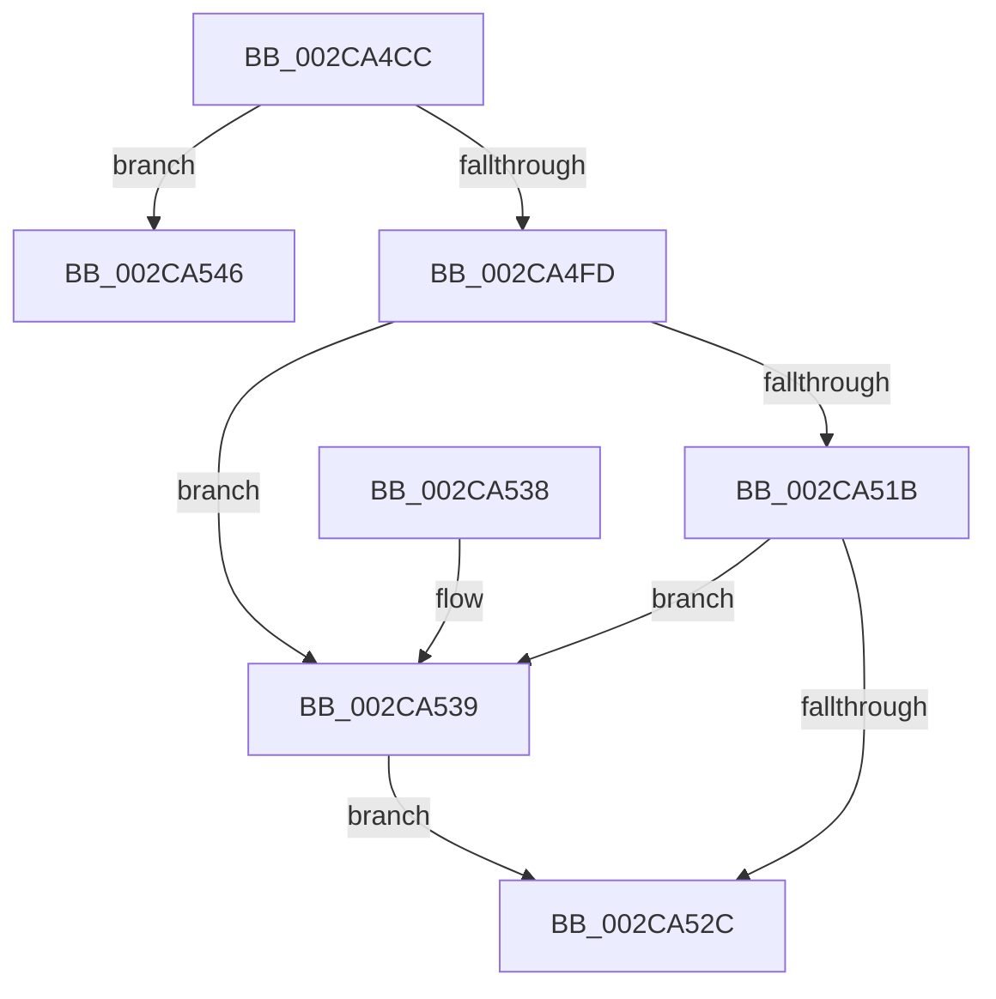

# MiTimeToWriteMemory

- RVA: `0x002CA4CC`–`0x002CA559` (길이 `141` bytes)
- VA: `0x00000001402CA4CC`
- 실행 섹션: `.text`
- PDB 이름 있음: `예`; PDB Function 태그: `예`
- unwind 정보 RVA: `0x000DB714`
- 디코드: `39`개 명령, `141/141` bytes 표시
- 미해석 바이트: `0` (있으면 어셈블리에 `.byte`로 보존)

> 이 문서는 커널 이미지의 기계어와 PDB 기호를 분석해 생성했습니다. 4번과 5번은 함수 원형과 자료형을 바이너리 사용 방식에서 추정한 C 해석이며 원본 소스 복구 결과는 아닙니다.

## 1. Dependencies

- 직접 호출 지점: **0**; 고유 호출 대상: **0**
- 직접 호출자로 확인된 함수: **1**
- RIP 상대 이미지 참조: **1**

### Outgoing calls
- 직접 디코드된 call 명령이 없습니다.

### Direct callers
- [MiComputeSoloZeroingTime](MiComputeSoloZeroingTime_function_002CA3F8.md) at `0x002CA4B6`

### Static image references
- `0x002CA4D5` → RVA `0x00E2DBF8` (`.data`; read)

## 2. Other-region calls and transfers

- 다른 실행 섹션으로 향하는 call: **0**
- call이 아닌 외부 분기/꼬리 이동: **1**
  - `0x002CA554` → `0x006DCC44` (`tail-transfer`)

## 3. Assembly (complete function range)

```asm
002CA4CC  8B C1                           mov eax, ecx
002CA4CE  4D 63 D9                        movsxd r11, r9d
002CA4D1  48 8D 0C 40                     lea rcx, [rax + rax*2]
002CA4D5  48 8B 05 1C 37 B6 00            mov rax, qword ptr [rip + 0xb6371c]
002CA4DC  48 C1 E1 07                     shl rcx, 7
002CA4E0  41 83 F8 03                     cmp r8d, 3
002CA4E4  4C 8B 94 01 78 01 00 00         mov r10, qword ptr [rcx + rax + 0x178]
002CA4EC  B8 01 00 00 00                  mov eax, 1
002CA4F1  41 0F 45 C0                     cmovne eax, r8d
002CA4F5  4C 63 C8                        movsxd r9, eax
002CA4F8  83 FA 03                        cmp edx, 3
002CA4FB  74 49                           je 0x1402ca546
002CA4FD  48 63 CA                        movsxd rcx, edx
002CA500  49 8D 04 49                     lea rax, [r9 + rcx*2]
002CA504  48 03 C8                        add rcx, rax
002CA507  48 6B C9 38                     imul rcx, rcx, 0x38
002CA50B  48 83 C1 48                     add rcx, 0x48
002CA50F  49 03 CA                        add rcx, r10
002CA512  48 8B 51 30                     mov rdx, qword ptr [rcx + 0x30]
002CA516  48 85 D2                        test rdx, rdx
002CA519  74 1E                           je 0x1402ca539
002CA51B  44 8B 01                        mov r8d, dword ptr [rcx]
002CA51E  4C 0F AF 41 08                  imul r8, qword ptr [rcx + 8]
002CA523  4A 8B 04 DA                     mov rax, qword ptr [rdx + r11*8]
002CA527  4D 85 C0                        test r8, r8
002CA52A  74 0D                           je 0x1402ca539
002CA52C  48 0F AF 44 24 28               imul rax, qword ptr [rsp + 0x28]
002CA532  33 D2                           xor edx, edx
002CA534  49 F7 F0                        div r8
002CA537  C3                              ret
002CA538  CC                              int3
002CA539  B8 C0 04 00 00                  mov eax, 0x4c0
002CA53E  41 B8 00 00 20 00               mov r8d, 0x200000
002CA544  EB E6                           jmp 0x1402ca52c
002CA546  49 6B C9 38                     imul rcx, r9, 0x38
002CA54A  45 33 C0                        xor r8d, r8d
002CA54D  48 83 C1 48                     add rcx, 0x48
002CA551  49 03 CA                        add rcx, r10
002CA554  E9 EB 26 41 00                  jmp 0x1406dcc44
```

## 4. C-style interpretation (structured pseudocode)

```c
__int64 __fastcall MiTimeToWriteMemory(int a1, int a2, int a3, int a4, __int64 a5)
{
    __int64 result;

    a1 = ((unsigned int)(a1) + (unsigned int)(a1) * 2) << (7);
    result = 1;
    if (a3 != 3) { result = a3; }
    if (a2 == 3) goto loc_002CA546;
    a1 = ((int)(a2)) + ((int)((unsigned int)(result)) + (int)(a2) * 2);
    a1 = (a1) * (a1);
    a1 = (a1) + (72);
    a1 = (a1) + (*(unsigned __int64 *)(a1 + *(unsigned __int64 *)(v_rip + 11941660) * 1 + 376));
    if (*(unsigned __int64 *)(a1 + 48) == 0) goto loc_002CA539;
    a3 = ((unsigned int)(*(unsigned int *)(a1))) * (*(unsigned __int64 *)(a1 + 8));
    if (a3 == 0) goto loc_002CA539;
loc_002CA52C:
    result = (*(unsigned __int64 *)(*(unsigned __int64 *)(a1 + 48) + (int)(a4) * 8)) * (a5);
    a2 = 0;
    return result;
loc_002CA539:
    goto loc_002CA52C;
loc_002CA546:
    a1 = (a1) * ((int)((unsigned int)(result)));
    a3 = 0;
    a1 = (a1) + (72);
    a1 = (a1) + (*(unsigned __int64 *)(a1 + *(unsigned __int64 *)(v_rip + 11941660) * 1 + 376));
}
```

## 5. (Beta) C Style

```c
int64_t MiTimeToWriteMemory(void *Arg1, int32_t Arg2, int32_t Arg3, int32_t Arg4, int64_t Arg5)
{
    uint8_t *arg1 = (uint8_t *)Arg1;

    int64_t result;

    Arg1 = ((uint32_t)(Arg1) + (uint32_t)(Arg1) * 2) << (7);
    result = 1;
    if (Arg3 != 3) { result = Arg3; }
    if (Arg2 == 3) goto loc_002CA546;
    Arg1 = ((int32_t)(Arg2)) + ((int32_t)((uint32_t)(result)) + (int32_t)(Arg2) * 2);
    Arg1 = (Arg1) * (Arg1);
    Arg1 = (Arg1) + (72);
    Arg1 = (Arg1) + (*(uint64_t *)(arg1 + *(uint64_t *)(v_rip + 0xB6371C) * 1 + 0x178));
    if (*(uint64_t *)(arg1 + 0x30) == 0) goto loc_002CA539;
    Arg3 = ((uint32_t)(*(uint32_t *)(arg1))) * (*(uint64_t *)(arg1 + 0x8));
    if (Arg3 == 0) goto loc_002CA539;
loc_002CA52C:
    result = (*(uint64_t *)(*(uint64_t *)(arg1 + 0x30) + (int32_t)(Arg4) * 8)) * (Arg5);
    Arg2 = 0;
    return result;
loc_002CA539:
    goto loc_002CA52C;
loc_002CA546:
    Arg1 = (Arg1) * ((int32_t)((uint32_t)(result)));
    Arg3 = 0;
    Arg1 = (Arg1) + (72);
    Arg1 = (Arg1) + (*(uint64_t *)(arg1 + *(uint64_t *)(v_rip + 0xB6371C) * 1 + 0x178));
}
```

### 관측된 메모리 오프셋

구조체 형식이 확인되지 않은 접근은 인자 기준의 오프셋으로만 기록했습니다.

| 기준 인자 | 오프셋 표현 | 폭 (bit) | 접근 |
|---|---:|---:|---|
| `Arg1` | `+ 0x0 + rax*2` | `64` | `R` |

## 6. Execution-region graph

[열기: 2D/3D 그래프와 함수 탐색 컨트롤 패널](../../../control-panel.html?section=text&rva=0x002CA4CC&view=graph)

- 2D 그래프는 위에서 아래로 흐르고, 3D 그래프는 빈 공간을 드래그해 회전합니다. Shift+드래그는 이동, 휠은 확대·축소, 함수 노드 선택은 대상 보고서 이동입니다.

### Static fallback


