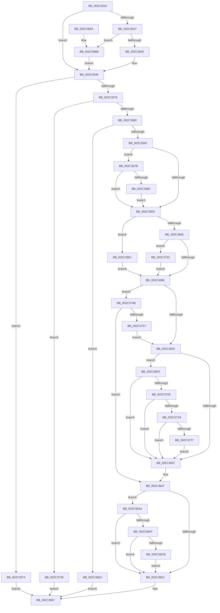

# MiUnlinkStandbyPfn

- RVA: `0x002C3510`–`0x002C375C` (길이 `588` bytes)
- VA: `0x00000001402C3510`
- 실행 섹션: `.text`
- PDB 이름 있음: `예`; PDB Function 태그: `아니요`
- unwind 정보 RVA: `0x0006E9E4`
- 디코드: `148`개 명령, `588/588` bytes 표시
- 미해석 바이트: `0` (있으면 어셈블리에 `.byte`로 보존)

> 이 문서는 커널 이미지의 기계어와 PDB 기호를 분석해 생성했습니다. 4번과 5번은 함수 원형과 자료형을 바이너리 사용 방식에서 추정한 C 해석이며 원본 소스 복구 결과는 아닙니다.

## 1. Dependencies

- 직접 호출 지점: **6**; 고유 호출 대상: **6**
- 직접 호출자로 확인된 함수: **1**
- RIP 상대 이미지 참조: **2**

### Outgoing calls
- `0x002C3585` → [MiUnlinkPageFromListEx](../28/MiUnlinkPageFromListEx_function_00287590.md) (function, `0x00287590`)
- `0x002C3613` → [MiMakeValidPte](MiMakeValidPte_function_002C5590.md) (function, `0x002C5590`)
- `0x002C367E` → [MiGetPfnPriority](../32/MiGetPfnPriority_function_003226F0.md) (function, `0x003226F0`)
- `0x002C36D7` → [MiCheckLinearProtectedPteAccessedBit](../29/MiCheckLinearProtectedPteAccessedBit_function_00292D80.md) (function, `0x00292D80`)
- `0x002C36EF` → [MiDiscardTransitionPteEx](../37/MiDiscardTransitionPteEx_function_00375954.md) (function, `0x00375954`)
- `0x002C3701` → [MiCanPfnOriginalPteBeLost](../37/MiCanPfnOriginalPteBeLost_function_00373D3C.md) (function, `0x00373D3C`)

### Direct callers
- [MmCopyToCachedPage](../34/MmCopyToCachedPage_function_00347B44.md) at `0x00347E8F`

### Static image references
- `0x002C3528` → RVA `0x00E2DC80` (`.data`; read)
- `0x002C3647` → RVA `0x00FC6A88` (`ALMOSTRO`; read)

## 2. Other-region calls and transfers

- 다른 실행 섹션으로 향하는 call: **0**
- 별도 외부 분기/꼬리 이동을 확인하지 못했습니다.

## 3. Assembly (complete function range)

```asm
002C3510  48 89 5C 24 10                  mov qword ptr [rsp + 0x10], rbx
002C3515  48 89 6C 24 18                  mov qword ptr [rsp + 0x18], rbp
002C351A  56                              push rsi
002C351B  57                              push rdi
002C351C  41 56                           push r14
002C351E  48 83 EC 20                     sub rsp, 0x20
002C3522  48 8B 19                        mov rbx, qword ptr [rcx]
002C3525  44 8B F2                        mov r14d, edx
002C3528  48 8B 05 51 A7 B6 00            mov rax, qword ptr [rip + 0xb6a751]
002C352F  48 8B F1                        mov rsi, rcx
002C3532  48 85 C0                        test rax, rax
002C3535  74 0F                           je 0x1402c3546
002C3537  F6 C3 10                        test bl, 0x10
002C353A  0F 85 2B 01 00 00               jne 0x1402c366b
002C3540  48 F7 D0                        not rax
002C3543  48 23 D8                        and rbx, rax
002C3546  48 C1 EB 0C                     shr rbx, 0xc
002C354A  48 B8 FF FF FF FF FF 00 00 00   movabs rax, 0xffffffffff
002C3554  48 23 D8                        and rbx, rax
002C3557  48 8D 3C 5B                     lea rdi, [rbx + rbx*2]
002C355B  48 C1 E7 04                     shl rdi, 4
002C355F  48 B8 00 00 00 00 00 DE FF FF   movabs rax, 0xffffde0000000000
002C3569  48 03 F8                        add rdi, rax
002C356C  F6 47 23 10                     test byte ptr [rdi + 0x23], 0x10
002C3570  0F 85 FE 00 00 00               jne 0x1402c3674
002C3576  F6 47 22 20                     test byte ptr [rdi + 0x22], 0x20
002C357A  0F 85 B8 01 00 00               jne 0x1402c3738
002C3580  33 D2                           xor edx, edx
002C3582  48 8B CF                        mov rcx, rdi
002C3585  E8 06 40 FC FF                  call 0x140287590
002C358A  A8 03                           test al, 3
002C358C  0F 85 58 01 00 00               jne 0x1402c36ea
002C3592  8B 47 20                        mov eax, dword ptr [rdi + 0x20]
002C3595  BD 01 00 00 00                  mov ebp, 1
002C359A  89 44 24 40                     mov dword ptr [rsp + 0x40], eax
002C359E  48 B9 01 00 00 00 00 00 00 C0   movabs rcx, 0xc000000000000001
002C35A8  66 01 6C 24 40                  add word ptr [rsp + 0x40], bp
002C35AD  8B 44 24 40                     mov eax, dword ptr [rsp + 0x40]
002C35B1  89 47 20                        mov dword ptr [rdi + 0x20], eax
002C35B4  8B 47 20                        mov eax, dword ptr [rdi + 0x20]
002C35B7  89 44 24 40                     mov dword ptr [rsp + 0x40], eax
002C35BB  C1 E8 10                        shr eax, 0x10
002C35BE  24 FE                           and al, 0xfe
002C35C0  0C 06                           or al, 6
002C35C2  88 44 24 42                     mov byte ptr [rsp + 0x42], al
002C35C6  8B 44 24 40                     mov eax, dword ptr [rsp + 0x40]
002C35CA  89 47 20                        mov dword ptr [rdi + 0x20], eax
002C35CD  48 8B 47 18                     mov rax, qword ptr [rdi + 0x18]
002C35D1  48 23 C1                        and rax, rcx
002C35D4  48 0B C5                        or rax, rbp
002C35D7  48 89 47 18                     mov qword ptr [rdi + 0x18], rax
002C35DB  41 F6 C6 02                     test r14b, 2
002C35DF  0F 85 96 00 00 00               jne 0x1402c367b
002C35E5  8B 47 20                        mov eax, dword ptr [rdi + 0x20]
002C35E8  44 8B 47 10                     mov r8d, dword ptr [rdi + 0x10]
002C35EC  C1 E8 10                        shr eax, 0x10
002C35EF  49 C1 E8 05                     shr r8, 5
002C35F3  0F B6 C8                        movzx ecx, al
002C35F6  41 83 E0 07                     and r8d, 7
002C35FA  C1 E9 06                        shr ecx, 6
002C35FD  85 C9                           test ecx, ecx
002C35FF  0F 84 DC 00 00 00               je 0x1402c36e1
002C3605  83 F9 02                        cmp ecx, 2
002C3608  0F 84 34 01 00 00               je 0x1402c3742
002C360E  48 8B D3                        mov rdx, rbx
002C3611  33 C9                           xor ecx, ecx
002C3613  E8 78 1F 00 00                  call 0x1402c5590
002C3618  48 8B D8                        mov rbx, rax
002C361B  41 F6 C6 04                     test r14b, 4
002C361F  0F 85 26 01 00 00               jne 0x1402c374b
002C3625  8B 47 20                        mov eax, dword ptr [rdi + 0x20]
002C3628  89 44 24 40                     mov dword ptr [rsp + 0x40], eax
002C362C  C1 E8 10                        shr eax, 0x10
002C362F  A8 08                           test al, 8
002C3631  0F 85 C7 00 00 00               jne 0x1402c36fe
002C3637  80 4C 24 42 10                  or byte ptr [rsp + 0x42], 0x10
002C363C  8B 44 24 40                     mov eax, dword ptr [rsp + 0x40]
002C3640  48 83 CB 42                     or rbx, 0x42
002C3644  89 47 20                        mov dword ptr [rdi + 0x20], eax
002C3647  48 0F BA 25 38 34 D0 00 24      bt qword ptr [rip + 0xd03438], 0x24
002C3650  72 58                           jb 0x1402c36aa
002C3652  48 89 1E                        mov qword ptr [rsi], rbx
002C3655  33 C0                           xor eax, eax
002C3657  48 8B 5C 24 48                  mov rbx, qword ptr [rsp + 0x48]
002C365C  48 8B 6C 24 50                  mov rbp, qword ptr [rsp + 0x50]
002C3661  48 83 C4 20                     add rsp, 0x20
002C3665  41 5E                           pop r14
002C3667  5F                              pop rdi
002C3668  5E                              pop rsi
002C3669  C3                              ret
002C366A  CC                              int3
002C366B  48 83 E3 EF                     and rbx, 0xffffffffffffffef
002C366F  E9 D2 FE FF FF                  jmp 0x1402c3546
002C3674  B8 03 00 00 00                  mov eax, 3
002C3679  EB DC                           jmp 0x1402c3657
002C367B  48 8B CF                        mov rcx, rdi
002C367E  E8 6D F0 05 00                  call 0x1403226f0
002C3683  83 F8 02                        cmp eax, 2
002C3686  0F 86 59 FF FF FF               jbe 0x1402c35e5
002C368C  8B 47 20                        mov eax, dword ptr [rdi + 0x20]
002C368F  89 44 24 40                     mov dword ptr [rsp + 0x40], eax
002C3693  C1 E8 18                        shr eax, 0x18
002C3696  24 FA                           and al, 0xfa
002C3698  0C 02                           or al, 2
002C369A  88 44 24 43                     mov byte ptr [rsp + 0x43], al
002C369E  8B 44 24 40                     mov eax, dword ptr [rsp + 0x40]
002C36A2  89 47 20                        mov dword ptr [rdi + 0x20], eax
002C36A5  E9 3B FF FF FF                  jmp 0x1402c35e5
002C36AA  F6 C3 20                        test bl, 0x20
002C36AD  75 A3                           jne 0x1402c3652
002C36AF  48 B8 00 00 00 00 80 F6 FF FF   movabs rax, 0xfffff68000000000
002C36B9  48 B9 00 00 00 00 40 00 00 00   movabs rcx, 0x4000000000
002C36C3  48 03 C1                        add rax, rcx
002C36C6  48 3B F0                        cmp rsi, rax
002C36C9  72 87                           jb 0x1402c3652
002C36CB  41 B8 80 00 00 00               mov r8d, 0x80
002C36D1  48 8B D3                        mov rdx, rbx
002C36D4  48 8B CE                        mov rcx, rsi
002C36D7  E8 A4 F6 FC FF                  call 0x140292d80
002C36DC  E9 71 FF FF FF                  jmp 0x1402c3652
002C36E1  41 83 C8 08                     or r8d, 8
002C36E5  E9 24 FF FF FF                  jmp 0x1402c360e
002C36EA  33 D2                           xor edx, edx
002C36EC  48 8B CF                        mov rcx, rdi
002C36EF  E8 60 22 0B 00                  call 0x140375954
002C36F4  B8 01 00 00 00                  mov eax, 1
002C36F9  E9 59 FF FF FF                  jmp 0x1402c3657
002C36FE  48 8B CF                        mov rcx, rdi
002C3701  E8 36 06 0B 00                  call 0x140373d3c
002C3706  85 C0                           test eax, eax
002C3708  0F 84 29 FF FF FF               je 0x1402c3637
002C370E  F6 47 22 10                     test byte ptr [rdi + 0x22], 0x10
002C3712  0F 85 1F FF FF FF               jne 0x1402c3637
002C3718  8B 47 10                        mov eax, dword ptr [rdi + 0x10]
002C371B  C0 E8 02                        shr al, 2
002C371E  40 84 C5                        test bpl, al
002C3721  0F 84 10 FF FF FF               je 0x1402c3637
002C3727  48 8B 47 10                     mov rax, qword ptr [rdi + 0x10]
002C372B  48 83 E0 FB                     and rax, 0xfffffffffffffffb
002C372F  48 89 47 10                     mov qword ptr [rdi + 0x10], rax
002C3733  E9 FF FE FF FF                  jmp 0x1402c3637
002C3738  B8 02 00 00 00                  mov eax, 2
002C373D  E9 15 FF FF FF                  jmp 0x1402c3657
002C3742  41 83 C8 18                     or r8d, 0x18
002C3746  E9 C3 FE FF FF                  jmp 0x1402c360e
002C374B  48 0F BA 67 28 35               bt qword ptr [rdi + 0x28], 0x35
002C3751  0F 82 F0 FE FF FF               jb 0x1402c3647
002C3757  E9 C9 FE FF FF                  jmp 0x1402c3625
```

## 4. C-style interpretation (structured pseudocode)

```c
__int64 __fastcall MiUnlinkStandbyPfn(__int64 a1, int a2)
{
    __int64 result;
    __int64 v_rbx;
    __int64 v_rdi;
    __int64 v_rsp;
    unsigned __int64 v_stack_p10;
    unsigned __int64 v_stack_p18;
    unsigned int v_stack_p40;
    unsigned __int8 v_stack_p43;
    unsigned int v_stack_p8;
    unsigned __int8 v_stack_pA;

    v_stack_p10 = v_rbx;
    v_stack_p18 = v_rbp;
    v_rsp = (v_rsp) - (32);
    if (*(unsigned __int64 *)(v_rip + 11970385) == 0) goto loc_002C3546;
    if ((((unsigned __int8)(*(unsigned __int64 *)(a1))) & (16)) != 0) goto loc_002C366B;
    result = ~(*(unsigned __int64 *)(v_rip + 11970385));
    v_rbx = (*(unsigned __int64 *)(a1)) & (result);
loc_002C3546:
    v_rbx = (v_rbx) >> (12);
    v_rbx = (v_rbx) & (result);
    v_rdi = (v_rbx + v_rbx * 2) << (4);
    v_rdi = (v_rdi) + (result);
    if (((*(unsigned __int8 *)(v_rdi + 35)) & (16)) != 0) goto loc_002C3674;
    if (((*(unsigned __int8 *)(v_rdi + 34)) & (32)) != 0) goto loc_002C3738;
    a2 = 0;
    result = MiUnlinkPageFromListEx(v_rdi, a2, a3, a4);
    if ((((unsigned __int8)(result)) & (3)) != 0) goto loc_002C36EA;
    v_stack_p8 = (unsigned int)((unsigned int)(*(unsigned int *)(v_rdi + 32)));
    *(unsigned int *)(v_rdi + 32) = (unsigned int)((unsigned int)(v_stack_p8));
    v_stack_p8 = (unsigned int)((unsigned int)(*(unsigned int *)(v_rdi + 32)));
    result = (unsigned int)(((unsigned int)(*(unsigned int *)(v_rdi + 32))) >> (16));
    result = (unsigned __int8)((result) & (254));
    result = (unsigned __int8)((result) | (6));
    v_stack_pA = (unsigned __int8)(result);
    *(unsigned int *)(v_rdi + 32) = (unsigned int)((unsigned int)(v_stack_p8));
    result = (*(unsigned __int64 *)(v_rdi + 24)) & (v_rdi);
    result = (result) | (1);
    *(unsigned __int64 *)(v_rdi + 24) = result;
    if ((((unsigned __int8)((unsigned int)(a2))) & (2)) != 0) goto loc_002C367B;
loc_002C35E5:
    result = (unsigned int)(((unsigned int)(*(unsigned int *)(v_rdi + 32))) >> (16));
    a3 = ((unsigned int)(*(unsigned int *)(v_rdi + 16))) >> (5);
    a3 = (unsigned int)((a3) & (7));
    a1 = (unsigned int)(((unsigned __int8)(result)) >> (6));
    if ((unsigned int)(a1) == 0) goto loc_002C36E1;
    if (((unsigned int)(a1)) == 2) goto loc_002C3742;
loc_002C360E:
    a1 = 0;
    result = MiMakeValidPte(a1, v_rbx, a3, a4);
    if ((((unsigned __int8)((unsigned int)(a2))) & (4)) != 0) goto loc_002C374B;
loc_002C3625:
    v_stack_p8 = (unsigned int)((unsigned int)(*(unsigned int *)(v_rdi + 32)));
    result = (unsigned int)(((unsigned int)(*(unsigned int *)(v_rdi + 32))) >> (16));
    if ((((unsigned __int8)(result)) & (8)) != 0) goto loc_002C36FE;
loc_002C3637:
    v_rbx = (result) | (66);
    *(unsigned int *)(v_rdi + 32) = (unsigned int)((unsigned int)(v_stack_p8));
loc_002C3647:
    if (condition_is_below) goto loc_002C36AA;
loc_002C3652:
    *(unsigned __int64 *)(a1) = v_rbx;
    result = 0;
loc_002C3657:
    v_rsp = (v_rsp) + (32);
    return result;
loc_002C366B:
    v_rbx = (v_stack_p10) & (-17);
    goto loc_002C3546;
loc_002C3674:
    goto loc_002C3657;
loc_002C367B:
    result = MiGetPfnPriority(v_rdi, v_rbx, a3, a4);
    if (((unsigned int)(result)) <= 2) goto loc_002C35E5;
    v_stack_p40 = (unsigned int)((unsigned int)(*(unsigned int *)(v_rdi + 32)));
    result = (unsigned int)(((unsigned int)(*(unsigned int *)(v_rdi + 32))) >> (24));
    result = (unsigned __int8)((result) & (250));
    result = (unsigned __int8)((result) | (2));
    v_stack_p43 = (unsigned __int8)(result);
    *(unsigned int *)(v_rdi + 32) = (unsigned int)((unsigned int)(v_stack_p40));
    goto loc_002C35E5;
loc_002C36AA:
    if ((((unsigned __int8)(v_rbx)) & (32)) != 0) goto loc_002C3652;
    result = ((unsigned int)(v_stack_p40)) + (v_rdi);
    if (0 < result) goto loc_002C3652;
    result = MiCheckLinearProtectedPteAccessedBit(0, v_rbx, 128, a4);
    goto loc_002C3652;
loc_002C36E1:
    a3 = (unsigned int)((128) | (8));
    goto loc_002C360E;
loc_002C36EA:
    a2 = 0;
    result = MiDiscardTransitionPteEx(v_rdi, a2, a3, a4);
    goto loc_002C3657;
loc_002C36FE:
    result = MiCanPfnOriginalPteBeLost(v_rdi, a2, a3, a4);
    if ((unsigned int)(result) == 0) goto loc_002C3637;
    if (((*(unsigned __int8 *)(v_rdi + 34)) & (16)) != 0) goto loc_002C3637;
    result = (unsigned __int8)(((unsigned int)(*(unsigned int *)(v_rdi + 16))) >> (2));
    if ((((unsigned __int8)(v_stack_p18)) & ((unsigned __int8)(result))) == 0) goto loc_002C3637;
    result = (*(unsigned __int64 *)(v_rdi + 16)) & (-5);
    *(unsigned __int64 *)(v_rdi + 16) = result;
    goto loc_002C3637;
loc_002C3738:
    goto loc_002C3657;
loc_002C3742:
    a3 = (unsigned int)((a3) | (24));
    goto loc_002C360E;
loc_002C374B:
    if (condition_is_below) goto loc_002C3647;
    goto loc_002C3625;
}
```

## 5. (Beta) C Style

```c
int64_t MiUnlinkStandbyPfn(void *Arg1, int32_t Arg2)
{
    uint8_t *arg1 = (uint8_t *)Arg1;

    int64_t result;
    int64_t local_rbx;
    int64_t local_rdi;
    int64_t local_rsp;
    uint64_t v_stack_p10;
    uint64_t v_stack_p18;
    uint32_t v_stack_p40;
    uint8_t v_stack_p43;
    uint32_t v_stack_p8;
    uint8_t v_stack_pA;

    v_stack_p10 = local_rbx;
    v_stack_p18 = local_rbp;
    local_rsp = (local_rsp) - (32);
    if (*(uint64_t *)(v_rip + 0xB6A751) == 0) goto loc_002C3546;
    if ((((uint8_t)(*(uint64_t *)(arg1))) & (16)) != 0) goto loc_002C366B;
    result = ~(*(uint64_t *)(v_rip + 0xB6A751));
    local_rbx = (*(uint64_t *)(arg1)) & (result);
loc_002C3546:
    local_rbx = (local_rbx) >> (12);
    local_rbx = (local_rbx) & (result);
    local_rdi = (local_rbx + local_rbx * 2) << (4);
    local_rdi = (local_rdi) + (result);
    if (((*(uint8_t *)(local_rdi + 0x23)) & (16)) != 0) goto loc_002C3674;
    if (((*(uint8_t *)(local_rdi + 0x22)) & (32)) != 0) goto loc_002C3738;
    Arg2 = 0;
    result = MiUnlinkPageFromListEx(local_rdi, Arg2, a3, a4);
    if ((((uint8_t)(result)) & (3)) != 0) goto loc_002C36EA;
    v_stack_p8 = (uint32_t)((uint32_t)(*(uint32_t *)(local_rdi + 0x20)));
    *(uint32_t *)(local_rdi + 0x20) = (uint32_t)((uint32_t)(v_stack_p8));
    v_stack_p8 = (uint32_t)((uint32_t)(*(uint32_t *)(local_rdi + 0x20)));
    result = (uint32_t)(((uint32_t)(*(uint32_t *)(local_rdi + 0x20))) >> (16));
    result = (uint8_t)((result) & (254));
    result = (uint8_t)((result) | (6));
    v_stack_pA = (uint8_t)(result);
    *(uint32_t *)(local_rdi + 0x20) = (uint32_t)((uint32_t)(v_stack_p8));
    result = (*(uint64_t *)(local_rdi + 0x18)) & (local_rdi);
    result = (result) | (1);
    *(uint64_t *)(local_rdi + 0x18) = result;
    if ((((uint8_t)((uint32_t)(Arg2))) & (2)) != 0) goto loc_002C367B;
loc_002C35E5:
    result = (uint32_t)(((uint32_t)(*(uint32_t *)(local_rdi + 0x20))) >> (16));
    a3 = ((uint32_t)(*(uint32_t *)(local_rdi + 0x10))) >> (5);
    a3 = (uint32_t)((a3) & (7));
    Arg1 = (uint32_t)(((uint8_t)(result)) >> (6));
    if ((uint32_t)(Arg1) == 0) goto loc_002C36E1;
    if (((uint32_t)(Arg1)) == 2) goto loc_002C3742;
loc_002C360E:
    Arg1 = 0;
    result = MiMakeValidPte(Arg1, local_rbx, a3, a4);
    if ((((uint8_t)((uint32_t)(Arg2))) & (4)) != 0) goto loc_002C374B;
loc_002C3625:
    v_stack_p8 = (uint32_t)((uint32_t)(*(uint32_t *)(local_rdi + 0x20)));
    result = (uint32_t)(((uint32_t)(*(uint32_t *)(local_rdi + 0x20))) >> (16));
    if ((((uint8_t)(result)) & (8)) != 0) goto loc_002C36FE;
loc_002C3637:
    local_rbx = (result) | (66);
    *(uint32_t *)(local_rdi + 0x20) = (uint32_t)((uint32_t)(v_stack_p8));
loc_002C3647:
    if (condition_is_below) goto loc_002C36AA;
loc_002C3652:
    *(uint64_t *)(arg1) = local_rbx;
    result = 0;
loc_002C3657:
    local_rsp = (local_rsp) + (32);
    return result;
loc_002C366B:
    local_rbx = (v_stack_p10) & (-17);
    goto loc_002C3546;
loc_002C3674:
    goto loc_002C3657;
loc_002C367B:
    result = MiGetPfnPriority(local_rdi, local_rbx, a3, a4);
    if (((uint32_t)(result)) <= 2) goto loc_002C35E5;
    v_stack_p40 = (uint32_t)((uint32_t)(*(uint32_t *)(local_rdi + 0x20)));
    result = (uint32_t)(((uint32_t)(*(uint32_t *)(local_rdi + 0x20))) >> (24));
    result = (uint8_t)((result) & (250));
    result = (uint8_t)((result) | (2));
    v_stack_p43 = (uint8_t)(result);
    *(uint32_t *)(local_rdi + 0x20) = (uint32_t)((uint32_t)(v_stack_p40));
    goto loc_002C35E5;
loc_002C36AA:
    if ((((uint8_t)(local_rbx)) & (32)) != 0) goto loc_002C3652;
    result = ((uint32_t)(v_stack_p40)) + (local_rdi);
    if (0 < result) goto loc_002C3652;
    result = MiCheckLinearProtectedPteAccessedBit(0, local_rbx, 128, a4);
    goto loc_002C3652;
loc_002C36E1:
    a3 = (uint32_t)((128) | (8));
    goto loc_002C360E;
loc_002C36EA:
    Arg2 = 0;
    result = MiDiscardTransitionPteEx(local_rdi, Arg2, a3, a4);
    goto loc_002C3657;
loc_002C36FE:
    result = MiCanPfnOriginalPteBeLost(local_rdi, Arg2, a3, a4);
    if ((uint32_t)(result) == 0) goto loc_002C3637;
    if (((*(uint8_t *)(local_rdi + 0x22)) & (16)) != 0) goto loc_002C3637;
    result = (uint8_t)(((uint32_t)(*(uint32_t *)(local_rdi + 0x10))) >> (2));
    if ((((uint8_t)(v_stack_p18)) & ((uint8_t)(result))) == 0) goto loc_002C3637;
    result = (*(uint64_t *)(local_rdi + 0x10)) & (-5);
    *(uint64_t *)(local_rdi + 0x10) = result;
    goto loc_002C3637;
loc_002C3738:
    goto loc_002C3657;
loc_002C3742:
    a3 = (uint32_t)((a3) | (24));
    goto loc_002C360E;
loc_002C374B:
    if (condition_is_below) goto loc_002C3647;
    goto loc_002C3625;
}
```

### 관측된 메모리 오프셋

구조체 형식이 확인되지 않은 접근은 인자 기준의 오프셋으로만 기록했습니다.

| 기준 인자 | 오프셋 표현 | 폭 (bit) | 접근 |
|---|---:|---:|---|
| `Arg1` | `+ 0x0` | `64` | `R` |

## 6. Execution-region graph

[열기: 2D/3D 그래프와 함수 탐색 컨트롤 패널](../../../control-panel.html?section=text&rva=0x002C3510&view=graph)

- 2D 그래프는 위에서 아래로 흐르고, 3D 그래프는 빈 공간을 드래그해 회전합니다. Shift+드래그는 이동, 휠은 확대·축소, 함수 노드 선택은 대상 보고서 이동입니다.

### Static fallback


