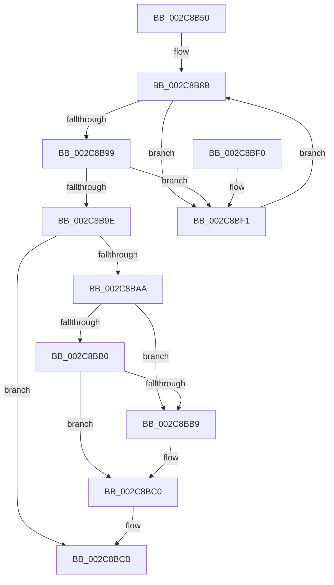

# MiUnlinkWorkingSet

- RVA: `0x002C8B50`–`0x002C8C2B` (길이 `219` bytes)
- VA: `0x00000001402C8B50`
- 실행 섹션: `.text`
- PDB 이름 있음: `예`; PDB Function 태그: `아니요`
- unwind 정보 RVA: `0x0006EF84`
- 디코드: `56`개 명령, `219/219` bytes 표시
- 미해석 바이트: `0` (있으면 어셈블리에 `.byte`로 보존)

> 이 문서는 커널 이미지의 기계어와 PDB 기호를 분석해 생성했습니다. 4번과 5번은 함수 원형과 자료형을 바이너리 사용 방식에서 추정한 C 해석이며 원본 소스 복구 결과는 아닙니다.

## 1. Dependencies

- 직접 호출 지점: **5**; 고유 호출 대상: **3**
- 직접 호출자로 확인된 함수: **2**
- RIP 상대 이미지 참조: **2**

### Outgoing calls
- `0x002C8B83` → [ExAcquireSpinLockExclusive](../24/ExAcquireSpinLockExclusive_function_00248690.md) (function, `0x00248690`)
- `0x002C8BE0` → [MiReleaseSpinLockExclusive](../24/MiReleaseSpinLockExclusive_function_002482C0.md) (function, `0x002482C0`)
- `0x002C8C04` → [MiReleaseSpinLockExclusive](../24/MiReleaseSpinLockExclusive_function_002482C0.md) (function, `0x002482C0`)
- `0x002C8C15` → [KeWaitForGate](KeWaitForGate_function_002CA794.md) (function, `0x002CA794`)
- `0x002C8C21` → [ExAcquireSpinLockExclusive](../24/ExAcquireSpinLockExclusive_function_00248690.md) (function, `0x00248690`)

### Direct callers
- [MiDeletePartitionResources](../../page/80/MiDeletePartitionResources_function_0080D074.md) at `0x0080D0AE`
- [MmDeleteProcessAddressSpace](../../page/AC/MmDeleteProcessAddressSpace_function_00AC804C.md) at `0x00AC8076`

### Static image references
- `0x002C8B74` → RVA `0x00E374C0` (`.data`; read)
- `0x002C8BCB` → RVA `0x00FC6C08` (`ALMOSTRO`; read)

## 2. Other-region calls and transfers

- 다른 실행 섹션으로 향하는 call: **0**
- 별도 외부 분기/꼬리 이동을 확인하지 못했습니다.

## 3. Assembly (complete function range)

```asm
002C8B50  4C 8B DC                        mov r11, rsp
002C8B53  49 89 5B 08                     mov qword ptr [r11 + 8], rbx
002C8B57  57                              push rdi
002C8B58  48 83 EC 40                     sub rsp, 0x40
002C8B5C  83 64 24 24 00                  and dword ptr [rsp + 0x24], 0
002C8B61  49 8D 43 E0                     lea rax, [r11 - 0x20]
002C8B65  C7 44 24 20 07 01 06 00         mov dword ptr [rsp + 0x20], 0x60107
002C8B6D  48 8B D9                        mov rbx, rcx
002C8B70  49 89 43 E8                     mov qword ptr [r11 - 0x18], rax
002C8B74  48 8D 0D 45 E9 B6 00            lea rcx, [rip + 0xb6e945]
002C8B7B  49 8D 43 E0                     lea rax, [r11 - 0x20]
002C8B7F  49 89 43 E0                     mov qword ptr [r11 - 0x20], rax
002C8B83  E8 08 FB F7 FF                  call 0x140248690
002C8B88  40 8A F8                        mov dil, al
002C8B8B  8B 8B B8 00 00 00               mov ecx, dword ptr [rbx + 0xb8]
002C8B91  C1 E9 08                        shr ecx, 8
002C8B94  F6 C1 06                        test cl, 6
002C8B97  75 58                           jne 0x1402c8bf1
002C8B99  F6 C1 F0                        test cl, 0xf0
002C8B9C  75 53                           jne 0x1402c8bf1
002C8B9E  48 8D 43 18                     lea rax, [rbx + 0x18]
002C8BA2  48 8B 08                        mov rcx, qword ptr [rax]
002C8BA5  48 85 C9                        test rcx, rcx
002C8BA8  74 21                           je 0x1402c8bcb
002C8BAA  48 39 41 08                     cmp qword ptr [rcx + 8], rax
002C8BAE  75 09                           jne 0x1402c8bb9
002C8BB0  48 8B 50 08                     mov rdx, qword ptr [rax + 8]
002C8BB4  48 39 02                        cmp qword ptr [rdx], rax
002C8BB7  74 07                           je 0x1402c8bc0
002C8BB9  B9 03 00 00 00                  mov ecx, 3
002C8BBE  CD 29                           int 0x29
002C8BC0  48 89 0A                        mov qword ptr [rdx], rcx
002C8BC3  48 89 51 08                     mov qword ptr [rcx + 8], rdx
002C8BC7  48 83 20 00                     and qword ptr [rax], 0
002C8BCB  48 8B 05 36 E0 CF 00            mov rax, qword ptr [rip + 0xcfe036]
002C8BD2  48 8D 0D E7 E8 B6 00            lea rcx, [rip + 0xb6e8e7]
002C8BD9  40 8A D7                        mov dl, dil
002C8BDC  48 89 43 68                     mov qword ptr [rbx + 0x68], rax
002C8BE0  E8 DB F6 F7 FF                  call 0x1402482c0
002C8BE5  48 8B 5C 24 50                  mov rbx, qword ptr [rsp + 0x50]
002C8BEA  48 83 C4 40                     add rsp, 0x40
002C8BEE  5F                              pop rdi
002C8BEF  C3                              ret
002C8BF0  CC                              int3
002C8BF1  48 8D 44 24 20                  lea rax, [rsp + 0x20]
002C8BF6  40 8A D7                        mov dl, dil
002C8BF9  48 8D 0D C0 E8 B6 00            lea rcx, [rip + 0xb6e8c0]
002C8C00  48 89 43 68                     mov qword ptr [rbx + 0x68], rax
002C8C04  E8 B7 F6 F7 FF                  call 0x1402482c0
002C8C09  45 33 C0                        xor r8d, r8d
002C8C0C  48 8D 4C 24 20                  lea rcx, [rsp + 0x20]
002C8C11  41 8D 50 12                     lea edx, [r8 + 0x12]
002C8C15  E8 7A 1B 00 00                  call 0x1402ca794
002C8C1A  48 8D 0D 9F E8 B6 00            lea rcx, [rip + 0xb6e89f]
002C8C21  E8 6A FA F7 FF                  call 0x140248690
002C8C26  E9 60 FF FF FF                  jmp 0x1402c8b8b
```

## 4. C-style interpretation (structured pseudocode)

```c
__int64 __fastcall MiUnlinkWorkingSet(__int64 a1, __int64 a2, int a3)
{
    __int64 result;
    __int64 v_rsp;
    unsigned int v_stack_m24;
    unsigned int v_stack_m28;
    unsigned __int64 v_stack_p20;
    unsigned __int64 v_stack_p8;

    *(unsigned __int64 *)(v_rsp + 8) = v_rbx;
    v_rsp = (v_rsp) - (64);
    v_stack_m28 = 0x60107ULL;
    *(unsigned __int64 *)(v_rsp - 24) = v_rsp - 32;
    *(unsigned __int64 *)(v_rsp - 32) = v_rsp - 32;
    result = ExAcquireSpinLockExclusive(v_rip + 11987269, a2, a3, a4);
loc_002C8B8B:
    a1 = (unsigned int)(((unsigned int)(*(unsigned int *)(a1 + 184))) >> (8));
    if ((((unsigned __int8)(a1)) & (6)) != 0) goto loc_002C8BF1;
    if ((((unsigned __int8)(a1)) & (240)) != 0) goto loc_002C8BF1;
    if (*(unsigned __int64 *)(a1 + 24) == 0) goto loc_002C8BCB;
    if ((*(unsigned __int64 *)(*(unsigned __int64 *)(a1 + 24) + 8)) != (a1 + 24)) goto loc_002C8BB9;
    if ((*(unsigned __int64 *)(*(unsigned __int64 *)(a1 + 24 + 8))) != (a1 + 24)) {
        a1 = 3;
    }
    *(unsigned __int64 *)(*(unsigned __int64 *)(a1 + 24 + 8)) = a1;
    *(unsigned __int64 *)(a1 + 8) = *(unsigned __int64 *)(a1 + 24 + 8);
loc_002C8BCB:
    *(unsigned __int64 *)(a1 + 104) = *(unsigned __int64 *)(v_rip + 13623350);
    result = MiReleaseSpinLockExclusive(v_rip + 11987175, (unsigned __int8)((unsigned __int8)(result)), a3, a4);
    v_rsp = (v_rsp) + (64);
    return result;
loc_002C8BF1:
    *(unsigned __int64 *)(v_stack_p8 + 104) = v_stack_p20;
    result = MiReleaseSpinLockExclusive(v_rip + 11987136, (unsigned __int8)((unsigned __int8)(result)), a3, a4);
    a3 = 0;
    result = KeWaitForGate(v_stack_p20, a3 + 18, a3, a4);
    result = ExAcquireSpinLockExclusive(v_rip + 11987103, a3 + 18, a3, a4);
    goto loc_002C8B8B;
}
```

## 5. (Beta) C Style

```c
int64_t MiUnlinkWorkingSet(void *Arg1, int64_t Arg2, int32_t Arg3)
{
    uint8_t *arg1 = (uint8_t *)Arg1;

    int64_t result;
    int64_t local_rsp;
    uint32_t v_stack_m24;
    uint32_t v_stack_m28;
    uint64_t v_stack_p20;
    uint64_t v_stack_p8;

    *(uint64_t *)(local_rsp + 0x8) = local_rbx;
    local_rsp = (local_rsp) - (64);
    v_stack_m28 = 0x60107ULL;
    *(uint64_t *)(local_rsp - 0x18) = local_rsp - 32;
    *(uint64_t *)(local_rsp - 0x20) = local_rsp - 32;
    result = ExAcquireSpinLockExclusive(v_rip + 11987269, Arg2, Arg3, a4);
loc_002C8B8B:
    Arg1 = (uint32_t)(((uint32_t)(*(uint32_t *)(arg1 + 0xB8))) >> (8));
    if ((((uint8_t)(Arg1)) & (6)) != 0) goto loc_002C8BF1;
    if ((((uint8_t)(Arg1)) & (240)) != 0) goto loc_002C8BF1;
    if (*(uint64_t *)(arg1 + 0x18) == 0) goto loc_002C8BCB;
    if ((*(uint64_t *)(*(uint64_t *)(arg1 + 0x18) + 0x8)) != (Arg1 + 24)) goto loc_002C8BB9;
    if ((*(uint64_t *)(*(uint64_t *)(arg1 + 0x18 + 0x8))) != (Arg1 + 24)) {
        Arg1 = 3;
    }
    *(void **)(*(uint64_t *)(arg1 + 0x18 + 0x8)) = Arg1;
    *(uint64_t *)(arg1 + 0x8) = *(uint64_t *)(arg1 + 0x18 + 0x8);
loc_002C8BCB:
    *(uint64_t *)(arg1 + 0x68) = *(uint64_t *)(v_rip + 0xCFE036);
    result = MiReleaseSpinLockExclusive(v_rip + 11987175, (uint8_t)((uint8_t)(result)), Arg3, a4);
    local_rsp = (local_rsp) + (64);
    return result;
loc_002C8BF1:
    *(uint64_t *)(v_stack_p8 + 0x68) = v_stack_p20;
    result = MiReleaseSpinLockExclusive(v_rip + 11987136, (uint8_t)((uint8_t)(result)), Arg3, a4);
    Arg3 = 0;
    result = KeWaitForGate(v_stack_p20, Arg3 + 18, Arg3, a4);
    result = ExAcquireSpinLockExclusive(v_rip + 11987103, Arg3 + 18, Arg3, a4);
    goto loc_002C8B8B;
}
```

### 관측된 메모리 오프셋

구조체 형식이 확인되지 않은 접근은 인자 기준의 오프셋으로만 기록했습니다.

| 기준 인자 | 오프셋 표현 | 폭 (bit) | 접근 |
|---|---:|---:|---|
| `Arg1` | `+ 0x0` | `64` | `R` |
| `Arg1` | `+ 0x0` | `64` | `R/W` |
| `Arg1` | `+ 0x8` | `64` | `R` |
| `Arg1` | `+ 0x18` | `64` | `R` |
| `Arg1` | `+ 0x68` | `64` | `W` |
| `Arg1` | `+ 0xB8` | `32` | `R` |

## 6. Execution-region graph

[열기: 2D/3D 그래프와 함수 탐색 컨트롤 패널](../../../control-panel.html?section=text&rva=0x002C8B50&view=graph)

- 2D 그래프는 위에서 아래로 흐르고, 3D 그래프는 빈 공간을 드래그해 회전합니다. Shift+드래그는 이동, 휠은 확대·축소, 함수 노드 선택은 대상 보고서 이동입니다.

### Static fallback


