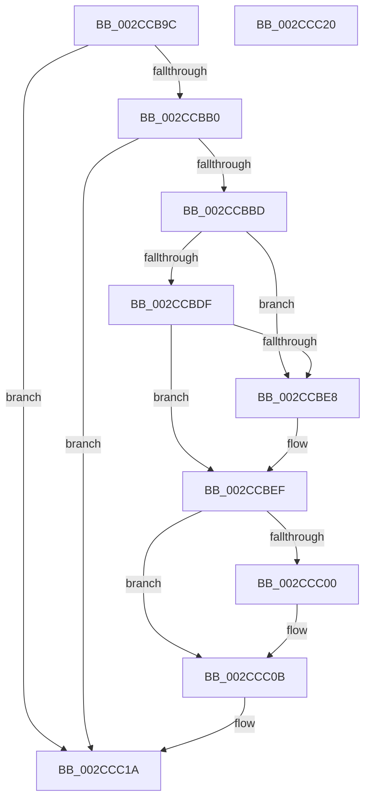

# MiUnlinkZeroThreadFromActiveDomain

- RVA: `0x002CCB9C`–`0x002CCC21` (길이 `133` bytes)
- VA: `0x00000001402CCB9C`
- 실행 섹션: `.text`
- PDB 이름 있음: `예`; PDB Function 태그: `아니요`
- unwind 정보 RVA: `0x0005CF00`
- 디코드: `36`개 명령, `133/133` bytes 표시
- 미해석 바이트: `0` (있으면 어셈블리에 `.byte`로 보존)

> 이 문서는 커널 이미지의 기계어와 PDB 기호를 분석해 생성했습니다. 4번과 5번은 함수 원형과 자료형을 바이너리 사용 방식에서 추정한 C 해석이며 원본 소스 복구 결과는 아닙니다.

## 1. Dependencies

- 직접 호출 지점: **1**; 고유 호출 대상: **1**
- 직접 호출자로 확인된 함수: **4**
- RIP 상대 이미지 참조: **0**

### Outgoing calls
- `0x002CCC06` → [MiUpdateDomainAvailableAffinity](MiUpdateDomainAvailableAffinity_function_002CDD14.md) (function, `0x002CDD14`)

### Direct callers
- [MiRemoveThreadFromEngineLists](MiRemoveThreadFromEngineLists_function_002CAB1C.md) at `0x002CAB3C`
- [MiAddZeroingThreads](MiAddZeroingThreads_function_002CBF78.md) at `0x002CC35F`
- [sub_002CC67B](Unknown_function_002CC67B.md) at `0x002CC6AF`
- [MiBackgroundZeroLocalPages](../31/MiBackgroundZeroLocalPages_function_0031EF30.md) at `0x0031F69C`

### Static image references
- 디코드된 RIP-relative 메모리 참조가 없습니다.

## 2. Other-region calls and transfers

- 다른 실행 섹션으로 향하는 call: **0**
- 별도 외부 분기/꼬리 이동을 확인하지 못했습니다.

## 3. Assembly (complete function range)

```asm
002CCB9C  40 53                           push rbx
002CCB9E  48 83 EC 20                     sub rsp, 0x20
002CCBA2  8B 81 58 01 00 00               mov eax, dword ptr [rcx + 0x158]
002CCBA8  48 8B D9                        mov rbx, rcx
002CCBAB  83 F8 FF                        cmp eax, -1
002CCBAE  74 6A                           je 0x1402ccc1a
002CCBB0  48 81 C1 B0 01 00 00            add rcx, 0x1b0
002CCBB7  48 83 39 00                     cmp qword ptr [rcx], 0
002CCBBB  74 5D                           je 0x1402ccc1a
002CCBBD  4C 8B 8B 50 01 00 00            mov r9, qword ptr [rbx + 0x150]
002CCBC4  48 8D 14 40                     lea rdx, [rax + rax*2]
002CCBC8  48 C1 E2 04                     shl rdx, 4
002CCBCC  49 03 91 88 00 00 00            add rdx, qword ptr [r9 + 0x88]
002CCBD3  FF 4A 20                        dec dword ptr [rdx + 0x20]
002CCBD6  4C 8B 01                        mov r8, qword ptr [rcx]
002CCBD9  49 39 48 08                     cmp qword ptr [r8 + 8], rcx
002CCBDD  75 09                           jne 0x1402ccbe8
002CCBDF  48 8B 41 08                     mov rax, qword ptr [rcx + 8]
002CCBE3  48 39 08                        cmp qword ptr [rax], rcx
002CCBE6  74 07                           je 0x1402ccbef
002CCBE8  B9 03 00 00 00                  mov ecx, 3
002CCBED  CD 29                           int 0x29
002CCBEF  4C 89 00                        mov qword ptr [rax], r8
002CCBF2  49 89 40 08                     mov qword ptr [r8 + 8], rax
002CCBF6  48 83 21 00                     and qword ptr [rcx], 0
002CCBFA  41 83 39 00                     cmp dword ptr [r9], 0
002CCBFE  74 0B                           je 0x1402ccc0b
002CCC00  45 33 C0                        xor r8d, r8d
002CCC03  48 8B CB                        mov rcx, rbx
002CCC06  E8 09 11 00 00                  call 0x1402cdd14
002CCC0B  48 83 A3 60 01 00 00 00         and qword ptr [rbx + 0x160], 0
002CCC13  83 8B 58 01 00 00 FF            or dword ptr [rbx + 0x158], 0xffffffff
002CCC1A  48 83 C4 20                     add rsp, 0x20
002CCC1E  5B                              pop rbx
002CCC1F  C3                              ret
002CCC20  CC                              int3
```

## 4. C-style interpretation (structured pseudocode)

```c
__int64 __fastcall MiUnlinkZeroThreadFromActiveDomain(__int64 a1)
{
    __int64 result;
    __int64 v_rsp;

    v_rsp = (v_rsp) - (32);
    if (((unsigned int)((unsigned int)(*(unsigned int *)(a1 + 344)))) == -1) goto loc_002CCC1A;
    a1 = (a1) + (432);
    if ((*(unsigned __int64 *)(a1)) == 0) goto loc_002CCC1A;
    a2 = ((unsigned int)(*(unsigned int *)(a1 + 344)) + (unsigned int)(*(unsigned int *)(a1 + 344)) * 2) << (4);
    a2 = (a2) + (*(unsigned __int64 *)(*(unsigned __int64 *)(a1 + 336) + 136));
    if ((*(unsigned __int64 *)(*(unsigned __int64 *)(a1) + 8)) != a1) goto loc_002CCBE8;
    if ((*(unsigned __int64 *)(*(unsigned __int64 *)(a1 + 8))) != a1) {
        a1 = 3;
    }
    *(unsigned __int64 *)(*(unsigned __int64 *)(a1 + 8)) = *(unsigned __int64 *)(a1);
    *(unsigned __int64 *)(*(unsigned __int64 *)(a1) + 8) = *(unsigned __int64 *)(a1 + 8);
    result = *(unsigned __int64 *)(a1 + 8);
    if ((*(unsigned int *)(*(unsigned __int64 *)(a1 + 336))) != 0) {
        a3 = 0;
        a1 = a1;
        result = MiUpdateDomainAvailableAffinity(a1, a2, a3, *(unsigned __int64 *)(a1 + 336));
    }
loc_002CCC1A:
    v_rsp = (v_rsp) + (32);
    return result;
}
```

## 5. (Beta) C Style

```c
int64_t MiUnlinkZeroThreadFromActiveDomain(void *Arg1)
{
    uint8_t *arg1 = (uint8_t *)Arg1;

    int64_t result;
    int64_t local_rsp;

    local_rsp = (local_rsp) - (32);
    if (((uint32_t)((uint32_t)(*(uint32_t *)(arg1 + 0x158)))) == -1) goto loc_002CCC1A;
    Arg1 = (Arg1) + (432);
    if ((*(uint64_t *)(arg1)) == 0) goto loc_002CCC1A;
    a2 = ((uint32_t)(*(uint32_t *)(arg1 + 0x158)) + (uint32_t)(*(uint32_t *)(arg1 + 0x158)) * 2) << (4);
    a2 = (a2) + (*(uint64_t *)(*(uint64_t *)(arg1 + 0x150) + 0x88));
    if ((*(uint64_t *)(*(uint64_t *)(arg1) + 0x8)) != Arg1) goto loc_002CCBE8;
    if ((*(uint64_t *)(*(uint64_t *)(arg1 + 0x8))) != Arg1) {
        Arg1 = 3;
    }
    *(uint64_t *)(*(uint64_t *)(arg1 + 0x8)) = *(uint64_t *)(arg1);
    *(uint64_t *)(*(uint64_t *)(arg1) + 0x8) = *(uint64_t *)(arg1 + 0x8);
    result = *(uint64_t *)(arg1 + 0x8);
    if ((*(uint32_t *)(*(uint64_t *)(arg1 + 0x150))) != 0) {
        a3 = 0;
        Arg1 = Arg1;
        result = MiUpdateDomainAvailableAffinity(Arg1, a2, a3, *(uint64_t *)(arg1 + 0x150));
    }
loc_002CCC1A:
    local_rsp = (local_rsp) + (32);
    return result;
}
```

### 관측된 메모리 오프셋

구조체 형식이 확인되지 않은 접근은 인자 기준의 오프셋으로만 기록했습니다.

| 기준 인자 | 오프셋 표현 | 폭 (bit) | 접근 |
|---|---:|---:|---|
| `Arg1` | `+ 0x0` | `64` | `R` |
| `Arg1` | `+ 0x8` | `64` | `R` |
| `Arg1` | `+ 0x150` | `64` | `R` |
| `Arg1` | `+ 0x158` | `32` | `R` |
| `Arg1` | `+ 0x158` | `32` | `R/W` |
| `Arg1` | `+ 0x160` | `64` | `R/W` |

## 6. Execution-region graph

[열기: 2D/3D 그래프와 함수 탐색 컨트롤 패널](../../../control-panel.html?section=text&rva=0x002CCB9C&view=graph)

- 2D 그래프는 위에서 아래로 흐르고, 3D 그래프는 빈 공간을 드래그해 회전합니다. Shift+드래그는 이동, 휠은 확대·축소, 함수 노드 선택은 대상 보고서 이동입니다.

### Static fallback


