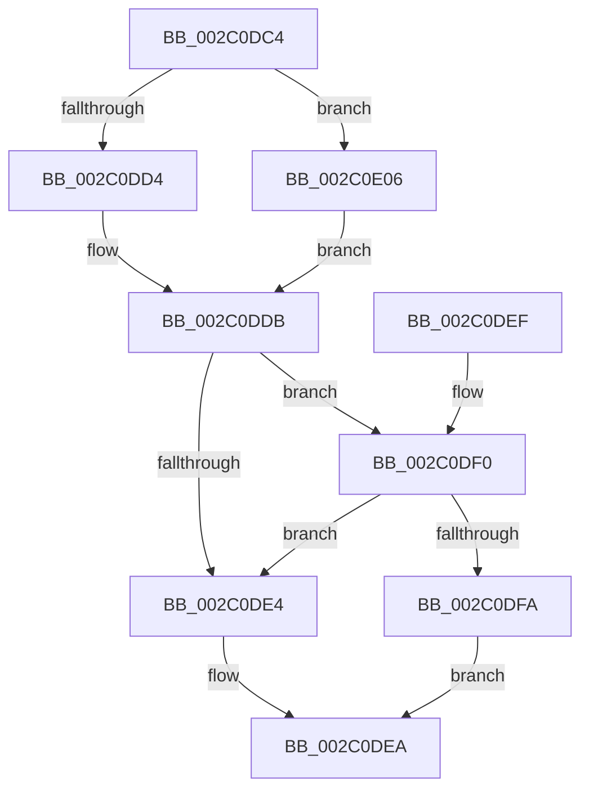

# MiUnlockWorkingSetCoreExclusive

- RVA: `0x002C0DC4`–`0x002C0E0F` (길이 `75` bytes)
- VA: `0x00000001402C0DC4`
- 실행 섹션: `.text`
- PDB 이름 있음: `예`; PDB Function 태그: `아니요`
- unwind 정보 RVA: `0x0006E680`
- 디코드: `20`개 명령, `75/75` bytes 표시
- 미해석 바이트: `0` (있으면 어셈블리에 `.byte`로 보존)

> 이 문서는 커널 이미지의 기계어와 PDB 기호를 분석해 생성했습니다. 4번과 5번은 함수 원형과 자료형을 바이너리 사용 방식에서 추정한 C 해석이며 원본 소스 복구 결과는 아닙니다.

## 1. Dependencies

- 직접 호출 지점: **1**; 고유 호출 대상: **1**
- 직접 호출자로 확인된 함수: **7**
- RIP 상대 이미지 참조: **3**

### Outgoing calls
- `0x002C0DFF` → [ExpReleaseSpinLockExclusiveFromDpcLevelInstrumented](ExpReleaseSpinLockExclusiveFromDpcLevelInstrumented_function_002C0F44.md) (function, `0x002C0F44`)

### Direct callers
- [MiLogPageAccess](../24/MiLogPageAccess_function_00240870.md) at `0x0024098E`
- [MiSetVaAgeList](../29/MiSetVaAgeList_function_00290A20.md) at `0x00291442`
- [MiSetVaAgeList](../29/MiSetVaAgeList_function_00290A20.md) at `0x002917E3`
- [MmQuerySystemWorkingSetInformation](MmQuerySystemWorkingSetInformation_function_002C0710.md) at `0x002C0804`
- [MiDrainOldAccessBuffers](MiDrainOldAccessBuffers_function_002C0C30.md) at `0x002C0CBC`
- [MiDrainSystemAccessLog](../47/MiDrainSystemAccessLog_function_00474144.md) at `0x004741DB`
- [MmAdjustWorkingSetSizeEx](../47/MmAdjustWorkingSetSizeEx_function_0047D8D4.md) at `0x0047DA3F`
- [MiCopyWorkingSetFields](../66/MiCopyWorkingSetFields_function_0066F0F4.md) at `0x0066F1EF`

### Static image references
- `0x002C0DD4` → RVA `0x00E38880` (`.data`; read)
- `0x002C0DDB` → RVA `0x00FC6B06` (`ALMOSTRO`; read)
- `0x002C0DF0` → RVA `0x00F0DE58` (`.data`; read)

## 2. Other-region calls and transfers

- 다른 실행 섹션으로 향하는 call: **0**
- 별도 외부 분기/꼬리 이동을 확인하지 못했습니다.

## 3. Assembly (complete function range)

```asm
002C0DC4  48 83 EC 28                     sub rsp, 0x28
002C0DC8  8B 81 B8 00 00 00               mov eax, dword ptr [rcx + 0xb8]
002C0DCE  24 0F                           and al, 0xf
002C0DD0  3C 01                           cmp al, 1
002C0DD2  75 32                           jne 0x1402c0e06
002C0DD4  48 8D 0D A5 7A B7 00            lea rcx, [rip + 0xb77aa5]
002C0DDB  F6 05 24 5D D0 00 01            test byte ptr [rip + 0xd05d24], 1
002C0DE2  75 0C                           jne 0x1402c0df0
002C0DE4  C7 01 00 00 00 00               mov dword ptr [rcx], 0
002C0DEA  48 83 C4 28                     add rsp, 0x28
002C0DEE  C3                              ret
002C0DEF  CC                              int3
002C0DF0  8B 05 62 D0 C4 00               mov eax, dword ptr [rip + 0xc4d062]
002C0DF6  85 C0                           test eax, eax
002C0DF8  75 EA                           jne 0x1402c0de4
002C0DFA  48 8B 54 24 28                  mov rdx, qword ptr [rsp + 0x28]
002C0DFF  E8 40 01 00 00                  call 0x1402c0f44
002C0E04  EB E4                           jmp 0x1402c0dea
002C0E06  48 81 C1 00 01 00 00            add rcx, 0x100
002C0E0D  EB CC                           jmp 0x1402c0ddb
```

## 4. C-style interpretation (structured pseudocode)

```c
__int64 __fastcall MiUnlockWorkingSetCoreExclusive(__int64 a1)
{
    __int64 result;
    __int64 v_rsp;
    unsigned __int64 v_stack_p28;

    v_rsp = (v_rsp) - (40);
    result = (unsigned __int8)(((unsigned int)(*(unsigned int *)(a1 + 184))) & (15));
    if (((unsigned __int8)(result)) != 1) goto loc_002C0E06;
loc_002C0DDB:
    if (((*(unsigned __int8 *)(v_rip + 13655332)) & (1)) != 0) goto loc_002C0DF0;
loc_002C0DE4:
    *(unsigned int *)(v_rip + 12024485) = 0;
loc_002C0DEA:
    v_rsp = (v_rsp) + (40);
    return result;
loc_002C0DF0:
    if ((unsigned int)((unsigned int)(*(unsigned int *)(v_rip + 12898402))) != 0) goto loc_002C0DE4;
    result = ExpReleaseSpinLockExclusiveFromDpcLevelInstrumented(v_rip + 12024485, v_stack_p28, a3, a4);
    goto loc_002C0DEA;
loc_002C0E06:
    a1 = (v_rip + 12024485) + (256);
    goto loc_002C0DDB;
}
```

## 5. (Beta) C Style

```c
int64_t MiUnlockWorkingSetCoreExclusive(void *Arg1)
{
    uint8_t *arg1 = (uint8_t *)Arg1;

    int64_t result;
    int64_t local_rsp;
    uint64_t v_stack_p28;

    local_rsp = (local_rsp) - (40);
    result = (uint8_t)(((uint32_t)(*(uint32_t *)(arg1 + 0xB8))) & (15));
    if (((uint8_t)(result)) != 1) goto loc_002C0E06;
loc_002C0DDB:
    if (((*(uint8_t *)(v_rip + 0xD05D24)) & (1)) != 0) goto loc_002C0DF0;
loc_002C0DE4:
    *(uint32_t *)(v_rip + 0xB77AA5) = 0;
loc_002C0DEA:
    local_rsp = (local_rsp) + (40);
    return result;
loc_002C0DF0:
    if ((uint32_t)((uint32_t)(*(uint32_t *)(v_rip + 0xC4D062))) != 0) goto loc_002C0DE4;
    result = ExpReleaseSpinLockExclusiveFromDpcLevelInstrumented(v_rip + 12024485, v_stack_p28, a3, a4);
    goto loc_002C0DEA;
loc_002C0E06:
    Arg1 = (v_rip + 12024485) + (256);
    goto loc_002C0DDB;
}
```

### 관측된 메모리 오프셋

구조체 형식이 확인되지 않은 접근은 인자 기준의 오프셋으로만 기록했습니다.

| 기준 인자 | 오프셋 표현 | 폭 (bit) | 접근 |
|---|---:|---:|---|
| `Arg1` | `+ 0xB8` | `32` | `R` |

## 6. Execution-region graph

[열기: 2D/3D 그래프와 함수 탐색 컨트롤 패널](../../../control-panel.html?section=text&rva=0x002C0DC4&view=graph)

- 2D 그래프는 위에서 아래로 흐르고, 3D 그래프는 빈 공간을 드래그해 회전합니다. Shift+드래그는 이동, 휠은 확대·축소, 함수 노드 선택은 대상 보고서 이동입니다.

### Static fallback


