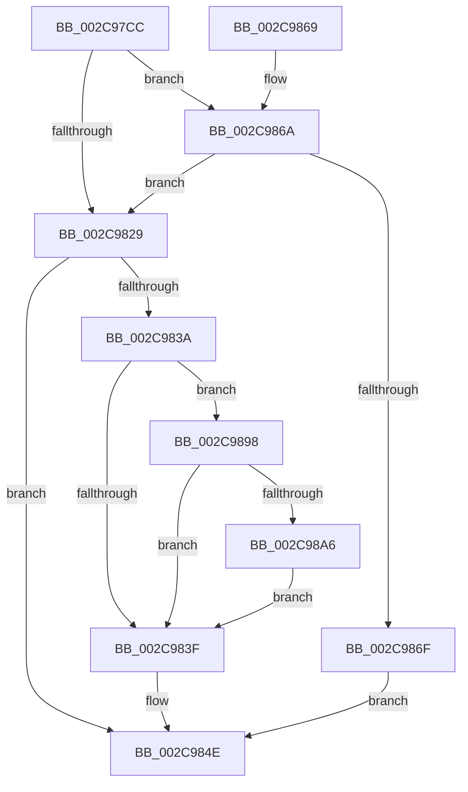

# MiUpdateCacheAttributeListsForPage

- RVA: `0x002C97CC`–`0x002C98AC` (길이 `224` bytes)
- VA: `0x00000001402C97CC`
- 실행 섹션: `.text`
- PDB 이름 있음: `예`; PDB Function 태그: `아니요`
- unwind 정보 RVA: `0x0006F090`
- 디코드: `63`개 명령, `224/224` bytes 표시
- 미해석 바이트: `0` (있으면 어셈블리에 `.byte`로 보존)

> 이 문서는 커널 이미지의 기계어와 PDB 기호를 분석해 생성했습니다. 4번과 5번은 함수 원형과 자료형을 바이너리 사용 방식에서 추정한 C 해석이며 원본 소스 복구 결과는 아닙니다.

## 1. Dependencies

- 직접 호출 지점: **5**; 고유 호출 대상: **3**
- 직접 호출자로 확인된 함수: **2**
- RIP 상대 이미지 참조: **0**

### Outgoing calls
- `0x002C9831` → [MiPageAttributeBatchChangeNeeded](../29/MiPageAttributeBatchChangeNeeded_function_0029FAD0.md) (function, `0x0029FAD0`)
- `0x002C9842` → [MiMakeLinkedListPte](MiMakeLinkedListPte_function_002C98C0.md) (function, `0x002C98C0`)
- `0x002C9875` → [MiPageAttributeBatchChangeNeeded](../29/MiPageAttributeBatchChangeNeeded_function_0029FAD0.md) (function, `0x0029FAD0`)
- `0x002C9888` → [MiMakeLinkedListPte](MiMakeLinkedListPte_function_002C98C0.md) (function, `0x002C98C0`)
- `0x002C989D` → [MiPfnBestZeroAttribute](MiPfnBestZeroAttribute_function_002C8600.md) (function, `0x002C8600`)

### Direct callers
- [MiInitializeMdlOneNodeBatchPages](MiInitializeMdlOneNodeBatchPages_function_002C9480.md) at `0x002C960F`
- [MiFindLargePageMemory](../../page/AA/MiFindLargePageMemory_function_00AA8334.md) at `0x00AA856B`

### Static image references
- 디코드된 RIP-relative 메모리 참조가 없습니다.

## 2. Other-region calls and transfers

- 다른 실행 섹션으로 향하는 call: **0**
- 별도 외부 분기/꼬리 이동을 확인하지 못했습니다.

## 3. Assembly (complete function range)

```asm
002C97CC  48 8B C4                        mov rax, rsp
002C97CF  48 89 58 08                     mov qword ptr [rax + 8], rbx
002C97D3  48 89 68 10                     mov qword ptr [rax + 0x10], rbp
002C97D7  48 89 70 18                     mov qword ptr [rax + 0x18], rsi
002C97DB  48 89 78 20                     mov qword ptr [rax + 0x20], rdi
002C97DF  41 56                           push r14
002C97E1  48 83 EC 20                     sub rsp, 0x20
002C97E5  45 8B F1                        mov r14d, r9d
002C97E8  48 8B FA                        mov rdi, rdx
002C97EB  BA 01 00 00 00                  mov edx, 1
002C97F0  41 83 E1 02                     and r9d, 2
002C97F4  44 23 F2                        and r14d, edx
002C97F7  41 C1 E1 03                     shl r9d, 3
002C97FB  41 8B F0                        mov esi, r8d
002C97FE  48 8B D9                        mov rbx, rcx
002C9801  48 B8 00 00 00 00 00 DE FF FF   movabs rax, 0xffffde0000000000
002C980B  48 8B EF                        mov rbp, rdi
002C980E  48 2B E8                        sub rbp, rax
002C9811  48 B8 AB AA AA AA AA AA AA AA   movabs rax, 0xaaaaaaaaaaaaaaab
002C981B  48 C1 FD 04                     sar rbp, 4
002C981F  48 0F AF E8                     imul rbp, rax
002C9823  41 83 F8 03                     cmp r8d, 3
002C9827  74 41                           je 0x1402c986a
002C9829  45 8B C1                        mov r8d, r9d
002C982C  8B D6                           mov edx, esi
002C982E  48 8B CF                        mov rcx, rdi
002C9831  E8 9A 62 FD FF                  call 0x14029fad0
002C9836  85 C0                           test eax, eax
002C9838  74 14                           je 0x1402c984e
002C983A  45 85 F6                        test r14d, r14d
002C983D  75 59                           jne 0x1402c9898
002C983F  48 8B 0B                        mov rcx, qword ptr [rbx]
002C9842  E8 79 00 00 00                  call 0x1402c98c0
002C9847  48 89 47 10                     mov qword ptr [rdi + 0x10], rax
002C984B  48 89 2B                        mov qword ptr [rbx], rbp
002C984E  48 8B 5C 24 30                  mov rbx, qword ptr [rsp + 0x30]
002C9853  48 8B 6C 24 38                  mov rbp, qword ptr [rsp + 0x38]
002C9858  48 8B 74 24 40                  mov rsi, qword ptr [rsp + 0x40]
002C985D  48 8B 7C 24 48                  mov rdi, qword ptr [rsp + 0x48]
002C9862  48 83 C4 20                     add rsp, 0x20
002C9866  41 5E                           pop r14
002C9868  C3                              ret
002C9869  CC                              int3
002C986A  45 85 F6                        test r14d, r14d
002C986D  74 BA                           je 0x1402c9829
002C986F  45 8B C1                        mov r8d, r9d
002C9872  48 8B CF                        mov rcx, rdi
002C9875  E8 56 62 FD FF                  call 0x14029fad0
002C987A  F7 D8                           neg eax
002C987C  48 1B D2                        sbb rdx, rdx
002C987F  48 83 E2 F8                     and rdx, 0xfffffffffffffff8
002C9883  48 8B 4C 1A 18                  mov rcx, qword ptr [rdx + rbx + 0x18]
002C9888  E8 33 00 00 00                  call 0x1402c98c0
002C988D  48 89 47 10                     mov qword ptr [rdi + 0x10], rax
002C9891  48 89 6C 1A 18                  mov qword ptr [rdx + rbx + 0x18], rbp
002C9896  EB B6                           jmp 0x1402c984e
002C9898  8B D6                           mov edx, esi
002C989A  48 8B CF                        mov rcx, rdi
002C989D  E8 5E ED FF FF                  call 0x1402c8600
002C98A2  3B C6                           cmp eax, esi
002C98A4  74 99                           je 0x1402c983f
002C98A6  48 83 C3 08                     add rbx, 8
002C98AA  EB 93                           jmp 0x1402c983f
```

## 4. C-style interpretation (structured pseudocode)

```c
__int64 __fastcall MiUpdateCacheAttributeListsForPage(__int64 a1, __int64 a2, int a3, int a4)
{
    __int64 result;
    __int64 v_r14;
    __int64 v_rbp;
    __int64 v_rbx;
    __int64 v_rsp;
    unsigned __int64 v_stack_p10;
    unsigned __int64 v_stack_p18;
    unsigned __int64 v_stack_p20;
    unsigned __int64 v_stack_p8;

    *(unsigned __int64 *)(v_rsp + 8) = v_rbx;
    *(unsigned __int64 *)(v_rsp + 16) = v_rbp;
    *(unsigned __int64 *)(v_rsp + 24) = v_rsi;
    *(unsigned __int64 *)(v_rsp + 32) = v_rdi;
    v_rsp = (v_rsp) - (32);
    a4 = (unsigned int)((a4) & (2));
    v_r14 = (unsigned int)(((unsigned int)(a4)) & (1));
    a4 = (unsigned int)((a4) << (3));
    v_rbp = (a2) - (v_rsp);
    v_rbp = (v_rbp) >> (4);
    v_rbp = (v_rbp) * (v_rsp);
    if (a3 == 3) goto loc_002C986A;
loc_002C9829:
    result = MiPageAttributeBatchChangeNeeded(a2, (unsigned int)((unsigned int)((unsigned int)(a3))), (unsigned int)(a4), a4);
    if ((unsigned int)(result) == 0) goto loc_002C984E;
    if ((unsigned int)(v_r14) != 0) goto loc_002C9898;
loc_002C983F:
    result = MiMakeLinkedListPte(*(unsigned __int64 *)(a1), (unsigned int)((unsigned int)((unsigned int)(a3))), (unsigned int)(a4), a4);
    *(unsigned __int64 *)(a2 + 16) = result;
    *(unsigned __int64 *)(a1) = v_rbp;
loc_002C984E:
    v_rsp = (v_rsp) + (32);
    return result;
loc_002C986A:
    if ((unsigned int)(v_r14) == 0) goto loc_002C9829;
    result = MiPageAttributeBatchChangeNeeded(v_stack_p20, (unsigned int)((unsigned int)((unsigned int)(a3))), (unsigned int)(a4), a4);
    result = (unsigned int)(-(result));
    a2 = ((unsigned int)((unsigned int)((unsigned int)(a3)))) & (-8);
    result = MiMakeLinkedListPte(*(unsigned __int64 *)(a2 + v_stack_p8 * 1 + 24), a2, (unsigned int)(a4), a4);
    *(unsigned __int64 *)(v_stack_p20 + 16) = result;
    *(unsigned __int64 *)(a2 + v_stack_p8 * 1 + 24) = v_stack_p10;
    goto loc_002C984E;
loc_002C9898:
    result = MiPfnBestZeroAttribute(v_stack_p20, (unsigned int)((unsigned int)(v_stack_p18)), (unsigned int)(a4), a4);
    if (((unsigned int)(result)) == ((unsigned int)(v_stack_p18))) goto loc_002C983F;
    v_rbx = (v_stack_p8) + (8);
    goto loc_002C983F;
}
```

## 5. (Beta) C Style

```c
int64_t MiUpdateCacheAttributeListsForPage(void *Arg1, void *Arg2, int32_t Arg3, int32_t Arg4)
{
    uint8_t *arg1 = (uint8_t *)Arg1;
    uint8_t *arg2 = (uint8_t *)Arg2;

    int64_t result;
    int64_t local_r14;
    int64_t local_rbp;
    int64_t local_rbx;
    int64_t local_rsp;
    uint64_t v_stack_p10;
    uint64_t v_stack_p18;
    uint64_t v_stack_p20;
    uint64_t v_stack_p8;

    *(uint64_t *)(local_rsp + 0x8) = local_rbx;
    *(uint64_t *)(local_rsp + 0x10) = local_rbp;
    *(uint64_t *)(local_rsp + 0x18) = local_rsi;
    *(uint64_t *)(local_rsp + 0x20) = local_rdi;
    local_rsp = (local_rsp) - (32);
    Arg4 = (uint32_t)((Arg4) & (2));
    local_r14 = (uint32_t)(((uint32_t)(Arg4)) & (1));
    Arg4 = (uint32_t)((Arg4) << (3));
    local_rbp = (Arg2) - (local_rsp);
    local_rbp = (local_rbp) >> (4);
    local_rbp = (local_rbp) * (local_rsp);
    if (Arg3 == 3) goto loc_002C986A;
loc_002C9829:
    result = MiPageAttributeBatchChangeNeeded(Arg2, (uint32_t)((uint32_t)((uint32_t)(Arg3))), (uint32_t)(Arg4), Arg4);
    if ((uint32_t)(result) == 0) goto loc_002C984E;
    if ((uint32_t)(local_r14) != 0) goto loc_002C9898;
loc_002C983F:
    result = MiMakeLinkedListPte(*(uint64_t *)(arg1), (uint32_t)((uint32_t)((uint32_t)(Arg3))), (uint32_t)(Arg4), Arg4);
    *(uint64_t *)(arg2 + 0x10) = result;
    *(uint64_t *)(arg1) = local_rbp;
loc_002C984E:
    local_rsp = (local_rsp) + (32);
    return result;
loc_002C986A:
    if ((uint32_t)(local_r14) == 0) goto loc_002C9829;
    result = MiPageAttributeBatchChangeNeeded(v_stack_p20, (uint32_t)((uint32_t)((uint32_t)(Arg3))), (uint32_t)(Arg4), Arg4);
    result = (uint32_t)(-(result));
    Arg2 = ((uint32_t)((uint32_t)((uint32_t)(Arg3)))) & (-8);
    result = MiMakeLinkedListPte(*(uint64_t *)(arg2 + v_stack_p8 * 1 + 0x18), Arg2, (uint32_t)(Arg4), Arg4);
    *(uint64_t *)(v_stack_p20 + 0x10) = result;
    *(uint64_t *)(arg2 + v_stack_p8 * 1 + 0x18) = v_stack_p10;
    goto loc_002C984E;
loc_002C9898:
    result = MiPfnBestZeroAttribute(v_stack_p20, (uint32_t)((uint32_t)(v_stack_p18)), (uint32_t)(Arg4), Arg4);
    if (((uint32_t)(result)) == ((uint32_t)(v_stack_p18))) goto loc_002C983F;
    local_rbx = (v_stack_p8) + (8);
    goto loc_002C983F;
}
```

### 관측된 메모리 오프셋

구조체 형식이 확인되지 않은 접근은 인자 기준의 오프셋으로만 기록했습니다.

| 기준 인자 | 오프셋 표현 | 폭 (bit) | 접근 |
|---|---:|---:|---|
| `Arg1` | `+ 0x0` | `64` | `R` |
| `Arg1` | `+ 0x0` | `64` | `W` |
| `Arg2` | `+ 0x10` | `64` | `W` |

## 6. Execution-region graph

[열기: 2D/3D 그래프와 함수 탐색 컨트롤 패널](../../../control-panel.html?section=text&rva=0x002C97CC&view=graph)

- 2D 그래프는 위에서 아래로 흐르고, 3D 그래프는 빈 공간을 드래그해 회전합니다. Shift+드래그는 이동, 휠은 확대·축소, 함수 노드 선택은 대상 보고서 이동입니다.

### Static fallback


