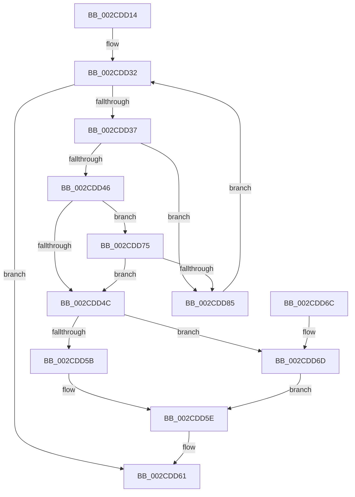

# MiUpdateDomainAvailableAffinity

- RVA: `0x002CDD14`–`0x002CDD8E` (길이 `122` bytes)
- VA: `0x00000001402CDD14`
- 실행 섹션: `.text`
- PDB 이름 있음: `예`; PDB Function 태그: `아니요`
- unwind 정보 RVA: `0x0006F56C`
- 디코드: `35`개 명령, `122/122` bytes 표시
- 미해석 바이트: `0` (있으면 어셈블리에 `.byte`로 보존)

> 이 문서는 커널 이미지의 기계어와 PDB 기호를 분석해 생성했습니다. 4번과 5번은 함수 원형과 자료형을 바이너리 사용 방식에서 추정한 C 해석이며 원본 소스 복구 결과는 아닙니다.

## 1. Dependencies

- 직접 호출 지점: **0**; 고유 호출 대상: **0**
- 직접 호출자로 확인된 함수: **2**
- RIP 상대 이미지 참조: **0**

### Outgoing calls
- 직접 디코드된 call 명령이 없습니다.

### Direct callers
- [MiAssignBackgroundZeroThreadToProcessor](MiAssignBackgroundZeroThreadToProcessor_function_002CCAAC.md) at `0x002CCB31`
- [MiUnlinkZeroThreadFromActiveDomain](MiUnlinkZeroThreadFromActiveDomain_function_002CCB9C.md) at `0x002CCC06`

### Static image references
- 디코드된 RIP-relative 메모리 참조가 없습니다.

## 2. Other-region calls and transfers

- 다른 실행 섹션으로 향하는 call: **0**
- 별도 외부 분기/꼬리 이동을 확인하지 못했습니다.

## 3. Assembly (complete function range)

```asm
002CDD14  48 89 5C 24 08                  mov qword ptr [rsp + 8], rbx
002CDD19  48 89 7C 24 10                  mov qword ptr [rsp + 0x10], rdi
002CDD1E  48 8B 99 50 01 00 00            mov rbx, qword ptr [rcx + 0x150]
002CDD25  4C 8B D9                        mov r11, rcx
002CDD28  4C 8B 4A 08                     mov r9, qword ptr [rdx + 8]
002CDD2C  45 33 D2                        xor r10d, r10d
002CDD2F  8B 7B 14                        mov edi, dword ptr [rbx + 0x14]
002CDD32  44 3B D7                        cmp r10d, edi
002CDD35  73 2A                           jae 0x1402cdd61
002CDD37  41 0F B7 83 68 01 00 00         movzx eax, word ptr [r11 + 0x168]
002CDD3F  66 41 39 41 08                  cmp word ptr [r9 + 8], ax
002CDD44  75 3F                           jne 0x1402cdd85
002CDD46  80 7B 24 00                     cmp byte ptr [rbx + 0x24], 0
002CDD4A  75 29                           jne 0x1402cdd75
002CDD4C  49 8B 83 60 01 00 00            mov rax, qword ptr [r11 + 0x160]
002CDD53  49 8B 09                        mov rcx, qword ptr [r9]
002CDD56  45 85 C0                        test r8d, r8d
002CDD59  75 12                           jne 0x1402cdd6d
002CDD5B  48 0B C1                        or rax, rcx
002CDD5E  49 89 01                        mov qword ptr [r9], rax
002CDD61  48 8B 5C 24 08                  mov rbx, qword ptr [rsp + 8]
002CDD66  48 8B 7C 24 10                  mov rdi, qword ptr [rsp + 0x10]
002CDD6B  C3                              ret
002CDD6C  CC                              int3
002CDD6D  48 F7 D0                        not rax
002CDD70  48 23 C1                        and rax, rcx
002CDD73  EB E9                           jmp 0x1402cdd5e
002CDD75  48 8B 02                        mov rax, qword ptr [rdx]
002CDD78  41 8B CA                        mov ecx, r10d
002CDD7B  48 03 C9                        add rcx, rcx
002CDD7E  48 83 3C C8 00                  cmp qword ptr [rax + rcx*8], 0
002CDD83  75 C7                           jne 0x1402cdd4c
002CDD85  41 FF C2                        inc r10d
002CDD88  49 83 C1 10                     add r9, 0x10
002CDD8C  EB A4                           jmp 0x1402cdd32
```

## 4. C-style interpretation (structured pseudocode)

```c
__int64 __fastcall MiUpdateDomainAvailableAffinity(__int64 a1, __int64 a2, int a3)
{
    __int64 result;
    __int64 v_r10;
    unsigned __int64 v_stack_p10;
    unsigned __int64 v_stack_p8;

    v_stack_p8 = v_rbx;
    v_stack_p10 = v_rdi;
    v_r10 = 0;
loc_002CDD32:
    if (0 >= ((unsigned int)((unsigned int)(*(unsigned int *)(*(unsigned __int64 *)(a1 + 336) + 20))))) goto loc_002CDD61;
    if ((*(unsigned __int16 *)(*(unsigned __int64 *)(a2 + 8) + 8)) != ((unsigned __int16)(*(unsigned __int16 *)(a1 + 360)))) goto loc_002CDD85;
    if ((*(unsigned __int8 *)(*(unsigned __int64 *)(a1 + 336) + 36)) != 0) goto loc_002CDD75;
loc_002CDD4C:
    if (a3 != 0) goto loc_002CDD6D;
    result = (*(unsigned __int64 *)(a1 + 352)) | (*(unsigned __int64 *)(*(unsigned __int64 *)(a2 + 8)));
loc_002CDD5E:
    *(unsigned __int64 *)(*(unsigned __int64 *)(a2 + 8)) = result;
loc_002CDD61:
    return result;
loc_002CDD6D:
    result = ~(result);
    result = (result) & (*(unsigned __int64 *)(*(unsigned __int64 *)(a2 + 8)));
    goto loc_002CDD5E;
loc_002CDD75:
    a1 = (0) + (0);
    if ((*(unsigned __int64 *)(*(unsigned __int64 *)(a2) + a1 * 8)) != 0) goto loc_002CDD4C;
loc_002CDD85:
    v_r10 = (unsigned int)((v_r10) + 1);
    a4 = (*(unsigned __int64 *)(a2 + 8)) + (16);
    goto loc_002CDD32;
}
```

## 5. (Beta) C Style

```c
int64_t MiUpdateDomainAvailableAffinity(void *Arg1, void *Arg2, int32_t Arg3)
{
    uint8_t *arg1 = (uint8_t *)Arg1;
    uint8_t *arg2 = (uint8_t *)Arg2;

    int64_t result;
    int64_t local_r10;
    uint64_t v_stack_p10;
    uint64_t v_stack_p8;

    v_stack_p8 = local_rbx;
    v_stack_p10 = local_rdi;
    local_r10 = 0;
loc_002CDD32:
    if (0 >= ((uint32_t)((uint32_t)(*(uint32_t *)(*(uint64_t *)(arg1 + 0x150) + 0x14))))) goto loc_002CDD61;
    if ((*(uint16_t *)(*(uint64_t *)(arg2 + 0x8) + 0x8)) != ((uint16_t)(*(uint16_t *)(arg1 + 0x168)))) goto loc_002CDD85;
    if ((*(uint8_t *)(*(uint64_t *)(arg1 + 0x150) + 0x24)) != 0) goto loc_002CDD75;
loc_002CDD4C:
    if (Arg3 != 0) goto loc_002CDD6D;
    result = (*(uint64_t *)(arg1 + 0x160)) | (*(uint64_t *)(*(uint64_t *)(arg2 + 0x8)));
loc_002CDD5E:
    *(uint64_t *)(*(uint64_t *)(arg2 + 0x8)) = result;
loc_002CDD61:
    return result;
loc_002CDD6D:
    result = ~(result);
    result = (result) & (*(uint64_t *)(*(uint64_t *)(arg2 + 0x8)));
    goto loc_002CDD5E;
loc_002CDD75:
    Arg1 = (0) + (0);
    if ((*(uint64_t *)(*(uint64_t *)(arg2) + arg1 * 8)) != 0) goto loc_002CDD4C;
loc_002CDD85:
    local_r10 = (uint32_t)((local_r10) + 1);
    a4 = (*(uint64_t *)(arg2 + 0x8)) + (16);
    goto loc_002CDD32;
}
```

### 관측된 메모리 오프셋

구조체 형식이 확인되지 않은 접근은 인자 기준의 오프셋으로만 기록했습니다.

| 기준 인자 | 오프셋 표현 | 폭 (bit) | 접근 |
|---|---:|---:|---|
| `Arg1` | `+ 0x150` | `64` | `R` |
| `Arg1` | `+ 0x160` | `64` | `R` |
| `Arg1` | `+ 0x168` | `16` | `R` |
| `Arg2` | `+ 0x0` | `64` | `R` |
| `Arg2` | `+ 0x8` | `64` | `R` |

## 6. Execution-region graph

[열기: 2D/3D 그래프와 함수 탐색 컨트롤 패널](../../../control-panel.html?section=text&rva=0x002CDD14&view=graph)

- 2D 그래프는 위에서 아래로 흐르고, 3D 그래프는 빈 공간을 드래그해 회전합니다. Shift+드래그는 이동, 휠은 확대·축소, 함수 노드 선택은 대상 보고서 이동입니다.

### Static fallback


