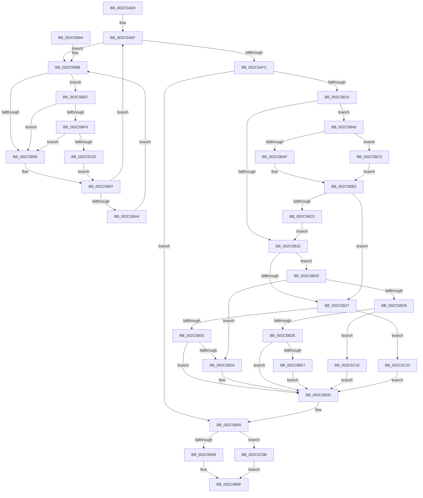

# MiUpdatePfnProtection

- RVA: `0x002C5AD0`–`0x002C5C2B` (길이 `347` bytes)
- VA: `0x00000001402C5AD0`
- 실행 섹션: `.text`
- PDB 이름 있음: `예`; PDB Function 태그: `아니요`
- unwind 정보 RVA: `0x0006EB80`
- 디코드: `95`개 명령, `347/347` bytes 표시
- 미해석 바이트: `0` (있으면 어셈블리에 `.byte`로 보존)

> 이 문서는 커널 이미지의 기계어와 PDB 기호를 분석해 생성했습니다. 4번과 5번은 함수 원형과 자료형을 바이너리 사용 방식에서 추정한 C 해석이며 원본 소스 복구 결과는 아닙니다.

## 1. Dependencies

- 직접 호출 지점: **3**; 고유 호출 대상: **3**
- 직접 호출자로 확인된 함수: **3**
- RIP 상대 이미지 참조: **2**

### Outgoing calls
- `0x002C5BF9` → [KiCheckVpBackingLongSpinWaitHypercall](../30/KiCheckVpBackingLongSpinWaitHypercall_function_0030F490.md) (function, `0x0030F490`)
- `0x002C5C04` → [HvlNotifyLongSpinWait](../30/HvlNotifyLongSpinWait_function_0030F460.md) (function, `0x0030F460`)
- `0x002C5C0E` → [MiMakeDemandZeroPte](../33/MiMakeDemandZeroPte_function_00337A00.md) (function, `0x00337A00`)

### Direct callers
- [MiSetReadOnlyOnSectionView](../29/MiSetReadOnlyOnSectionView_function_00294538.md) at `0x002948BC`
- [sub_002C3A7C](Unknown_function_002C3A7C.md) at `0x002C3CCA`
- [sub_006F91FE](../6F/Unknown_function_006F91FE.md) at `0x006F9353`

### Static image references
- `0x002C5B8D` → RVA `0x00FC52AC` (`ALMOSTRO`; reference)
- `0x002C5BEF` → RVA `0x00FC6AB8` (`ALMOSTRO`; read)

## 2. Other-region calls and transfers

- 다른 실행 섹션으로 향하는 call: **0**
- 별도 외부 분기/꼬리 이동을 확인하지 못했습니다.

## 3. Assembly (complete function range)

```asm
002C5AD0  48 89 5C 24 08                  mov qword ptr [rsp + 8], rbx
002C5AD5  48 89 6C 24 10                  mov qword ptr [rsp + 0x10], rbp
002C5ADA  48 89 74 24 18                  mov qword ptr [rsp + 0x18], rsi
002C5ADF  57                              push rdi
002C5AE0  48 83 EC 20                     sub rsp, 0x20
002C5AE4  41 8B D8                        mov ebx, r8d
002C5AE7  48 8B FA                        mov rdi, rdx
002C5AEA  48 8B E9                        mov rbp, rcx
002C5AED  33 F6                           xor esi, esi
002C5AEF  F0 48 0F BA 6F 18 3F            lock bts qword ptr [rdi + 0x18], 0x3f
002C5AF6  0F 82 8F 00 00 00               jb 0x1402c5b8b
002C5AFC  48 8B 4F 10                     mov rcx, qword ptr [rdi + 0x10]
002C5B00  41 B8 18 00 00 00               mov r8d, 0x18
002C5B06  48 8B C1                        mov rax, rcx
002C5B09  48 C1 E8 05                     shr rax, 5
002C5B0D  83 E0 1F                        and eax, 0x1f
002C5B10  41 3B D8                        cmp ebx, r8d
002C5B13  74 2B                           je 0x1402c5b40
002C5B15  41 3B C0                        cmp eax, r8d
002C5B18  0F 84 88 00 00 00               je 0x1402c5ba6
002C5B1E  41 23 C0                        and eax, r8d
002C5B21  0F 85 A9 00 00 00               jne 0x1402c5bd0
002C5B27  8B C3                           mov eax, ebx
002C5B29  41 23 C0                        and eax, r8d
002C5B2C  41 3B C0                        cmp eax, r8d
002C5B2F  0F 84 EE 00 00 00               je 0x1402c5c23
002C5B35  83 F8 08                        cmp eax, 8
002C5B38  75 03                           jne 0x1402c5b3d
002C5B3A  83 E3 F7                        and ebx, 0xfffffff7
002C5B3D  44 8B C3                        mov r8d, ebx
002C5B40  48 85 C9                        test rcx, rcx
002C5B43  0F 84 C2 00 00 00               je 0x1402c5c0b
002C5B49  41 8B D0                        mov edx, r8d
002C5B4C  48 C1 E2 05                     shl rdx, 5
002C5B50  48 8B C2                        mov rax, rdx
002C5B53  48 33 C1                        xor rax, rcx
002C5B56  48 25 1F FC FF FF               and rax, 0xfffffffffffffc1f
002C5B5C  48 33 C2                        xor rax, rdx
002C5B5F  48 89 47 10                     mov qword ptr [rdi + 0x10], rax
002C5B63  48 B8 FF FF FF FF FF FF FF 7F   movabs rax, 0x7fffffffffffffff
002C5B6D  F0 48 21 47 18                  lock and qword ptr [rdi + 0x18], rax
002C5B72  48 8B 5C 24 30                  mov rbx, qword ptr [rsp + 0x30]
002C5B77  41 8B C0                        mov eax, r8d
002C5B7A  48 8B 6C 24 38                  mov rbp, qword ptr [rsp + 0x38]
002C5B7F  48 8B 74 24 40                  mov rsi, qword ptr [rsp + 0x40]
002C5B84  48 83 C4 20                     add rsp, 0x20
002C5B88  5F                              pop rdi
002C5B89  C3                              ret
002C5B8A  CC                              int3
002C5B8B  FF C6                           inc esi
002C5B8D  85 35 19 F7 CF 00               test dword ptr [rip + 0xcff719], esi
002C5B93  74 5A                           je 0x1402c5bef
002C5B95  F3 90                           pause
002C5B97  48 8B 47 18                     mov rax, qword ptr [rdi + 0x18]
002C5B9B  48 85 C0                        test rax, rax
002C5B9E  0F 89 4B FF FF FF               jns 0x1402c5aef
002C5BA4  EB E5                           jmp 0x1402c5b8b
002C5BA6  8B 55 30                        mov edx, dword ptr [rbp + 0x30]
002C5BA9  0F BA E2 15                     bt edx, 0x15
002C5BAD  73 16                           jae 0x1402c5bc5
002C5BAF  C1 EA 07                        shr edx, 7
002C5BB2  83 E2 1F                        and edx, 0x1f
002C5BB5  8B C2                           mov eax, edx
002C5BB7  41 3B D0                        cmp edx, r8d
002C5BBA  0F 84 67 FF FF FF               je 0x1402c5b27
002C5BC0  E9 59 FF FF FF                  jmp 0x1402c5b1e
002C5BC5  48 8B 45 48                     mov rax, qword ptr [rbp + 0x48]
002C5BC9  8B 50 20                        mov edx, dword ptr [rax + 0x20]
002C5BCC  D1 EA                           shr edx, 1
002C5BCE  EB E2                           jmp 0x1402c5bb2
002C5BD0  83 F8 10                        cmp eax, 0x10
002C5BD3  0F 84 61 FF FF FF               je 0x1402c5b3a
002C5BD9  83 F8 08                        cmp eax, 8
002C5BDC  74 3A                           je 0x1402c5c18
002C5BDE  41 3B C0                        cmp eax, r8d
002C5BE1  0F 85 56 FF FF FF               jne 0x1402c5b3d
002C5BE7  41 0B D8                        or ebx, r8d
002C5BEA  E9 4E FF FF FF                  jmp 0x1402c5b3d
002C5BEF  8B 05 C3 0E D0 00               mov eax, dword ptr [rip + 0xd00ec3]
002C5BF5  A8 40                           test al, 0x40
002C5BF7  74 9C                           je 0x1402c5b95
002C5BF9  E8 92 98 04 00                  call 0x14030f490
002C5BFE  84 C0                           test al, al
002C5C00  74 93                           je 0x1402c5b95
002C5C02  8B CE                           mov ecx, esi
002C5C04  E8 57 98 04 00                  call 0x14030f460
002C5C09  EB 8C                           jmp 0x1402c5b97
002C5C0B  41 8B C8                        mov ecx, r8d
002C5C0E  E8 ED 1D 07 00                  call 0x140337a00
002C5C13  E9 47 FF FF FF                  jmp 0x1402c5b5f
002C5C18  83 E3 EF                        and ebx, 0xffffffef
002C5C1B  83 CB 08                        or ebx, 8
002C5C1E  E9 1A FF FF FF                  jmp 0x1402c5b3d
002C5C23  83 E3 E7                        and ebx, 0xffffffe7
002C5C26  E9 12 FF FF FF                  jmp 0x1402c5b3d
```

## 4. C-style interpretation (structured pseudocode)

```c
__int64 __fastcall MiUpdatePfnProtection(__int64 a1, __int64 a2, int a3)
{
    __int64 result;
    __int64 v_rbx;
    __int64 v_rsi;
    __int64 v_rsp;
    unsigned __int64 v_stack_p10;
    unsigned __int64 v_stack_p18;
    unsigned __int64 v_stack_p8;

    v_stack_p8 = v_rbx;
    v_stack_p10 = v_rbp;
    v_stack_p18 = v_rsi;
    v_rsp = (v_rsp) - (32);
    v_rsi = 0;
loc_002C5AEF:
    if (condition_is_below) goto loc_002C5B8B;
    result = (*(unsigned __int64 *)(a2 + 16)) >> (5);
    result = (unsigned int)((result) & (31));
    if (((unsigned int)((unsigned int)(a3))) == 24) goto loc_002C5B40;
    if (((unsigned int)(result)) == 24) goto loc_002C5BA6;
loc_002C5B1E:
    result = (unsigned int)((result) & (24));
    if (condition_is_not_equal) goto loc_002C5BD0;
loc_002C5B27:
    result = (unsigned int)(((unsigned int)((unsigned int)((unsigned int)(a3)))) & (24));
    if (((unsigned int)(result)) == 24) goto loc_002C5C23;
    v_rbx = (unsigned int)(a3);
    if (((unsigned int)(result)) == 8) {
        v_rbx = (unsigned int)(((unsigned int)(a3)) & (0xFFFFFFF7ULL));
    }
loc_002C5B40:
    if (*(unsigned __int64 *)(a2 + 16) == 0) goto loc_002C5C0B;
    a2 = ((unsigned int)((unsigned int)((unsigned int)((unsigned int)(v_rbx))))) << (5);
    result = (a2) ^ (*(unsigned __int64 *)(a2 + 16));
    result = (result) & (-993);
    result = (result) ^ (a2);
loc_002C5B5F:
    *(unsigned __int64 *)(a2 + 16) = result;
    v_rsp = (v_rsp) + (32);
    return (unsigned int)((unsigned int)((unsigned int)((unsigned int)(v_rbx))));
loc_002C5B8B:
    v_rsi = (unsigned int)((v_stack_p18) + 1);
    if (((*(unsigned int *)(v_rip + 13629209)) & ((unsigned int)(v_rsi))) == 0) goto loc_002C5BEF;
loc_002C5B95:
loc_002C5B97:
    if (!sign_flag) goto loc_002C5AEF;
    goto loc_002C5B8B;
loc_002C5BA6:
    if (condition_is_above_or_equal) goto loc_002C5BC5;
    a2 = (unsigned int)(((unsigned int)(*(unsigned int *)(v_stack_p10 + 48))) >> (7));
loc_002C5BB2:
    a2 = (unsigned int)((a2) & (31));
    if (((unsigned int)(a2)) == ((unsigned int)((unsigned int)((unsigned int)(v_rbx))))) goto loc_002C5B27;
    goto loc_002C5B1E;
loc_002C5BC5:
    a2 = (unsigned int)(((unsigned int)(*(unsigned int *)(*(unsigned __int64 *)(v_stack_p10 + 72) + 32))) >> (1));
    goto loc_002C5BB2;
loc_002C5BD0:
    if (((unsigned int)(*(unsigned __int64 *)(v_stack_p10 + 72))) == 16) goto loc_002C5B3A;
    if (((unsigned int)(*(unsigned __int64 *)(v_stack_p10 + 72))) == 8) goto loc_002C5C18;
    if (((unsigned int)(*(unsigned __int64 *)(v_stack_p10 + 72))) != ((unsigned int)((unsigned int)((unsigned int)(v_rbx))))) goto loc_002C5B3D;
    v_rbx = (unsigned int)((v_stack_p8) | ((unsigned int)((unsigned int)((unsigned int)(v_rbx)))));
    goto loc_002C5B3D;
loc_002C5BEF:
    if ((((unsigned __int8)((unsigned int)(*(unsigned int *)(v_rip + 13635267)))) & (64)) == 0) goto loc_002C5B95;
    result = KiCheckVpBackingLongSpinWaitHypercall(*(unsigned __int64 *)(a2 + 16), a2, (unsigned int)((unsigned int)(v_rbx)), a4);
    if ((unsigned __int8)(result) == 0) goto loc_002C5B95;
    result = HvlNotifyLongSpinWait((unsigned int)((unsigned int)(v_rsi)), a2, (unsigned int)((unsigned int)(v_rbx)), a4);
    goto loc_002C5B97;
loc_002C5C0B:
    result = MiMakeDemandZeroPte((unsigned int)((unsigned int)((unsigned int)((unsigned int)(v_rbx)))), a2, (unsigned int)((unsigned int)(v_rbx)), a4);
    goto loc_002C5B5F;
loc_002C5C18:
    v_rbx = (unsigned int)((v_rbx) & (0xFFFFFFEFULL));
    v_rbx = (unsigned int)((v_rbx) | (8));
    goto loc_002C5B3D;
loc_002C5C23:
    v_rbx = (unsigned int)((v_rbx) & (0xFFFFFFE7ULL));
    goto loc_002C5B3D;
}
```

## 5. (Beta) C Style

```c
int64_t MiUpdatePfnProtection(void *Arg1, void *Arg2, int32_t Arg3)
{
    uint8_t *arg1 = (uint8_t *)Arg1;
    uint8_t *arg2 = (uint8_t *)Arg2;

    int64_t result;
    int64_t local_rbx;
    int64_t local_rsi;
    int64_t local_rsp;
    uint64_t v_stack_p10;
    uint64_t v_stack_p18;
    uint64_t v_stack_p8;

    v_stack_p8 = local_rbx;
    v_stack_p10 = local_rbp;
    v_stack_p18 = local_rsi;
    local_rsp = (local_rsp) - (32);
    local_rsi = 0;
loc_002C5AEF:
    if (condition_is_below) goto loc_002C5B8B;
    result = (*(uint64_t *)(arg2 + 0x10)) >> (5);
    result = (uint32_t)((result) & (31));
    if (((uint32_t)((uint32_t)(Arg3))) == 24) goto loc_002C5B40;
    if (((uint32_t)(result)) == 24) goto loc_002C5BA6;
loc_002C5B1E:
    result = (uint32_t)((result) & (24));
    if (condition_is_not_equal) goto loc_002C5BD0;
loc_002C5B27:
    result = (uint32_t)(((uint32_t)((uint32_t)((uint32_t)(Arg3)))) & (24));
    if (((uint32_t)(result)) == 24) goto loc_002C5C23;
    local_rbx = (uint32_t)(Arg3);
    if (((uint32_t)(result)) == 8) {
        local_rbx = (uint32_t)(((uint32_t)(Arg3)) & (0xFFFFFFF7ULL));
    }
loc_002C5B40:
    if (*(uint64_t *)(arg2 + 0x10) == 0) goto loc_002C5C0B;
    Arg2 = ((uint32_t)((uint32_t)((uint32_t)((uint32_t)(local_rbx))))) << (5);
    result = (Arg2) ^ (*(uint64_t *)(arg2 + 0x10));
    result = (result) & (-993);
    result = (result) ^ (Arg2);
loc_002C5B5F:
    *(uint64_t *)(arg2 + 0x10) = result;
    local_rsp = (local_rsp) + (32);
    return (uint32_t)((uint32_t)((uint32_t)((uint32_t)(local_rbx))));
loc_002C5B8B:
    local_rsi = (uint32_t)((v_stack_p18) + 1);
    if (((*(uint32_t *)(v_rip + 0xCFF719)) & ((uint32_t)(local_rsi))) == 0) goto loc_002C5BEF;
loc_002C5B95:
loc_002C5B97:
    if (!sign_flag) goto loc_002C5AEF;
    goto loc_002C5B8B;
loc_002C5BA6:
    if (condition_is_above_or_equal) goto loc_002C5BC5;
    Arg2 = (uint32_t)(((uint32_t)(*(uint32_t *)(v_stack_p10 + 0x30))) >> (7));
loc_002C5BB2:
    Arg2 = (uint32_t)((Arg2) & (31));
    if (((uint32_t)(Arg2)) == ((uint32_t)((uint32_t)((uint32_t)(local_rbx))))) goto loc_002C5B27;
    goto loc_002C5B1E;
loc_002C5BC5:
    Arg2 = (uint32_t)(((uint32_t)(*(uint32_t *)(*(uint64_t *)(v_stack_p10 + 0x48) + 0x20))) >> (1));
    goto loc_002C5BB2;
loc_002C5BD0:
    if (((uint32_t)(*(uint64_t *)(v_stack_p10 + 0x48))) == 16) goto loc_002C5B3A;
    if (((uint32_t)(*(uint64_t *)(v_stack_p10 + 0x48))) == 8) goto loc_002C5C18;
    if (((uint32_t)(*(uint64_t *)(v_stack_p10 + 0x48))) != ((uint32_t)((uint32_t)((uint32_t)(local_rbx))))) goto loc_002C5B3D;
    local_rbx = (uint32_t)((v_stack_p8) | ((uint32_t)((uint32_t)((uint32_t)(local_rbx)))));
    goto loc_002C5B3D;
loc_002C5BEF:
    if ((((uint8_t)((uint32_t)(*(uint32_t *)(v_rip + 0xD00EC3)))) & (64)) == 0) goto loc_002C5B95;
    result = KiCheckVpBackingLongSpinWaitHypercall(*(uint64_t *)(arg2 + 0x10), Arg2, (uint32_t)((uint32_t)(local_rbx)), a4);
    if ((uint8_t)(result) == 0) goto loc_002C5B95;
    result = HvlNotifyLongSpinWait((uint32_t)((uint32_t)(local_rsi)), Arg2, (uint32_t)((uint32_t)(local_rbx)), a4);
    goto loc_002C5B97;
loc_002C5C0B:
    result = MiMakeDemandZeroPte((uint32_t)((uint32_t)((uint32_t)((uint32_t)(local_rbx)))), Arg2, (uint32_t)((uint32_t)(local_rbx)), a4);
    goto loc_002C5B5F;
loc_002C5C18:
    local_rbx = (uint32_t)((local_rbx) & (0xFFFFFFEFULL));
    local_rbx = (uint32_t)((local_rbx) | (8));
    goto loc_002C5B3D;
loc_002C5C23:
    local_rbx = (uint32_t)((local_rbx) & (0xFFFFFFE7ULL));
    goto loc_002C5B3D;
}
```

### 관측된 메모리 오프셋

구조체 형식이 확인되지 않은 접근은 인자 기준의 오프셋으로만 기록했습니다.

| 기준 인자 | 오프셋 표현 | 폭 (bit) | 접근 |
|---|---:|---:|---|
| `Arg1` | `+ 0x30` | `32` | `R` |
| `Arg1` | `+ 0x48` | `64` | `R` |
| `Arg2` | `+ 0x10` | `64` | `R` |
| `Arg2` | `+ 0x10` | `64` | `W` |
| `Arg2` | `+ 0x18` | `64` | `R` |
| `Arg2` | `+ 0x18` | `64` | `R/W` |

## 6. Execution-region graph

[열기: 2D/3D 그래프와 함수 탐색 컨트롤 패널](../../../control-panel.html?section=text&rva=0x002C5AD0&view=graph)

- 2D 그래프는 위에서 아래로 흐르고, 3D 그래프는 빈 공간을 드래그해 회전합니다. Shift+드래그는 이동, 휠은 확대·축소, 함수 노드 선택은 대상 보고서 이동입니다.

### Static fallback


