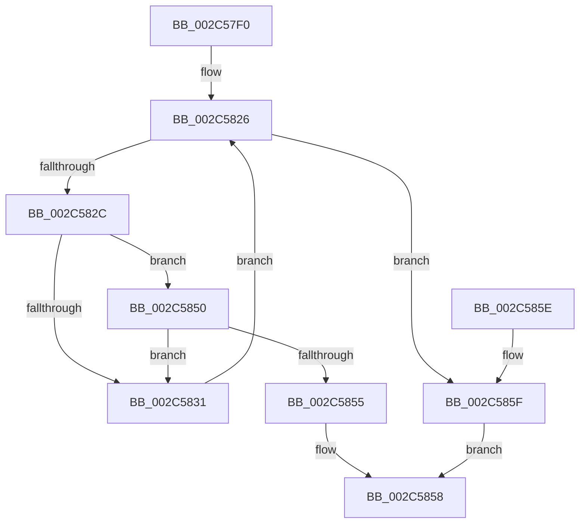

# MiUserPdeOrAbove

- RVA: `0x002C57F0`–`0x002C5863` (길이 `115` bytes)
- VA: `0x00000001402C57F0`
- 실행 섹션: `.text`
- PDB 이름 있음: `예`; PDB Function 태그: `아니요`
- unwind 정보 RVA: `0x0006EB48`
- 디코드: `29`개 명령, `115/115` bytes 표시
- 미해석 바이트: `0` (있으면 어셈블리에 `.byte`로 보존)

> 이 문서는 커널 이미지의 기계어와 PDB 기호를 분석해 생성했습니다. 4번과 5번은 함수 원형과 자료형을 바이너리 사용 방식에서 추정한 C 해석이며 원본 소스 복구 결과는 아닙니다.

## 1. Dependencies

- 직접 호출 지점: **0**; 고유 호출 대상: **0**
- 직접 호출자로 확인된 함수: **11**
- RIP 상대 이미지 참조: **0**

### Outgoing calls
- 직접 디코드된 call 명령이 없습니다.

### Direct callers
- [sub_00283F59](../28/Unknown_function_00283F59.md) at `0x00283F8B`
- [sub_002B21A1](../2B/Unknown_function_002B21A1.md) at `0x002B24D9`
- [sub_002B21A1](../2B/Unknown_function_002B21A1.md) at `0x002B252B`
- [sub_002C574C](Unknown_function_002C574C.md) at `0x002C579A`
- [sub_002C7096](Unknown_function_002C7096.md) at `0x002C70D2`
- [MiMapFrame](MiMapFrame_function_002C7190.md) at `0x002C7355`
- [MiFillSystemPtes](../31/MiFillSystemPtes_function_00319850.md) at `0x00319D0D`
- [sub_0031EDB1](../31/Unknown_function_0031EDB1.md) at `0x0031EE13`
- [MiCompletePrivateZeroFault](../33/MiCompletePrivateZeroFault_function_00330CC0.md) at `0x003318A6`
- [MiMapPageInHyperSpaceWorker](../33/MiMapPageInHyperSpaceWorker_function_00332B10.md) at `0x00332D5E`
- [sub_00345562](../34/Unknown_function_00345562.md) at `0x003455B6`
- [MiCompleteProtoPteFault](../34/MiCompleteProtoPteFault_function_00345710.md) at `0x0034609F`

### Static image references
- 디코드된 RIP-relative 메모리 참조가 없습니다.

## 2. Other-region calls and transfers

- 다른 실행 섹션으로 향하는 call: **0**
- 별도 외부 분기/꼬리 이동을 확인하지 못했습니다.

## 3. Assembly (complete function range)

```asm
002C57F0  48 89 5C 24 08                  mov qword ptr [rsp + 8], rbx
002C57F5  48 BA 00 00 00 40 FB F6 FF FF   movabs rdx, 0xfffff6fb40000000
002C57FF  49 B8 F8 FF FF 5F FB F6 FF FF   movabs r8, 0xfffff6fb5ffffff8
002C5809  41 BA 01 00 00 00               mov r10d, 1
002C580F  49 BB 00 00 00 00 80 F6 FF FF   movabs r11, 0xfffff68000000000
002C5819  45 8B CA                        mov r9d, r10d
002C581C  48 BB F8 FF FF FF 7F 00 00 00   movabs rbx, 0x7ffffffff8
002C5826  41 83 F9 04                     cmp r9d, 4
002C582A  73 33                           jae 0x1402c585f
002C582C  49 3B C8                        cmp rcx, r8
002C582F  76 1F                           jbe 0x1402c5850
002C5831  48 C1 EA 09                     shr rdx, 9
002C5835  48 23 D3                        and rdx, rbx
002C5838  49 8B C3                        mov rax, r11
002C583B  49 C1 E8 09                     shr r8, 9
002C583F  48 03 D0                        add rdx, rax
002C5842  4C 23 C3                        and r8, rbx
002C5845  49 8B C3                        mov rax, r11
002C5848  4C 03 C0                        add r8, rax
002C584B  45 03 CA                        add r9d, r10d
002C584E  EB D6                           jmp 0x1402c5826
002C5850  48 3B CA                        cmp rcx, rdx
002C5853  72 DC                           jb 0x1402c5831
002C5855  41 8B C2                        mov eax, r10d
002C5858  48 8B 5C 24 08                  mov rbx, qword ptr [rsp + 8]
002C585D  C3                              ret
002C585E  CC                              int3
002C585F  33 C0                           xor eax, eax
002C5861  EB F5                           jmp 0x1402c5858
```

## 4. C-style interpretation (structured pseudocode)

```c
__int64 __fastcall MiUserPdeOrAbove(__int64 a1)
{
    __int64 result;
    unsigned __int64 v_stack_p8;

    v_stack_p8 = v_rbx;
loc_002C5826:
    if (1 >= 4) goto loc_002C585F;
    if (a1 <= a3) goto loc_002C5850;
loc_002C5831:
    a2 = (a2) >> (9);
    a2 = (a2) & (v_rbx);
    a3 = (a3) >> (9);
    a2 = (a2) + (v_r11);
    a3 = (a3) & (v_rbx);
    a3 = (a3) + (v_r11);
    a4 = (unsigned int)((1) + (1));
    goto loc_002C5826;
loc_002C5850:
    if (a1 < a2) goto loc_002C5831;
loc_002C5858:
    return 1;
loc_002C585F:
    result = 0;
    goto loc_002C5858;
}
```

## 5. (Beta) C Style

```c
int64_t MiUserPdeOrAbove(int64_t Arg1)
{
    int64_t result;
    uint64_t v_stack_p8;

    v_stack_p8 = local_rbx;
loc_002C5826:
    if (1 >= 4) goto loc_002C585F;
    if (Arg1 <= a3) goto loc_002C5850;
loc_002C5831:
    a2 = (a2) >> (9);
    a2 = (a2) & (local_rbx);
    a3 = (a3) >> (9);
    a2 = (a2) + (local_r11);
    a3 = (a3) & (local_rbx);
    a3 = (a3) + (local_r11);
    a4 = (uint32_t)((1) + (1));
    goto loc_002C5826;
loc_002C5850:
    if (Arg1 < a2) goto loc_002C5831;
loc_002C5858:
    return 1;
loc_002C585F:
    result = 0;
    goto loc_002C5858;
}
```

## 6. Execution-region graph

[열기: 2D/3D 그래프와 함수 탐색 컨트롤 패널](../../../control-panel.html?section=text&rva=0x002C57F0&view=graph)

- 2D 그래프는 위에서 아래로 흐르고, 3D 그래프는 빈 공간을 드래그해 회전합니다. Shift+드래그는 이동, 휠은 확대·축소, 함수 노드 선택은 대상 보고서 이동입니다.

### Static fallback


