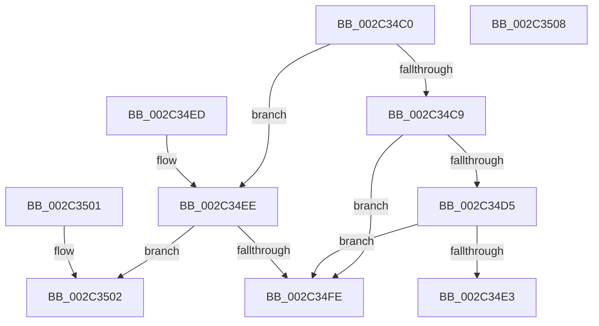

# MiVadPureReserve

- RVA: `0x002C34C0`–`0x002C3509` (길이 `73` bytes)
- VA: `0x00000001402C34C0`
- 실행 섹션: `.text`
- PDB 이름 있음: `예`; PDB Function 태그: `아니요`
- unwind 정보 RVA: `0x000DB714`
- 디코드: `27`개 명령, `73/73` bytes 표시
- 미해석 바이트: `0` (있으면 어셈블리에 `.byte`로 보존)

> 이 문서는 커널 이미지의 기계어와 PDB 기호를 분석해 생성했습니다. 4번과 5번은 함수 원형과 자료형을 바이너리 사용 방식에서 추정한 C 해석이며 원본 소스 복구 결과는 아닙니다.

## 1. Dependencies

- 직접 호출 지점: **0**; 고유 호출 대상: **0**
- 직접 호출자로 확인된 함수: **17**
- RIP 상대 이미지 참조: **0**

### Outgoing calls
- 직접 디코드된 call 명령이 없습니다.

### Direct callers
- [MiProbeAndLockPrepare](../23/MiProbeAndLockPrepare_function_0023BB40.md) at `0x0023BD46`
- [MiDecommitInitializePacket](../24/MiDecommitInitializePacket_function_00242F30.md) at `0x002430A3`
- [MiSetReadOnlyOnSectionView](../29/MiSetReadOnlyOnSectionView_function_00294538.md) at `0x00294567`
- [MiDeleteEmptyPageTables](../2A/MiDeleteEmptyPageTables_function_002A5220.md) at `0x002A531B`
- [MiSplitPrivatePage](../2A/MiSplitPrivatePage_function_002A6210.md) at `0x002A6262`
- [MiComputeVadCharges](MiComputeVadCharges_function_002C3348.md) at `0x002C33B6`
- [sub_002C37D9](Unknown_function_002C37D9.md) at `0x002C38C2`
- [MiCommitExistingVad](../32/MiCommitExistingVad_function_0032A860.md) at `0x0032AB15`
- [MiQueryAddressState](../32/MiQueryAddressState_function_0032C380.md) at `0x0032CC63`
- [MiQueryAddressState](../32/MiQueryAddressState_function_0032C380.md) at `0x0032D2AE`
- [MiInPagePageTable](../3E/MiInPagePageTable_function_003EF8DC.md) at `0x003EFE5A`
- [NtLockVirtualMemory](../40/NtLockVirtualMemory_function_004088A0.md) at `0x00408A7D`
- [NtLockVirtualMemory](../40/NtLockVirtualMemory_function_004088A0.md) at `0x00408E25`
- [MiCommitPageTablesForVad](../../page/88/MiCommitPageTablesForVad_function_00886D50.md) at `0x00886D88`
- [MiCommitPageTablesForVad](../../page/88/MiCommitPageTablesForVad_function_00886D50.md) at `0x00886F32`
- [MiCommitPagefileBackedSection](../../page/8C/MiCommitPagefileBackedSection_function_008CECC0.md) at `0x008CED5D`
- [MiAllocateChildVads](../../page/97/MiAllocateChildVads_function_0097E380.md) at `0x0097E4F1`
- [sub_009E57A9](../../page/9E/Unknown_function_009E57A9.md) at `0x009E5827`
- [sub_009E5A2C](../../page/9E/Unknown_function_009E5A2C.md) at `0x009E5BC9`
- [sub_009E5A2C](../../page/9E/Unknown_function_009E5A2C.md) at `0x009E5BF9`
- [MiReturnVadQuota](../../page/A1/MiReturnVadQuota_function_00A1E314.md) at `0x00A1E381`

### Static image references
- 디코드된 RIP-relative 메모리 참조가 없습니다.

## 2. Other-region calls and transfers

- 다른 실행 섹션으로 향하는 call: **0**
- 별도 외부 분기/꼬리 이동을 확인하지 못했습니다.

## 3. Assembly (complete function range)

```asm
002C34C0  8B 41 30                        mov eax, dword ptr [rcx + 0x30]
002C34C3  0F BA E0 15                     bt eax, 0x15
002C34C7  72 25                           jb 0x1402c34ee
002C34C9  25 80 0F 00 00                  and eax, 0xf80
002C34CE  3D 00 0C 00 00                  cmp eax, 0xc00
002C34D3  75 29                           jne 0x1402c34fe
002C34D5  48 8B 41 48                     mov rax, qword ptr [rcx + 0x48]
002C34D9  48 8B 00                        mov rax, qword ptr [rax]
002C34DC  48 83 78 40 00                  cmp qword ptr [rax + 0x40], 0
002C34E1  75 1B                           jne 0x1402c34fe
002C34E3  8B 40 38                        mov eax, dword ptr [rax + 0x38]
002C34E6  C1 E8 0C                        shr eax, 0xc
002C34E9  83 E0 01                        and eax, 1
002C34EC  C3                              ret
002C34ED  CC                              int3
002C34EE  A8 70                           test al, 0x70
002C34F0  0F 94 C1                        sete cl
002C34F3  0F BA E0 19                     bt eax, 0x19
002C34F7  0F 93 C0                        setae al
002C34FA  84 C8                           test al, cl
002C34FC  75 04                           jne 0x1402c3502
002C34FE  33 C0                           xor eax, eax
002C3500  C3                              ret
002C3501  CC                              int3
002C3502  B8 01 00 00 00                  mov eax, 1
002C3507  C3                              ret
002C3508  CC                              int3
```

## 4. C-style interpretation (structured pseudocode)

```c
__int64 __fastcall MiVadPureReserve(__int64 a1)
{
    __int64 result;

    if (condition_is_below) goto loc_002C34EE;
    result = (unsigned int)(((unsigned int)(*(unsigned int *)(a1 + 48))) & (0xF80ULL));
    if (((unsigned int)(result)) != 0xC00ULL) goto loc_002C34FE;
    if ((*(unsigned __int64 *)(*(unsigned __int64 *)(*(unsigned __int64 *)(a1 + 72)) + 64)) != 0) goto loc_002C34FE;
    result = (unsigned int)(((unsigned int)(*(unsigned int *)(*(unsigned __int64 *)(*(unsigned __int64 *)(a1 + 72)) + 56))) >> (12));
    result = (unsigned int)((result) & (1));
    return result;
loc_002C34EE:
    a1 = ((((unsigned __int8)(result)) & (112)) == 0) ? 1 : 0;
    result = (condition_is_above_or_equal) ? 1 : 0;
    if ((((unsigned __int8)(result)) & ((unsigned __int8)(a1))) != 0) goto loc_002C3502;
loc_002C34FE:
    result = 0;
    return result;
loc_002C3502:
    return 1;
}
```

## 5. (Beta) C Style

```c
int64_t MiVadPureReserve(void *Arg1)
{
    uint8_t *arg1 = (uint8_t *)Arg1;

    int64_t result;

    if (condition_is_below) goto loc_002C34EE;
    result = (uint32_t)(((uint32_t)(*(uint32_t *)(arg1 + 0x30))) & (0xF80ULL));
    if (((uint32_t)(result)) != 0xC00ULL) goto loc_002C34FE;
    if ((*(uint64_t *)(*(uint64_t *)(*(uint64_t *)(arg1 + 0x48)) + 0x40)) != 0) goto loc_002C34FE;
    result = (uint32_t)(((uint32_t)(*(uint32_t *)(*(uint64_t *)(*(uint64_t *)(arg1 + 0x48)) + 0x38))) >> (12));
    result = (uint32_t)((result) & (1));
    return result;
loc_002C34EE:
    Arg1 = ((((uint8_t)(result)) & (112)) == 0) ? 1 : 0;
    result = (condition_is_above_or_equal) ? 1 : 0;
    if ((((uint8_t)(result)) & ((uint8_t)(Arg1))) != 0) goto loc_002C3502;
loc_002C34FE:
    result = 0;
    return result;
loc_002C3502:
    return 1;
}
```

### 관측된 메모리 오프셋

구조체 형식이 확인되지 않은 접근은 인자 기준의 오프셋으로만 기록했습니다.

| 기준 인자 | 오프셋 표현 | 폭 (bit) | 접근 |
|---|---:|---:|---|
| `Arg1` | `+ 0x30` | `32` | `R` |
| `Arg1` | `+ 0x48` | `64` | `R` |

## 6. Execution-region graph

[열기: 2D/3D 그래프와 함수 탐색 컨트롤 패널](../../../control-panel.html?section=text&rva=0x002C34C0&view=graph)

- 2D 그래프는 위에서 아래로 흐르고, 3D 그래프는 빈 공간을 드래그해 회전합니다. Shift+드래그는 이동, 휠은 확대·축소, 함수 노드 선택은 대상 보고서 이동입니다.

### Static fallback


