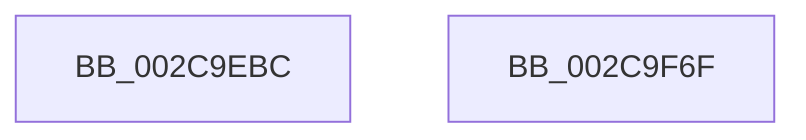

# MiWaitForPageWriteCompletion

- RVA: `0x002C9EBC`–`0x002C9F70` (길이 `180` bytes)
- VA: `0x00000001402C9EBC`
- 실행 섹션: `.text`
- PDB 이름 있음: `예`; PDB Function 태그: `아니요`
- unwind 정보 RVA: `0x0006F120`
- 디코드: `47`개 명령, `180/180` bytes 표시
- 미해석 바이트: `0` (있으면 어셈블리에 `.byte`로 보존)

> 이 문서는 커널 이미지의 기계어와 PDB 기호를 분석해 생성했습니다. 4번과 5번은 함수 원형과 자료형을 바이너리 사용 방식에서 추정한 C 해석이며 원본 소스 복구 결과는 아닙니다.

## 1. Dependencies

- 직접 호출 지점: **4**; 고유 호출 대상: **4**
- 직접 호출자로 확인된 함수: **2**
- RIP 상대 이미지 참조: **0**

### Outgoing calls
- `0x002C9F0D` → [ExAcquireSpinLockExclusiveAtDpcLevel](../24/ExAcquireSpinLockExclusiveAtDpcLevel_function_00248E80.md) (function, `0x00248E80`)
- `0x002C9F26` → [ExReleaseSpinLockExclusiveFromDpcLevel](../24/ExReleaseSpinLockExclusiveFromDpcLevel_function_002497E0.md) (function, `0x002497E0`)
- `0x002C9F40` → [MiUnlockProtoPoolPage](../24/MiUnlockProtoPoolPage_function_00246090.md) (function, `0x00246090`)
- `0x002C9F50` → [KeWaitForGate](KeWaitForGate_function_002CA794.md) (function, `0x002CA794`)

### Direct callers
- [MiPurgeSubsection](../37/MiPurgeSubsection_function_003712F0.md) at `0x00371A8E`
- [MiFlushSection](../40/MiFlushSection_function_004036B0.md) at `0x00404440`

### Static image references
- 디코드된 RIP-relative 메모리 참조가 없습니다.

## 2. Other-region calls and transfers

- 다른 실행 섹션으로 향하는 call: **0**
- 별도 외부 분기/꼬리 이동을 확인하지 못했습니다.

## 3. Assembly (complete function range)

```asm
002C9EBC  48 89 5C 24 08                  mov qword ptr [rsp + 8], rbx
002C9EC1  48 89 74 24 10                  mov qword ptr [rsp + 0x10], rsi
002C9EC6  48 89 7C 24 18                  mov qword ptr [rsp + 0x18], rdi
002C9ECB  55                              push rbp
002C9ECC  41 56                           push r14
002C9ECE  41 57                           push r15
002C9ED0  48 8B EC                        mov rbp, rsp
002C9ED3  48 83 EC 50                     sub rsp, 0x50
002C9ED7  33 C0                           xor eax, eax
002C9ED9  48 C7 45 D8 08 00 00 00         mov qword ptr [rbp - 0x28], 8
002C9EE1  48 89 45 D0                     mov qword ptr [rbp - 0x30], rax
002C9EE5  48 8B F1                        mov rsi, rcx
002C9EE8  48 8D 45 E8                     lea rax, [rbp - 0x18]
002C9EEC  48 C7 45 E0 07 01 06 00         mov qword ptr [rbp - 0x20], 0x60107
002C9EF4  48 89 45 F0                     mov qword ptr [rbp - 0x10], rax
002C9EF8  48 8D 4A 48                     lea rcx, [rdx + 0x48]
002C9EFC  48 8D 45 E8                     lea rax, [rbp - 0x18]
002C9F00  45 8A F1                        mov r14b, r9b
002C9F03  48 89 45 E8                     mov qword ptr [rbp - 0x18], rax
002C9F07  4D 8B F8                        mov r15, r8
002C9F0A  48 8B FA                        mov rdi, rdx
002C9F0D  E8 6E EF F7 FF                  call 0x140248e80
002C9F12  48 8B 47 50                     mov rax, qword ptr [rdi + 0x50]
002C9F16  48 8D 4F 48                     lea rcx, [rdi + 0x48]
002C9F1A  48 89 45 D0                     mov qword ptr [rbp - 0x30], rax
002C9F1E  48 8D 45 D0                     lea rax, [rbp - 0x30]
002C9F22  48 89 47 50                     mov qword ptr [rdi + 0x50], rax
002C9F26  E8 B5 F8 F7 FF                  call 0x1402497e0
002C9F2B  48 B8 FF FF FF FF FF FF FF 7F   movabs rax, 0x7fffffffffffffff
002C9F35  F0 48 21 46 18                  lock and qword ptr [rsi + 0x18], rax
002C9F3A  41 8A D6                        mov dl, r14b
002C9F3D  49 8B CF                        mov rcx, r15
002C9F40  E8 4B C1 F7 FF                  call 0x140246090
002C9F45  45 33 C0                        xor r8d, r8d
002C9F48  48 8D 4D E0                     lea rcx, [rbp - 0x20]
002C9F4C  41 8D 50 12                     lea edx, [r8 + 0x12]
002C9F50  E8 3F 08 00 00                  call 0x1402ca794
002C9F55  4C 8D 5C 24 50                  lea r11, [rsp + 0x50]
002C9F5A  49 8B 5B 20                     mov rbx, qword ptr [r11 + 0x20]
002C9F5E  49 8B 73 28                     mov rsi, qword ptr [r11 + 0x28]
002C9F62  49 8B 7B 30                     mov rdi, qword ptr [r11 + 0x30]
002C9F66  49 8B E3                        mov rsp, r11
002C9F69  41 5F                           pop r15
002C9F6B  41 5E                           pop r14
002C9F6D  5D                              pop rbp
002C9F6E  C3                              ret
002C9F6F  CC                              int3
```

## 4. C-style interpretation (structured pseudocode)

```c
__int64 __fastcall MiWaitForPageWriteCompletion(__int64 a1, __int64 a2, __int64 a3, unsigned __int8 a4)
{
    __int64 result;
    __int64 v_rsp;
    unsigned __int64 v_stack_m18;
    unsigned __int64 v_stack_m28;
    unsigned __int64 v_stack_m30;
    unsigned __int64 v_stack_m38;
    unsigned __int64 v_stack_m40;
    unsigned __int64 v_stack_m48;
    unsigned __int64 v_stack_p10;
    unsigned __int64 v_stack_p18;
    unsigned __int64 v_stack_p8;

    v_stack_p8 = v_rbx;
    v_stack_p10 = v_rsi;
    v_stack_p18 = v_rdi;
    v_rsp = (v_rsp) - (80);
    result = 0;
    v_stack_m40 = 8;
    v_stack_m48 = 0;
    v_stack_m38 = 0x60107ULL;
    v_stack_m28 = v_stack_m30;
    v_stack_m30 = v_stack_m30;
    result = ExAcquireSpinLockExclusiveAtDpcLevel(a2 + 72, a2, a3, a4);
    v_stack_m48 = *(unsigned __int64 *)(a2 + 80);
    *(unsigned __int64 *)(a2 + 80) = v_stack_m48;
    result = ExReleaseSpinLockExclusiveFromDpcLevel(a2 + 72, a2, a3, a4);
    result = MiUnlockProtoPoolPage(a3, a4, a3, a4);
    a3 = 0;
    result = KeWaitForGate(v_stack_m38, a3 + 18, a3, a4);
    return result;
}
```

## 5. (Beta) C Style

```c
int64_t MiWaitForPageWriteCompletion(void *Arg1, void *Arg2, int64_t Arg3, uint8_t Arg4)
{
    uint8_t *arg1 = (uint8_t *)Arg1;
    uint8_t *arg2 = (uint8_t *)Arg2;

    int64_t result;
    int64_t local_rsp;
    uint64_t v_stack_m18;
    uint64_t v_stack_m28;
    uint64_t v_stack_m30;
    uint64_t v_stack_m38;
    uint64_t v_stack_m40;
    uint64_t v_stack_m48;
    uint64_t v_stack_p10;
    uint64_t v_stack_p18;
    uint64_t v_stack_p8;

    v_stack_p8 = local_rbx;
    v_stack_p10 = local_rsi;
    v_stack_p18 = local_rdi;
    local_rsp = (local_rsp) - (80);
    result = 0;
    v_stack_m40 = 8;
    v_stack_m48 = 0;
    v_stack_m38 = 0x60107ULL;
    v_stack_m28 = v_stack_m30;
    v_stack_m30 = v_stack_m30;
    result = ExAcquireSpinLockExclusiveAtDpcLevel(Arg2 + 72, Arg2, Arg3, Arg4);
    v_stack_m48 = *(uint64_t *)(arg2 + 0x50);
    *(uint64_t *)(arg2 + 0x50) = v_stack_m48;
    result = ExReleaseSpinLockExclusiveFromDpcLevel(Arg2 + 72, Arg2, Arg3, Arg4);
    result = MiUnlockProtoPoolPage(Arg3, Arg4, Arg3, Arg4);
    Arg3 = 0;
    result = KeWaitForGate(v_stack_m38, Arg3 + 18, Arg3, Arg4);
    return result;
}
```

### 관측된 메모리 오프셋

구조체 형식이 확인되지 않은 접근은 인자 기준의 오프셋으로만 기록했습니다.

| 기준 인자 | 오프셋 표현 | 폭 (bit) | 접근 |
|---|---:|---:|---|
| `Arg1` | `+ 0x18` | `64` | `R/W` |
| `Arg2` | `+ 0x48` | `64` | `R` |
| `Arg2` | `+ 0x50` | `64` | `R` |
| `Arg2` | `+ 0x50` | `64` | `W` |

## 6. Execution-region graph

[열기: 2D/3D 그래프와 함수 탐색 컨트롤 패널](../../../control-panel.html?section=text&rva=0x002C9EBC&view=graph)

- 2D 그래프는 위에서 아래로 흐르고, 3D 그래프는 빈 공간을 드래그해 회전합니다. Shift+드래그는 이동, 휠은 확대·축소, 함수 노드 선택은 대상 보고서 이동입니다.

### Static fallback


