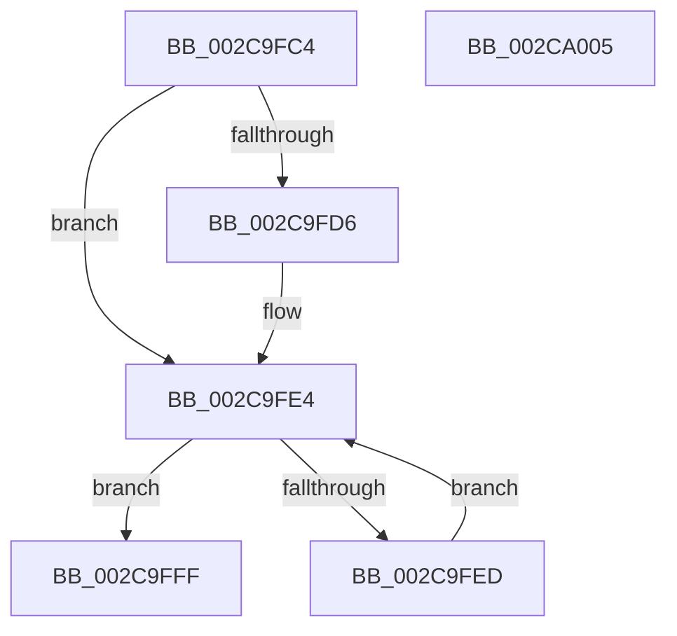

# MiWaitForZeroWorkers

- RVA: `0x002C9FC4`–`0x002CA006` (길이 `66` bytes)
- VA: `0x00000001402C9FC4`
- 실행 섹션: `.text`
- PDB 이름 있음: `예`; PDB Function 태그: `아니요`
- unwind 정보 RVA: `0x0005CF00`
- 디코드: `21`개 명령, `66/66` bytes 표시
- 미해석 바이트: `0` (있으면 어셈블리에 `.byte`로 보존)

> 이 문서는 커널 이미지의 기계어와 PDB 기호를 분석해 생성했습니다. 4번과 5번은 함수 원형과 자료형을 바이너리 사용 방식에서 추정한 C 해석이며 원본 소스 복구 결과는 아닙니다.

## 1. Dependencies

- 직접 호출 지점: **2**; 고유 호출 대상: **2**
- 직접 호출자로 확인된 함수: **1**
- RIP 상대 이미지 참조: **0**

### Outgoing calls
- `0x002C9FDF` → [KeWaitForGate](KeWaitForGate_function_002CA794.md) (function, `0x002CA794`)
- `0x002C9FF8` → [MiDeleteAcceleratorDescriptor](MiDeleteAcceleratorDescriptor_function_002CA560.md) (function, `0x002CA560`)

### Direct callers
- [MiZeroInParallel](MiZeroInParallel_function_002C9F78.md) at `0x002C9F9E`

### Static image references
- 디코드된 RIP-relative 메모리 참조가 없습니다.

## 2. Other-region calls and transfers

- 다른 실행 섹션으로 향하는 call: **0**
- 별도 외부 분기/꼬리 이동을 확인하지 못했습니다.

## 3. Assembly (complete function range)

```asm
002C9FC4  40 53                           push rbx
002C9FC6  48 83 EC 20                     sub rsp, 0x20
002C9FCA  F7 41 10 00 02 00 00            test dword ptr [rcx + 0x10], 0x200
002C9FD1  48 8B D9                        mov rbx, rcx
002C9FD4  74 0E                           je 0x1402c9fe4
002C9FD6  48 83 C1 78                     add rcx, 0x78
002C9FDA  45 33 C0                        xor r8d, r8d
002C9FDD  33 D2                           xor edx, edx
002C9FDF  E8 B0 07 00 00                  call 0x1402ca794
002C9FE4  48 8B 4B 50                     mov rcx, qword ptr [rbx + 0x50]
002C9FE8  48 85 C9                        test rcx, rcx
002C9FEB  74 12                           je 0x1402c9fff
002C9FED  48 8B 01                        mov rax, qword ptr [rcx]
002C9FF0  48 83 C1 20                     add rcx, 0x20
002C9FF4  48 89 43 50                     mov qword ptr [rbx + 0x50], rax
002C9FF8  E8 63 05 00 00                  call 0x1402ca560
002C9FFD  EB E5                           jmp 0x1402c9fe4
002C9FFF  48 83 C4 20                     add rsp, 0x20
002CA003  5B                              pop rbx
002CA004  C3                              ret
002CA005  CC                              int3
```

## 4. C-style interpretation (structured pseudocode)

```c
__int64 __fastcall MiWaitForZeroWorkers(__int64 a1, int a2, int a3)
{
    __int64 result;
    __int64 v_rsp;

    v_rsp = (v_rsp) - (32);
    if (((*(unsigned int *)(a1 + 16)) & (512)) != 0) {
        a1 = (a1) + (120);
        a3 = 0;
        a2 = 0;
        result = KeWaitForGate(a1, a2, a3, a4);
    }
    if (*(unsigned __int64 *)(a1 + 80) == 0) goto loc_002C9FFF;
    a1 = (*(unsigned __int64 *)(a1 + 80)) + (32);
    *(unsigned __int64 *)(a1 + 80) = *(unsigned __int64 *)(*(unsigned __int64 *)(a1 + 80));
    result = MiDeleteAcceleratorDescriptor(a1, a2, a3, a4);
    goto loc_002C9FE4;
loc_002C9FFF:
    v_rsp = (v_rsp) + (32);
    return result;
}
```

## 5. (Beta) C Style

```c
int64_t MiWaitForZeroWorkers(void *Arg1, int32_t Arg2, int32_t Arg3)
{
    uint8_t *arg1 = (uint8_t *)Arg1;

    int64_t result;
    int64_t local_rsp;

    local_rsp = (local_rsp) - (32);
    if (((*(uint32_t *)(arg1 + 0x10)) & (512)) != 0) {
        Arg1 = (Arg1) + (120);
        Arg3 = 0;
        Arg2 = 0;
        result = KeWaitForGate(Arg1, Arg2, Arg3, a4);
    }
    if (*(uint64_t *)(arg1 + 0x50) == 0) goto loc_002C9FFF;
    Arg1 = (*(uint64_t *)(arg1 + 0x50)) + (32);
    *(uint64_t *)(arg1 + 0x50) = *(uint64_t *)(*(uint64_t *)(arg1 + 0x50));
    result = MiDeleteAcceleratorDescriptor(Arg1, Arg2, Arg3, a4);
    goto loc_002C9FE4;
loc_002C9FFF:
    local_rsp = (local_rsp) + (32);
    return result;
}
```

### 관측된 메모리 오프셋

구조체 형식이 확인되지 않은 접근은 인자 기준의 오프셋으로만 기록했습니다.

| 기준 인자 | 오프셋 표현 | 폭 (bit) | 접근 |
|---|---:|---:|---|
| `Arg1` | `+ 0x10` | `32` | `R` |
| `Arg1` | `+ 0x50` | `64` | `R` |
| `Arg1` | `+ 0x50` | `64` | `W` |

## 6. Execution-region graph

[열기: 2D/3D 그래프와 함수 탐색 컨트롤 패널](../../../control-panel.html?section=text&rva=0x002C9FC4&view=graph)

- 2D 그래프는 위에서 아래로 흐르고, 3D 그래프는 빈 공간을 드래그해 회전합니다. Shift+드래그는 이동, 휠은 확대·축소, 함수 노드 선택은 대상 보고서 이동입니다.

### Static fallback


