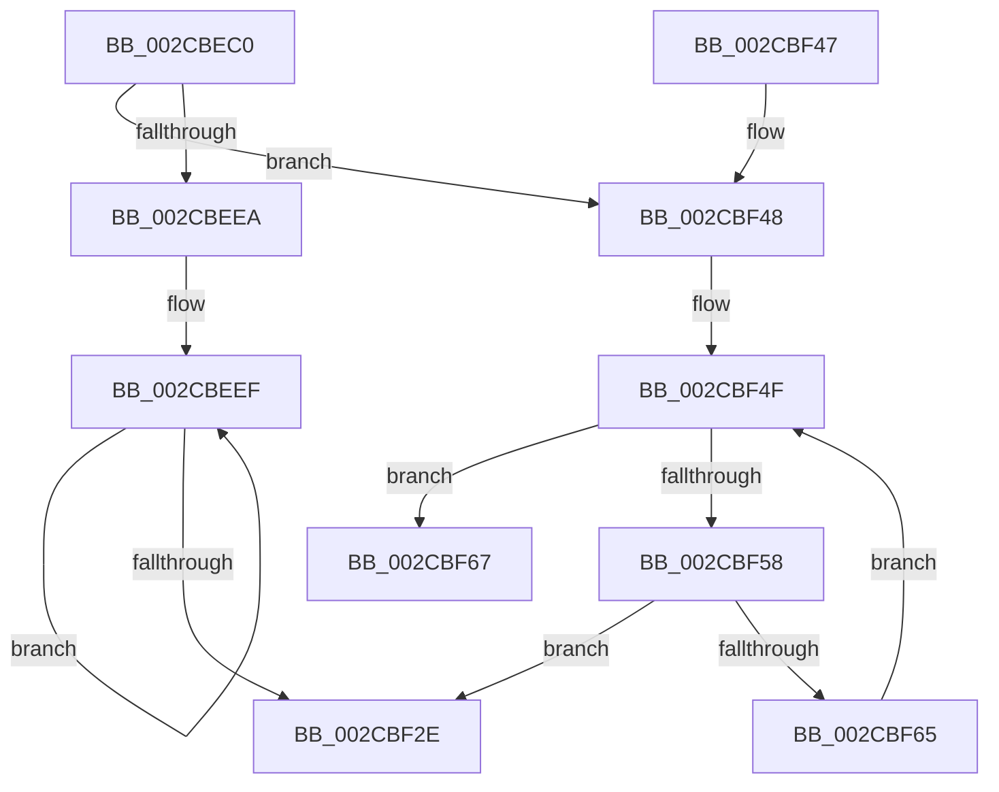

# MiWakeZeroingThreads

- RVA: `0x002CBEC0`–`0x002CBF6F` (길이 `175` bytes)
- VA: `0x00000001402CBEC0`
- 실행 섹션: `.text`
- PDB 이름 있음: `예`; PDB Function 태그: `예`
- unwind 정보 RVA: `0x0006F3F8`
- 디코드: `47`개 명령, `175/175` bytes 표시
- 미해석 바이트: `0` (있으면 어셈블리에 `.byte`로 보존)

> 이 문서는 커널 이미지의 기계어와 PDB 기호를 분석해 생성했습니다. 4번과 5번은 함수 원형과 자료형을 바이너리 사용 방식에서 추정한 C 해석이며 원본 소스 복구 결과는 아닙니다.

## 1. Dependencies

- 직접 호출 지점: **2**; 고유 호출 대상: **2**
- 직접 호출자로 확인된 함수: **4**
- RIP 상대 이미지 참조: **0**

### Outgoing calls
- `0x002CBEF9` → [MiAddZeroingThreads](MiAddZeroingThreads_function_002CBF78.md) (function, `0x002CBF78`)
- `0x002CBF25` → [MiLogZeroPageDecision](MiLogZeroPageDecision_function_002CD090.md) (function, `0x002CD090`)

### Direct callers
- [sub_002CBDF6](Unknown_function_002CBDF6.md) at `0x002CBE67`
- [MiWorkingSetManager](../2D/MiWorkingSetManager_function_002DA7E0.md) at `0x002DAA1F`
- [sub_003354FB](../33/Unknown_function_003354FB.md) at `0x00335C2D`
- [MiZeroNodeExiting](../69/MiZeroNodeExiting_function_00696A04.md) at `0x00696A54`

### Static image references
- 디코드된 RIP-relative 메모리 참조가 없습니다.

## 2. Other-region calls and transfers

- 다른 실행 섹션으로 향하는 call: **0**
- call이 아닌 외부 분기/꼬리 이동: **1**
  - `0x002CBF6A` → [sub_006DCCA8 + 0x7D](../6D/Unknown_function_006DCCA8.md) (`tail-transfer`)

## 3. Assembly (complete function range)

```asm
002CBEC0  48 89 5C 24 10                  mov qword ptr [rsp + 0x10], rbx
002CBEC5  48 89 6C 24 18                  mov qword ptr [rsp + 0x18], rbp
002CBECA  48 89 74 24 20                  mov qword ptr [rsp + 0x20], rsi
002CBECF  57                              push rdi
002CBED0  41 56                           push r14
002CBED2  41 57                           push r15
002CBED4  48 83 EC 30                     sub rsp, 0x30
002CBED8  48 8B 41 30                     mov rax, qword ptr [rcx + 0x30]
002CBEDC  48 8B F9                        mov rdi, rcx
002CBEDF  BD 03 00 00 00                  mov ebp, 3
002CBEE4  83 78 5C 00                     cmp dword ptr [rax + 0x5c], 0
002CBEE8  75 5E                           jne 0x1402cbf48
002CBEEA  83 64 24 50 00                  and dword ptr [rsp + 0x50], 0
002CBEEF  4C 8D 44 24 50                  lea r8, [rsp + 0x50]
002CBEF4  8B D5                           mov edx, ebp
002CBEF6  48 8B CF                        mov rcx, rdi
002CBEF9  E8 7A 00 00 00                  call 0x1402cbf78
002CBEFE  48 63 54 24 50                  movsxd rdx, dword ptr [rsp + 0x50]
002CBF03  45 33 C9                        xor r9d, r9d
002CBF06  48 69 CA 30 01 00 00            imul rcx, rdx, 0x130
002CBF0D  89 44 24 28                     mov dword ptr [rsp + 0x28], eax
002CBF11  45 33 C0                        xor r8d, r8d
002CBF14  83 64 24 20 00                  and dword ptr [rsp + 0x20], 0
002CBF19  48 81 C1 88 00 00 00            add rcx, 0x88
002CBF20  48 03 CF                        add rcx, rdi
002CBF23  8B D8                           mov ebx, eax
002CBF25  E8 66 11 00 00                  call 0x1402cd090
002CBF2A  85 DB                           test ebx, ebx
002CBF2C  74 C1                           je 0x1402cbeef
002CBF2E  48 8B 5C 24 58                  mov rbx, qword ptr [rsp + 0x58]
002CBF33  48 8B 6C 24 60                  mov rbp, qword ptr [rsp + 0x60]
002CBF38  48 8B 74 24 68                  mov rsi, qword ptr [rsp + 0x68]
002CBF3D  48 83 C4 30                     add rsp, 0x30
002CBF41  41 5F                           pop r15
002CBF43  41 5E                           pop r14
002CBF45  5F                              pop rdi
002CBF46  C3                              ret
002CBF47  CC                              int3
002CBF48  48 8D 99 48 01 00 00            lea rbx, [rcx + 0x148]
002CBF4F  80 BB 5F FF FF FF 00            cmp byte ptr [rbx - 0xa1], 0
002CBF56  75 0F                           jne 0x1402cbf67
002CBF58  48 81 C3 30 01 00 00            add rbx, 0x130
002CBF5F  48 83 ED 01                     sub rbp, 1
002CBF63  74 C9                           je 0x1402cbf2e
002CBF65  EB E8                           jmp 0x1402cbf4f
002CBF67  48 8B 3B                        mov rdi, qword ptr [rbx]
002CBF6A  E9 B6 0D 41 00                  jmp 0x1406dcd25
```

## 4. C-style interpretation (structured pseudocode)

```c
__int64 __fastcall MiWakeZeroingThreads(__int64 a1, __int64 a2, __int64 a3, int a4)
{
    __int64 result;
    __int64 v_rbp;
    __int64 v_rbx;
    __int64 v_rsp;
    unsigned int v_stack_m20;
    unsigned int v_stack_m28;
    unsigned __int64 v_stack_p10;
    unsigned __int64 v_stack_p18;
    unsigned __int64 v_stack_p20;
    unsigned int v_stack_p8;

    v_stack_p10 = v_rbx;
    v_stack_p18 = v_rbp;
    v_stack_p20 = v_rsi;
    v_rsp = (v_rsp) - (48);
    if ((*(unsigned int *)(*(unsigned __int64 *)(a1 + 48) + 92)) != 0) goto loc_002CBF48;
loc_002CBEEF:
    result = MiAddZeroingThreads(a1, 3, v_stack_p8, a4);
    a4 = 0;
    a1 = (a1) * ((int)(v_stack_p8));
    v_stack_m20 = (unsigned int)(result);
    a3 = 0;
    a1 = (a1) + (136);
    a1 = (a1) + (a1);
    result = MiLogZeroPageDecision(a1, (int)(v_stack_p8), a3, a4);
    if ((unsigned int)((unsigned int)((unsigned int)(result))) == 0) goto loc_002CBEEF;
loc_002CBF2E:
    v_rsp = (v_rsp) + (48);
    return result;
loc_002CBF48:
loc_002CBF4F:
    if ((*(unsigned __int8 *)(a1 + 328 - 161)) != 0) goto loc_002CBF67;
    v_rbx = (a1 + 328) + (304);
    v_rbp = (v_stack_p18) - (1);
    if (condition_is_equal) goto loc_002CBF2E;
    goto loc_002CBF4F;
loc_002CBF67:
}
```

## 5. (Beta) C Style

```c
int64_t MiWakeZeroingThreads(void *Arg1, int64_t Arg2, int64_t Arg3, int32_t Arg4)
{
    uint8_t *arg1 = (uint8_t *)Arg1;

    int64_t result;
    int64_t local_rbp;
    int64_t local_rbx;
    int64_t local_rsp;
    uint32_t v_stack_m20;
    uint32_t v_stack_m28;
    uint64_t v_stack_p10;
    uint64_t v_stack_p18;
    uint64_t v_stack_p20;
    uint32_t v_stack_p8;

    v_stack_p10 = local_rbx;
    v_stack_p18 = local_rbp;
    v_stack_p20 = local_rsi;
    local_rsp = (local_rsp) - (48);
    if ((*(uint32_t *)(*(uint64_t *)(arg1 + 0x30) + 0x5C)) != 0) goto loc_002CBF48;
loc_002CBEEF:
    result = MiAddZeroingThreads(Arg1, 3, v_stack_p8, Arg4);
    Arg4 = 0;
    Arg1 = (Arg1) * ((int32_t)(v_stack_p8));
    v_stack_m20 = (uint32_t)(result);
    Arg3 = 0;
    Arg1 = (Arg1) + (136);
    Arg1 = (Arg1) + (Arg1);
    result = MiLogZeroPageDecision(Arg1, (int32_t)(v_stack_p8), Arg3, Arg4);
    if ((uint32_t)((uint32_t)((uint32_t)(result))) == 0) goto loc_002CBEEF;
loc_002CBF2E:
    local_rsp = (local_rsp) + (48);
    return result;
loc_002CBF48:
loc_002CBF4F:
    if ((*(uint8_t *)(arg1 + 0x148 - 0xA1)) != 0) goto loc_002CBF67;
    local_rbx = (Arg1 + 328) + (304);
    local_rbp = (v_stack_p18) - (1);
    if (condition_is_equal) goto loc_002CBF2E;
    goto loc_002CBF4F;
loc_002CBF67:
}
```

### 관측된 메모리 오프셋

구조체 형식이 확인되지 않은 접근은 인자 기준의 오프셋으로만 기록했습니다.

| 기준 인자 | 오프셋 표현 | 폭 (bit) | 접근 |
|---|---:|---:|---|
| `Arg1` | `- 0xA1` | `8` | `R` |
| `Arg1` | `+ 0x0` | `64` | `R` |
| `Arg1` | `+ 0x30` | `64` | `R` |
| `Arg1` | `+ 0x148` | `64` | `R` |

## 6. Execution-region graph

[열기: 2D/3D 그래프와 함수 탐색 컨트롤 패널](../../../control-panel.html?section=text&rva=0x002CBEC0&view=graph)

- 2D 그래프는 위에서 아래로 흐르고, 3D 그래프는 빈 공간을 드래그해 회전합니다. Shift+드래그는 이동, 휠은 확대·축소, 함수 노드 선택은 대상 보고서 이동입니다.

### Static fallback


