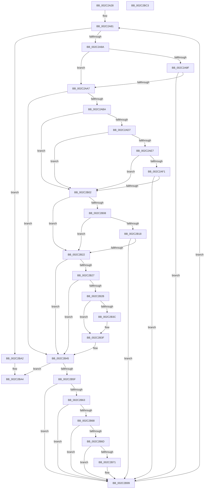

# MiWalkPageTablesRecursivelyNoSynch

- RVA: `0x002C2A28`–`0x002C2BC4` (길이 `412` bytes)
- VA: `0x00000001402C2A28`
- 실행 섹션: `.text`
- PDB 이름 있음: `예`; PDB Function 태그: `아니요`
- unwind 정보 RVA: `0x0005FEF8`
- 디코드: `103`개 명령, `412/412` bytes 표시
- 미해석 바이트: `0` (있으면 어셈블리에 `.byte`로 보존)

> 이 문서는 커널 이미지의 기계어와 PDB 기호를 분석해 생성했습니다. 4번과 5번은 함수 원형과 자료형을 바이너리 사용 방식에서 추정한 C 해석이며 원본 소스 복구 결과는 아닙니다.

## 1. Dependencies

- 직접 호출 지점: **4**; 고유 호출 대상: **4**
- 직접 호출자로 확인된 함수: **2**
- RIP 상대 이미지 참조: **4**

### Outgoing calls
- `0x002C2A8F` → [KdCheckForDebugBreak](../39/KdCheckForDebugBreak_function_0039DED8.md) (function, `0x0039DED8`)
- `0x002C2AAA` → [MI_READ_PTE_LOCK_FREE](../28/MI_READ_PTE_LOCK_FREE_function_002828A0.md) (function, `0x002828A0`)
- `0x002C2B55` → [guard_dispatch_icall](../6B/guard_dispatch_icall_function_006BAAD0.md) (function, `0x006BAAD0`)
- `0x002C2B94` → [MiWalkPageTablesRecursivelyNoSynch](MiWalkPageTablesRecursivelyNoSynch_function_002C2A28.md) (function, `0x002C2A28`)

### Direct callers
- [MiWalkPageTables](MiWalkPageTables_function_002C2710.md) at `0x002C2937`
- [MiWalkPageTablesRecursivelyNoSynch](MiWalkPageTablesRecursivelyNoSynch_function_002C2A28.md) at `0x002C2B94`

### Static image references
- `0x002C2A48` → RVA `0x00E2CB40` (`.data`; read)
- `0x002C2AD7` → RVA `0x00E37458` (`.data`; read)
- `0x002C2ADE` → RVA `0x00E37440` (`.data`; read)
- `0x002C2AF1` → RVA `0x00FC6A88` (`ALMOSTRO`; read)

## 2. Other-region calls and transfers

- 다른 실행 섹션으로 향하는 call: **0**
- 별도 외부 분기/꼬리 이동을 확인하지 못했습니다.

## 3. Assembly (complete function range)

```asm
002C2A28  48 8B C4                        mov rax, rsp
002C2A2B  48 89 58 08                     mov qword ptr [rax + 8], rbx
002C2A2F  48 89 68 10                     mov qword ptr [rax + 0x10], rbp
002C2A33  48 89 70 18                     mov qword ptr [rax + 0x18], rsi
002C2A37  48 89 78 20                     mov qword ptr [rax + 0x20], rdi
002C2A3B  41 54                           push r12
002C2A3D  41 56                           push r14
002C2A3F  41 57                           push r15
002C2A41  48 83 EC 20                     sub rsp, 0x20
002C2A45  49 63 F0                        movsxd rsi, r8d
002C2A48  4C 8D 25 F1 A0 B6 00            lea r12, [rip + 0xb6a0f1]
002C2A4F  48 8B FA                        mov rdi, rdx
002C2A52  4C 8B F1                        mov r14, rcx
002C2A55  48 8B 44 F1 60                  mov rax, qword ptr [rcx + rsi*8 + 0x60]
002C2A5A  48 3B D0                        cmp rdx, rax
002C2A5D  48 0F 42 F8                     cmovb rdi, rax
002C2A61  48 8B 84 F1 80 00 00 00         mov rax, qword ptr [rcx + rsi*8 + 0x80]
002C2A69  48 8B EF                        mov rbp, rdi
002C2A6C  48 81 E5 00 F0 FF FF            and rbp, 0xfffffffffffff000
002C2A73  48 81 C5 F8 0F 00 00            add rbp, 0xff8
002C2A7A  48 3B E8                        cmp rbp, rax
002C2A7D  48 0F 47 E8                     cmova rbp, rax
002C2A81  48 3B FD                        cmp rdi, rbp
002C2A84  0F 87 18 01 00 00               ja 0x1402c2ba2
002C2A8A  83 FE 03                        cmp esi, 3
002C2A8D  75 18                           jne 0x1402c2aa7
002C2A8F  E8 44 B4 0D 00                  call 0x14039ded8
002C2A94  48 B8 68 DF BE 7D FB F6 FF FF   movabs rax, 0xfffff6fb7dbedf68
002C2A9E  48 3B F8                        cmp rdi, rax
002C2AA1  0F 84 F2 00 00 00               je 0x1402c2b99
002C2AA7  48 8B CF                        mov rcx, rdi
002C2AAA  E8 F1 FD FB FF                  call 0x1402828a0
002C2AAF  48 8B D8                        mov rbx, rax
002C2AB2  A8 01                           test al, 1
002C2AB4  0F 84 8B 00 00 00               je 0x1402c2b45
002C2ABA  41 8B 16                        mov edx, dword ptr [r14]
002C2ABD  48 8B C8                        mov rcx, rax
002C2AC0  48 C1 E9 0C                     shr rcx, 0xc
002C2AC4  48 B8 FF FF FF FF FF 00 00 00   movabs rax, 0xffffffffff
002C2ACE  48 23 C8                        and rcx, rax
002C2AD1  0F BA E2 09                     bt edx, 9
002C2AD5  73 2B                           jae 0x1402c2b02
002C2AD7  48 8B 05 7A 49 B7 00            mov rax, qword ptr [rip + 0xb7497a]
002C2ADE  48 39 05 5B 49 B7 00            cmp qword ptr [rip + 0xb7495b], rax
002C2AE5  74 1B                           je 0x1402c2b02
002C2AE7  49 3B 8C F4 00 A9 00 00         cmp rcx, qword ptr [r12 + rsi*8 + 0xa900]
002C2AEF  75 11                           jne 0x1402c2b02
002C2AF1  48 F7 05 8C 3F D0 00 00 00 00 20  test qword ptr [rip + 0xd03f8c], 0x20000000
002C2AFC  0F 85 97 00 00 00               jne 0x1402c2b99
002C2B02  0F BA E2 0A                     bt edx, 0xa
002C2B06  73 1A                           jae 0x1402c2b22
002C2B08  48 8B 05 49 49 B7 00            mov rax, qword ptr [rip + 0xb74949]
002C2B0F  48 39 05 2A 49 B7 00            cmp qword ptr [rip + 0xb7492a], rax
002C2B16  74 0A                           je 0x1402c2b22
002C2B18  49 3B 8C F4 38 A9 00 00         cmp rcx, qword ptr [r12 + rsi*8 + 0xa938]
002C2B20  74 77                           je 0x1402c2b99
002C2B22  F6 C3 20                        test bl, 0x20
002C2B25  75 1E                           jne 0x1402c2b45
002C2B27  85 F6                           test esi, esi
002C2B29  74 1A                           je 0x1402c2b45
002C2B2B  48 83 CB 20                     or rbx, 0x20
002C2B2F  48 F7 05 4E 3F D0 00 00 00 00 02  test qword ptr [rip + 0xd03f4e], 0x2000000
002C2B3A  74 03                           je 0x1402c2b3f
002C2B3C  0F AE E8                        lfence
002C2B3F  48 8B C3                        mov rax, rbx
002C2B42  48 87 07                        xchg qword ptr [rdi], rax
002C2B45  49 8B 86 A8 00 00 00            mov rax, qword ptr [r14 + 0xa8]
002C2B4C  44 8B C6                        mov r8d, esi
002C2B4F  48 8B D7                        mov rdx, rdi
002C2B52  49 8B CE                        mov rcx, r14
002C2B55  E8 76 7F 3F 00                  call 0x1406baad0
002C2B5A  83 F8 04                        cmp eax, 4
002C2B5D  7D 45                           jge 0x1402c2ba4
002C2B5F  85 F6                           test esi, esi
002C2B61  74 36                           je 0x1402c2b99
002C2B63  83 F8 01                        cmp eax, 1
002C2B66  74 31                           je 0x1402c2b99
002C2B68  F6 C3 01                        test bl, 1
002C2B6B  74 2C                           je 0x1402c2b99
002C2B6D  84 DB                           test bl, bl
002C2B6F  78 28                           js 0x1402c2b99
002C2B71  48 8B D7                        mov rdx, rdi
002C2B74  44 8D 46 FF                     lea r8d, [rsi - 1]
002C2B78  48 C1 E2 19                     shl rdx, 0x19
002C2B7C  48 B8 00 00 00 00 80 F6 FF FF   movabs rax, 0xfffff68000000000
002C2B86  48 C1 E0 19                     shl rax, 0x19
002C2B8A  49 8B CE                        mov rcx, r14
002C2B8D  48 2B D0                        sub rdx, rax
002C2B90  48 C1 FA 10                     sar rdx, 0x10
002C2B94  E8 8F FE FF FF                  call 0x1402c2a28
002C2B99  48 83 C7 08                     add rdi, 8
002C2B9D  E9 DF FE FF FF                  jmp 0x1402c2a81
002C2BA2  33 C0                           xor eax, eax
002C2BA4  48 8B 5C 24 40                  mov rbx, qword ptr [rsp + 0x40]
002C2BA9  48 8B 6C 24 48                  mov rbp, qword ptr [rsp + 0x48]
002C2BAE  48 8B 74 24 50                  mov rsi, qword ptr [rsp + 0x50]
002C2BB3  48 8B 7C 24 58                  mov rdi, qword ptr [rsp + 0x58]
002C2BB8  48 83 C4 20                     add rsp, 0x20
002C2BBC  41 5F                           pop r15
002C2BBE  41 5E                           pop r14
002C2BC0  41 5C                           pop r12
002C2BC2  C3                              ret
002C2BC3  CC                              int3
```

## 4. C-style interpretation (structured pseudocode)

```c
__int64 __fastcall MiWalkPageTablesRecursivelyNoSynch(__int64 a1, __int64 a2, int a3)
{
    __int64 result;
    __int64 v_rbp;
    __int64 v_rbx;
    __int64 v_rdi;
    __int64 v_rsp;
    unsigned __int64 v_stack_p10;
    unsigned __int64 v_stack_p18;
    unsigned __int64 v_stack_p20;
    unsigned __int64 v_stack_p8;

    *(unsigned __int64 *)(v_rsp + 8) = v_rbx;
    *(unsigned __int64 *)(v_rsp + 16) = v_rbp;
    *(unsigned __int64 *)(v_rsp + 24) = v_rsi;
    *(unsigned __int64 *)(v_rsp + 32) = v_rdi;
    v_rsp = (v_rsp) - (32);
    if (a2 < (*(unsigned __int64 *)(a1 + (int)(a3) * 8 + 96))) { a2 = *(unsigned __int64 *)(a1 + (int)(a3) * 8 + 96); }
    v_rbp = (a2) & (0xFFFFFFFFFFFFF000ULL);
    v_rbp = (v_rbp) + (0xFF8ULL);
    if (v_rbp > (*(unsigned __int64 *)(a1 + (int)(a3) * 8 + 128))) { v_rbp = *(unsigned __int64 *)(a1 + (int)(a3) * 8 + 128); }
loc_002C2A81:
    if (a2 > v_rbp) goto loc_002C2BA2;
    if (((unsigned int)((int)(a3))) != 3) goto loc_002C2AA7;
    result = KdCheckForDebugBreak(a1, a2, a3, a4);
    if (a2 == result) goto loc_002C2B99;
loc_002C2AA7:
    result = MI_READ_PTE_LOCK_FREE(a2, a2, a3, a4);
    if ((((unsigned __int8)(result)) & (1)) == 0) goto loc_002C2B45;
    a1 = (result) >> (12);
    a1 = (a1) & (result);
    if (condition_is_above_or_equal) goto loc_002C2B02;
    if ((*(unsigned __int64 *)(v_rip + 12011867)) == (*(unsigned __int64 *)(v_rip + 12011898))) goto loc_002C2B02;
    if (a1 != (*(unsigned __int64 *)(v_rip + 11968753 + (int)(a3) * 8 + 43264))) goto loc_002C2B02;
    if (((*(unsigned __int64 *)(v_rip + 13647756)) & (0x20000000ULL)) != 0) goto loc_002C2B99;
loc_002C2B02:
    if (condition_is_above_or_equal) goto loc_002C2B22;
    if ((*(unsigned __int64 *)(v_rip + 12011818)) == (*(unsigned __int64 *)(v_rip + 12011849))) goto loc_002C2B22;
    if (a1 == (*(unsigned __int64 *)(v_rip + 11968753 + (int)(a3) * 8 + 43320))) goto loc_002C2B99;
loc_002C2B22:
    if ((((unsigned __int8)(result)) & (32)) != 0) goto loc_002C2B45;
    if ((unsigned int)((int)(a3)) == 0) goto loc_002C2B45;
    v_rbx = (result) | (32);
    if (((*(unsigned __int64 *)(v_rip + 13647694)) & (0x2000000ULL)) != 0) {
    }
loc_002C2B45:
    result = guard_dispatch_icall(a1, a2, (unsigned int)((unsigned int)((int)(a3))), a4);
    if (((unsigned int)(result)) >= 4) goto loc_002C2BA4;
    if ((unsigned int)((int)(a3)) == 0) goto loc_002C2B99;
    if (((unsigned int)(result)) == 1) goto loc_002C2B99;
    if ((((unsigned __int8)(v_rbx)) & (1)) == 0) goto loc_002C2B99;
    if (!(sign_flag)) {
        a2 = a2;
        a3 = (int)(a3) - 1;
        a2 = (a2) << (25);
        result = (result) << (25);
        a1 = a1;
        a2 = (a2) - (result);
        a2 = (a2) >> (16);
        result = MiWalkPageTablesRecursivelyNoSynch(a1, a2, a3, a4);
    }
    v_rdi = (a2) + (8);
    goto loc_002C2A81;
loc_002C2BA2:
    result = 0;
loc_002C2BA4:
    v_rsp = (v_rsp) + (32);
    return result;
}
```

## 5. (Beta) C Style

```c
int64_t MiWalkPageTablesRecursivelyNoSynch(void *Arg1, int64_t Arg2, int32_t Arg3)
{
    uint8_t *arg1 = (uint8_t *)Arg1;

    int64_t result;
    int64_t local_rbp;
    int64_t local_rbx;
    int64_t local_rdi;
    int64_t local_rsp;
    uint64_t v_stack_p10;
    uint64_t v_stack_p18;
    uint64_t v_stack_p20;
    uint64_t v_stack_p8;

    *(uint64_t *)(local_rsp + 0x8) = local_rbx;
    *(uint64_t *)(local_rsp + 0x10) = local_rbp;
    *(uint64_t *)(local_rsp + 0x18) = local_rsi;
    *(uint64_t *)(local_rsp + 0x20) = local_rdi;
    local_rsp = (local_rsp) - (32);
    if (Arg2 < (*(uint64_t *)(arg1 + (int32_t)(Arg3) * 8 + 0x60))) { Arg2 = *(uint64_t *)(arg1 + (int32_t)(Arg3) * 8 + 0x60); }
    local_rbp = (Arg2) & (0xFFFFFFFFFFFFF000ULL);
    local_rbp = (local_rbp) + (0xFF8ULL);
    if (local_rbp > (*(uint64_t *)(arg1 + (int32_t)(Arg3) * 8 + 0x80))) { local_rbp = *(uint64_t *)(arg1 + (int32_t)(Arg3) * 8 + 0x80); }
loc_002C2A81:
    if (Arg2 > local_rbp) goto loc_002C2BA2;
    if (((uint32_t)((int32_t)(Arg3))) != 3) goto loc_002C2AA7;
    result = KdCheckForDebugBreak(Arg1, Arg2, Arg3, a4);
    if (Arg2 == result) goto loc_002C2B99;
loc_002C2AA7:
    result = MI_READ_PTE_LOCK_FREE(Arg2, Arg2, Arg3, a4);
    if ((((uint8_t)(result)) & (1)) == 0) goto loc_002C2B45;
    Arg1 = (result) >> (12);
    Arg1 = (Arg1) & (result);
    if (condition_is_above_or_equal) goto loc_002C2B02;
    if ((*(uint64_t *)(v_rip + 0xB7495B)) == (*(uint64_t *)(v_rip + 0xB7497A))) goto loc_002C2B02;
    if (Arg1 != (*(uint64_t *)(v_rip + 0xB6A0F1 + (int32_t)(Arg3) * 8 + 0xA900))) goto loc_002C2B02;
    if (((*(uint64_t *)(v_rip + 0xD03F8C)) & (0x20000000ULL)) != 0) goto loc_002C2B99;
loc_002C2B02:
    if (condition_is_above_or_equal) goto loc_002C2B22;
    if ((*(uint64_t *)(v_rip + 0xB7492A)) == (*(uint64_t *)(v_rip + 0xB74949))) goto loc_002C2B22;
    if (Arg1 == (*(uint64_t *)(v_rip + 0xB6A0F1 + (int32_t)(Arg3) * 8 + 0xA938))) goto loc_002C2B99;
loc_002C2B22:
    if ((((uint8_t)(result)) & (32)) != 0) goto loc_002C2B45;
    if ((uint32_t)((int32_t)(Arg3)) == 0) goto loc_002C2B45;
    local_rbx = (result) | (32);
    if (((*(uint64_t *)(v_rip + 0xD03F4E)) & (0x2000000ULL)) != 0) {
    }
loc_002C2B45:
    result = guard_dispatch_icall(Arg1, Arg2, (uint32_t)((uint32_t)((int32_t)(Arg3))), a4);
    if (((uint32_t)(result)) >= 4) goto loc_002C2BA4;
    if ((uint32_t)((int32_t)(Arg3)) == 0) goto loc_002C2B99;
    if (((uint32_t)(result)) == 1) goto loc_002C2B99;
    if ((((uint8_t)(local_rbx)) & (1)) == 0) goto loc_002C2B99;
    if (!(sign_flag)) {
        Arg2 = Arg2;
        Arg3 = (int32_t)(Arg3) - 1;
        Arg2 = (Arg2) << (25);
        result = (result) << (25);
        Arg1 = Arg1;
        Arg2 = (Arg2) - (result);
        Arg2 = (Arg2) >> (16);
        result = MiWalkPageTablesRecursivelyNoSynch(Arg1, Arg2, Arg3, a4);
    }
    local_rdi = (Arg2) + (8);
    goto loc_002C2A81;
loc_002C2BA2:
    result = 0;
loc_002C2BA4:
    local_rsp = (local_rsp) + (32);
    return result;
}
```

### 관측된 메모리 오프셋

구조체 형식이 확인되지 않은 접근은 인자 기준의 오프셋으로만 기록했습니다.

| 기준 인자 | 오프셋 표현 | 폭 (bit) | 접근 |
|---|---:|---:|---|
| `Arg1` | `+ 0x0` | `32` | `R` |
| `Arg1` | `+ 0x60 + rsi*8` | `64` | `R` |
| `Arg1` | `+ 0x80 + rsi*8` | `64` | `R` |
| `Arg1` | `+ 0xA8` | `64` | `R` |

## 6. Execution-region graph

[열기: 2D/3D 그래프와 함수 탐색 컨트롤 패널](../../../control-panel.html?section=text&rva=0x002C2A28&view=graph)

- 2D 그래프는 위에서 아래로 흐르고, 3D 그래프는 빈 공간을 드래그해 회전합니다. Shift+드래그는 이동, 휠은 확대·축소, 함수 노드 선택은 대상 보고서 이동입니다.

### Static fallback


