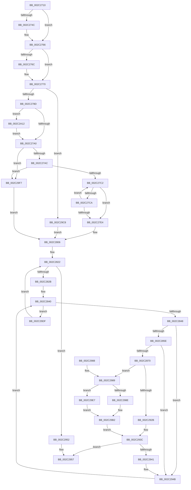

# MiWalkPageTables

- RVA: `0x002C2710`–`0x002C2A1F` (길이 `783` bytes)
- VA: `0x00000001402C2710`
- 실행 섹션: `.text`
- PDB 이름 있음: `예`; PDB Function 태그: `아니요`
- unwind 정보 RVA: `0x0006E8E4`
- 디코드: `192`개 명령, `783/783` bytes 표시
- 미해석 바이트: `0` (있으면 어셈블리에 `.byte`로 보존)

> 이 문서는 커널 이미지의 기계어와 PDB 기호를 분석해 생성했습니다. 4번과 5번은 함수 원형과 자료형을 바이너리 사용 방식에서 추정한 C 해석이며 원본 소스 복구 결과는 아닙니다.

## 1. Dependencies

- 직접 호출 지점: **5**; 고유 호출 대상: **5**
- 직접 호출자로 확인된 함수: **33**
- RIP 상대 이미지 참조: **4**

### Outgoing calls
- `0x002C280E` → [MiInitializeWalkBounds](MiInitializeWalkBounds_function_002C2BCC.md) (function, `0x002C2BCC`)
- `0x002C2937` → [MiWalkPageTablesRecursivelyNoSynch](MiWalkPageTablesRecursivelyNoSynch_function_002C2A28.md) (function, `0x002C2A28`)
- `0x002C2962` → [_security_check_cookie](../6A/_security_check_cookie_function_006AC640.md) (function, `0x006AC640`)
- `0x002C29AD` → [MiReacquireWalkLocks](../28/MiReacquireWalkLocks_function_002819A0.md) (function, `0x002819A0`)
- `0x002C29BE` → [MiWalkPageTablesRecursively](../27/MiWalkPageTablesRecursively_function_002796C0.md) (function, `0x002796C0`)

### Direct callers
- [sub_00243541](../24/Unknown_function_00243541.md) at `0x0024358B`
- [MiWalkVaRange](../24/MiWalkVaRange_function_00243BF0.md) at `0x002447D1`
- [MiGetWorkingSetInfoEx](../29/MiGetWorkingSetInfoEx_function_0029E640.md) at `0x0029E7B5`
- [MiDeleteEmptyPageTables](../2A/MiDeleteEmptyPageTables_function_002A5220.md) at `0x002A54E3`
- [MiEmptyWorkingSetInitiate](../2A/MiEmptyWorkingSetInitiate_function_002A7128.md) at `0x002A71FC`
- [MiDeletePagablePteRange](../2A/MiDeletePagablePteRange_function_002A96B4.md) at `0x002A98B7`
- [MiDeleteSystemPageTables](MiDeleteSystemPageTables_function_002C1110.md) at `0x002C11BF`
- [MiOutSwapWorkingSet](MiOutSwapWorkingSet_function_002C1464.md) at `0x002C14ED`
- [MiClearNonPagedPtes](MiClearNonPagedPtes_function_002C17A0.md) at `0x002C1A69`
- [MiAgeWorkingSet](MiAgeWorkingSet_function_002C21E0.md) at `0x002C2373`
- [sub_002C2FAE](Unknown_function_002C2FAE.md) at `0x002C304C`
- [MiQueryAddressState](../32/MiQueryAddressState_function_0032C380.md) at `0x0032D16E`
- [MiMakeZeroedPageTablesEx](../3B/MiMakeZeroedPageTablesEx_function_003B59FC.md) at `0x003B5C55`
- [MiCaptureAndResetWorkingSetAccessBits](../47/MiCaptureAndResetWorkingSetAccessBits_function_00473FC0.md) at `0x0047407A`
- [MmRemoveExecuteGrants](../4A/MmRemoveExecuteGrants_function_004A8B60.md) at `0x004A8BDD`
- [MmUpdateOldWorkingSetPages](../4E/MmUpdateOldWorkingSetPages_function_004EDF18.md) at `0x004EE0EE`
- [MiWalkResetCommitPages](../66/MiWalkResetCommitPages_function_0066FC58.md) at `0x0066FCFF`
- [MmProtectDriverSection](../67/MmProtectDriverSection_function_00670A80.md) at `0x00670CAC`
- [MmProtectDriverSection](../67/MmProtectDriverSection_function_00670A80.md) at `0x00670D8D`
- [MmProtectDriverSection](../67/MmProtectDriverSection_function_00670A80.md) at `0x00670DF0`
- [MmProtectDriverSection](../67/MmProtectDriverSection_function_00670A80.md) at `0x00670E2C`
- [MmAddRangeToCrashDump](../67/MmAddRangeToCrashDump_function_0067D8B0.md) at `0x0067D940`
- [MmAddRangeToCrashDump](../67/MmAddRangeToCrashDump_function_0067D8B0.md) at `0x0067D9A5`
- [MmRemoveSystemCacheFromDump](../67/MmRemoveSystemCacheFromDump_function_0067DD58.md) at `0x0067DDC1`
- [MmRemoveSystemCacheFromDump](../67/MmRemoveSystemCacheFromDump_function_0067DD58.md) at `0x0067DE00`
- [MiCombineWorkingSet](../68/MiCombineWorkingSet_function_0068BB18.md) at `0x0068BC68`
- [sub_006F7146](../6F/Unknown_function_006F7146.md) at `0x006F71B1`
- [MmUnlockPhysicalPagesByVa](../../page/7F/MmUnlockPhysicalPagesByVa_function_007FBA3C.md) at `0x007FBB06`
- [MiConvertHiberPhasePages](../../pagelk/B7/MiConvertHiberPhasePages_function_00B73E24.md) at `0x00B73E8F`
- [MiMarkKernelPageTablePages](../../pagelk/B7/MiMarkKernelPageTablePages_function_00B73F68.md) at `0x00B73FD6`
- [MiMarkNonPagedHiberPhasePages](../../pagelk/B7/MiMarkNonPagedHiberPhasePages_function_00B73FEC.md) at `0x00B74057`
- [MmMarkHiberPhase](../../pagelk/B7/MmMarkHiberPhase_function_00B74578.md) at `0x00B748C5`
- [MiAddLoaderHalIoMappings](../../init/C5/MiAddLoaderHalIoMappings_function_00C5E568.md) at `0x00C5E5D6`
- [MiMarkLargePageMappings](../../init/C6/MiMarkLargePageMappings_function_00C60BC8.md) at `0x00C60C43`
- [MiInitializePfnsForValidMappings](../../init/C6/MiInitializePfnsForValidMappings_function_00C6267C.md) at `0x00C626FF`
- [MiInitializePfnsForValidMappings](../../init/C6/MiInitializePfnsForValidMappings_function_00C6267C.md) at `0x00C62727`
- [MiCreateInitialSystemWsles](../../init/C6/MiCreateInitialSystemWsles_function_00C642C8.md) at `0x00C64347`
- [MiCountBootDriverRegions](../../init/C6/MiCountBootDriverRegions_function_00C659B4.md) at `0x00C65A20`
- [MiFillGapAddresses](../../init/C6/MiFillGapAddresses_function_00C65A3C.md) at `0x00C65A96`

### Static image references
- `0x002C272F` → RVA `0x00E0A740` (`.data`; read)
- `0x002C2757` → RVA `0x00E30088` (`.data`; read)
- `0x002C27E4` → RVA `0x00010980` (`.rdata`; read)
- `0x002C29F7` → RVA `0x00010FA0` (`.rdata`; read)

## 2. Other-region calls and transfers

- 다른 실행 섹션으로 향하는 call: **0**
- 별도 외부 분기/꼬리 이동을 확인하지 못했습니다.

## 3. Assembly (complete function range)

```asm
002C2710  48 89 5C 24 10                  mov qword ptr [rsp + 0x10], rbx
002C2715  48 89 6C 24 18                  mov qword ptr [rsp + 0x18], rbp
002C271A  48 89 74 24 20                  mov qword ptr [rsp + 0x20], rsi
002C271F  57                              push rdi
002C2720  41 54                           push r12
002C2722  41 55                           push r13
002C2724  41 56                           push r14
002C2726  41 57                           push r15
002C2728  48 81 EC 90 00 00 00            sub rsp, 0x90
002C272F  48 8B 05 0A 80 B4 00            mov rax, qword ptr [rip + 0xb4800a]
002C2736  48 33 C4                        xor rax, rsp
002C2739  48 89 84 24 80 00 00 00         mov qword ptr [rsp + 0x80], rax
002C2741  F7 01 00 00 02 00               test dword ptr [rcx], 0x20000
002C2747  48 8B F1                        mov rsi, rcx
002C274A  75 1A                           jne 0x1402c2766
002C274C  48 8B 41 20                     mov rax, qword ptr [rcx + 0x20]
002C2750  0F B7 90 AE 00 00 00            movzx edx, word ptr [rax + 0xae]
002C2757  48 8B 05 2A D9 B6 00            mov rax, qword ptr [rip + 0xb6d92a]
002C275E  48 8B 14 D0                     mov rdx, qword ptr [rax + rdx*8]
002C2762  48 89 51 58                     mov qword ptr [rcx + 0x58], rdx
002C2766  80 79 08 00                     cmp byte ptr [rcx + 8], 0
002C276A  75 04                           jne 0x1402c2770
002C276C  C6 41 08 0F                     mov byte ptr [rcx + 8], 0xf
002C2770  48 8B 49 40                     mov rcx, qword ptr [rcx + 0x40]
002C2774  41 BC 01 00 00 00               mov r12d, 1
002C277A  49 BD 00 00 00 00 80 F6 FF FF   movabs r13, 0xfffff68000000000
002C2784  48 85 C9                        test rcx, rcx
002C2787  0F 84 3B 02 00 00               je 0x1402c29c8
002C278D  48 B8 68 DF BE 7D FB F6 FF FF   movabs rax, 0xfffff6fb7dbedf68
002C2797  48 3B C8                        cmp rcx, rax
002C279A  0F 84 72 02 00 00               je 0x1402c2a12
002C27A0  49 8B C5                        mov rax, r13
002C27A3  48 3B C8                        cmp rcx, rax
002C27A6  0F 82 4B 02 00 00               jb 0x1402c29f7
002C27AC  48 BA FF FF FF FF FF F6 FF FF   movabs rdx, 0xfffff6ffffffffff
002C27B6  48 8B C2                        mov rax, rdx
002C27B9  48 3B C8                        cmp rcx, rax
002C27BC  0F 87 35 02 00 00               ja 0x1402c29f7
002C27C2  48 8B C2                        mov rax, rdx
002C27C5  48 3B C8                        cmp rcx, rax
002C27C8  77 1A                           ja 0x1402c27e4
002C27CA  48 C1 E1 19                     shl rcx, 0x19
002C27CE  49 8B C5                        mov rax, r13
002C27D1  48 C1 E0 19                     shl rax, 0x19
002C27D5  48 2B C8                        sub rcx, rax
002C27D8  48 C1 F9 10                     sar rcx, 0x10
002C27DC  49 8B C5                        mov rax, r13
002C27DF  48 3B C8                        cmp rcx, rax
002C27E2  73 DE                           jae 0x1402c27c2
002C27E4  66 0F 6F 05 94 E1 D4 FF         movdqa xmm0, xmmword ptr [rip - 0x2b1e6c]
002C27EC  48 8D 41 FF                     lea rax, [rcx - 1]
002C27F0  F3 0F 7F 44 24 28               movdqu xmmword ptr [rsp + 0x28], xmm0
002C27F6  48 89 44 24 38                  mov qword ptr [rsp + 0x38], rax
002C27FB  41 BC 02 00 00 00               mov r12d, 2
002C2801  48 89 4C 24 20                  mov qword ptr [rsp + 0x20], rcx
002C2806  48 8D 54 24 50                  lea rdx, [rsp + 0x50]
002C280B  48 8B CE                        mov rcx, rsi
002C280E  E8 B9 03 00 00                  call 0x1402c2bcc
002C2813  8B E8                           mov ebp, eax
002C2815  45 33 FF                        xor r15d, r15d
002C2818  49 B9 F8 FF FF FF 7F 00 00 00   movabs r9, 0x7ffffffff8
002C2822  45 3B FC                        cmp r15d, r12d
002C2825  0F 83 27 01 00 00               jae 0x1402c2952
002C282B  41 8B CF                        mov ecx, r15d
002C282E  4C 8D 74 24 20                  lea r14, [rsp + 0x20]
002C2833  48 C1 E1 04                     shl rcx, 4
002C2837  33 FF                           xor edi, edi
002C2839  4C 03 F1                        add r14, rcx
002C283C  0F 1F 40 00                     nop dword ptr [rax]
002C2840  3B FD                           cmp edi, ebp
002C2842  0F 83 97 01 00 00               jae 0x1402c29df
002C2848  49 8B 1E                        mov rbx, qword ptr [r14]
002C284B  8B C7                           mov eax, edi
002C284D  48 03 C0                        add rax, rax
002C2850  4C 8B 44 C4 58                  mov r8, qword ptr [rsp + rax*8 + 0x58]
002C2855  49 3B D8                        cmp rbx, r8
002C2858  0F 87 ED 00 00 00               ja 0x1402c294b
002C285E  48 8B 54 C4 50                  mov rdx, qword ptr [rsp + rax*8 + 0x50]
002C2863  49 8B 4E 08                     mov rcx, qword ptr [r14 + 8]
002C2867  48 3B CA                        cmp rcx, rdx
002C286A  0F 82 DB 00 00 00               jb 0x1402c294b
002C2870  48 3B DA                        cmp rbx, rdx
002C2873  48 0F 42 DA                     cmovb rbx, rdx
002C2877  49 3B C8                        cmp rcx, r8
002C287A  49 0F 47 C8                     cmova rcx, r8
002C287E  48 C1 EB 09                     shr rbx, 9
002C2882  49 23 D9                        and rbx, r9
002C2885  49 8B C5                        mov rax, r13
002C2888  48 03 D8                        add rbx, rax
002C288B  48 89 5E 60                     mov qword ptr [rsi + 0x60], rbx
002C288F  48 C1 EB 09                     shr rbx, 9
002C2893  49 23 D9                        and rbx, r9
002C2896  49 8B C5                        mov rax, r13
002C2899  48 03 D8                        add rbx, rax
002C289C  48 89 5E 68                     mov qword ptr [rsi + 0x68], rbx
002C28A0  48 C1 EB 09                     shr rbx, 9
002C28A4  49 23 D9                        and rbx, r9
002C28A7  49 8B C5                        mov rax, r13
002C28AA  48 03 D8                        add rbx, rax
002C28AD  48 89 5E 70                     mov qword ptr [rsi + 0x70], rbx
002C28B1  48 C1 EB 09                     shr rbx, 9
002C28B5  49 23 D9                        and rbx, r9
002C28B8  49 8B C5                        mov rax, r13
002C28BB  48 03 D8                        add rbx, rax
002C28BE  48 C1 E9 09                     shr rcx, 9
002C28C2  48 89 5E 78                     mov qword ptr [rsi + 0x78], rbx
002C28C6  49 23 C9                        and rcx, r9
002C28C9  49 8B C5                        mov rax, r13
002C28CC  48 03 C8                        add rcx, rax
002C28CF  48 89 8E 80 00 00 00            mov qword ptr [rsi + 0x80], rcx
002C28D6  48 C1 E9 09                     shr rcx, 9
002C28DA  49 23 C9                        and rcx, r9
002C28DD  49 8B C5                        mov rax, r13
002C28E0  48 03 C8                        add rcx, rax
002C28E3  48 89 8E 88 00 00 00            mov qword ptr [rsi + 0x88], rcx
002C28EA  48 C1 E9 09                     shr rcx, 9
002C28EE  49 23 C9                        and rcx, r9
002C28F1  49 8B C5                        mov rax, r13
002C28F4  48 03 C8                        add rcx, rax
002C28F7  48 89 8E 90 00 00 00            mov qword ptr [rsi + 0x90], rcx
002C28FE  48 C1 E9 09                     shr rcx, 9
002C2902  49 23 C9                        and rcx, r9
002C2905  49 8B C5                        mov rax, r13
002C2908  48 03 C8                        add rcx, rax
002C290B  48 89 8E 98 00 00 00            mov qword ptr [rsi + 0x98], rcx
002C2912  8B 46 04                        mov eax, dword ptr [rsi + 4]
002C2915  8B 0E                           mov ecx, dword ptr [rsi]
002C2917  83 E0 E3                        and eax, 0xffffffe3
002C291A  48 C7 46 48 00 00 00 00         mov qword ptr [rsi + 0x48], 0
002C2922  89 46 04                        mov dword ptr [rsi + 4], eax
002C2925  0F BA E1 11                     bt ecx, 0x11
002C2929  73 5E                           jae 0x1402c2989
002C292B  41 B8 03 00 00 00               mov r8d, 3
002C2931  48 8B D3                        mov rdx, rbx
002C2934  48 8B CE                        mov rcx, rsi
002C2937  E8 EC 00 00 00                  call 0x1402c2a28
002C293C  83 F8 04                        cmp eax, 4
002C293F  7D 16                           jge 0x1402c2957
002C2941  49 B9 F8 FF FF FF 7F 00 00 00   movabs r9, 0x7ffffffff8
002C294B  FF C7                           inc edi
002C294D  E9 EE FE FF FF                  jmp 0x1402c2840
002C2952  B8 04 00 00 00                  mov eax, 4
002C2957  48 8B 8C 24 80 00 00 00         mov rcx, qword ptr [rsp + 0x80]
002C295F  48 33 CC                        xor rcx, rsp
002C2962  E8 D9 9C 3E 00                  call 0x1406ac640
002C2967  4C 8D 9C 24 90 00 00 00         lea r11, [rsp + 0x90]
002C296F  49 8B 5B 38                     mov rbx, qword ptr [r11 + 0x38]
002C2973  49 8B 6B 40                     mov rbp, qword ptr [r11 + 0x40]
002C2977  49 8B 73 48                     mov rsi, qword ptr [r11 + 0x48]
002C297B  49 8B E3                        mov rsp, r11
002C297E  41 5F                           pop r15
002C2980  41 5E                           pop r14
002C2982  41 5D                           pop r13
002C2984  41 5C                           pop r12
002C2986  5F                              pop rdi
002C2987  C3                              ret
002C2988  CC                              int3
002C2989  F6 C1 04                        test cl, 4
002C298C  74 59                           je 0x1402c29e7
002C298E  48 8B D3                        mov rdx, rbx
002C2991  83 C8 01                        or eax, 1
002C2994  48 C1 EA 09                     shr rdx, 9
002C2998  49 23 D1                        and rdx, r9
002C299B  89 46 04                        mov dword ptr [rsi + 4], eax
002C299E  49 8B C5                        mov rax, r13
002C29A1  48 03 D0                        add rdx, rax
002C29A4  41 B8 01 00 00 00               mov r8d, 1
002C29AA  48 8B CE                        mov rcx, rsi
002C29AD  E8 EE EF FB FF                  call 0x1402819a0
002C29B2  41 B8 03 00 00 00               mov r8d, 3
002C29B8  48 8B D3                        mov rdx, rbx
002C29BB  48 8B CE                        mov rcx, rsi
002C29BE  E8 FD 6C FB FF                  call 0x1402796c0
002C29C3  E9 74 FF FF FF                  jmp 0x1402c293c
002C29C8  48 8B 46 28                     mov rax, qword ptr [rsi + 0x28]
002C29CC  48 89 44 24 20                  mov qword ptr [rsp + 0x20], rax
002C29D1  48 8B 46 30                     mov rax, qword ptr [rsi + 0x30]
002C29D5  48 89 44 24 28                  mov qword ptr [rsp + 0x28], rax
002C29DA  E9 27 FE FF FF                  jmp 0x1402c2806
002C29DF  41 FF C7                        inc r15d
002C29E2  E9 3B FE FF FF                  jmp 0x1402c2822
002C29E7  83 E0 FE                        and eax, 0xfffffffe
002C29EA  48 C7 46 38 00 00 00 00         mov qword ptr [rsi + 0x38], 0
002C29F2  89 46 04                        mov dword ptr [rsi + 4], eax
002C29F5  EB BB                           jmp 0x1402c29b2
002C29F7  66 0F 6F 05 A1 E5 D4 FF         movdqa xmm0, xmmword ptr [rip - 0x2b1a5f]
002C29FF  F3 0F 7F 44 24 20               movdqu xmmword ptr [rsp + 0x20], xmm0
002C2A05  48 C7 46 40 00 00 00 00         mov qword ptr [rsi + 0x40], 0
002C2A0D  E9 F4 FD FF FF                  jmp 0x1402c2806
002C2A12  48 83 C1 08                     add rcx, 8
002C2A16  48 89 4E 40                     mov qword ptr [rsi + 0x40], rcx
002C2A1A  E9 81 FD FF FF                  jmp 0x1402c27a0
```

## 4. C-style interpretation (structured pseudocode)

```c
__int64 __fastcall MiWalkPageTables(__int64 a1)
{
    __int64 result;
    __int64 v_r14;
    __int64 v_r15;
    __int64 v_rbx;
    __int64 v_rdi;
    __int64 v_rsp;
    unsigned __int64 v_stack_m28;
    unsigned __int64 v_stack_m38;
    unsigned __int64 v_stack_m68;
    unsigned __int64 v_stack_m70;
    unsigned __int64 v_stack_m80;
    unsigned __int64 v_stack_m90;
    unsigned __int64 v_stack_m98;
    unsigned __int64 v_stack_p10;
    unsigned __int64 v_stack_p18;
    unsigned __int64 v_stack_p20;

    v_stack_p10 = v_rbx;
    v_stack_p18 = v_rbp;
    v_stack_p20 = v_rsi;
    v_rsp = (v_rsp) - (144);
    result = (*(unsigned __int64 *)(v_rip + 11829258)) ^ (v_rsp);
    v_stack_m38 = result;
    if (((*(unsigned int *)(a1)) & (0x20000ULL)) == 0) {
        result = *(unsigned __int64 *)(a1 + 32);
        a2 = *(unsigned __int16 *)(result + 174);
        result = *(unsigned __int64 *)(v_rip + 11983146);
        a2 = *(unsigned __int64 *)(result + a2 * 8);
        *(unsigned __int64 *)(a1 + 88) = a2;
    }
    if ((*(unsigned __int8 *)(a1 + 8)) == 0) {
        *(unsigned __int8 *)(a1 + 8) = 15;
    }
    if (*(unsigned __int64 *)(a1 + 64) == 0) goto loc_002C29C8;
    if ((*(unsigned __int64 *)(a1 + 64)) == result) goto loc_002C2A12;
loc_002C27A0:
    if ((*(unsigned __int64 *)(a1 + 64)) < v_r13) goto loc_002C29F7;
    if ((*(unsigned __int64 *)(a1 + 64)) > a2) goto loc_002C29F7;
loc_002C27C2:
    if ((*(unsigned __int64 *)(a1 + 64)) > a2) goto loc_002C27E4;
    a1 = (*(unsigned __int64 *)(a1 + 64)) << (25);
    result = (v_r13) << (25);
    a1 = (a1) - (result);
    a1 = (a1) >> (16);
    if (a1 >= v_r13) goto loc_002C27C2;
loc_002C27E4:
    v_stack_m90 = v_xmm0;
    v_stack_m80 = a1 - 1;
    v_stack_m98 = a1;
loc_002C2806:
    result = MiInitializeWalkBounds(a1, v_stack_m68, a3, a4);
    v_r15 = 0;
loc_002C2822:
    if (0 >= 2) goto loc_002C2952;
    a1 = (0) << (4);
    v_rdi = 0;
    v_r14 = (v_stack_m98) + (a1);
loc_002C2840:
    if (0 >= ((unsigned int)((unsigned int)((unsigned int)(result))))) goto loc_002C29DF;
    result = (0) + (0);
    if ((*(unsigned __int64 *)(v_r14)) > (*(unsigned __int64 *)(v_rsp + result * 8 + 88))) goto loc_002C294B;
    if ((*(unsigned __int64 *)(v_r14 + 8)) < (*(unsigned __int64 *)(v_rsp + result * 8 + 80))) goto loc_002C294B;
    v_rbx = *(unsigned __int64 *)(v_r14);
    if ((*(unsigned __int64 *)(v_r14)) < (*(unsigned __int64 *)(v_rsp + result * 8 + 80))) { v_rbx = *(unsigned __int64 *)(v_rsp + result * 8 + 80); }
    a1 = *(unsigned __int64 *)(v_r14 + 8);
    if ((*(unsigned __int64 *)(v_r14 + 8)) > (*(unsigned __int64 *)(v_rsp + result * 8 + 88))) { a1 = *(unsigned __int64 *)(v_rsp + result * 8 + 88); }
    v_rbx = (v_rbx) >> (9);
    v_rbx = (v_rbx) & (a4);
    v_rbx = (v_rbx) + (v_r13);
    *(unsigned __int64 *)(a1 + 96) = v_rbx;
    v_rbx = (v_rbx) >> (9);
    v_rbx = (v_rbx) & (a4);
    v_rbx = (v_rbx) + (v_r13);
    *(unsigned __int64 *)(a1 + 104) = v_rbx;
    v_rbx = (v_rbx) >> (9);
    v_rbx = (v_rbx) & (a4);
    v_rbx = (v_rbx) + (v_r13);
    *(unsigned __int64 *)(a1 + 112) = v_rbx;
    v_rbx = (v_rbx) >> (9);
    v_rbx = (v_rbx) & (a4);
    v_rbx = (v_rbx) + (v_r13);
    a1 = (a1) >> (9);
    *(unsigned __int64 *)(a1 + 120) = v_rbx;
    a1 = (a1) & (a4);
    a1 = (a1) + (v_r13);
    *(unsigned __int64 *)(a1 + 128) = a1;
    a1 = (a1) >> (9);
    a1 = (a1) & (a4);
    a1 = (a1) + (v_r13);
    *(unsigned __int64 *)(a1 + 136) = a1;
    a1 = (a1) >> (9);
    a1 = (a1) & (a4);
    a1 = (a1) + (v_r13);
    *(unsigned __int64 *)(a1 + 144) = a1;
    a1 = (a1) >> (9);
    a1 = (a1) & (a4);
    a1 = (a1) + (v_r13);
    *(unsigned __int64 *)(a1 + 152) = a1;
    result = (unsigned int)(((unsigned int)(*(unsigned int *)(a1 + 4))) & (0xFFFFFFE3ULL));
    *(unsigned __int64 *)(a1 + 72) = 0;
    *(unsigned int *)(a1 + 4) = (unsigned int)(result);
    if (condition_is_above_or_equal) goto loc_002C2989;
    result = MiWalkPageTablesRecursivelyNoSynch(a1, v_rbx, 3, a4);
loc_002C293C:
    if (((unsigned int)(result)) >= 4) goto loc_002C2957;
loc_002C294B:
    v_rdi = (unsigned int)((v_rdi) + 1);
    goto loc_002C2840;
loc_002C2952:
loc_002C2957:
    a1 = (v_stack_m38) ^ (v_rsp);
    result = _security_check_cookie(a1, v_rbx, 3, a4);
    return result;
loc_002C2989:
    if ((((unsigned __int8)(a1)) & (4)) == 0) goto loc_002C29E7;
    result = (unsigned int)((result) | (1));
    a2 = (*(unsigned __int64 *)(v_stack_m28 + 56)) >> (9);
    a2 = (a2) & (a4);
    *(unsigned int *)(*(unsigned __int64 *)(v_stack_m28 + 72) + 4) = (unsigned int)(result);
    a2 = (a2) + (v_r13);
    result = MiReacquireWalkLocks(*(unsigned __int64 *)(v_stack_m28 + 72), a2, 1, a4);
loc_002C29B2:
    result = MiWalkPageTablesRecursively(*(unsigned __int64 *)(v_stack_m28 + 72), *(unsigned __int64 *)(v_stack_m28 + 56), 3, a4);
    goto loc_002C293C;
loc_002C29C8:
    v_stack_m70 = *(unsigned __int64 *)(*(unsigned __int64 *)(v_stack_m28 + 72) + 40);
    v_stack_m68 = *(unsigned __int64 *)(*(unsigned __int64 *)(v_stack_m28 + 72) + 48);
    goto loc_002C2806;
loc_002C29DF:
    v_r15 = (unsigned int)((v_r15) + 1);
    goto loc_002C2822;
loc_002C29E7:
    result = (unsigned int)((*(unsigned __int64 *)(*(unsigned __int64 *)(v_stack_m28 + 72) + 48)) & (0xFFFFFFFEULL));
    *(unsigned __int64 *)(*(unsigned __int64 *)(v_stack_m28 + 72) + 56) = 0;
    *(unsigned int *)(*(unsigned __int64 *)(v_stack_m28 + 72) + 4) = (unsigned int)(result);
    goto loc_002C29B2;
loc_002C29F7:
    v_stack_m70 = v_xmm0;
    *(unsigned __int64 *)(*(unsigned __int64 *)(v_stack_m28 + 72) + 64) = 0;
    goto loc_002C2806;
loc_002C2A12:
    a1 = (*(unsigned __int64 *)(v_stack_m28 + 72)) + (8);
    *(unsigned __int64 *)(*(unsigned __int64 *)(v_stack_m28 + 72) + 64) = a1;
    goto loc_002C27A0;
}
```

## 5. (Beta) C Style

```c
int64_t MiWalkPageTables(void *Arg1)
{
    uint8_t *arg1 = (uint8_t *)Arg1;

    int64_t result;
    int64_t local_r14;
    int64_t local_r15;
    int64_t local_rbx;
    int64_t local_rdi;
    int64_t local_rsp;
    uint64_t v_stack_m28;
    uint64_t v_stack_m38;
    uint64_t v_stack_m68;
    uint64_t v_stack_m70;
    uint64_t v_stack_m80;
    uint64_t v_stack_m90;
    uint64_t v_stack_m98;
    uint64_t v_stack_p10;
    uint64_t v_stack_p18;
    uint64_t v_stack_p20;

    v_stack_p10 = local_rbx;
    v_stack_p18 = local_rbp;
    v_stack_p20 = local_rsi;
    local_rsp = (local_rsp) - (144);
    result = (*(uint64_t *)(v_rip + 0xB4800A)) ^ (local_rsp);
    v_stack_m38 = result;
    if (((*(uint32_t *)(arg1)) & (0x20000ULL)) == 0) {
        result = *(uint64_t *)(arg1 + 0x20);
        a2 = *(uint16_t *)(result + 0xAE);
        result = *(uint64_t *)(v_rip + 0xB6D92A);
        a2 = *(uint64_t *)(result + a2 * 8);
        *(uint64_t *)(arg1 + 0x58) = a2;
    }
    if ((*(uint8_t *)(arg1 + 0x8)) == 0) {
        *(uint8_t *)(arg1 + 0x8) = 15;
    }
    if (*(uint64_t *)(arg1 + 0x40) == 0) goto loc_002C29C8;
    if ((*(uint64_t *)(arg1 + 0x40)) == result) goto loc_002C2A12;
loc_002C27A0:
    if ((*(uint64_t *)(arg1 + 0x40)) < local_r13) goto loc_002C29F7;
    if ((*(uint64_t *)(arg1 + 0x40)) > a2) goto loc_002C29F7;
loc_002C27C2:
    if ((*(uint64_t *)(arg1 + 0x40)) > a2) goto loc_002C27E4;
    Arg1 = (*(uint64_t *)(arg1 + 0x40)) << (25);
    result = (local_r13) << (25);
    Arg1 = (Arg1) - (result);
    Arg1 = (Arg1) >> (16);
    if (Arg1 >= local_r13) goto loc_002C27C2;
loc_002C27E4:
    v_stack_m90 = v_xmm0;
    v_stack_m80 = Arg1 - 1;
    v_stack_m98 = Arg1;
loc_002C2806:
    result = MiInitializeWalkBounds(Arg1, v_stack_m68, a3, a4);
    local_r15 = 0;
loc_002C2822:
    if (0 >= 2) goto loc_002C2952;
    Arg1 = (0) << (4);
    local_rdi = 0;
    local_r14 = (v_stack_m98) + (Arg1);
loc_002C2840:
    if (0 >= ((uint32_t)((uint32_t)((uint32_t)(result))))) goto loc_002C29DF;
    result = (0) + (0);
    if ((*(uint64_t *)(local_r14)) > (*(uint64_t *)(local_rsp + result * 8 + 0x58))) goto loc_002C294B;
    if ((*(uint64_t *)(local_r14 + 0x8)) < (*(uint64_t *)(local_rsp + result * 8 + 0x50))) goto loc_002C294B;
    local_rbx = *(uint64_t *)(local_r14);
    if ((*(uint64_t *)(local_r14)) < (*(uint64_t *)(local_rsp + result * 8 + 0x50))) { local_rbx = *(uint64_t *)(local_rsp + result * 8 + 0x50); }
    Arg1 = *(uint64_t *)(local_r14 + 0x8);
    if ((*(uint64_t *)(local_r14 + 0x8)) > (*(uint64_t *)(local_rsp + result * 8 + 0x58))) { Arg1 = *(uint64_t *)(local_rsp + result * 8 + 0x58); }
    local_rbx = (local_rbx) >> (9);
    local_rbx = (local_rbx) & (a4);
    local_rbx = (local_rbx) + (local_r13);
    *(uint64_t *)(arg1 + 0x60) = local_rbx;
    local_rbx = (local_rbx) >> (9);
    local_rbx = (local_rbx) & (a4);
    local_rbx = (local_rbx) + (local_r13);
    *(uint64_t *)(arg1 + 0x68) = local_rbx;
    local_rbx = (local_rbx) >> (9);
    local_rbx = (local_rbx) & (a4);
    local_rbx = (local_rbx) + (local_r13);
    *(uint64_t *)(arg1 + 0x70) = local_rbx;
    local_rbx = (local_rbx) >> (9);
    local_rbx = (local_rbx) & (a4);
    local_rbx = (local_rbx) + (local_r13);
    Arg1 = (Arg1) >> (9);
    *(uint64_t *)(arg1 + 0x78) = local_rbx;
    Arg1 = (Arg1) & (a4);
    Arg1 = (Arg1) + (local_r13);
    *(void **)(arg1 + 0x80) = Arg1;
    Arg1 = (Arg1) >> (9);
    Arg1 = (Arg1) & (a4);
    Arg1 = (Arg1) + (local_r13);
    *(void **)(arg1 + 0x88) = Arg1;
    Arg1 = (Arg1) >> (9);
    Arg1 = (Arg1) & (a4);
    Arg1 = (Arg1) + (local_r13);
    *(void **)(arg1 + 0x90) = Arg1;
    Arg1 = (Arg1) >> (9);
    Arg1 = (Arg1) & (a4);
    Arg1 = (Arg1) + (local_r13);
    *(void **)(arg1 + 0x98) = Arg1;
    result = (uint32_t)(((uint32_t)(*(uint32_t *)(arg1 + 0x4))) & (0xFFFFFFE3ULL));
    *(uint64_t *)(arg1 + 0x48) = 0;
    *(uint32_t *)(arg1 + 0x4) = (uint32_t)(result);
    if (condition_is_above_or_equal) goto loc_002C2989;
    result = MiWalkPageTablesRecursivelyNoSynch(Arg1, local_rbx, 3, a4);
loc_002C293C:
    if (((uint32_t)(result)) >= 4) goto loc_002C2957;
loc_002C294B:
    local_rdi = (uint32_t)((local_rdi) + 1);
    goto loc_002C2840;
loc_002C2952:
loc_002C2957:
    Arg1 = (v_stack_m38) ^ (local_rsp);
    result = _security_check_cookie(Arg1, local_rbx, 3, a4);
    return result;
loc_002C2989:
    if ((((uint8_t)(Arg1)) & (4)) == 0) goto loc_002C29E7;
    result = (uint32_t)((result) | (1));
    a2 = (*(uint64_t *)(v_stack_m28 + 0x38)) >> (9);
    a2 = (a2) & (a4);
    *(uint32_t *)(*(uint64_t *)(v_stack_m28 + 0x48) + 0x4) = (uint32_t)(result);
    a2 = (a2) + (local_r13);
    result = MiReacquireWalkLocks(*(uint64_t *)(v_stack_m28 + 0x48), a2, 1, a4);
loc_002C29B2:
    result = MiWalkPageTablesRecursively(*(uint64_t *)(v_stack_m28 + 0x48), *(uint64_t *)(v_stack_m28 + 0x38), 3, a4);
    goto loc_002C293C;
loc_002C29C8:
    v_stack_m70 = *(uint64_t *)(*(uint64_t *)(v_stack_m28 + 0x48) + 0x28);
    v_stack_m68 = *(uint64_t *)(*(uint64_t *)(v_stack_m28 + 0x48) + 0x30);
    goto loc_002C2806;
loc_002C29DF:
    local_r15 = (uint32_t)((local_r15) + 1);
    goto loc_002C2822;
loc_002C29E7:
    result = (uint32_t)((*(uint64_t *)(*(uint64_t *)(v_stack_m28 + 0x48) + 0x30)) & (0xFFFFFFFEULL));
    *(uint64_t *)(*(uint64_t *)(v_stack_m28 + 0x48) + 0x38) = 0;
    *(uint32_t *)(*(uint64_t *)(v_stack_m28 + 0x48) + 0x4) = (uint32_t)(result);
    goto loc_002C29B2;
loc_002C29F7:
    v_stack_m70 = v_xmm0;
    *(uint64_t *)(*(uint64_t *)(v_stack_m28 + 0x48) + 0x40) = 0;
    goto loc_002C2806;
loc_002C2A12:
    Arg1 = (*(uint64_t *)(v_stack_m28 + 0x48)) + (8);
    *(void **)(*(uint64_t *)(v_stack_m28 + 0x48) + 0x40) = Arg1;
    goto loc_002C27A0;
}
```

### 관측된 메모리 오프셋

구조체 형식이 확인되지 않은 접근은 인자 기준의 오프셋으로만 기록했습니다.

| 기준 인자 | 오프셋 표현 | 폭 (bit) | 접근 |
|---|---:|---:|---|
| `Arg1` | `+ 0x0` | `32` | `R` |
| `Arg1` | `+ 0x4` | `32` | `R` |
| `Arg1` | `+ 0x4` | `32` | `W` |
| `Arg1` | `+ 0x8` | `8` | `R` |
| `Arg1` | `+ 0x8` | `8` | `W` |
| `Arg1` | `+ 0x20` | `64` | `R` |
| `Arg1` | `+ 0x28` | `64` | `R` |
| `Arg1` | `+ 0x30` | `64` | `R` |
| `Arg1` | `+ 0x38` | `64` | `W` |
| `Arg1` | `+ 0x40` | `64` | `R` |
| `Arg1` | `+ 0x40` | `64` | `W` |
| `Arg1` | `+ 0x48` | `64` | `W` |
| `Arg1` | `+ 0x58` | `64` | `W` |
| `Arg1` | `+ 0x60` | `64` | `W` |
| `Arg1` | `+ 0x68` | `64` | `W` |
| `Arg1` | `+ 0x70` | `64` | `W` |
| `Arg1` | `+ 0x78` | `64` | `W` |
| `Arg1` | `+ 0x80` | `64` | `W` |
| `Arg1` | `+ 0x88` | `64` | `W` |
| `Arg1` | `+ 0x90` | `64` | `W` |
| `Arg1` | `+ 0x98` | `64` | `W` |

## 6. Execution-region graph

[열기: 2D/3D 그래프와 함수 탐색 컨트롤 패널](../../../control-panel.html?section=text&rva=0x002C2710&view=graph)

- 2D 그래프는 위에서 아래로 흐르고, 3D 그래프는 빈 공간을 드래그해 회전합니다. Shift+드래그는 이동, 휠은 확대·축소, 함수 노드 선택은 대상 보고서 이동입니다.

### Static fallback


