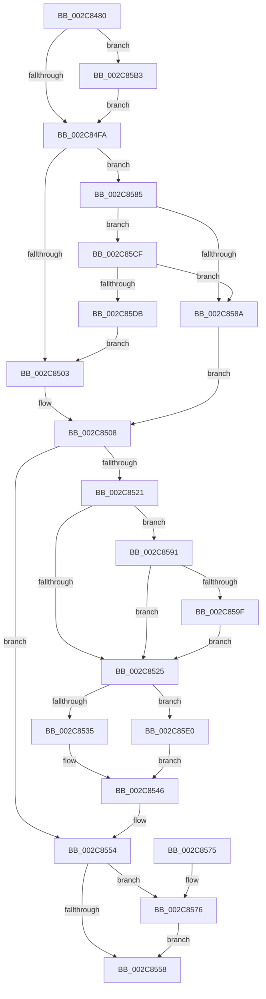

# MiZeroAndConvertPage

- RVA: `0x002C8480`–`0x002C85FA` (길이 `378` bytes)
- VA: `0x00000001402C8480`
- 실행 섹션: `.text`
- PDB 이름 있음: `예`; PDB Function 태그: `아니요`
- unwind 정보 RVA: `0x0006EF10`
- 디코드: `111`개 명령, `378/378` bytes 표시
- 미해석 바이트: `0` (있으면 어셈블리에 `.byte`로 보존)

> 이 문서는 커널 이미지의 기계어와 PDB 기호를 분석해 생성했습니다. 4번과 5번은 함수 원형과 자료형을 바이너리 사용 방식에서 추정한 C 해석이며 원본 소스 복구 결과는 아닙니다.

## 1. Dependencies

- 직접 호출 지점: **7**; 고유 호출 대상: **4**
- 직접 호출자로 확인된 함수: **3**
- RIP 상대 이미지 참조: **0**

### Outgoing calls
- `0x002C8541` → [MiZeroPhysicalPage](../33/MiZeroPhysicalPage_function_00332590.md) (function, `0x00332590`)
- `0x002C857E` → [MiChangePageAttribute](../33/MiChangePageAttribute_function_00332ECC.md) (function, `0x00332ECC`)
- `0x002C8596` → [MiPfnBestZeroAttribute](MiPfnBestZeroAttribute_function_002C8600.md) (function, `0x002C8600`)
- `0x002C85A7` → [MiChangePageAttribute](../33/MiChangePageAttribute_function_00332ECC.md) (function, `0x00332ECC`)
- `0x002C85B8` → [MiPfnBestZeroAttribute](MiPfnBestZeroAttribute_function_002C8600.md) (function, `0x002C8600`)
- `0x002C85C5` → [MiChangePageAttribute](../33/MiChangePageAttribute_function_00332ECC.md) (function, `0x00332ECC`)
- `0x002C85F0` → [MiZeroLargePage](MiZeroLargePage_function_002C6914.md) (function, `0x002C6914`)

### Direct callers
- [MiZeroChainWorker](MiZeroChainWorker_function_002C67C8.md) at `0x002C68C5`
- [MiInitializeMdlOneNodeBatchPages](MiInitializeMdlOneNodeBatchPages_function_002C9480.md) at `0x002C9660`
- [sub_006E75BA](../6E/Unknown_function_006E75BA.md) at `0x006E761E`

### Static image references
- 디코드된 RIP-relative 메모리 참조가 없습니다.

## 2. Other-region calls and transfers

- 다른 실행 섹션으로 향하는 call: **0**
- 별도 외부 분기/꼬리 이동을 확인하지 못했습니다.

## 3. Assembly (complete function range)

```asm
002C8480  48 89 5C 24 08                  mov qword ptr [rsp + 8], rbx
002C8485  48 89 6C 24 10                  mov qword ptr [rsp + 0x10], rbp
002C848A  48 89 74 24 18                  mov qword ptr [rsp + 0x18], rsi
002C848F  57                              push rdi
002C8490  41 54                           push r12
002C8492  41 55                           push r13
002C8494  41 56                           push r14
002C8496  41 57                           push r15
002C8498  48 83 EC 30                     sub rsp, 0x30
002C849C  41 8B F1                        mov esi, r9d
002C849F  45 8B F8                        mov r15d, r8d
002C84A2  48 8B FA                        mov rdi, rdx
002C84A5  4C 8B E9                        mov r13, rcx
002C84A8  48 B8 00 00 00 00 00 DE FF FF   movabs rax, 0xffffde0000000000
002C84B2  8B 9C 24 80 00 00 00            mov ebx, dword ptr [rsp + 0x80]
002C84B9  4C 8B E2                        mov r12, rdx
002C84BC  4C 2B E0                        sub r12, rax
002C84BF  44 8B C3                        mov r8d, ebx
002C84C2  41 83 E0 08                     and r8d, 8
002C84C6  49 C1 FC 04                     sar r12, 4
002C84CA  45 03 C0                        add r8d, r8d
002C84CD  48 B8 AB AA AA AA AA AA AA AA   movabs rax, 0xaaaaaaaaaaaaaaab
002C84D7  4C 0F AF E0                     imul r12, rax
002C84DB  8B 42 20                        mov eax, dword ptr [rdx + 0x20]
002C84DE  45 8B F0                        mov r14d, r8d
002C84E1  41 83 CE 08                     or r14d, 8
002C84E5  0F BA E3 0A                     bt ebx, 0xa
002C84E9  45 0F 43 F0                     cmovae r14d, r8d
002C84ED  C1 E8 10                        shr eax, 0x10
002C84F0  24 C0                           and al, 0xc0
002C84F2  3C C0                           cmp al, 0xc0
002C84F4  0F 84 B9 00 00 00               je 0x1402c85b3
002C84FA  F6 C3 01                        test bl, 1
002C84FD  0F 84 82 00 00 00               je 0x1402c8585
002C8503  B9 01 00 00 00                  mov ecx, 1
002C8508  8B 47 20                        mov eax, dword ptr [rdi + 0x20]
002C850B  C1 E8 10                        shr eax, 0x10
002C850E  0F B6 D0                        movzx edx, al
002C8511  33 C0                           xor eax, eax
002C8513  C1 EA 06                        shr edx, 6
002C8516  3B D6                           cmp edx, esi
002C8518  0F 95 C0                        setne al
002C851B  8B E8                           mov ebp, eax
002C851D  85 C9                           test ecx, ecx
002C851F  74 33                           je 0x1402c8554
002C8521  3B D6                           cmp edx, esi
002C8523  75 6C                           jne 0x1402c8591
002C8525  44 8B CE                        mov r9d, esi
002C8528  49 8B CD                        mov rcx, r13
002C852B  41 83 FF 03                     cmp r15d, 3
002C852F  0F 85 AB 00 00 00               jne 0x1402c85e0
002C8535  C1 EB 02                        shr ebx, 2
002C8538  49 8B D4                        mov rdx, r12
002C853B  83 E3 02                        and ebx, 2
002C853E  44 8B C3                        mov r8d, ebx
002C8541  E8 4A A0 06 00                  call 0x140332590
002C8546  48 8B 47 10                     mov rax, qword ptr [rdi + 0x10]
002C854A  48 25 1F FC FF FF               and rax, 0xfffffffffffffc1f
002C8550  48 89 47 10                     mov qword ptr [rdi + 0x10], rax
002C8554  85 ED                           test ebp, ebp
002C8556  75 1E                           jne 0x1402c8576
002C8558  48 8B 5C 24 60                  mov rbx, qword ptr [rsp + 0x60]
002C855D  48 8B 6C 24 68                  mov rbp, qword ptr [rsp + 0x68]
002C8562  48 8B 74 24 70                  mov rsi, qword ptr [rsp + 0x70]
002C8567  48 83 C4 30                     add rsp, 0x30
002C856B  41 5F                           pop r15
002C856D  41 5E                           pop r14
002C856F  41 5D                           pop r13
002C8571  41 5C                           pop r12
002C8573  5F                              pop rdi
002C8574  C3                              ret
002C8575  CC                              int3
002C8576  45 8B C6                        mov r8d, r14d
002C8579  8B D6                           mov edx, esi
002C857B  48 8B CF                        mov rcx, rdi
002C857E  E8 49 A9 06 00                  call 0x140332ecc
002C8583  EB D3                           jmp 0x1402c8558
002C8585  F6 C3 02                        test bl, 2
002C8588  75 45                           jne 0x1402c85cf
002C858A  33 C9                           xor ecx, ecx
002C858C  E9 77 FF FF FF                  jmp 0x1402c8508
002C8591  8B D6                           mov edx, esi
002C8593  48 8B CF                        mov rcx, rdi
002C8596  E8 65 00 00 00                  call 0x1402c8600
002C859B  3B C6                           cmp eax, esi
002C859D  75 86                           jne 0x1402c8525
002C859F  45 8B C6                        mov r8d, r14d
002C85A2  8B D6                           mov edx, esi
002C85A4  48 8B CF                        mov rcx, rdi
002C85A7  E8 20 A9 06 00                  call 0x140332ecc
002C85AC  33 ED                           xor ebp, ebp
002C85AE  E9 72 FF FF FF                  jmp 0x1402c8525
002C85B3  8B D6                           mov edx, esi
002C85B5  48 8B CF                        mov rcx, rdi
002C85B8  E8 43 00 00 00                  call 0x1402c8600
002C85BD  8B D0                           mov edx, eax
002C85BF  45 8B C6                        mov r8d, r14d
002C85C2  48 8B CF                        mov rcx, rdi
002C85C5  E8 02 A9 06 00                  call 0x140332ecc
002C85CA  E9 2B FF FF FF                  jmp 0x1402c84fa
002C85CF  48 8B 47 10                     mov rax, qword ptr [rdi + 0x10]
002C85D3  48 A9 E0 03 00 00               test rax, 0x3e0
002C85D9  74 AF                           je 0x1402c858a
002C85DB  E9 23 FF FF FF                  jmp 0x1402c8503
002C85E0  C1 EB 03                        shr ebx, 3
002C85E3  45 8B C7                        mov r8d, r15d
002C85E6  83 E3 01                        and ebx, 1
002C85E9  48 8B D7                        mov rdx, rdi
002C85EC  89 5C 24 20                     mov dword ptr [rsp + 0x20], ebx
002C85F0  E8 1F E3 FF FF                  call 0x1402c6914
002C85F5  E9 4C FF FF FF                  jmp 0x1402c8546
```

## 4. C-style interpretation (structured pseudocode)

```c
__int64 __fastcall MiZeroAndConvertPage(__int64 a1, __int64 a2, int a3, int a4, unsigned int a5)
{
    __int64 result;
    __int64 v_r12;
    __int64 v_r14;
    __int64 v_rbp;
    __int64 v_rbx;
    __int64 v_rsp;
    unsigned __int64 v_stack_p10;
    unsigned __int64 v_stack_p18;
    unsigned int v_stack_p20;
    unsigned __int64 v_stack_p8;

    v_stack_p8 = v_rbx;
    v_stack_p10 = v_rbp;
    v_stack_p18 = v_rsi;
    v_rsp = (v_rsp) - (48);
    v_r12 = (a2) - (result);
    a3 = (unsigned int)(((unsigned int)((unsigned int)((unsigned int)(a5)))) & (8));
    v_r12 = (v_r12) >> (4);
    a3 = (unsigned int)((a3) + (a3));
    v_r12 = (v_r12) * (result);
    v_r14 = (unsigned int)(((unsigned int)(a3)) | (8));
    if (condition_is_above_or_equal) { v_r14 = a3; }
    result = (unsigned int)(((unsigned int)(*(unsigned int *)(a2 + 32))) >> (16));
    result = (unsigned __int8)((result) & (192));
    if (((unsigned __int8)(result)) == 192) goto loc_002C85B3;
loc_002C84FA:
    if ((((unsigned __int8)((unsigned int)(a5))) & (1)) == 0) goto loc_002C8585;
loc_002C8503:
loc_002C8508:
    result = (unsigned int)(((unsigned int)(*(unsigned int *)(a2 + 32))) >> (16));
    result = 0;
    a2 = (unsigned int)(((unsigned __int8)(result)) >> (6));
    result = (((unsigned int)(a2)) != ((unsigned int)((unsigned int)(a4)))) ? 1 : 0;
    if (1 == 0) goto loc_002C8554;
    if (((unsigned int)(a2)) != ((unsigned int)((unsigned int)(a4)))) goto loc_002C8591;
loc_002C8525:
    if (((unsigned int)((unsigned int)(a3))) != 3) goto loc_002C85E0;
    v_rbx = (unsigned int)(((unsigned int)(a5)) >> (2));
    v_rbx = (unsigned int)((v_rbx) & (2));
    result = MiZeroPhysicalPage(a1, v_r12, (unsigned int)((unsigned int)(v_rbx)), (unsigned int)((unsigned int)((unsigned int)(a4))));
loc_002C8546:
    result = (*(unsigned __int64 *)(a2 + 16)) & (-993);
    *(unsigned __int64 *)(a2 + 16) = result;
loc_002C8554:
    if ((unsigned int)((unsigned int)((unsigned int)(result))) != 0) goto loc_002C8576;
loc_002C8558:
    v_rsp = (v_rsp) + (48);
    return result;
loc_002C8576:
    result = MiChangePageAttribute(a2, (unsigned int)((unsigned int)(v_stack_p18)), (unsigned int)((unsigned int)(v_r14)), (unsigned int)((unsigned int)((unsigned int)(a4))));
    goto loc_002C8558;
loc_002C8585:
    if ((((unsigned __int8)(v_stack_p8)) & (2)) != 0) goto loc_002C85CF;
loc_002C858A:
    a1 = 0;
    goto loc_002C8508;
loc_002C8591:
    result = MiPfnBestZeroAttribute(a2, (unsigned int)((unsigned int)(v_stack_p18)), (unsigned int)((unsigned int)(v_r14)), (unsigned int)((unsigned int)((unsigned int)(a4))));
    if (((unsigned int)(result)) != ((unsigned int)(v_stack_p18))) goto loc_002C8525;
    result = MiChangePageAttribute(a2, (unsigned int)((unsigned int)(v_stack_p18)), (unsigned int)((unsigned int)(v_r14)), (unsigned int)((unsigned int)((unsigned int)(a4))));
    v_rbp = 0;
    goto loc_002C8525;
loc_002C85B3:
    result = MiPfnBestZeroAttribute(a2, (unsigned int)((unsigned int)(v_stack_p18)), (unsigned int)((unsigned int)(v_r14)), (unsigned int)((unsigned int)((unsigned int)(a4))));
    result = MiChangePageAttribute(a2, (unsigned int)((unsigned int)(result)), (unsigned int)((unsigned int)(v_r14)), (unsigned int)((unsigned int)((unsigned int)(a4))));
    goto loc_002C84FA;
loc_002C85CF:
    if (((*(unsigned __int64 *)(a2 + 16)) & (992)) == 0) goto loc_002C858A;
    goto loc_002C8503;
loc_002C85E0:
    v_rbx = (unsigned int)((v_stack_p8) >> (3));
    v_rbx = (unsigned int)((v_rbx) & (1));
    v_stack_p20 = (unsigned int)(v_rbx);
    result = MiZeroLargePage(a2, a2, (unsigned int)((unsigned int)((unsigned int)(a3))), (unsigned int)((unsigned int)((unsigned int)(a4))));
    goto loc_002C8546;
}
```

## 5. (Beta) C Style

```c
int64_t MiZeroAndConvertPage(int64_t Arg1, void *Arg2, int32_t Arg3, int32_t Arg4, uint32_t Arg5)
{
    uint8_t *arg2 = (uint8_t *)Arg2;

    int64_t result;
    int64_t local_r12;
    int64_t local_r14;
    int64_t local_rbp;
    int64_t local_rbx;
    int64_t local_rsp;
    uint64_t v_stack_p10;
    uint64_t v_stack_p18;
    uint32_t v_stack_p20;
    uint64_t v_stack_p8;

    v_stack_p8 = local_rbx;
    v_stack_p10 = local_rbp;
    v_stack_p18 = local_rsi;
    local_rsp = (local_rsp) - (48);
    local_r12 = (Arg2) - (result);
    Arg3 = (uint32_t)(((uint32_t)((uint32_t)((uint32_t)(Arg5)))) & (8));
    local_r12 = (local_r12) >> (4);
    Arg3 = (uint32_t)((Arg3) + (Arg3));
    local_r12 = (local_r12) * (result);
    local_r14 = (uint32_t)(((uint32_t)(Arg3)) | (8));
    if (condition_is_above_or_equal) { local_r14 = Arg3; }
    result = (uint32_t)(((uint32_t)(*(uint32_t *)(arg2 + 0x20))) >> (16));
    result = (uint8_t)((result) & (192));
    if (((uint8_t)(result)) == 192) goto loc_002C85B3;
loc_002C84FA:
    if ((((uint8_t)((uint32_t)(Arg5))) & (1)) == 0) goto loc_002C8585;
loc_002C8503:
loc_002C8508:
    result = (uint32_t)(((uint32_t)(*(uint32_t *)(arg2 + 0x20))) >> (16));
    result = 0;
    Arg2 = (uint32_t)(((uint8_t)(result)) >> (6));
    result = (((uint32_t)(Arg2)) != ((uint32_t)((uint32_t)(Arg4)))) ? 1 : 0;
    if (1 == 0) goto loc_002C8554;
    if (((uint32_t)(Arg2)) != ((uint32_t)((uint32_t)(Arg4)))) goto loc_002C8591;
loc_002C8525:
    if (((uint32_t)((uint32_t)(Arg3))) != 3) goto loc_002C85E0;
    local_rbx = (uint32_t)(((uint32_t)(Arg5)) >> (2));
    local_rbx = (uint32_t)((local_rbx) & (2));
    result = MiZeroPhysicalPage(Arg1, local_r12, (uint32_t)((uint32_t)(local_rbx)), (uint32_t)((uint32_t)((uint32_t)(Arg4))));
loc_002C8546:
    result = (*(uint64_t *)(arg2 + 0x10)) & (-993);
    *(uint64_t *)(arg2 + 0x10) = result;
loc_002C8554:
    if ((uint32_t)((uint32_t)((uint32_t)(result))) != 0) goto loc_002C8576;
loc_002C8558:
    local_rsp = (local_rsp) + (48);
    return result;
loc_002C8576:
    result = MiChangePageAttribute(Arg2, (uint32_t)((uint32_t)(v_stack_p18)), (uint32_t)((uint32_t)(local_r14)), (uint32_t)((uint32_t)((uint32_t)(Arg4))));
    goto loc_002C8558;
loc_002C8585:
    if ((((uint8_t)(v_stack_p8)) & (2)) != 0) goto loc_002C85CF;
loc_002C858A:
    Arg1 = 0;
    goto loc_002C8508;
loc_002C8591:
    result = MiPfnBestZeroAttribute(Arg2, (uint32_t)((uint32_t)(v_stack_p18)), (uint32_t)((uint32_t)(local_r14)), (uint32_t)((uint32_t)((uint32_t)(Arg4))));
    if (((uint32_t)(result)) != ((uint32_t)(v_stack_p18))) goto loc_002C8525;
    result = MiChangePageAttribute(Arg2, (uint32_t)((uint32_t)(v_stack_p18)), (uint32_t)((uint32_t)(local_r14)), (uint32_t)((uint32_t)((uint32_t)(Arg4))));
    local_rbp = 0;
    goto loc_002C8525;
loc_002C85B3:
    result = MiPfnBestZeroAttribute(Arg2, (uint32_t)((uint32_t)(v_stack_p18)), (uint32_t)((uint32_t)(local_r14)), (uint32_t)((uint32_t)((uint32_t)(Arg4))));
    result = MiChangePageAttribute(Arg2, (uint32_t)((uint32_t)(result)), (uint32_t)((uint32_t)(local_r14)), (uint32_t)((uint32_t)((uint32_t)(Arg4))));
    goto loc_002C84FA;
loc_002C85CF:
    if (((*(uint64_t *)(arg2 + 0x10)) & (992)) == 0) goto loc_002C858A;
    goto loc_002C8503;
loc_002C85E0:
    local_rbx = (uint32_t)((v_stack_p8) >> (3));
    local_rbx = (uint32_t)((local_rbx) & (1));
    v_stack_p20 = (uint32_t)(local_rbx);
    result = MiZeroLargePage(Arg2, Arg2, (uint32_t)((uint32_t)((uint32_t)(Arg3))), (uint32_t)((uint32_t)((uint32_t)(Arg4))));
    goto loc_002C8546;
}
```

### 관측된 메모리 오프셋

구조체 형식이 확인되지 않은 접근은 인자 기준의 오프셋으로만 기록했습니다.

| 기준 인자 | 오프셋 표현 | 폭 (bit) | 접근 |
|---|---:|---:|---|
| `Arg2` | `+ 0x10` | `64` | `R` |
| `Arg2` | `+ 0x10` | `64` | `W` |
| `Arg2` | `+ 0x20` | `32` | `R` |

## 6. Execution-region graph

[열기: 2D/3D 그래프와 함수 탐색 컨트롤 패널](../../../control-panel.html?section=text&rva=0x002C8480&view=graph)

- 2D 그래프는 위에서 아래로 흐르고, 3D 그래프는 빈 공간을 드래그해 회전합니다. Shift+드래그는 이동, 휠은 확대·축소, 함수 노드 선택은 대상 보고서 이동입니다.

### Static fallback


