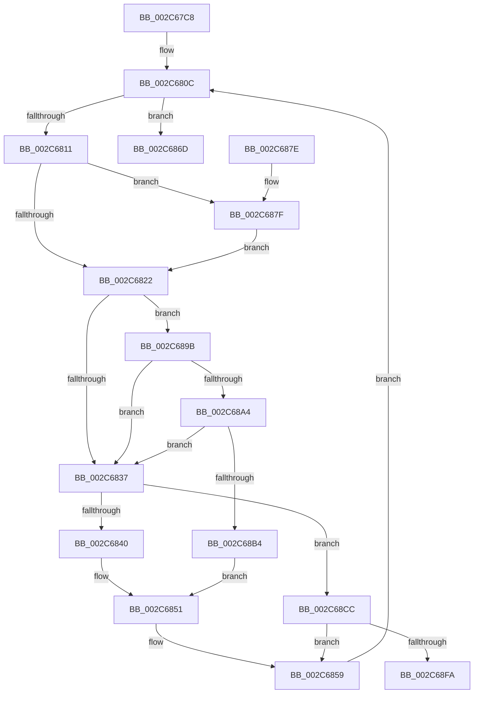

# MiZeroChainWorker

- RVA: `0x002C67C8`–`0x002C690B` (길이 `323` bytes)
- VA: `0x00000001402C67C8`
- 실행 섹션: `.text`
- PDB 이름 있음: `예`; PDB Function 태그: `예`
- unwind 정보 RVA: `0x0006EC34`
- 디코드: `92`개 명령, `323/323` bytes 표시
- 미해석 바이트: `0` (있으면 어셈블리에 `.byte`로 보존)

> 이 문서는 커널 이미지의 기계어와 PDB 기호를 분석해 생성했습니다. 4번과 5번은 함수 원형과 자료형을 바이너리 사용 방식에서 추정한 C 해석이며 원본 소스 복구 결과는 아닙니다.

## 1. Dependencies

- 직접 호출 지점: **3**; 고유 호출 대상: **3**
- 직접 호출자로 확인된 함수: **1**
- RIP 상대 이미지 참조: **1**

### Outgoing calls
- `0x002C684C` → [MiZeroWithUltraSpace](MiZeroWithUltraSpace_function_002C6C9C.md) (function, `0x002C6C9C`)
- `0x002C6882` → [MiGetPfnPageSizeIndex](../31/MiGetPfnPageSizeIndex_function_0031C710.md) (function, `0x0031C710`)
- `0x002C68C5` → [MiZeroAndConvertPage](MiZeroAndConvertPage_function_002C8480.md) (function, `0x002C8480`)

### Direct callers
- [MiZeroInParallelWorker](MiZeroInParallelWorker_function_002C6600.md) at `0x002C6751`

### Static image references
- `0x002C6825` → RVA `0x00011C60` (`.rdata`; read)

## 2. Other-region calls and transfers

- 다른 실행 섹션으로 향하는 call: **0**
- call이 아닌 외부 분기/꼬리 이동: **1**
  - `0x002C6906` → [sub_006DC750](../6D/Unknown_function_006DC750.md) (`tail-transfer`)

## 3. Assembly (complete function range)

```asm
002C67C8  4C 89 4C 24 20                  mov qword ptr [rsp + 0x20], r9
002C67CD  4C 89 44 24 18                  mov qword ptr [rsp + 0x18], r8
002C67D2  48 89 54 24 10                  mov qword ptr [rsp + 0x10], rdx
002C67D7  53                              push rbx
002C67D8  55                              push rbp
002C67D9  56                              push rsi
002C67DA  57                              push rdi
002C67DB  41 54                           push r12
002C67DD  41 55                           push r13
002C67DF  41 56                           push r14
002C67E1  41 57                           push r15
002C67E3  48 83 EC 38                     sub rsp, 0x38
002C67E7  8B 71 10                        mov esi, dword ptr [rcx + 0x10]
002C67EA  4C 8B EA                        mov r13, rdx
002C67ED  8B 51 14                        mov edx, dword ptr [rcx + 0x14]
002C67F0  4D 8B D1                        mov r10, r9
002C67F3  D1 EE                           shr esi, 1
002C67F5  4D 8B F8                        mov r15, r8
002C67F8  4C 8B F1                        mov r14, rcx
002C67FB  89 94 24 80 00 00 00            mov dword ptr [rsp + 0x80], edx
002C6802  49 8D 45 70                     lea rax, [r13 + 0x70]
002C6806  83 E6 04                        and esi, 4
002C6809  48 8B 18                        mov rbx, qword ptr [rax]
002C680C  48 3B D8                        cmp rbx, rax
002C680F  74 5C                           je 0x1402c686d
002C6811  48 8B 43 28                     mov rax, qword ptr [rbx + 0x28]
002C6815  41 B8 03 00 00 00               mov r8d, 3
002C681B  48 0F BA E0 28                  bt rax, 0x28
002C6820  72 5D                           jb 0x1402c687f
002C6822  41 8B C8                        mov ecx, r8d
002C6825  48 8D 2D 34 B4 D4 FF            lea rbp, [rip - 0x2b4bcc]
002C682C  48 8B 6C CD 00                  mov rbp, qword ptr [rbp + rcx*8]
002C6831  41 83 F8 02                     cmp r8d, 2
002C6835  76 64                           jbe 0x1402c689b
002C6837  4D 85 D2                        test r10, r10
002C683A  0F 84 8C 00 00 00               je 0x1402c68cc
002C6840  44 8B CE                        mov r9d, esi
002C6843  4C 8B C3                        mov r8, rbx
002C6846  49 8B D7                        mov rdx, r15
002C6849  49 8B CA                        mov rcx, r10
002C684C  E8 4B 04 00 00                  call 0x1402c6c9c
002C6851  4C 8B 94 24 98 00 00 00         mov r10, qword ptr [rsp + 0x98]
002C6859  48 8B 1B                        mov rbx, qword ptr [rbx]
002C685C  49 8D 45 70                     lea rax, [r13 + 0x70]
002C6860  49 29 6D 68                     sub qword ptr [r13 + 0x68], rbp
002C6864  8B 94 24 80 00 00 00            mov edx, dword ptr [rsp + 0x80]
002C686B  EB 9F                           jmp 0x1402c680c
002C686D  48 83 C4 38                     add rsp, 0x38
002C6871  41 5F                           pop r15
002C6873  41 5E                           pop r14
002C6875  41 5D                           pop r13
002C6877  41 5C                           pop r12
002C6879  5F                              pop rdi
002C687A  5E                              pop rsi
002C687B  5D                              pop rbp
002C687C  5B                              pop rbx
002C687D  C3                              ret
002C687E  CC                              int3
002C687F  48 8B CB                        mov rcx, rbx
002C6882  E8 89 5E 05 00                  call 0x14031c710
002C6887  4C 8B 94 24 98 00 00 00         mov r10, qword ptr [rsp + 0x98]
002C688F  44 8B C0                        mov r8d, eax
002C6892  8B 94 24 80 00 00 00            mov edx, dword ptr [rsp + 0x80]
002C6899  EB 87                           jmp 0x1402c6822
002C689B  41 8B 4E 10                     mov ecx, dword ptr [r14 + 0x10]
002C689F  F6 C1 20                        test cl, 0x20
002C68A2  75 93                           jne 0x1402c6837
002C68A4  8B 4B 20                        mov ecx, dword ptr [rbx + 0x20]
002C68A7  C1 E9 10                        shr ecx, 0x10
002C68AA  0F B6 C1                        movzx eax, cl
002C68AD  C1 E8 06                        shr eax, 6
002C68B0  3B C2                           cmp eax, edx
002C68B2  74 83                           je 0x1402c6837
002C68B4  41 8B 46 10                     mov eax, dword ptr [r14 + 0x10]
002C68B8  44 8B CA                        mov r9d, edx
002C68BB  48 8B D3                        mov rdx, rbx
002C68BE  89 44 24 20                     mov dword ptr [rsp + 0x20], eax
002C68C2  49 8B CF                        mov rcx, r15
002C68C5  E8 B6 1B 00 00                  call 0x1402c8480
002C68CA  EB 85                           jmp 0x1402c6851
002C68CC  48 B8 00 00 00 00 00 DE FF FF   movabs rax, 0xffffde0000000000
002C68D6  48 8B FB                        mov rdi, rbx
002C68D9  45 33 E4                        xor r12d, r12d
002C68DC  48 2B F8                        sub rdi, rax
002C68DF  48 B8 AB AA AA AA AA AA AA AA   movabs rax, 0xaaaaaaaaaaaaaaab
002C68E9  48 C1 FF 04                     sar rdi, 4
002C68ED  48 0F AF F8                     imul rdi, rax
002C68F1  48 85 ED                        test rbp, rbp
002C68F4  0F 84 5F FF FF FF               je 0x1402c6859
002C68FA  4C 8B AC 24 90 00 00 00         mov r13, qword ptr [rsp + 0x90]
002C6902  4C 8D 7B 20                     lea r15, [rbx + 0x20]
002C6906  E9 45 5E 41 00                  jmp 0x1406dc750
```

## 4. C-style interpretation (structured pseudocode)

```c
__int64 __fastcall MiZeroChainWorker(__int64 a1, __int64 a2, __int64 a3, __int64 a4)
{
    __int64 result;
    __int64 v_r12;
    __int64 v_rdi;
    __int64 v_rsi;
    __int64 v_rsp;
    unsigned __int64 v_stack_p10;
    unsigned __int64 v_stack_p18;
    unsigned __int64 v_stack_p20;
    unsigned int v_stack_p8;
    unsigned int v_stack_p80;
    unsigned __int64 v_stack_p90;
    unsigned __int64 v_stack_p98;

    v_stack_p20 = a4;
    v_stack_p18 = a3;
    v_stack_p10 = a2;
    v_rsp = (v_rsp) - (56);
    v_rsi = (unsigned int)(((unsigned int)(*(unsigned int *)(a1 + 16))) >> (1));
    v_stack_p8 = (unsigned int)((unsigned int)(*(unsigned int *)(a1 + 20)));
    v_rsi = (unsigned int)((v_rsi) & (4));
loc_002C680C:
    if ((*(unsigned __int64 *)(a2 + 112)) == (a2 + 112)) goto loc_002C686D;
    if ((*(unsigned __int64 *)(a2 + 112)) < (a2 + 112)) goto loc_002C687F;
loc_002C6822:
    if (3 <= 2) goto loc_002C689B;
loc_002C6837:
    if (a4 == 0) goto loc_002C68CC;
    result = MiZeroWithUltraSpace(a4, a3, *(unsigned __int64 *)(a2 + 112), (unsigned int)((unsigned int)(v_rsi)));
loc_002C6851:
loc_002C6859:
    goto loc_002C680C;
loc_002C686D:
    v_rsp = (v_rsp) + (56);
    return a2 + 112;
loc_002C687F:
    result = MiGetPfnPageSizeIndex(*(unsigned __int64 *)(*(unsigned __int64 *)(a2 + 112)), (unsigned int)(v_stack_p8), *(unsigned __int64 *)(a2 + 112), (unsigned int)((unsigned int)(v_rsi)));
    goto loc_002C6822;
loc_002C689B:
    if ((((unsigned __int8)((unsigned int)(*(unsigned int *)(a1 + 16)))) & (32)) != 0) goto loc_002C6837;
    a1 = (unsigned int)(((unsigned int)(*(unsigned int *)(*(unsigned __int64 *)(*(unsigned __int64 *)(a2 + 112)) + 32))) >> (16));
    result = (unsigned int)(((unsigned __int8)(a1)) >> (6));
    if (((unsigned int)(result)) == ((unsigned int)((unsigned int)(v_stack_p80)))) goto loc_002C6837;
    v_stack_p20 = (unsigned int)((unsigned int)(*(unsigned int *)(a1 + 16)));
    result = MiZeroAndConvertPage(a3, *(unsigned __int64 *)(*(unsigned __int64 *)(a2 + 112)), (unsigned int)((unsigned int)(result)), (unsigned int)((unsigned int)((unsigned int)(v_stack_p80))));
    goto loc_002C6851;
loc_002C68CC:
    v_r12 = 0;
    v_rdi = (*(unsigned __int64 *)(*(unsigned __int64 *)(a2 + 112))) - (result);
    v_rdi = (v_rdi) >> (4);
    v_rdi = (v_rdi) * (result);
    if (*(unsigned __int64 *)(v_rip - 2837452 + 3 * 8) == 0) goto loc_002C6859;
}
```

## 5. (Beta) C Style

```c
void *MiZeroChainWorker(void *Arg1, void *Arg2, int64_t Arg3, int64_t Arg4)
{
    uint8_t *arg1 = (uint8_t *)Arg1;
    uint8_t *arg2 = (uint8_t *)Arg2;

    int64_t result;
    int64_t local_r12;
    int64_t local_rdi;
    int64_t local_rsi;
    int64_t local_rsp;
    uint64_t v_stack_p10;
    uint64_t v_stack_p18;
    uint64_t v_stack_p20;
    uint32_t v_stack_p8;
    uint32_t v_stack_p80;
    uint64_t v_stack_p90;
    uint64_t v_stack_p98;

    v_stack_p20 = Arg4;
    v_stack_p18 = Arg3;
    v_stack_p10 = Arg2;
    local_rsp = (local_rsp) - (56);
    local_rsi = (uint32_t)(((uint32_t)(*(uint32_t *)(arg1 + 0x10))) >> (1));
    v_stack_p8 = (uint32_t)((uint32_t)(*(uint32_t *)(arg1 + 0x14)));
    local_rsi = (uint32_t)((local_rsi) & (4));
loc_002C680C:
    if ((*(uint64_t *)(arg2 + 0x70)) == (Arg2 + 112)) goto loc_002C686D;
    if ((*(uint64_t *)(arg2 + 0x70)) < (Arg2 + 112)) goto loc_002C687F;
loc_002C6822:
    if (3 <= 2) goto loc_002C689B;
loc_002C6837:
    if (Arg4 == 0) goto loc_002C68CC;
    result = MiZeroWithUltraSpace(Arg4, Arg3, *(uint64_t *)(arg2 + 0x70), (uint32_t)((uint32_t)(local_rsi)));
loc_002C6851:
loc_002C6859:
    goto loc_002C680C;
loc_002C686D:
    local_rsp = (local_rsp) + (56);
    return Arg2 + 112;
loc_002C687F:
    result = MiGetPfnPageSizeIndex(*(uint64_t *)(*(uint64_t *)(arg2 + 0x70)), (uint32_t)(v_stack_p8), *(uint64_t *)(arg2 + 0x70), (uint32_t)((uint32_t)(local_rsi)));
    goto loc_002C6822;
loc_002C689B:
    if ((((uint8_t)((uint32_t)(*(uint32_t *)(arg1 + 0x10)))) & (32)) != 0) goto loc_002C6837;
    Arg1 = (uint32_t)(((uint32_t)(*(uint32_t *)(*(uint64_t *)(*(uint64_t *)(arg2 + 0x70)) + 0x20))) >> (16));
    result = (uint32_t)(((uint8_t)(Arg1)) >> (6));
    if (((uint32_t)(result)) == ((uint32_t)((uint32_t)(v_stack_p80)))) goto loc_002C6837;
    v_stack_p20 = (uint32_t)((uint32_t)(*(uint32_t *)(arg1 + 0x10)));
    result = MiZeroAndConvertPage(Arg3, *(uint64_t *)(*(uint64_t *)(arg2 + 0x70)), (uint32_t)((uint32_t)(result)), (uint32_t)((uint32_t)((uint32_t)(v_stack_p80))));
    goto loc_002C6851;
loc_002C68CC:
    local_r12 = 0;
    local_rdi = (*(uint64_t *)(*(uint64_t *)(arg2 + 0x70))) - (result);
    local_rdi = (local_rdi) >> (4);
    local_rdi = (local_rdi) * (result);
    if (*(uint64_t *)(v_rip - 0x2B4BCC + 0x3 * 8) == 0) goto loc_002C6859;
}
```

### 관측된 메모리 오프셋

구조체 형식이 확인되지 않은 접근은 인자 기준의 오프셋으로만 기록했습니다.

| 기준 인자 | 오프셋 표현 | 폭 (bit) | 접근 |
|---|---:|---:|---|
| `Arg1` | `+ 0x10` | `32` | `R` |
| `Arg1` | `+ 0x14` | `32` | `R` |
| `Arg2` | `+ 0x0` | `64` | `R` |
| `Arg2` | `+ 0x68` | `64` | `R/W` |
| `Arg2` | `+ 0x70` | `64` | `R` |

## 6. Execution-region graph

[열기: 2D/3D 그래프와 함수 탐색 컨트롤 패널](../../../control-panel.html?section=text&rva=0x002C67C8&view=graph)

- 2D 그래프는 위에서 아래로 흐르고, 3D 그래프는 빈 공간을 드래그해 회전합니다. Shift+드래그는 이동, 휠은 확대·축소, 함수 노드 선택은 대상 보고서 이동입니다.

### Static fallback


