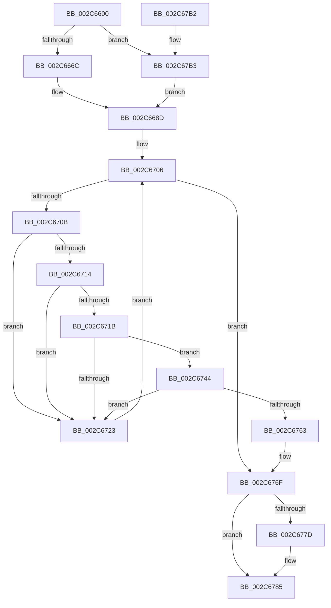

# MiZeroInParallelWorker

- RVA: `0x002C6600`–`0x002C67C1` (길이 `449` bytes)
- VA: `0x00000001402C6600`
- 실행 섹션: `.text`
- PDB 이름 있음: `예`; PDB Function 태그: `아니요`
- unwind 정보 RVA: `0x0006EC08`
- 디코드: `117`개 명령, `449/449` bytes 표시
- 미해석 바이트: `0` (있으면 어셈블리에 `.byte`로 보존)

> 이 문서는 커널 이미지의 기계어와 PDB 기호를 분석해 생성했습니다. 4번과 5번은 함수 원형과 자료형을 바이너리 사용 방식에서 추정한 C 해석이며 원본 소스 복구 결과는 아닙니다.

## 1. Dependencies

- 직접 호출 지점: **9**; 고유 호출 대상: **9**
- 직접 호출자로 확인된 함수: **0**
- RIP 상대 이미지 참조: **2**

### Outgoing calls
- `0x002C664F` → [memset](../6C/memset_function_006C6C40.md) (function, `0x006C6C40`)
- `0x002C6690` → [MiAssignDefaultChannel](../31/MiAssignDefaultChannel_function_0031E5B0.md) (function, `0x0031E5B0`)
- `0x002C66DB` → [MiCreateUltraThreadContext](../28/MiCreateUltraThreadContext_function_00288200.md) (function, `0x00288200`)
- `0x002C66F3` → [MiZeroMoveToProcessor](MiZeroMoveToProcessor_function_002C73BC.md) (function, `0x002C73BC`)
- `0x002C6751` → [MiZeroChainWorker](MiZeroChainWorker_function_002C67C8.md) (function, `0x002C67C8`)
- `0x002C676A` → [KeSignalGate](KeSignalGate_function_002C748C.md) (function, `0x002C748C`)
- `0x002C6773` → [MiRevertProcessorMove](MiRevertProcessorMove_function_002C7420.md) (function, `0x002C7420`)
- `0x002C6780` → [MiDeleteUltraThreadContext](../32/MiDeleteUltraThreadContext_function_00322C90.md) (function, `0x00322C90`)
- `0x002C678C` → [_security_check_cookie](../6A/_security_check_cookie_function_006AC640.md) (function, `0x006AC640`)

### Direct callers
- 이 함수 시작 RVA로 연결되는 직접 call은 확인되지 않았습니다. 간접 호출은 완전히 역산할 수 없습니다.

### Static image references
- `0x002C6623` → RVA `0x00E0A740` (`.data`; read)
- `0x002C6675` → RVA `0x00FC8C40` (`ALMOSTRO`; read)

## 2. Other-region calls and transfers

- 다른 실행 섹션으로 향하는 call: **0**
- 별도 외부 분기/꼬리 이동을 확인하지 못했습니다.

## 3. Assembly (complete function range)

```asm
002C6600  48 8B C4                        mov rax, rsp
002C6603  48 89 58 10                     mov qword ptr [rax + 0x10], rbx
002C6607  48 89 70 18                     mov qword ptr [rax + 0x18], rsi
002C660B  48 89 78 20                     mov qword ptr [rax + 0x20], rdi
002C660F  55                              push rbp
002C6610  41 54                           push r12
002C6612  41 55                           push r13
002C6614  41 56                           push r14
002C6616  41 57                           push r15
002C6618  48 8D 68 A1                     lea rbp, [rax - 0x5f]
002C661C  48 81 EC E0 00 00 00            sub rsp, 0xe0
002C6623  48 8B 05 16 41 B4 00            mov rax, qword ptr [rip + 0xb44116]
002C662A  48 33 C4                        xor rax, rsp
002C662D  48 89 45 27                     mov qword ptr [rbp + 0x27], rax
002C6631  83 65 83 00                     and dword ptr [rbp - 0x7d], 0
002C6635  0F 57 C0                        xorps xmm0, xmm0
002C6638  48 8B D9                        mov rbx, rcx
002C663B  33 D2                           xor edx, edx
002C663D  48 8D 4D A7                     lea rcx, [rbp - 0x59]
002C6641  41 B8 80 00 00 00               mov r8d, 0x80
002C6647  0F 11 45 87                     movups xmmword ptr [rbp - 0x79], xmm0
002C664B  0F 11 45 97                     movups xmmword ptr [rbp - 0x69], xmm0
002C664F  E8 EC 05 40 00                  call 0x1406c6c40
002C6654  48 8B 7B 20                     mov rdi, qword ptr [rbx + 0x20]
002C6658  44 8B 4F 58                     mov r9d, dword ptr [rdi + 0x58]
002C665C  44 8B 7F 28                     mov r15d, dword ptr [rdi + 0x28]
002C6660  41 8D 41 01                     lea eax, [r9 + 1]
002C6664  85 C0                           test eax, eax
002C6666  0F 85 47 01 00 00               jne 0x1402c67b3
002C666C  65 48 8B 04 25 88 01 00 00      mov rax, qword ptr gs:[0x188]
002C6675  4C 8D 15 C4 25 D0 00            lea r10, [rip + 0xd025c4]
002C667C  8B 88 4C 02 00 00               mov ecx, dword ptr [rax + 0x24c]
002C6682  4D 8B 14 CA                     mov r10, qword ptr [r10 + rcx*8]
002C6686  45 8B 8A 54 87 00 00            mov r9d, dword ptr [r10 + 0x8754]
002C668D  41 8B C9                        mov ecx, r9d
002C6690  E8 1B 7F 05 00                  call 0x14031e5b0
002C6695  41 83 E1 3F                     and r9d, 0x3f
002C6699  48 8D 54 24 20                  lea rdx, [rsp + 0x20]
002C669E  41 81 C9 80 03 00 00            or r9d, 0x380
002C66A5  48 8D 4D A7                     lea rcx, [rbp - 0x59]
002C66A9  45 03 C9                        add r9d, r9d
002C66AC  41 BC 01 00 00 00               mov r12d, 1
002C66B2  41 23 C4                        and eax, r12d
002C66B5  41 0B C1                        or eax, r9d
002C66B8  C1 E0 08                        shl eax, 8
002C66BB  89 44 24 28                     mov dword ptr [rsp + 0x28], eax
002C66BF  45 8D 44 24 0E                  lea r8d, [r12 + 0xe]
002C66C4  49 8D 82 50 87 00 00            lea rax, [r10 + 0x8750]
002C66CB  48 89 44 24 20                  mov qword ptr [rsp + 0x20], rax
002C66D0  44 8B 4F 10                     mov r9d, dword ptr [rdi + 0x10]
002C66D4  41 D1 E9                        shr r9d, 1
002C66D7  41 83 E1 04                     and r9d, 4
002C66DB  E8 20 1B FC FF                  call 0x140288200
002C66E0  F7 D8                           neg eax
002C66E2  48 8D 55 87                     lea rdx, [rbp - 0x79]
002C66E6  48 8D 45 A7                     lea rax, [rbp - 0x59]
002C66EA  48 8B CB                        mov rcx, rbx
002C66ED  48 1B F6                        sbb rsi, rsi
002C66F0  48 23 F0                        and rsi, rax
002C66F3  E8 C4 0C 00 00                  call 0x1402c73bc
002C66F8  4D 8B EF                        mov r13, r15
002C66FB  49 C1 E5 07                     shl r13, 7
002C66FF  49 83 C5 28                     add r13, 0x28
002C6703  45 33 F6                        xor r14d, r14d
002C6706  45 3B F7                        cmp r14d, r15d
002C6709  73 64                           jae 0x1402c676f
002C670B  48 8D 43 70                     lea rax, [rbx + 0x70]
002C670F  48 39 00                        cmp qword ptr [rax], rax
002C6712  74 0F                           je 0x1402c6723
002C6714  8B 43 60                        mov eax, dword ptr [rbx + 0x60]
002C6717  85 C0                           test eax, eax
002C6719  75 08                           jne 0x1402c6723
002C671B  F0 44 0F B1 63 60               lock cmpxchg dword ptr [rbx + 0x60], r12d
002C6721  74 21                           je 0x1402c6744
002C6723  48 8B C3                        mov rax, rbx
002C6726  48 8D 8B 80 00 00 00            lea rcx, [rbx + 0x80]
002C672D  45 03 F4                        add r14d, r12d
002C6730  4A 8D 14 2F                     lea rdx, [rdi + r13]
002C6734  48 3B C2                        cmp rax, rdx
002C6737  48 8D 9F A8 00 00 00            lea rbx, [rdi + 0xa8]
002C673E  48 0F 45 D9                     cmovne rbx, rcx
002C6742  EB C2                           jmp 0x1402c6706
002C6744  4C 8B 45 97                     mov r8, qword ptr [rbp - 0x69]
002C6748  4C 8B CE                        mov r9, rsi
002C674B  48 8B D3                        mov rdx, rbx
002C674E  48 8B CF                        mov rcx, rdi
002C6751  E8 72 00 00 00                  call 0x1402c67c8
002C6756  83 C8 FF                        or eax, 0xffffffff
002C6759  F0 0F C1 47 6C                  lock xadd dword ptr [rdi + 0x6c], eax
002C675E  41 3B C4                        cmp eax, r12d
002C6761  75 C0                           jne 0x1402c6723
002C6763  48 8D 4F 78                     lea rcx, [rdi + 0x78]
002C6767  41 8B D4                        mov edx, r12d
002C676A  E8 1D 0D 00 00                  call 0x1402c748c
002C676F  48 8D 4D 87                     lea rcx, [rbp - 0x79]
002C6773  E8 A8 0C 00 00                  call 0x1402c7420
002C6778  48 85 F6                        test rsi, rsi
002C677B  74 08                           je 0x1402c6785
002C677D  48 8B CE                        mov rcx, rsi
002C6780  E8 0B C5 05 00                  call 0x140322c90
002C6785  48 8B 4D 27                     mov rcx, qword ptr [rbp + 0x27]
002C6789  48 33 CC                        xor rcx, rsp
002C678C  E8 AF 5E 3E 00                  call 0x1406ac640
002C6791  4C 8D 9C 24 E0 00 00 00         lea r11, [rsp + 0xe0]
002C6799  49 8B 5B 38                     mov rbx, qword ptr [r11 + 0x38]
002C679D  49 8B 73 40                     mov rsi, qword ptr [r11 + 0x40]
002C67A1  49 8B 7B 48                     mov rdi, qword ptr [r11 + 0x48]
002C67A5  49 8B E3                        mov rsp, r11
002C67A8  41 5F                           pop r15
002C67AA  41 5E                           pop r14
002C67AC  41 5D                           pop r13
002C67AE  41 5C                           pop r12
002C67B0  5D                              pop rbp
002C67B1  C3                              ret
002C67B2  CC                              int3
002C67B3  65 4C 8B 14 25 20 00 00 00      mov r10, qword ptr gs:[0x20]
002C67BC  E9 CC FE FF FF                  jmp 0x1402c668d
```

## 4. C-style interpretation (structured pseudocode)

```c
__int64 __fastcall MiZeroInParallelWorker(__int64 a1, int a2)
{
    __int64 result;
    __int64 v_r13;
    __int64 v_r14;
    __int64 v_rbx;
    __int64 v_rsi;
    __int64 v_rsp;
    unsigned __int64 v_stack_m28;
    unsigned int v_stack_mE0;
    unsigned __int64 v_stack_mE8;

    *(unsigned __int64 *)(v_rsp + 16) = v_rbx;
    *(unsigned __int64 *)(v_rsp + 24) = v_rsi;
    *(unsigned __int64 *)(v_rsp + 32) = v_rdi;
    v_rsp = (v_rsp) - (224);
    result = (*(unsigned __int64 *)(v_rip + 11813142)) ^ (v_rsp);
    *(unsigned __int64 *)(v_rsp - 95 + 39) = result;
    a2 = 0;
    *(unsigned __int64 *)(v_rsp - 95 - 121) = v_xmm0;
    *(unsigned __int64 *)(v_rsp - 95 - 105) = v_xmm0;
    result = memset(v_rsp - 95 - 89, a2, 128, a4);
    if ((unsigned int)((unsigned int)(*(unsigned int *)(*(unsigned __int64 *)(a1 + 32) + 88)) + 1) != 0) goto loc_002C67B3;
loc_002C668D:
    result = MiAssignDefaultChannel((unsigned int)((unsigned int)((unsigned int)(*(unsigned int *)(*(unsigned __int64 *)(v_rip + 13641156 + (unsigned int)(*(unsigned int *)(*(unsigned __int64 *)(gs_base + (0 + 392)) + 588)) * 8) + 34644)))), a2, 128, (unsigned int)(*(unsigned int *)(*(unsigned __int64 *)(v_rip + 13641156 + (unsigned int)(*(unsigned int *)(*(unsigned __int64 *)(gs_base + (0 + 392)) + 588)) * 8) + 34644)));
    a4 = (unsigned int)(((unsigned int)(*(unsigned int *)(*(unsigned __int64 *)(v_rip + 13641156 + (unsigned int)(*(unsigned int *)(*(unsigned __int64 *)(gs_base + (0 + 392)) + 588)) * 8) + 34644))) & (63));
    a4 = (unsigned int)((a4) | (896));
    a4 = (unsigned int)((a4) + ((unsigned int)(a4)));
    result = (unsigned int)((result) & (1));
    result = (unsigned int)((result) | ((unsigned int)(a4)));
    result = (unsigned int)((result) << (8));
    v_stack_mE0 = (unsigned int)(result);
    v_stack_mE8 = *(unsigned __int64 *)(v_rip + 13641156 + (unsigned int)(*(unsigned int *)(*(unsigned __int64 *)(gs_base + (0 + 392)) + 588)) * 8) + 34640;
    a4 = (unsigned int)(((unsigned int)(*(unsigned int *)(*(unsigned __int64 *)(a1 + 32) + 16))) >> (1));
    a4 = (unsigned int)((a4) & (4));
    result = MiCreateUltraThreadContext(v_rsp - 95 - 89, v_stack_mE8, 1 + 14, a4);
    result = (unsigned int)(-(result));
    v_rsi = (v_rsi) & (v_rsp - 95 - 89);
    result = MiZeroMoveToProcessor(a1, v_rsp - 95 - 121, 1 + 14, a4);
    v_r13 = ((unsigned int)(*(unsigned int *)(*(unsigned __int64 *)(a1 + 32) + 40))) << (7);
    v_r13 = (v_r13) + (40);
    v_r14 = 0;
loc_002C6706:
    if (0 >= ((unsigned int)((unsigned int)(*(unsigned int *)(*(unsigned __int64 *)(a1 + 32) + 40))))) goto loc_002C676F;
    if ((*(unsigned __int64 *)(a1 + 112)) == (a1 + 112)) goto loc_002C6723;
    if ((unsigned int)((unsigned int)(*(unsigned int *)(a1 + 96))) != 0) goto loc_002C6723;
    if ((unsigned int)((unsigned int)(*(unsigned int *)(a1 + 96))) == 0) goto loc_002C6744;
loc_002C6723:
    v_r14 = (unsigned int)((v_r14) + (1));
    v_rbx = *(unsigned __int64 *)(a1 + 32) + 168;
    if (a1 != (*(unsigned __int64 *)(a1 + 32) + v_r13 * 1)) { v_rbx = a1 + 128; }
    goto loc_002C6706;
loc_002C6744:
    result = MiZeroChainWorker(*(unsigned __int64 *)(a1 + 32), v_rbx, *(unsigned __int64 *)(v_rsp - 95 - 105), v_rsi);
    result = (unsigned int)((result) | (0xFFFFFFFFULL));
    if (((unsigned int)(result)) != 1) goto loc_002C6723;
    result = KeSignalGate(*(unsigned __int64 *)(a1 + 32) + 120, 1, *(unsigned __int64 *)(v_rsp - 95 - 105), v_rsi);
loc_002C676F:
    result = MiRevertProcessorMove(v_rsp - 95 - 121, 1, *(unsigned __int64 *)(v_rsp - 95 - 105), v_rsi);
    if (v_rsi != 0) {
        a1 = v_rsi;
        result = MiDeleteUltraThreadContext(a1, 1, *(unsigned __int64 *)(v_rsp - 95 - 105), v_rsi);
    }
    a1 = (*(unsigned __int64 *)(v_rsp - 95 + 39)) ^ (v_rsp);
    result = _security_check_cookie(a1, 1, *(unsigned __int64 *)(v_rsp - 95 - 105), v_rsi);
    return result;
loc_002C67B3:
    goto loc_002C668D;
}
```

## 5. (Beta) C Style

```c
int64_t MiZeroInParallelWorker(void *Arg1, int32_t Arg2)
{
    uint8_t *arg1 = (uint8_t *)Arg1;

    int64_t result;
    int64_t local_r13;
    int64_t local_r14;
    int64_t local_rbx;
    int64_t local_rsi;
    int64_t local_rsp;
    uint64_t v_stack_m28;
    uint32_t v_stack_mE0;
    uint64_t v_stack_mE8;

    *(uint64_t *)(local_rsp + 0x10) = local_rbx;
    *(uint64_t *)(local_rsp + 0x18) = local_rsi;
    *(uint64_t *)(local_rsp + 0x20) = local_rdi;
    local_rsp = (local_rsp) - (224);
    result = (*(uint64_t *)(v_rip + 0xB44116)) ^ (local_rsp);
    *(uint64_t *)(local_rsp - 0x5F + 0x27) = result;
    Arg2 = 0;
    *(uint64_t *)(local_rsp - 0x5F - 0x79) = v_xmm0;
    *(uint64_t *)(local_rsp - 0x5F - 0x69) = v_xmm0;
    result = memset(local_rsp - 95 - 89, Arg2, 128, a4);
    if ((uint32_t)((uint32_t)(*(uint32_t *)(*(uint64_t *)(arg1 + 0x20) + 0x58)) + 1) != 0) goto loc_002C67B3;
loc_002C668D:
    result = MiAssignDefaultChannel((uint32_t)((uint32_t)((uint32_t)(*(uint32_t *)(*(uint64_t *)(v_rip + 0xD025C4 + (uint32_t)(*(uint32_t *)(*(uint64_t *)(gs_base + (0 + 0x188)) + 0x24C)) * 8) + 0x8754)))), Arg2, 128, (uint32_t)(*(uint32_t *)(*(uint64_t *)(v_rip + 0xD025C4 + (uint32_t)(*(uint32_t *)(*(uint64_t *)(gs_base + (0 + 0x188)) + 0x24C)) * 8) + 0x8754)));
    a4 = (uint32_t)(((uint32_t)(*(uint32_t *)(*(uint64_t *)(v_rip + 0xD025C4 + (uint32_t)(*(uint32_t *)(*(uint64_t *)(gs_base + (0 + 0x188)) + 0x24C)) * 8) + 0x8754))) & (63));
    a4 = (uint32_t)((a4) | (896));
    a4 = (uint32_t)((a4) + ((uint32_t)(a4)));
    result = (uint32_t)((result) & (1));
    result = (uint32_t)((result) | ((uint32_t)(a4)));
    result = (uint32_t)((result) << (8));
    v_stack_mE0 = (uint32_t)(result);
    v_stack_mE8 = *(uint64_t *)(v_rip + 0xD025C4 + (uint32_t)(*(uint32_t *)(*(uint64_t *)(gs_base + (0 + 0x188)) + 0x24C)) * 8) + 34640;
    a4 = (uint32_t)(((uint32_t)(*(uint32_t *)(*(uint64_t *)(arg1 + 0x20) + 0x10))) >> (1));
    a4 = (uint32_t)((a4) & (4));
    result = MiCreateUltraThreadContext(local_rsp - 95 - 89, v_stack_mE8, 1 + 14, a4);
    result = (uint32_t)(-(result));
    local_rsi = (local_rsi) & (local_rsp - 95 - 89);
    result = MiZeroMoveToProcessor(Arg1, local_rsp - 95 - 121, 1 + 14, a4);
    local_r13 = ((uint32_t)(*(uint32_t *)(*(uint64_t *)(arg1 + 0x20) + 0x28))) << (7);
    local_r13 = (local_r13) + (40);
    local_r14 = 0;
loc_002C6706:
    if (0 >= ((uint32_t)((uint32_t)(*(uint32_t *)(*(uint64_t *)(arg1 + 0x20) + 0x28))))) goto loc_002C676F;
    if ((*(uint64_t *)(arg1 + 0x70)) == (Arg1 + 112)) goto loc_002C6723;
    if ((uint32_t)((uint32_t)(*(uint32_t *)(arg1 + 0x60))) != 0) goto loc_002C6723;
    if ((uint32_t)((uint32_t)(*(uint32_t *)(arg1 + 0x60))) == 0) goto loc_002C6744;
loc_002C6723:
    local_r14 = (uint32_t)((local_r14) + (1));
    local_rbx = *(uint64_t *)(arg1 + 0x20) + 168;
    if (Arg1 != (*(uint64_t *)(arg1 + 0x20) + local_r13 * 1)) { local_rbx = Arg1 + 128; }
    goto loc_002C6706;
loc_002C6744:
    result = MiZeroChainWorker(*(uint64_t *)(arg1 + 0x20), local_rbx, *(uint64_t *)(local_rsp - 0x5F - 0x69), local_rsi);
    result = (uint32_t)((result) | (0xFFFFFFFFULL));
    if (((uint32_t)(result)) != 1) goto loc_002C6723;
    result = KeSignalGate(*(uint64_t *)(arg1 + 0x20) + 120, 1, *(uint64_t *)(local_rsp - 0x5F - 0x69), local_rsi);
loc_002C676F:
    result = MiRevertProcessorMove(local_rsp - 95 - 121, 1, *(uint64_t *)(local_rsp - 0x5F - 0x69), local_rsi);
    if (local_rsi != 0) {
        Arg1 = local_rsi;
        result = MiDeleteUltraThreadContext(Arg1, 1, *(uint64_t *)(local_rsp - 0x5F - 0x69), local_rsi);
    }
    Arg1 = (*(uint64_t *)(local_rsp - 0x5F + 0x27)) ^ (local_rsp);
    result = _security_check_cookie(Arg1, 1, *(uint64_t *)(local_rsp - 0x5F - 0x69), local_rsi);
    return result;
loc_002C67B3:
    goto loc_002C668D;
}
```

### 관측된 메모리 오프셋

구조체 형식이 확인되지 않은 접근은 인자 기준의 오프셋으로만 기록했습니다.

| 기준 인자 | 오프셋 표현 | 폭 (bit) | 접근 |
|---|---:|---:|---|
| `Arg1` | `+ 0x20` | `64` | `R` |

## 6. Execution-region graph

[열기: 2D/3D 그래프와 함수 탐색 컨트롤 패널](../../../control-panel.html?section=text&rva=0x002C6600&view=graph)

- 2D 그래프는 위에서 아래로 흐르고, 3D 그래프는 빈 공간을 드래그해 회전합니다. Shift+드래그는 이동, 휠은 확대·축소, 함수 노드 선택은 대상 보고서 이동입니다.

### Static fallback


