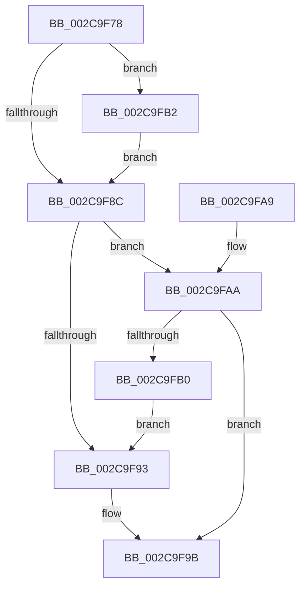

# MiZeroInParallel

- RVA: `0x002C9F78`–`0x002C9FBC` (길이 `68` bytes)
- VA: `0x00000001402C9F78`
- 실행 섹션: `.text`
- PDB 이름 있음: `예`; PDB Function 태그: `아니요`
- unwind 정보 RVA: `0x0006F13C`
- 디코드: `23`개 명령, `68/68` bytes 표시
- 미해석 바이트: `0` (있으면 어셈블리에 `.byte`로 보존)

> 이 문서는 커널 이미지의 기계어와 PDB 기호를 분석해 생성했습니다. 4번과 5번은 함수 원형과 자료형을 바이너리 사용 방식에서 추정한 C 해석이며 원본 소스 복구 결과는 아닙니다.

## 1. Dependencies

- 직접 호출 지점: **4**; 고유 호출 대상: **4**
- 직접 호출자로 확인된 함수: **3**
- RIP 상대 이미지 참조: **0**

### Outgoing calls
- `0x002C9F81` → [MiInitializeZeroGroup](MiInitializeZeroGroup_function_002CA00C.md) (function, `0x002CA00C`)
- `0x002C9F96` → [MiLaunchZeroParent](MiLaunchZeroParent_function_002CA5F8.md) (function, `0x002CA5F8`)
- `0x002C9F9E` → [MiWaitForZeroWorkers](MiWaitForZeroWorkers_function_002C9FC4.md) (function, `0x002C9FC4`)
- `0x002C9FB5` → [MiLaunchZeroWorkers](MiLaunchZeroWorkers_function_002CAF28.md) (function, `0x002CAF28`)

### Direct callers
- [MiChangePageAttributeAndZeroBatch](MiChangePageAttributeAndZeroBatch_function_002C98EC.md) at `0x002C9985`
- [MiProcessPageGroupInfo](../37/MiProcessPageGroupInfo_function_00376910.md) at `0x0037692E`
- [MiGroupZeroHugeRange](../68/MiGroupZeroHugeRange_function_0068C384.md) at `0x0068C45D`

### Static image references
- 디코드된 RIP-relative 메모리 참조가 없습니다.

## 2. Other-region calls and transfers

- 다른 실행 섹션으로 향하는 call: **0**
- 별도 외부 분기/꼬리 이동을 확인하지 못했습니다.

## 3. Assembly (complete function range)

```asm
002C9F78  40 53                           push rbx
002C9F7A  48 83 EC 20                     sub rsp, 0x20
002C9F7E  48 8B D9                        mov rbx, rcx
002C9F81  E8 86 00 00 00                  call 0x1402ca00c
002C9F86  83 7B 20 00                     cmp dword ptr [rbx + 0x20], 0
002C9F8A  75 26                           jne 0x1402c9fb2
002C9F8C  8B 43 10                        mov eax, dword ptr [rbx + 0x10]
002C9F8F  A8 40                           test al, 0x40
002C9F91  74 17                           je 0x1402c9faa
002C9F93  48 8B CB                        mov rcx, rbx
002C9F96  E8 5D 06 00 00                  call 0x1402ca5f8
002C9F9B  48 8B CB                        mov rcx, rbx
002C9F9E  E8 21 00 00 00                  call 0x1402c9fc4
002C9FA3  48 83 C4 20                     add rsp, 0x20
002C9FA7  5B                              pop rbx
002C9FA8  C3                              ret
002C9FA9  CC                              int3
002C9FAA  83 7B 20 00                     cmp dword ptr [rbx + 0x20], 0
002C9FAE  75 EB                           jne 0x1402c9f9b
002C9FB0  EB E1                           jmp 0x1402c9f93
002C9FB2  48 8B CB                        mov rcx, rbx
002C9FB5  E8 6E 0F 00 00                  call 0x1402caf28
002C9FBA  EB D0                           jmp 0x1402c9f8c
```

## 4. C-style interpretation (structured pseudocode)

```c
__int64 __fastcall MiZeroInParallel(__int64 a1)
{
    __int64 result;
    __int64 v_rsp;

    v_rsp = (v_rsp) - (32);
    result = MiInitializeZeroGroup(a1, a2, a3, a4);
    if ((*(unsigned int *)(a1 + 32)) != 0) goto loc_002C9FB2;
loc_002C9F8C:
    if ((((unsigned __int8)((unsigned int)(*(unsigned int *)(a1 + 16)))) & (64)) == 0) goto loc_002C9FAA;
loc_002C9F93:
    result = MiLaunchZeroParent(a1, a2, a3, a4);
loc_002C9F9B:
    result = MiWaitForZeroWorkers(a1, a2, a3, a4);
    v_rsp = (v_rsp) + (32);
    return result;
loc_002C9FAA:
    if ((*(unsigned int *)(a1 + 32)) != 0) goto loc_002C9F9B;
    goto loc_002C9F93;
loc_002C9FB2:
    result = MiLaunchZeroWorkers(a1, a2, a3, a4);
    goto loc_002C9F8C;
}
```

## 5. (Beta) C Style

```c
int64_t MiZeroInParallel(void *Arg1)
{
    uint8_t *arg1 = (uint8_t *)Arg1;

    int64_t result;
    int64_t local_rsp;

    local_rsp = (local_rsp) - (32);
    result = MiInitializeZeroGroup(Arg1, a2, a3, a4);
    if ((*(uint32_t *)(arg1 + 0x20)) != 0) goto loc_002C9FB2;
loc_002C9F8C:
    if ((((uint8_t)((uint32_t)(*(uint32_t *)(arg1 + 0x10)))) & (64)) == 0) goto loc_002C9FAA;
loc_002C9F93:
    result = MiLaunchZeroParent(Arg1, a2, a3, a4);
loc_002C9F9B:
    result = MiWaitForZeroWorkers(Arg1, a2, a3, a4);
    local_rsp = (local_rsp) + (32);
    return result;
loc_002C9FAA:
    if ((*(uint32_t *)(arg1 + 0x20)) != 0) goto loc_002C9F9B;
    goto loc_002C9F93;
loc_002C9FB2:
    result = MiLaunchZeroWorkers(Arg1, a2, a3, a4);
    goto loc_002C9F8C;
}
```

### 관측된 메모리 오프셋

구조체 형식이 확인되지 않은 접근은 인자 기준의 오프셋으로만 기록했습니다.

| 기준 인자 | 오프셋 표현 | 폭 (bit) | 접근 |
|---|---:|---:|---|
| `Arg1` | `+ 0x10` | `32` | `R` |
| `Arg1` | `+ 0x20` | `32` | `R` |

## 6. Execution-region graph

[열기: 2D/3D 그래프와 함수 탐색 컨트롤 패널](../../../control-panel.html?section=text&rva=0x002C9F78&view=graph)

- 2D 그래프는 위에서 아래로 흐르고, 3D 그래프는 빈 공간을 드래그해 회전합니다. Shift+드래그는 이동, 휠은 확대·축소, 함수 노드 선택은 대상 보고서 이동입니다.

### Static fallback


