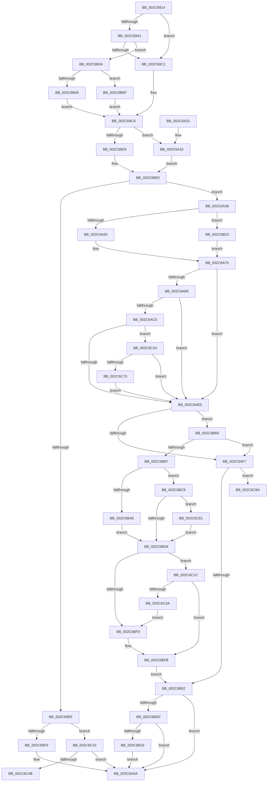

# MiZeroLargePage

- RVA: `0x002C6914`–`0x002C6C96` (길이 `898` bytes)
- VA: `0x00000001402C6914`
- 실행 섹션: `.text`
- PDB 이름 있음: `예`; PDB Function 태그: `예`
- unwind 정보 RVA: `0x0006EC60`
- 디코드: `220`개 명령, `898/898` bytes 표시
- 미해석 바이트: `0` (있으면 어셈블리에 `.byte`로 보존)

> 이 문서는 커널 이미지의 기계어와 PDB 기호를 분석해 생성했습니다. 4번과 5번은 함수 원형과 자료형을 바이너리 사용 방식에서 추정한 C 해석이며 원본 소스 복구 결과는 아닙니다.

## 1. Dependencies

- 직접 호출 지점: **15**; 고유 호출 대상: **13**
- 직접 호출자로 확인된 함수: **6**
- RIP 상대 이미지 참조: **6**

### Outgoing calls
- `0x002C695F` → [memset](../6C/memset_function_006C6C40.md) (function, `0x006C6C40`)
- `0x002C6A05` → [MiZeroWithUltraSpace](MiZeroWithUltraSpace_function_002C6C9C.md) (function, `0x002C6C9C`)
- `0x002C6A11` → [_security_check_cookie](../6A/_security_check_cookie_function_006AC640.md) (function, `0x006AC640`)
- `0x002C6A3C` → [MiPageToNode](../33/MiPageToNode_function_00338CD0.md) (function, `0x00338CD0`)
- `0x002C6A78` → [MiAssignDefaultChannel](../31/MiAssignDefaultChannel_function_0031E5B0.md) (function, `0x0031E5B0`)
- `0x002C6B19` → [MiDeleteAcceleratorDescriptor](MiDeleteAcceleratorDescriptor_function_002CA560.md) (function, `0x002CA560`)
- `0x002C6B78` → [MiCreateUltraThreadContext](../28/MiCreateUltraThreadContext_function_00288200.md) (function, `0x00288200`)
- `0x002C6B9B` → [MiGetUltraMapping](../32/MiGetUltraMapping_function_00323270.md) (function, `0x00323270`)
- `0x002C6BB6` → [MiGetUltraMapping](../32/MiGetUltraMapping_function_00323270.md) (function, `0x00323270`)
- `0x002C6BE2` → [MiWriteLargePte](MiWriteLargePte_function_002C6DE0.md) (function, `0x002C6DE0`)
- `0x002C6BF6` → [KeZeroPages](../6B/KeZeroPages_function_006BA070.md) (function, `0x006BA070`)
- `0x002C6C07` → [MiWriteLargePte](MiWriteLargePte_function_002C6DE0.md) (function, `0x002C6DE0`)
- `0x002C6C10` → [MiDeleteUltraThreadContext](../32/MiDeleteUltraThreadContext_function_00322C90.md) (function, `0x00322C90`)
- `0x002C6C31` → [AccelFillMemory](AccelFillMemory_function_002C7C7C.md) (function, `0x002C7C7C`)
- `0x002C6C64` → [MiAllocateAcceleratorDescriptor](../69/MiAllocateAcceleratorDescriptor_function_00697124.md) (function, `0x00697124`)

### Direct callers
- [MiGetPage](../28/MiGetPage_function_002884C0.md) at `0x002898D0`
- [MiZeroAndConvertPage](MiZeroAndConvertPage_function_002C8480.md) at `0x002C85F0`
- [MiGetLargePage](../31/MiGetLargePage_function_0031E210.md) at `0x0031E3F1`
- [MiZeroAndReleasePages](../37/MiZeroAndReleasePages_function_003748D0.md) at `0x00374CF1`
- [MiAllocateLargeProcessPagesFromCache](../69/MiAllocateLargeProcessPagesFromCache_function_0069818C.md) at `0x00698512`
- [MiAllocatePartitionPhysicalPages](../../page/80/MiAllocatePartitionPhysicalPages_function_0080C9D4.md) at `0x0080CD65`

### Static image references
- `0x002C6930` → RVA `0x00E0A740` (`.data`; read)
- `0x002C6989` → RVA `0x00000000` (`image boundary/outside`; read)
- `0x002C6990` → RVA `0x00E2DCE0` (`.data`; read)
- `0x002C6AB5` → RVA `0x00FC6A88` (`ALMOSTRO`; read)
- `0x002C6ACD` → RVA `0x00E2DBF8` (`.data`; read)
- `0x002C6C3A` → RVA `0x00EF508C` (`.data`; read/write)

## 2. Other-region calls and transfers

- 다른 실행 섹션으로 향하는 call: **0**
- call이 아닌 외부 분기/꼬리 이동: **2**
  - `0x002C6C4F` → [sub_006DC794](../6D/Unknown_function_006DC794.md) (`tail-transfer`)
  - `0x002C6C91` → [sub_006DC794 + 0x21](../6D/Unknown_function_006DC794.md) (`tail-transfer`)

## 3. Assembly (complete function range)

```asm
002C6914  48 89 5C 24 08                  mov qword ptr [rsp + 8], rbx
002C6919  55                              push rbp
002C691A  56                              push rsi
002C691B  57                              push rdi
002C691C  41 54                           push r12
002C691E  41 55                           push r13
002C6920  41 56                           push r14
002C6922  41 57                           push r15
002C6924  48 8D 6C 24 E1                  lea rbp, [rsp - 0x1f]
002C6929  48 81 EC F0 00 00 00            sub rsp, 0xf0
002C6930  48 8B 05 09 3E B4 00            mov rax, qword ptr [rip + 0xb43e09]
002C6937  48 33 C4                        xor rax, rsp
002C693A  48 89 45 0F                     mov qword ptr [rbp + 0xf], rax
002C693E  45 8B E0                        mov r12d, r8d
002C6941  4C 8B FA                        mov r15, rdx
002C6944  48 89 4C 24 40                  mov qword ptr [rsp + 0x40], rcx
002C6949  33 C0                           xor eax, eax
002C694B  33 D2                           xor edx, edx
002C694D  89 45 83                        mov dword ptr [rbp - 0x7d], eax
002C6950  41 B8 80 00 00 00               mov r8d, 0x80
002C6956  44 89 4C 24 30                  mov dword ptr [rsp + 0x30], r9d
002C695B  48 8D 4D 8F                     lea rcx, [rbp - 0x71]
002C695F  E8 DC 02 40 00                  call 0x1406c6c40
002C6964  48 B8 00 00 00 00 00 DE FF FF   movabs rax, 0xffffde0000000000
002C696E  4D 8B F7                        mov r14, r15
002C6971  45 8B EC                        mov r13d, r12d
002C6974  4C 2B F0                        sub r14, rax
002C6977  48 B8 AB AA AA AA AA AA AA AA   movabs rax, 0xaaaaaaaaaaaaaaab
002C6981  49 C1 FE 04                     sar r14, 4
002C6985  4C 0F AF F0                     imul r14, rax
002C6989  48 8D 05 70 96 D3 FF            lea rax, [rip - 0x2c6990]
002C6990  4C 3B 35 49 73 B6 00            cmp r14, qword ptr [rip + 0xb67349]
002C6997  4A 8B BC E0 60 1C 01 00         mov rdi, qword ptr [rax + r12*8 + 0x11c60]
002C699F  77 20                           ja 0x1402c69c1
002C69A1  4B 8D 04 76                     lea rax, [r14 + r14*2]
002C69A5  48 03 C0                        add rax, rax
002C69A8  48 B9 28 00 00 00 00 DE FF FF   movabs rcx, 0xffffde0000000028
002C69B2  48 8B 04 C1                     mov rax, qword ptr [rcx + rax*8]
002C69B6  48 0F BA E0 36                  bt rax, 0x36
002C69BB  0F 82 73 01 00 00               jb 0x1402c6b34
002C69C1  41 B9 04 00 00 00               mov r9d, 4
002C69C7  41 8B D9                        mov ebx, r9d
002C69CA  33 D2                           xor edx, edx
002C69CC  44 8D 42 02                     lea r8d, [rdx + 2]
002C69D0  45 85 E4                        test r12d, r12d
002C69D3  74 5D                           je 0x1402c6a32
002C69D5  41 83 FC 01                     cmp r12d, 1
002C69D9  41 8B F1                        mov esi, r9d
002C69DC  41 0F 44 F0                     cmove esi, r8d
002C69E0  39 55 7F                        cmp dword ptr [rbp + 0x7f], edx
002C69E3  74 54                           je 0x1402c6a39
002C69E5  65 48 8B 04 25 20 00 00 00      mov rax, qword ptr gs:[0x20]
002C69EE  48 8B 88 38 88 00 00            mov rcx, qword ptr [rax + 0x8838]
002C69F5  48 85 C9                        test rcx, rcx
002C69F8  0F 84 44 02 00 00               je 0x1402c6c42
002C69FE  48 83 C1 08                     add rcx, 8
002C6A02  4D 8B C7                        mov r8, r15
002C6A05  E8 92 02 00 00                  call 0x1402c6c9c
002C6A0A  48 8B 4D 0F                     mov rcx, qword ptr [rbp + 0xf]
002C6A0E  48 33 CC                        xor rcx, rsp
002C6A11  E8 2A 5C 3E 00                  call 0x1406ac640
002C6A16  48 8B 9C 24 30 01 00 00         mov rbx, qword ptr [rsp + 0x130]
002C6A1E  48 81 C4 F0 00 00 00            add rsp, 0xf0
002C6A25  41 5F                           pop r15
002C6A27  41 5E                           pop r14
002C6A29  41 5D                           pop r13
002C6A2B  41 5C                           pop r12
002C6A2D  5F                              pop rdi
002C6A2E  5E                              pop rsi
002C6A2F  5D                              pop rbp
002C6A30  C3                              ret
002C6A31  CC                              int3
002C6A32  BE 01 00 00 00                  mov esi, 1
002C6A37  EB A7                           jmp 0x1402c69e0
002C6A39  49 8B CE                        mov rcx, r14
002C6A3C  E8 8F 22 07 00                  call 0x140338cd0
002C6A41  44 8B D0                        mov r10d, eax
002C6A44  41 8D 4A 01                     lea ecx, [r10 + 1]
002C6A48  85 C9                           test ecx, ecx
002C6A4A  0F 85 D3 00 00 00               jne 0x1402c6b23
002C6A50  65 48 8B 04 25 88 01 00 00      mov rax, qword ptr gs:[0x188]
002C6A59  4C 8D 1D A0 95 D3 FF            lea r11, [rip - 0x2c6a60]
002C6A60  8B 88 4C 02 00 00               mov ecx, dword ptr [rax + 0x24c]
002C6A66  4D 8B 9C CB 40 8C FC 00         mov r11, qword ptr [r11 + rcx*8 + 0xfc8c40]
002C6A6E  45 8B 8B 54 87 00 00            mov r9d, dword ptr [r11 + 0x8754]
002C6A75  41 8B C9                        mov ecx, r9d
002C6A78  E8 33 7B 05 00                  call 0x14031e5b0
002C6A7D  41 83 E1 3F                     and r9d, 0x3f
002C6A81  0F B6 C0                        movzx eax, al
002C6A84  41 81 C9 80 03 00 00            or r9d, 0x380
002C6A8B  83 E0 01                        and eax, 1
002C6A8E  45 03 C9                        add r9d, r9d
002C6A91  33 D2                           xor edx, edx
002C6A93  44 0B C8                        or r9d, eax
002C6A96  44 8B FA                        mov r15d, edx
002C6A99  41 C1 E1 08                     shl r9d, 8
002C6A9D  49 8D 83 50 87 00 00            lea rax, [r11 + 0x8750]
002C6AA4  44 89 4C 24 50                  mov dword ptr [rsp + 0x50], r9d
002C6AA9  48 89 44 24 48                  mov qword ptr [rsp + 0x48], rax
002C6AAE  48 39 54 24 40                  cmp qword ptr [rsp + 0x40], rdx
002C6AB3  75 30                           jne 0x1402c6ae5
002C6AB5  48 0F BA 25 CA FF CF 00 26      bt qword ptr [rip + 0xcfffca], 0x26
002C6ABE  73 25                           jae 0x1402c6ae5
002C6AC0  4B 8D 04 52                     lea rax, [r10 + r10*2]
002C6AC4  48 89 54 24 38                  mov qword ptr [rsp + 0x38], rdx
002C6AC9  48 C1 E0 07                     shl rax, 7
002C6ACD  48 03 05 24 71 B6 00            add rax, qword ptr [rip + 0xb67124]
002C6AD4  48 8B 80 78 01 00 00            mov rax, qword ptr [rax + 0x178]
002C6ADB  66 39 50 18                     cmp word ptr [rax + 0x18], dx
002C6ADF  0F 85 6F 01 00 00               jne 0x1402c6c54
002C6AE5  65 48 8B 04 25 20 00 00 00      mov rax, qword ptr gs:[0x20]
002C6AEE  48 39 90 38 88 00 00            cmp qword ptr [rax + 0x8838], rdx
002C6AF5  75 72                           jne 0x1402c6b69
002C6AF7  8B DA                           mov ebx, edx
002C6AF9  48 85 FF                        test rdi, rdi
002C6AFC  0F 85 88 01 00 00               jne 0x1402c6c8a
002C6B02  48 39 54 24 40                  cmp qword ptr [rsp + 0x40], rdx
002C6B07  0F 85 FD FE FF FF               jne 0x1402c6a0a
002C6B0D  4D 85 FF                        test r15, r15
002C6B10  0F 84 F4 FE FF FF               je 0x1402c6a0a
002C6B16  49 8B CF                        mov rcx, r15
002C6B19  E8 42 3A 00 00                  call 0x1402ca560
002C6B1E  E9 E7 FE FF FF                  jmp 0x1402c6a0a
002C6B23  65 4C 8B 1C 25 20 00 00 00      mov r11, qword ptr gs:[0x20]
002C6B2C  45 8B CA                        mov r9d, r10d
002C6B2F  E9 41 FF FF FF                  jmp 0x1402c6a75
002C6B34  41 8B 47 20                     mov eax, dword ptr [r15 + 0x20]
002C6B38  41 B9 04 00 00 00               mov r9d, 4
002C6B3E  C1 E8 10                        shr eax, 0x10
002C6B41  3C 40                           cmp al, 0x40
002C6B43  72 1A                           jb 0x1402c6b5f
002C6B45  41 8B 47 20                     mov eax, dword ptr [r15 + 0x20]
002C6B49  41 8D 49 18                     lea ecx, [r9 + 0x18]
002C6B4D  C1 E8 10                        shr eax, 0x10
002C6B50  41 8B D9                        mov ebx, r9d
002C6B53  24 C0                           and al, 0xc0
002C6B55  3C 80                           cmp al, 0x80
002C6B57  0F 44 D9                        cmove ebx, ecx
002C6B5A  E9 6B FE FF FF                  jmp 0x1402c69ca
002C6B5F  BB 0C 00 00 00                  mov ebx, 0xc
002C6B64  E9 61 FE FF FF                  jmp 0x1402c69ca
002C6B69  45 33 C9                        xor r9d, r9d
002C6B6C  48 8D 54 24 48                  lea rdx, [rsp + 0x48]
002C6B71  44 8B C6                        mov r8d, esi
002C6B74  48 8D 4D 8F                     lea rcx, [rbp - 0x71]
002C6B78  E8 83 16 FC FF                  call 0x140288200
002C6B7D  33 D2                           xor edx, edx
002C6B7F  85 C0                           test eax, eax
002C6B81  0F 84 70 FF FF FF               je 0x1402c6af7
002C6B87  49 C1 E5 05                     shl r13, 5
002C6B8B  48 8D 4D 8F                     lea rcx, [rbp - 0x71]
002C6B8F  49 03 CD                        add rcx, r13
002C6B92  45 33 C9                        xor r9d, r9d
002C6B95  4C 8B C7                        mov r8, rdi
002C6B98  41 8B D4                        mov edx, r12d
002C6B9B  E8 D0 C6 05 00                  call 0x140323270
002C6BA0  48 8B F0                        mov rsi, rax
002C6BA3  41 83 FC 02                     cmp r12d, 2
002C6BA7  75 1D                           jne 0x1402c6bc6
002C6BA9  45 33 C9                        xor r9d, r9d
002C6BAC  48 8D 4D CF                     lea rcx, [rbp - 0x31]
002C6BB0  4C 8B C7                        mov r8, rdi
002C6BB3  41 8B D4                        mov edx, r12d
002C6BB6  E8 B5 C6 05 00                  call 0x140323270
002C6BBB  48 8B F0                        mov rsi, rax
002C6BBE  81 CB 00 00 00 A0               or ebx, 0xa0000000
002C6BC4  EB 10                           jmp 0x1402c6bd6
002C6BC6  81 CB 00 00 00 A0               or ebx, 0xa0000000
002C6BCC  41 83 FC 01                     cmp r12d, 1
002C6BD0  0F 86 AB 00 00 00               jbe 0x1402c6c81
002C6BD6  44 8B CB                        mov r9d, ebx
002C6BD9  45 8B C4                        mov r8d, r12d
002C6BDC  49 8B D6                        mov rdx, r14
002C6BDF  48 8B CE                        mov rcx, rsi
002C6BE2  E8 F9 01 00 00                  call 0x1402c6de0
002C6BE7  48 C1 E7 0C                     shl rdi, 0xc
002C6BEB  4D 85 FF                        test r15, r15
002C6BEE  75 2C                           jne 0x1402c6c1c
002C6BF0  48 8B D7                        mov rdx, rdi
002C6BF3  48 8B CE                        mov rcx, rsi
002C6BF6  E8 75 34 3F 00                  call 0x1406ba070
002C6BFB  45 33 C9                        xor r9d, r9d
002C6BFE  45 8B C4                        mov r8d, r12d
002C6C01  49 8B D6                        mov rdx, r14
002C6C04  48 8B CE                        mov rcx, rsi
002C6C07  E8 D4 01 00 00                  call 0x1402c6de0
002C6C0C  48 8D 4D 8F                     lea rcx, [rbp - 0x71]
002C6C10  E8 7B C0 05 00                  call 0x140322c90
002C6C15  33 D2                           xor edx, edx
002C6C17  E9 E6 FE FF FF                  jmp 0x1402c6b02
002C6C1C  45 33 C9                        xor r9d, r9d
002C6C1F  48 C7 44 24 20 03 00 00 00      mov qword ptr [rsp + 0x20], 3
002C6C28  4C 8B C7                        mov r8, rdi
002C6C2B  48 8B D6                        mov rdx, rsi
002C6C2E  49 8B CF                        mov rcx, r15
002C6C31  E8 46 10 00 00                  call 0x1402c7c7c
002C6C36  85 C0                           test eax, eax
002C6C38  79 C1                           jns 0x1402c6bfb
002C6C3A  FF 05 4C E4 C2 00               inc dword ptr [rip + 0xc2e44c]
002C6C40  EB AE                           jmp 0x1402c6bf0
002C6C42  48 85 FF                        test rdi, rdi
002C6C45  0F 84 BF FD FF FF               je 0x1402c6a0a
002C6C4B  8B 74 24 30                     mov esi, dword ptr [rsp + 0x30]
002C6C4F  E9 40 5B 41 00                  jmp 0x1406dc794
002C6C54  4C 8D 4C 24 38                  lea r9, [rsp + 0x38]
002C6C59  41 B8 01 00 00 00               mov r8d, 1
002C6C5F  41 8B D2                        mov edx, r10d
002C6C62  33 C9                           xor ecx, ecx
002C6C64  E8 BB 04 3D 00                  call 0x140697124
002C6C69  33 D2                           xor edx, edx
002C6C6B  85 C0                           test eax, eax
002C6C6D  0F 84 72 FE FF FF               je 0x1402c6ae5
002C6C73  4C 8B 7C 24 38                  mov r15, qword ptr [rsp + 0x38]
002C6C78  49 83 C7 20                     add r15, 0x20
002C6C7C  E9 64 FE FF FF                  jmp 0x1402c6ae5
002C6C81  0F BA EB 1A                     bts ebx, 0x1a
002C6C85  E9 4C FF FF FF                  jmp 0x1402c6bd6
002C6C8A  8B 74 24 30                     mov esi, dword ptr [rsp + 0x30]
002C6C8E  48 8B C2                        mov rax, rdx
002C6C91  E9 1F 5B 41 00                  jmp 0x1406dc7b5
```

## 4. C-style interpretation (structured pseudocode)

```c
__int64 __fastcall MiZeroLargePage(__int64 a1, __int64 a2, int a3, int a4, unsigned int a5)
{
    __int64 result;
    __int64 v_r13;
    __int64 v_r14;
    __int64 v_r15;
    __int64 v_rbx;
    __int64 v_rdi;
    __int64 v_rsi;
    __int64 v_rsp;
    unsigned __int64 v_stack_m48;
    unsigned __int64 v_stack_m57;
    unsigned __int64 v_stack_m88;
    unsigned __int64 v_stack_mC8;
    unsigned int v_stack_mD4;
    unsigned __int64 v_stack_mE8;
    unsigned int v_stack_mF8;
    unsigned __int64 v_stack_p20;
    unsigned int v_stack_p30;
    unsigned __int64 v_stack_p38;
    unsigned __int64 v_stack_p40;
    unsigned __int64 v_stack_p48;
    unsigned int v_stack_p50;
    unsigned __int64 v_stack_p8;

    v_stack_p8 = v_rbx;
    v_rsp = (v_rsp) - (240);
    result = (*(unsigned __int64 *)(v_rip + 11812361)) ^ (v_rsp);
    v_stack_m48 = result;
    v_stack_mE8 = a1;
    result = 0;
    a2 = 0;
    v_stack_mD4 = 0;
    v_stack_mF8 = a4;
    result = memset(v_stack_mC8, a2, 128, a4);
    v_r14 = (0) - (result);
    v_r14 = (v_r14) >> (4);
    v_r14 = (v_r14) * (result);
    if (v_r14 > (*(unsigned __int64 *)(v_rip + 11957065))) goto loc_002C69C1;
    result = (v_r14 + v_r14 * 2) + (v_r14 + v_r14 * 2);
    if (condition_is_below) goto loc_002C6B34;
loc_002C69C1:
loc_002C69CA:
    a2 = 0;
    if ((unsigned int)((unsigned int)(a3)) == 0) goto loc_002C6A32;
    v_rsi = 4;
    if (((unsigned int)((unsigned int)(a3))) == 1) { v_rsi = (unsigned int)(a2 + 2); }
loc_002C69E0:
    if (a5 == 0) goto loc_002C6A39;
    if (*(unsigned __int64 *)(*(unsigned __int64 *)(gs_base + (0 + 32)) + 34872) == 0) goto loc_002C6C42;
    a1 = (*(unsigned __int64 *)(*(unsigned __int64 *)(gs_base + (0 + 32)) + 34872)) + (8);
    result = MiZeroWithUltraSpace(a1, a2, 0, 4);
loc_002C6A0A:
    a1 = (v_stack_m48) ^ (v_rsp);
    result = _security_check_cookie(a1, a2, 0, 4);
    v_rsp = (v_rsp) + (240);
    return result;
loc_002C6A32:
    goto loc_002C69E0;
loc_002C6A39:
    result = MiPageToNode(v_r14, a2, 0, 4);
    if ((unsigned int)((unsigned int)((unsigned int)(result)) + 1) != 0) goto loc_002C6B23;
loc_002C6A75:
    result = MiAssignDefaultChannel((unsigned int)((unsigned int)((unsigned int)(*(unsigned int *)(*(unsigned __int64 *)(v_rip - 2910816 + (unsigned int)(*(unsigned int *)(*(unsigned __int64 *)(gs_base + (0 + 392)) + 588)) * 8 + 16550976) + 34644)))), a2, 0, (unsigned int)(*(unsigned int *)(*(unsigned __int64 *)(v_rip - 2910816 + (unsigned int)(*(unsigned int *)(*(unsigned __int64 *)(gs_base + (0 + 392)) + 588)) * 8 + 16550976) + 34644)));
    a4 = (unsigned int)(((unsigned int)(*(unsigned int *)(*(unsigned __int64 *)(v_rip - 2910816 + (unsigned int)(*(unsigned int *)(*(unsigned __int64 *)(gs_base + (0 + 392)) + 588)) * 8 + 16550976) + 34644))) & (63));
    a4 = (unsigned int)((a4) | (896));
    result = (unsigned int)(((unsigned __int8)(result)) & (1));
    a4 = (unsigned int)((a4) + (a4));
    a2 = 0;
    a4 = (unsigned int)((a4) | ((unsigned int)(result)));
    a4 = (unsigned int)((a4) << (8));
    v_stack_p50 = a4;
    v_stack_p48 = *(unsigned __int64 *)(v_rip - 2910816 + (unsigned int)(*(unsigned int *)(*(unsigned __int64 *)(gs_base + (0 + 392)) + 588)) * 8 + 16550976) + 34640;
    if (v_stack_p40 != 0) goto loc_002C6AE5;
    if (v_stack_p40 >= 0) goto loc_002C6AE5;
    v_stack_p38 = 0;
    result = ((unsigned int)((unsigned int)(result)) + (unsigned int)((unsigned int)(result)) * 2) << (7);
    result = (result) + (*(unsigned __int64 *)(v_rip + 11956516));
    if ((*(unsigned __int16 *)(*(unsigned __int64 *)(result + 376) + 24)) != 0) goto loc_002C6C54;
loc_002C6AE5:
    if ((*(unsigned __int64 *)(*(unsigned __int64 *)(gs_base + (0 + 32)) + 34872)) != 0) goto loc_002C6B69;
loc_002C6AF7:
    if (*(unsigned __int64 *)(v_rip - 2910608 + (unsigned int)(a3) * 8 + 72800) != 0) goto loc_002C6C8A;
loc_002C6B02:
    if (v_stack_p40 != 0) goto loc_002C6A0A;
    if (0 == 0) goto loc_002C6A0A;
    result = MiDeleteAcceleratorDescriptor(0, a2, 0, a4);
    goto loc_002C6A0A;
loc_002C6B23:
    goto loc_002C6A75;
loc_002C6B34:
    result = (unsigned int)(((unsigned int)(*(unsigned int *)(0 + 32))) >> (16));
    if (((unsigned __int8)(result)) < 64) goto loc_002C6B5F;
    result = (unsigned int)(((unsigned int)(*(unsigned int *)(0 + 32))) >> (16));
    result = (unsigned __int8)((result) & (192));
    v_rbx = 4;
    if (((unsigned __int8)(result)) == 128) { v_rbx = (unsigned int)(4 + 24); }
    goto loc_002C69CA;
loc_002C6B5F:
    goto loc_002C69CA;
loc_002C6B69:
    a4 = 0;
    result = MiCreateUltraThreadContext(v_stack_mC8, v_stack_p48, 1, a4);
    a2 = 0;
    if ((unsigned int)(result) == 0) goto loc_002C6AF7;
    v_r13 = ((unsigned int)((unsigned int)((unsigned int)(a3)))) << (5);
    a1 = (v_stack_mC8) + (v_r13);
    a4 = 0;
    result = MiGetUltraMapping(a1, (unsigned int)((unsigned int)((unsigned int)(a3))), *(unsigned __int64 *)(v_rip - 2910608 + (unsigned int)(a3) * 8 + 72800), a4);
    if (((unsigned int)((unsigned int)(a3))) != 2) goto loc_002C6BC6;
    a4 = 0;
    result = MiGetUltraMapping(v_stack_m88, (unsigned int)((unsigned int)((unsigned int)(a3))), *(unsigned __int64 *)(v_rip - 2910608 + (unsigned int)(a3) * 8 + 72800), a4);
    v_rbx = (unsigned int)((12) | (0xA0000000ULL));
    goto loc_002C6BD6;
loc_002C6BC6:
    v_rbx = (unsigned int)((v_rbx) | (0xA0000000ULL));
    if (((unsigned int)((unsigned int)(a3))) <= 1) goto loc_002C6C81;
loc_002C6BD6:
    result = MiWriteLargePte(result, v_r14, (unsigned int)((unsigned int)((unsigned int)(a3))), (unsigned int)((unsigned int)(v_rbx)));
    v_rdi = (*(unsigned __int64 *)(v_rip - 2910608 + (unsigned int)(a3) * 8 + 72800)) << (12);
    if (0 != 0) goto loc_002C6C1C;
loc_002C6BF0:
    result = KeZeroPages(result, v_rdi, (unsigned int)((unsigned int)((unsigned int)(a3))), (unsigned int)((unsigned int)(v_rbx)));
loc_002C6BFB:
    a4 = 0;
    result = MiWriteLargePte(result, v_r14, (unsigned int)((unsigned int)((unsigned int)(a3))), a4);
    result = MiDeleteUltraThreadContext(v_stack_mC8, v_r14, (unsigned int)((unsigned int)((unsigned int)(a3))), a4);
    a2 = 0;
    goto loc_002C6B02;
loc_002C6C1C:
    a4 = 0;
    v_stack_p20 = 3;
    result = AccelFillMemory(0, result, v_rdi, a4);
    if (!sign_flag) goto loc_002C6BFB;
    goto loc_002C6BF0;
loc_002C6C42:
    if (v_rdi == 0) goto loc_002C6A0A;
loc_002C6C54:
    a1 = 0;
    result = MiAllocateAcceleratorDescriptor(a1, (unsigned int)((unsigned int)((unsigned int)((unsigned int)(result)))), 1, v_stack_p38);
    a2 = 0;
    if ((unsigned int)(result) == 0) goto loc_002C6AE5;
    v_r15 = (v_stack_p38) + (32);
    goto loc_002C6AE5;
loc_002C6C81:
    goto loc_002C6BD6;
loc_002C6C8A:
}
```

## 5. (Beta) C Style

```c
int64_t MiZeroLargePage(int64_t Arg1, void *Arg2, int32_t Arg3, int32_t Arg4, uint32_t Arg5)
{
    uint8_t *arg2 = (uint8_t *)Arg2;

    int64_t result;
    int64_t local_r13;
    int64_t local_r14;
    int64_t local_r15;
    int64_t local_rbx;
    int64_t local_rdi;
    int64_t local_rsi;
    int64_t local_rsp;
    uint64_t v_stack_m48;
    uint64_t v_stack_m57;
    uint64_t v_stack_m88;
    uint64_t v_stack_mC8;
    uint32_t v_stack_mD4;
    uint64_t v_stack_mE8;
    uint32_t v_stack_mF8;
    uint64_t v_stack_p20;
    uint32_t v_stack_p30;
    uint64_t v_stack_p38;
    uint64_t v_stack_p40;
    uint64_t v_stack_p48;
    uint32_t v_stack_p50;
    uint64_t v_stack_p8;

    v_stack_p8 = local_rbx;
    local_rsp = (local_rsp) - (240);
    result = (*(uint64_t *)(v_rip + 0xB43E09)) ^ (local_rsp);
    v_stack_m48 = result;
    v_stack_mE8 = Arg1;
    result = 0;
    Arg2 = 0;
    v_stack_mD4 = 0;
    v_stack_mF8 = Arg4;
    result = memset(v_stack_mC8, Arg2, 128, Arg4);
    local_r14 = (0) - (result);
    local_r14 = (local_r14) >> (4);
    local_r14 = (local_r14) * (result);
    if (local_r14 > (*(uint64_t *)(v_rip + 0xB67349))) goto loc_002C69C1;
    result = (local_r14 + local_r14 * 2) + (local_r14 + local_r14 * 2);
    if (condition_is_below) goto loc_002C6B34;
loc_002C69C1:
loc_002C69CA:
    Arg2 = 0;
    if ((uint32_t)((uint32_t)(Arg3)) == 0) goto loc_002C6A32;
    local_rsi = 4;
    if (((uint32_t)((uint32_t)(Arg3))) == 1) { local_rsi = (uint32_t)(Arg2 + 2); }
loc_002C69E0:
    if (Arg5 == 0) goto loc_002C6A39;
    if (*(uint64_t *)(*(uint64_t *)(gs_base + (0 + 0x20)) + 0x8838) == 0) goto loc_002C6C42;
    Arg1 = (*(uint64_t *)(*(uint64_t *)(gs_base + (0 + 0x20)) + 0x8838)) + (8);
    result = MiZeroWithUltraSpace(Arg1, Arg2, 0, 4);
loc_002C6A0A:
    Arg1 = (v_stack_m48) ^ (local_rsp);
    result = _security_check_cookie(Arg1, Arg2, 0, 4);
    local_rsp = (local_rsp) + (240);
    return result;
loc_002C6A32:
    goto loc_002C69E0;
loc_002C6A39:
    result = MiPageToNode(local_r14, Arg2, 0, 4);
    if ((uint32_t)((uint32_t)((uint32_t)(result)) + 1) != 0) goto loc_002C6B23;
loc_002C6A75:
    result = MiAssignDefaultChannel((uint32_t)((uint32_t)((uint32_t)(*(uint32_t *)(*(uint64_t *)(v_rip - 0x2C6A60 + (uint32_t)(*(uint32_t *)(*(uint64_t *)(gs_base + (0 + 0x188)) + 0x24C)) * 8 + 0xFC8C40) + 0x8754)))), Arg2, 0, (uint32_t)(*(uint32_t *)(*(uint64_t *)(v_rip - 0x2C6A60 + (uint32_t)(*(uint32_t *)(*(uint64_t *)(gs_base + (0 + 0x188)) + 0x24C)) * 8 + 0xFC8C40) + 0x8754)));
    Arg4 = (uint32_t)(((uint32_t)(*(uint32_t *)(*(uint64_t *)(v_rip - 0x2C6A60 + (uint32_t)(*(uint32_t *)(*(uint64_t *)(gs_base + (0 + 0x188)) + 0x24C)) * 8 + 0xFC8C40) + 0x8754))) & (63));
    Arg4 = (uint32_t)((Arg4) | (896));
    result = (uint32_t)(((uint8_t)(result)) & (1));
    Arg4 = (uint32_t)((Arg4) + (Arg4));
    Arg2 = 0;
    Arg4 = (uint32_t)((Arg4) | ((uint32_t)(result)));
    Arg4 = (uint32_t)((Arg4) << (8));
    v_stack_p50 = Arg4;
    v_stack_p48 = *(uint64_t *)(v_rip - 0x2C6A60 + (uint32_t)(*(uint32_t *)(*(uint64_t *)(gs_base + (0 + 0x188)) + 0x24C)) * 8 + 0xFC8C40) + 34640;
    if (v_stack_p40 != 0) goto loc_002C6AE5;
    if (v_stack_p40 >= 0) goto loc_002C6AE5;
    v_stack_p38 = 0;
    result = ((uint32_t)((uint32_t)(result)) + (uint32_t)((uint32_t)(result)) * 2) << (7);
    result = (result) + (*(uint64_t *)(v_rip + 0xB67124));
    if ((*(uint16_t *)(*(uint64_t *)(result + 0x178) + 0x18)) != 0) goto loc_002C6C54;
loc_002C6AE5:
    if ((*(uint64_t *)(*(uint64_t *)(gs_base + (0 + 0x20)) + 0x8838)) != 0) goto loc_002C6B69;
loc_002C6AF7:
    if (*(uint64_t *)(v_rip - 0x2C6990 + (uint32_t)(Arg3) * 8 + 0x11C60) != 0) goto loc_002C6C8A;
loc_002C6B02:
    if (v_stack_p40 != 0) goto loc_002C6A0A;
    if (0 == 0) goto loc_002C6A0A;
    result = MiDeleteAcceleratorDescriptor(0, Arg2, 0, Arg4);
    goto loc_002C6A0A;
loc_002C6B23:
    goto loc_002C6A75;
loc_002C6B34:
    result = (uint32_t)(((uint32_t)(*(uint32_t *)(0 + 0x20))) >> (16));
    if (((uint8_t)(result)) < 64) goto loc_002C6B5F;
    result = (uint32_t)(((uint32_t)(*(uint32_t *)(0 + 0x20))) >> (16));
    result = (uint8_t)((result) & (192));
    local_rbx = 4;
    if (((uint8_t)(result)) == 128) { local_rbx = (uint32_t)(4 + 24); }
    goto loc_002C69CA;
loc_002C6B5F:
    goto loc_002C69CA;
loc_002C6B69:
    Arg4 = 0;
    result = MiCreateUltraThreadContext(v_stack_mC8, v_stack_p48, 1, Arg4);
    Arg2 = 0;
    if ((uint32_t)(result) == 0) goto loc_002C6AF7;
    local_r13 = ((uint32_t)((uint32_t)((uint32_t)(Arg3)))) << (5);
    Arg1 = (v_stack_mC8) + (local_r13);
    Arg4 = 0;
    result = MiGetUltraMapping(Arg1, (uint32_t)((uint32_t)((uint32_t)(Arg3))), *(uint64_t *)(v_rip - 0x2C6990 + (uint32_t)(Arg3) * 8 + 0x11C60), Arg4);
    if (((uint32_t)((uint32_t)(Arg3))) != 2) goto loc_002C6BC6;
    Arg4 = 0;
    result = MiGetUltraMapping(v_stack_m88, (uint32_t)((uint32_t)((uint32_t)(Arg3))), *(uint64_t *)(v_rip - 0x2C6990 + (uint32_t)(Arg3) * 8 + 0x11C60), Arg4);
    local_rbx = (uint32_t)((12) | (0xA0000000ULL));
    goto loc_002C6BD6;
loc_002C6BC6:
    local_rbx = (uint32_t)((local_rbx) | (0xA0000000ULL));
    if (((uint32_t)((uint32_t)(Arg3))) <= 1) goto loc_002C6C81;
loc_002C6BD6:
    result = MiWriteLargePte(result, local_r14, (uint32_t)((uint32_t)((uint32_t)(Arg3))), (uint32_t)((uint32_t)(local_rbx)));
    local_rdi = (*(uint64_t *)(v_rip - 0x2C6990 + (uint32_t)(Arg3) * 8 + 0x11C60)) << (12);
    if (0 != 0) goto loc_002C6C1C;
loc_002C6BF0:
    result = KeZeroPages(result, local_rdi, (uint32_t)((uint32_t)((uint32_t)(Arg3))), (uint32_t)((uint32_t)(local_rbx)));
loc_002C6BFB:
    Arg4 = 0;
    result = MiWriteLargePte(result, local_r14, (uint32_t)((uint32_t)((uint32_t)(Arg3))), Arg4);
    result = MiDeleteUltraThreadContext(v_stack_mC8, local_r14, (uint32_t)((uint32_t)((uint32_t)(Arg3))), Arg4);
    Arg2 = 0;
    goto loc_002C6B02;
loc_002C6C1C:
    Arg4 = 0;
    v_stack_p20 = 3;
    result = AccelFillMemory(0, result, local_rdi, Arg4);
    if (!sign_flag) goto loc_002C6BFB;
    goto loc_002C6BF0;
loc_002C6C42:
    if (local_rdi == 0) goto loc_002C6A0A;
loc_002C6C54:
    Arg1 = 0;
    result = MiAllocateAcceleratorDescriptor(Arg1, (uint32_t)((uint32_t)((uint32_t)((uint32_t)(result)))), 1, v_stack_p38);
    Arg2 = 0;
    if ((uint32_t)(result) == 0) goto loc_002C6AE5;
    local_r15 = (v_stack_p38) + (32);
    goto loc_002C6AE5;
loc_002C6C81:
    goto loc_002C6BD6;
loc_002C6C8A:
}
```

### 관측된 메모리 오프셋

구조체 형식이 확인되지 않은 접근은 인자 기준의 오프셋으로만 기록했습니다.

| 기준 인자 | 오프셋 표현 | 폭 (bit) | 접근 |
|---|---:|---:|---|
| `Arg2` | `+ 0x20` | `32` | `R` |

## 6. Execution-region graph

[열기: 2D/3D 그래프와 함수 탐색 컨트롤 패널](../../../control-panel.html?section=text&rva=0x002C6914&view=graph)

- 2D 그래프는 위에서 아래로 흐르고, 3D 그래프는 빈 공간을 드래그해 회전합니다. Shift+드래그는 이동, 휠은 확대·축소, 함수 노드 선택은 대상 보고서 이동입니다.

### Static fallback


