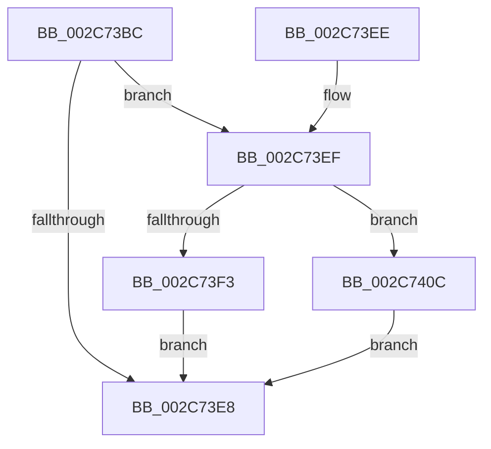

# MiZeroMoveToProcessor

- RVA: `0x002C73BC`–`0x002C741A` (길이 `94` bytes)
- VA: `0x00000001402C73BC`
- 실행 섹션: `.text`
- PDB 이름 있음: `예`; PDB Function 태그: `아니요`
- unwind 정보 RVA: `0x0006EDA8`
- 디코드: `28`개 명령, `94/94` bytes 표시
- 미해석 바이트: `0` (있으면 어셈블리에 `.byte`로 보존)

> 이 문서는 커널 이미지의 기계어와 PDB 기호를 분석해 생성했습니다. 4번과 5번은 함수 원형과 자료형을 바이너리 사용 방식에서 추정한 C 해석이며 원본 소스 복구 결과는 아닙니다.

## 1. Dependencies

- 직접 호출 지점: **1**; 고유 호출 대상: **1**
- 직접 호출자로 확인된 함수: **2**
- RIP 상대 이미지 참조: **0**

### Outgoing calls
- `0x002C7402` → [MiSetIdealProcessorThread](MiSetIdealProcessorThread_function_002C760C.md) (function, `0x002C760C`)

### Direct callers
- [MiZeroInParallelWorker](MiZeroInParallelWorker_function_002C6600.md) at `0x002C66F3`
- [MiZeroHugeRangeWorker](../68/MiZeroHugeRangeWorker_function_0068C960.md) at `0x0068C990`

### Static image references
- 디코드된 RIP-relative 메모리 참조가 없습니다.

## 2. Other-region calls and transfers

- 다른 실행 섹션으로 향하는 call: **0**
- 별도 외부 분기/꼬리 이동을 확인하지 못했습니다.

## 3. Assembly (complete function range)

```asm
002C73BC  40 53                           push rbx
002C73BE  48 83 EC 30                     sub rsp, 0x30
002C73C2  65 48 8B 04 25 88 01 00 00      mov rax, qword ptr gs:[0x188]
002C73CB  48 8B DA                        mov rbx, rdx
002C73CE  48 83 62 10 00                  and qword ptr [rdx + 0x10], 0
002C73D3  48 89 02                        mov qword ptr [rdx], rax
002C73D6  83 CA FF                        or edx, 0xffffffff
002C73D9  8B 41 2C                        mov eax, dword ptr [rcx + 0x2c]
002C73DC  89 53 08                        mov dword ptr [rbx + 8], edx
002C73DF  48 89 4B 18                     mov qword ptr [rbx + 0x18], rcx
002C73E3  83 F8 FE                        cmp eax, -2
002C73E6  75 07                           jne 0x1402c73ef
002C73E8  48 83 C4 30                     add rsp, 0x30
002C73EC  5B                              pop rbx
002C73ED  C3                              ret
002C73EE  CC                              int3
002C73EF  3B C2                           cmp eax, edx
002C73F1  74 19                           je 0x1402c740c
002C73F3  0F 10 41 30                     movups xmm0, xmmword ptr [rcx + 0x30]
002C73F7  48 8D 4C 24 20                  lea rcx, [rsp + 0x20]
002C73FC  F3 0F 7F 44 24 20               movdqu xmmword ptr [rsp + 0x20], xmm0
002C7402  E8 05 02 00 00                  call 0x1402c760c
002C7407  89 43 08                        mov dword ptr [rbx + 8], eax
002C740A  EB DC                           jmp 0x1402c73e8
002C740C  48 8B 41 30                     mov rax, qword ptr [rcx + 0x30]
002C7410  48 83 C0 20                     add rax, 0x20
002C7414  48 89 43 10                     mov qword ptr [rbx + 0x10], rax
002C7418  EB CE                           jmp 0x1402c73e8
```

## 4. C-style interpretation (structured pseudocode)

```c
__int64 __fastcall MiZeroMoveToProcessor(__int64 a1, __int64 a2)
{
    __int64 result;
    __int64 v_rsp;
    unsigned __int64 v_stack_p20;

    v_rsp = (v_rsp) - (48);
    *(unsigned __int64 *)(a2) = *(unsigned __int64 *)(gs_base + (0 + 392));
    a2 = (unsigned int)((a2) | (0xFFFFFFFFULL));
    *(unsigned int *)(a2 + 8) = (unsigned int)(a2);
    *(unsigned __int64 *)(a2 + 24) = a1;
    if (((unsigned int)((unsigned int)(*(unsigned int *)(a1 + 44)))) != -2) goto loc_002C73EF;
loc_002C73E8:
    v_rsp = (v_rsp) + (48);
    return (unsigned int)(*(unsigned int *)(a1 + 44));
loc_002C73EF:
    if (((unsigned int)((unsigned int)(*(unsigned int *)(a1 + 44)))) == ((unsigned int)(a2))) goto loc_002C740C;
    v_stack_p20 = v_xmm0;
    result = MiSetIdealProcessorThread(v_stack_p20, a2, a3, a4);
    *(unsigned int *)(a2 + 8) = (unsigned int)(result);
    goto loc_002C73E8;
loc_002C740C:
    result = (*(unsigned __int64 *)(v_stack_p20 + 48)) + (32);
    *(unsigned __int64 *)(a2 + 16) = result;
    goto loc_002C73E8;
}
```

## 5. (Beta) C Style

```c
int64_t MiZeroMoveToProcessor(void *Arg1, void *Arg2)
{
    uint8_t *arg1 = (uint8_t *)Arg1;
    uint8_t *arg2 = (uint8_t *)Arg2;

    int64_t result;
    int64_t local_rsp;
    uint64_t v_stack_p20;

    local_rsp = (local_rsp) - (48);
    *(uint64_t *)(arg2) = *(uint64_t *)(gs_base + (0 + 0x188));
    Arg2 = (uint32_t)((Arg2) | (0xFFFFFFFFULL));
    *(uint32_t *)(arg2 + 0x8) = (uint32_t)(Arg2);
    *(void **)(arg2 + 0x18) = Arg1;
    if (((uint32_t)((uint32_t)(*(uint32_t *)(arg1 + 0x2C)))) != -2) goto loc_002C73EF;
loc_002C73E8:
    local_rsp = (local_rsp) + (48);
    return (uint32_t)(*(uint32_t *)(arg1 + 0x2C));
loc_002C73EF:
    if (((uint32_t)((uint32_t)(*(uint32_t *)(arg1 + 0x2C)))) == ((uint32_t)(Arg2))) goto loc_002C740C;
    v_stack_p20 = v_xmm0;
    result = MiSetIdealProcessorThread(v_stack_p20, Arg2, a3, a4);
    *(uint32_t *)(arg2 + 0x8) = (uint32_t)(result);
    goto loc_002C73E8;
loc_002C740C:
    result = (*(uint64_t *)(v_stack_p20 + 0x30)) + (32);
    *(uint64_t *)(arg2 + 0x10) = result;
    goto loc_002C73E8;
}
```

### 관측된 메모리 오프셋

구조체 형식이 확인되지 않은 접근은 인자 기준의 오프셋으로만 기록했습니다.

| 기준 인자 | 오프셋 표현 | 폭 (bit) | 접근 |
|---|---:|---:|---|
| `Arg1` | `+ 0x2C` | `32` | `R` |
| `Arg1` | `+ 0x30` | `64` | `R` |
| `Arg1` | `+ 0x30` | `128` | `R` |
| `Arg2` | `+ 0x0` | `64` | `W` |
| `Arg2` | `+ 0x8` | `32` | `W` |
| `Arg2` | `+ 0x10` | `64` | `R/W` |
| `Arg2` | `+ 0x10` | `64` | `W` |
| `Arg2` | `+ 0x18` | `64` | `W` |

## 6. Execution-region graph

[열기: 2D/3D 그래프와 함수 탐색 컨트롤 패널](../../../control-panel.html?section=text&rva=0x002C73BC&view=graph)

- 2D 그래프는 위에서 아래로 흐르고, 3D 그래프는 빈 공간을 드래그해 회전합니다. Shift+드래그는 이동, 휠은 확대·축소, 함수 노드 선택은 대상 보고서 이동입니다.

### Static fallback


